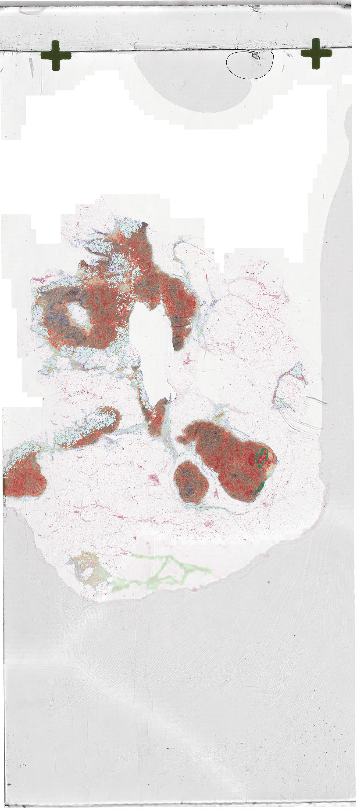
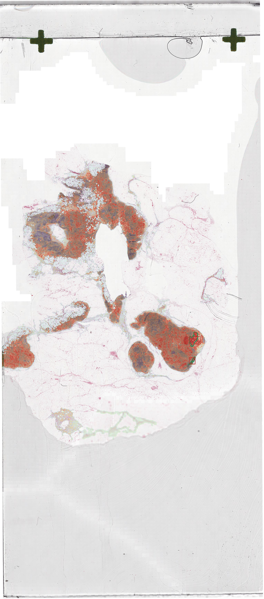

# PARVISIGHT（观隅）

**An AI-assisted pathology workflow for breast cancer lymph-node H&E whole-slide images — explainable CLAM evidence, a pathologist-in-control review flow, and LLM report drafts that are grounded in model evidence and validated before they reach a clinician.**

> [!IMPORTANT]
> A **seven-day product-grade prototype** and **clinical decision-support demonstration** built on public CAMELYON16 sample data. It is not a diagnostic system or a validated medical device.

HackDKU 2025 → Imperial College London Global Challenge Lab 2026 (Imperial Enterprise Lab). Built by a two-person team; project lead: **Yuyao Wang**.

<p align="center">
  
  
</p>
<p align="center"><sub>CAMELYON16 tumour slide: relative CLAM attention (left) and candidate-region evidence (right).</sub></p>

## Highlights

- **Explainable slide-level inference** — a 10-fold CLAM attention-MIL ensemble (CAMELYON16 checkpoints) over 1024-d ResNet-50 patch features produces a slide evidence score, an attention heatmap and ranked candidate regions.
- **Uncertainty routes work to people** — cases with fold disagreement ≥ 0.15, boundary scores (0.35–0.65), pathologist rejection/escalation, or a 10% random QC sample go to a senior pathologist before any report is produced.
- **Grounded LLM reporting** — a multimodal LLM (GPT-5.6 via an OpenAI-compatible relay) drafts the report only after the clinical decision, using only the model evidence and the clinician's decision. Output is restricted to a fixed JSON structure and checked field by field on the backend (`AiReportContentValidator`); invalid drafts are rejected, with a deterministic fallback.
- **Interactive annotation** — MobileSAM point/box-prompted segmentation, annotation version history, review workflow, batch export and real-time notifications over WebSocket.
- **Tested and deployable** — 63 backend unit tests, Python service tests, headless visual checks, and a static public demo with no backend, uploads or secrets.
- **Built with AI pair programming** — developed with Claude Code from written product, design and agent-handoff documents ([PRODUCT.md](PRODUCT.md), [DESIGN.md](DESIGN.md), [AGENT_HANDOFF.md](AGENT_HANDOFF.md)), with every change reviewed by the team.

## The workflow

```
Upload WSI ─▶ Create case + bind Primary H&E WSI ─▶ Assign pathologist
     │
     ▼
Manual CLAM analysis ─▶ Review heatmap / candidate regions / metrics
     │
     ▼
Pathologist decision  (accept · modify · reject · escalate)
     │
     ├─ direct final decision ──────────────▶ AI-assisted report ─▶ feedback pool
     │
     └─ conditional (reject / escalate / low-confidence / boundary / QC)
            └─▶ Senior pathologist review ──▶ approve ─▶ report ─▶ feedback pool
                                            └▶ return  ─▶ back to pathologist
```

## Architecture

Three services plus a database. The **public demo** is a static build only; the
full clinical stack runs locally and is never exposed.

```
                 ┌───────────────────────────── LOCAL / PRIVATE ─────────────────────────────┐
                 │                                                                            │
  Browser ─────▶ │  Vue 3 + Vite frontend  ──HTTP──▶  Spring Boot API  ──▶  PostgreSQL        │
  :5173          │  (Element Plus, Pinia,            (:8080, MyBatis-Plus,   (wsi_platform)   │
                 │   OpenSeadragon)                   Flyway V1–V9)                            │
                 │                                        │                                    │
                 │                                        └──HTTP──▶  Python GPU service       │
                 │                                                   (:8000, FastAPI,          │
                 │                                                    CLAM + MobileSAM, Torch)  │
                 └────────────────────────────────────────────────────────────────────────────┘

  Public demo:   Vue "demo" build  ──▶  static host (Netlify)   [precomputed evidence,
                 (frontend/dist)                                 localStorage, NO backend,
                                                                 NO upload, NO API key]
```

## Tech stack

| Layer            | Technology |
| ---------------- | ---------- |
| Frontend         | Vue 3, Vite 5, Element Plus, Pinia, Vue Router, Vue I18n, OpenSeadragon, Fabric.js, ECharts |
| Backend          | Java 21, Spring Boot 3.3.5, MyBatis-Plus 3.5.9, Flyway |
| Database         | PostgreSQL |
| AI service       | Python, FastAPI, PyTorch / TorchVision / timm, MobileSAM, OpenSlide, a CLAM-style inference pipeline |
| Reporting        | Live multimodal LLM (via a configurable relay) with a deterministic fallback |

## Features

- **Case workflow** — create a clinical case, bind exactly one Primary H&E WSI,
  and assign a pathologist. Binding becomes immutable once analysis starts.
- **Explainable AI evidence** — model overview and relative-attention heatmaps,
  candidate regions, tumor-evidence score, ensemble disagreement, and per-region
  metrics, shown alongside provenance and stated limitations.
- **Clinician-in-control decisions** — accept, modify, reject, or escalate, with
  a full audit trail.
- **Conditional senior review** — reject/escalation, ensemble disagreement,
  boundary evidence, image–text discordance, or stable QC sampling route a case
  into a senior pathologist queue; a report is generated only after approval.
- **AI-assisted reporting** — reports carry both pathologist and senior-review
  context and are marked stale when a decision changes.
- **Governed feedback pool** — completed results are queued and validated by an
  AI/data administrator.
- **Bilingual UI** — English default with full Chinese parity.
- **Static public demo** — precomputed CAMELYON positive/negative evidence with
  a strict static boundary (no registration, upload, live inference, or secrets).

## Roles

| Role                       | System role      | Responsibilities |
| -------------------------- | ---------------- | ---------------- |
| Pathologist                | `ANNOTATOR`      | Triage cases, run analysis, review evidence, make the final decision |
| Senior pathologist         | `REVIEWER`       | Review escalated / flagged / QC-sampled cases |
| AI / data administrator    | `AI_DATA_ADMIN`  | Create cases, bind slides, assign pathologists, validate feedback |
| System administrator       | `SYSTEM_ADMIN`   | User and system administration, case intake (no clinical decisions) |

## Repository structure

```
.
├── backend/           Spring Boot API (Java 21, Maven, MyBatis-Plus, Flyway V1–V9)
├── frontend/          Vue 3 + Vite product (local mode + static demo mode)
├── python-service/    FastAPI GPU inference service (CLAM pipeline, MobileSAM)
├── scripts/           start-local.ps1 / stop-local.ps1 (local stack orchestration)
├── PRODUCT.md         Product decisions, users, and design principles
├── DESIGN.md          Visual system and interaction direction
├── RUNBOOK.md         Startup, accounts, and browser workflow
├── DEPLOY.md          Public static demo deployment (Netlify)
├── docs/            Local setup guide and technical report
└── AGENT_HANDOFF.md   Engineering state and next work
```

## Quick start

The local stack has three services (Vue, Spring Boot, FastAPI), PostgreSQL, and model assets that are **not** stored in this repository (CLAM source, CAMELYON checkpoints, ResNet-50 and MobileSAM weights). See **[docs/SETUP.md](docs/SETUP.md)** for the full step-by-step guide.

```powershell
.\scripts\stop-local.ps1
.\scripts\start-local.ps1            # add -DisableLlm for deterministic report fallbacks
```

| Service          | URL |
| ---------------- | --- |
| Product (Vue)    | http://127.0.0.1:5173 |
| Spring API       | http://127.0.0.1:8080 |
| AI service docs  | http://127.0.0.1:8000/docs |

Local development accounts are listed in [RUNBOOK.md](RUNBOOK.md).

## Testing

```bash
# Backend — 63 unit tests (Mockito)
cd backend
mvn test

# AI service
cd python-service
conda run -n parvisight-py --no-capture-output python -m unittest discover -s tests -v

# Frontend - public build, local static build, and headless visual regression
cd frontend
npm run build               # public demo, outputs frontend/dist
npm run build:local         # local-system build, outputs frontend/dist-local
npm run check:visual         # drives Edge over the demo + local flows
```

## Public demo deployment

The public demo is a **static** build containing only precomputed CAMELYON
evidence and browser-local (`localStorage`) state — no backend, upload, live
inference, credentials, or patient data.

```bash
cd frontend
npm run build:demo           # outputs frontend/dist
```

Deploy `frontend/dist` to any static host. See [`DEPLOY.md`](DEPLOY.md) for the
step-by-step Netlify runbook (drag-and-drop, hardening headers, and the
pre-publish safety checklist).

## Documentation

| Document | Purpose |
| -------- | ------- |
| [docs/SETUP.md](docs/SETUP.md) | Full local setup: software, database, CUDA, model assets |
| [docs/technical-report.md](docs/technical-report.md) | Technical report (Chinese) |
| [PRODUCT.md](PRODUCT.md) | Product purpose, users, and design principles |
| [DESIGN.md](DESIGN.md) | Visual system, tokens, and interaction direction |
| [RUNBOOK.md](RUNBOOK.md) | Startup, local accounts, and the browser workflow |
| [DEPLOY.md](DEPLOY.md) | Public static demo deployment |
| [AGENT_HANDOFF.md](AGENT_HANDOFF.md) | Current engineering state and next work |

## Security & data boundary

- The public demo must remain static: no registration, upload, live inference,
  real credentials, or sensitive data.
- The LLM relay configuration (containing the API key) lives **outside** the
  repository and is read only at runtime; it is never committed or logged.
- Clinical uploads, generated tiles, exports, and runtime artifacts are
  gitignored (`data/`, `python-service/storage/`, `.run/`, `*.env`).

## Acknowledgments

- **CAMELYON16** — the public breast cancer lymph-node metastasis dataset used
  for demonstration evidence.
- **MobileSAM** — lightweight Segment Anything model used by the AI service.
- **CLAM** — the clustering-constrained attention multiple-instance learning
  approach that inspired the WSI inference pipeline.

## License

No license file is currently present in this repository. Until a license is
added, all rights are reserved by the authors. Add a `LICENSE` file to define
reuse terms before any public distribution.
