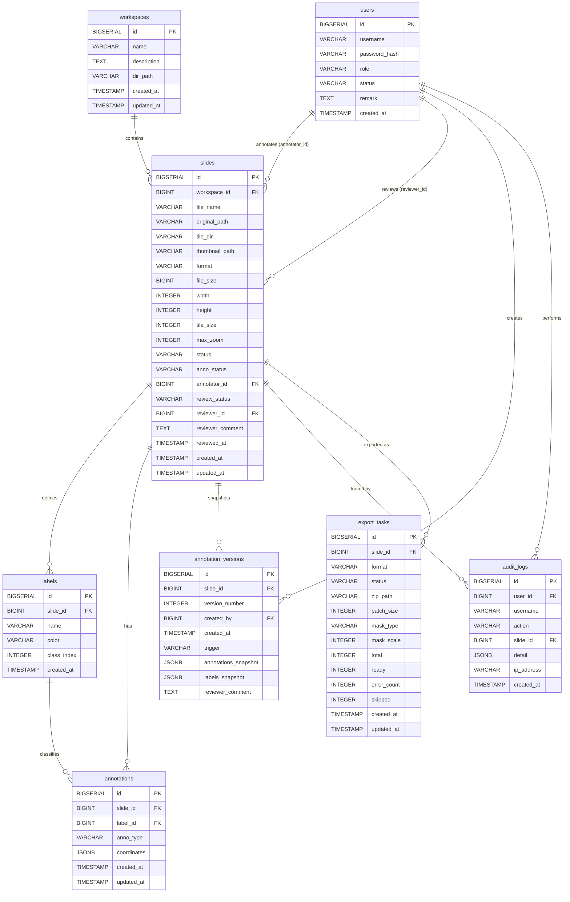

# 2 需求分析与系统架构

## 2.1 功能需求

本系统面向数字病理图像标注的全流程管理，经过需求分析归纳出五大功能模块：**幻灯片标注**、**审核工作流**、**多格式导出/导入**、**协作与通知**，以及**AI 辅助分割**。以下各小节结合系统实现对每类需求进行详细描述。

---

### 2.1.1 幻灯片管理与标注

**幻灯片上传与预处理。** 系统需支持病理切片文件的批量上传，格式覆盖常规图像（PNG、JPG、TIFF）及专有 WSI 格式（SVS、NDPI、MRXS、SCN 等）。为降低用户操作成本，上传接口同时支持单文件、多文件、ZIP 压缩包及 TAR.GZ 压缩包四种形式（`SlideController.java:30–43`）。文件上传后立即返回 `PENDING` 状态的幻灯片记录，后台通过 `SlideProcessingService` 异步触发切片处理（`SlideController.java:36`），将原始文件分解为多分辨率 DeepZoom 金字塔（状态流转：`PENDING → PROCESSING → READY / ERROR`，字段定义见 `Slide.java:45`）。

**标注工具。** 标注员需能在浏览器内对 WSI 切片执行区域标注，系统提供三种几何类型：**多边形**（`polygon`）、**矩形**（`rect`）和**笔刷**（`brush`）。坐标以 WSI 全局像素坐标系统一表达，以 JSON 形式存入 PostgreSQL `JSONB` 列（`Annotation.java:31`）。多边形与矩形存储顶点序列 `[[x1,y1],[x2,y2],…]`，笔刷则存储笔画对象数组 `[{"points":[[x,y],…],"size":20},…]`（`Annotation.java:27–31`）。

**批量自动保存。** 为避免数据丢失，前端在每次编辑周期结束时，通过 `POST /api/slides/{slideId}/annotations/batch` 将当前切片的**全量**标注替换式写入后端（`AnnotationController.java:31–35`）。标注员完成标注后，调用 `PATCH /api/slides/{slideId}/annotations/complete` 提交至审核队列（`AnnotationController.java:41–46`），触发状态流转：`annoStatus: IN_PROGRESS → DONE`，`reviewStatus: NOT_SUBMITTED → PENDING_REVIEW`。

---

### 2.1.2 审核工作流

**双状态机设计。** 每张幻灯片持有两个独立状态字段（`Slide.java:51–60`）：

| 字段 | 可选值 | 语义 |
| --- | --- | --- |
| `annoStatus` | `NOT_STARTED` / `IN_PROGRESS` / `DONE` | 标注进度 |
| `reviewStatus` | `NOT_SUBMITTED` / `PENDING_REVIEW` / `APPROVED` / `REJECTED` | 审核进度 |

**审核操作。** 审核员可通过 `GET /api/reviews/pending` 获取待审队列，通过 `GET /api/reviews/approved` 获取已通过列表（`ReviewController.java:36–51`）。对于每张待审切片，审核员可执行两种操作：

-   **批准**（`PATCH /api/reviews/{slideId}/approve`）：将 `reviewStatus` 置为 `APPROVED`，记录审核人 ID 和时间（`ReviewController.java:54–83`）；
-   **拒绝**（`PATCH /api/reviews/{slideId}/reject`）：将 `reviewStatus` 置为 `REJECTED`，同时将 `annoStatus` 重置为 `IN_PROGRESS`，允许标注员重新编辑，并记录拒绝原因（`ReviewController.java:91–126`）。

两种操作均自动写入审计日志并触发 WebSocket 实时通知（详见 §2.1.4）。

---

### 2.1.3 多格式导出与导入

**导出。** 系统支持六种导出格式（`ExportFormat.java:7–12`）：

| 格式 | 说明 |
| --- | --- |
| `COCO` | MS COCO JSON，含 `images` / `annotations` / `categories` 结构 |
| `YOLO` | 每张图一个 `.txt`，归一化坐标 |
| `VOC` | Pascal VOC XML（`<annotation>` 结构） |
| `GEOJSON` | 地理空间多边形，适配 QuPath 等 GIS 工具 |
| `MASK_ONLY` | 逐类别渲染的语义掩码 PNG |
| `PATCHES` | 按类别裁切标注区域图像块（默认 256 px） |

单张导出通过 `POST /api/slides/{slideId}/export` 触发，批量导出通过 `POST /api/export/batch` 传入 `slideIds` 列表（`ExportController.java:30–67`）。导出任务以 `PENDING → PROCESSING → DONE / ERROR` 的异步状态机运行，前端通过 `GET /api/export-tasks/{taskId}` 轮询，任务完成后由 `GET /api/export-tasks/{taskId}/download` 流式下载 ZIP 文件（`ExportController.java:69–97`）。

**导入。** 系统同样支持从外部标注文件反向导入，格式包括 `COCO`、`YOLO`（需附 `classes.txt`）、`VOC`、`GEOJSON`、以及平台自身的 `CUSTOM_JSON`（`ImportController.java:16–19`）。导入模式支持 `REPLACE`（替换全部现有标注）和 `MERGE`（追加合并）两种策略（`ImportController.java:36`）。

---

### 2.1.4 协作与实时通知

**WebSocket 推送。** 系统通过 STOMP over SockJS 实现服务器主动推送，无需客户端轮询。`NotificationPayload`（`NotificationPayload.java:13–19`）携带通知类型、切片 ID、切片名和时间戳，支持三种通知场景：

-   `REVIEW_PENDING`：广播至 `/topic/review-notification`，所有在线审核员收到新任务提醒；
-   `APPROVED`：点对点推送至标注员 `/user/queue/notifications`，告知审核通过；
-   `REJECTED`：点对点推送至标注员，附带拒绝原因。

**版本历史快照。** 每次提交、拒绝、重新提交或批准动作均触发 `AnnotationVersionService.createVersion()`，将当时的标注数据以 JSONB 快照形式写入 `annotation_versions` 表。这一机制使审核员和标注员均可追溯任意历史时刻的标注状态，并在前端进行版本间对比。

**审计追踪。** 所有关键操作（`SAVE` / `SUBMIT` / `RESUBMIT` / `APPROVE` / `REJECT` / `IMPORT`）均由 `AuditLogService` 写入 `audit_logs` 表，记录操作人、操作类型、目标切片及时间戳，为合规性审查提供完整证据链。

---

### 2.1.5 AI 辅助分割（SAM）

**需求背景。** 手工勾勒多边形边界耗时且精度依赖操作者经验。系统集成 MobileSAM 模型，允许标注员以**点提示**或**框提示**两种交互方式引导模型自动生成分割轮廓。

**接口设计。** `POST /api/slides/{slideId}/sam/predict`（`SamController.java:73`）接受以下请求体：

json

Copy

```json
{  "level": 0,  "points": [[x, y], ...],  "point_labels": [1, 0, ...],  "box": [x1, y1, x2, y2],  "patch_size": 1024}
```

其中 `points` 为前景/背景点（`point_labels` 中 1 表示前景，0 表示背景），`box` 为可选的边界框提示，两者至少提供其一（`SamController.java:87–106`）。坐标系统一为 WSI level-0 全分辨率像素坐标。

**响应结构。** Python 微服务完成推理后，Spring Boot 端将结果映射为：

json

Copy

```json
{  "polygons": [[[x, y], ...]],  "score": 0.95,  "mask_b64": "<base64 PNG>"}
```

`polygons` 为可直接导入 Fabric.js 的多边形坐标序列，`mask_b64` 为 Base64 编码的二值掩码 PNG，供前端可视化叠加（`SamController.java:54–62`）。Java 层仅负责验证与转发，模型推理逻辑完全封装在 Python FastAPI 微服务内部。

---

以上五大功能模块覆盖了从数据接入、交互标注、质量审核、格式转换到 AI 辅助的端到端病理图像标注流程，构成本系统功能需求的完整集合。

---

## 2.2 非功能需求

非功能需求决定了系统在实际病理工作场景中的可用性上限。本节围绕三个核心维度展开：**大文件传输能力**、**并发处理机制**、以及**接口响应时间目标**，并逐一说明系统如何通过工程手段加以满足。

---

### 2.2.1 大文件传输

**需求背景。** 病理数字切片文件体积庞大。一张 40× 放大倍率的 SVS 文件典型大小在 500 MB 至 3 GB 之间，ZIP 压缩包（多切片批量上传）可轻易超过 4 GB。传统 Web 框架默认的 multipart 限制（通常 1–10 MB）完全无法满足此需求。

**配置决策。** 系统在 `application.yml:10–11` 将 Spring Boot 的 multipart 阈值显式上调至 4 GB：

yaml

Copy

```yaml
spring:  servlet:    multipart:      max-file-size: 4096MB      max-request-size: 4096MB
```

这一配置使单次请求可承载任意实际切片文件，覆盖当前病理成像设备的输出范围。

**存储隔离。** 三类持久化目录在配置中显式分离（`application.yml:30–33`）：

| 目录键 | 默认路径 | 用途 |
| --- | --- | --- |
| `upload-dir` | `./data/uploads` | 原始切片文件 |
| `tile-dir` | `./data/tiles` | DeepZoom 金字塔切片 |
| `export-dir` | `./data/exports` | 导出 ZIP 文件 |

分离存储避免了三类数据在磁盘操作中相互竞争，也简化了后续按需清理的维护逻辑。

**流式写出。** 导出任务生成 ZIP 时，采用 `ZipOutputStream` 包裹 `BufferedOutputStream`（`ExportAsyncService.java:112–113`），以流式写出取代内存全量构建，避免导出大批切片时出现堆溢出。

---

### 2.2.2 并发处理机制

WSI 切片处理和导出渲染均属于 CPU/IO 密集型操作，若在请求线程中同步执行，将阻塞 HTTP 连接数秒乃至数分钟。系统采用多层异步机制予以解决。

**Spring `@Async` 异步执行。** `AppConfig.java:7` 通过 `@EnableAsync` 启用全局异步支持。两个核心服务以独立 Bean 的形式持有 `@Async` 方法（Spring AOP 代理要求自调用不可触发 AOP，因此均抽离为单独 Bean）：

-   `SlideProcessingService.triggerProcessing()`（`SlideProcessingService.java:28`）：上传完成后立即在后台线程触发 Python 切片服务，主线程已返回 HTTP 响应；
-   `ExportAsyncService.doExport()`（`ExportAsyncService.java:56`）及 `ExportAsyncService.doBatchExport()`（`ExportAsyncService.java:132`）：导出任务全程在后台执行，主线程仅创建任务记录后即响应。

**批量掩码并行生成。** 批量导出中，COCO 和 MASK\_ONLY 格式需要为每张切片分别调用 Python 掩码渲染接口。系统使用专用的固定线程池 `maskGenerationExecutor`（`AppConfig.java:56–58`，池大小 = 4）配合 `CompletableFuture.runAsync()` 并行执行（`ExportAsyncService.java:173–186`）：

java

Copy

```java
// AppConfig.java:55–58@Bean(name = "maskGenerationExecutor")public ExecutorService maskGenerationExecutor() {    // Use at most 4 threads to avoid overwhelming the Python service    return Executors.newFixedThreadPool(4);}
```

线程数上限设为 4 是有意为之的保守值——Python FastAPI 微服务以单进程 uvicorn 运行，过高并发会导致其成为瓶颈；4 线程在并行加速与下游保护之间取得平衡。所有并行 Future 通过 `CompletableFuture.allOf(...).join()` 统一等待（`ExportAsyncService.java:186`），保证进入 ZIP 打包阶段时所有掩码已就绪。

**Python 微服务隔离。** Python 服务仅监听 `localhost:8000`，不对外暴露（`main.py:8`），由 Spring Boot 通过 `RestTemplate` 串行或受控并发地调用，防止外部流量直接冲击计算密集型端点。

**WebSocket 连接管理。** 实时通知通过 STOMP over SockJS 实现，使用 Spring 内置内存 Broker（`WebSocketConfig.java:22`），支持 `/topic`（广播）和 `/queue`（点对点）两类目的地，单服务节点无需额外消息队列即可管理多路并发 WebSocket 连接。

---

### 2.2.3 接口响应时间

病理标注场景对响应时间有明确的用户体验要求：标注保存、状态查询等轻量操作需在用户感知范围内（< 500 ms）完成，而切片处理、批量导出等重型操作则不应阻塞前端。

**"立即返回 + 状态轮询"模式。** 系统对所有重型操作统一采用异步任务状态机模式：

| 操作 | 触发接口 | 立即返回内容 | 轮询接口 |
| --- | --- | --- | --- |
| 上传切片 | `POST /api/workspaces/{id}/slides/upload` | `PENDING` 状态的幻灯片记录（`SlideController.java:36`） | `GET /api/slides/{id}` |
| 单张导出 | `POST /api/slides/{id}/export` | `PENDING` 导出任务 ID | `GET /api/export-tasks/{taskId}` |
| 批量导出 | `POST /api/export/batch` | `PENDING` 导出任务 ID | `GET /api/export-tasks/{taskId}` |

这一模式将 HTTP 请求的阻塞时间控制在毫秒级（数据库写入 + 异步任务提交），无论后台实际耗时多长，前端均可即时获得响应。

**轻量查询路径。** 标注保存（`POST /api/slides/{slideId}/annotations/batch`）和读取（`GET /api/slides/{slideId}/annotations`）均为纯数据库 CRUD，无外部服务调用，预期在本地网络下可维持 < 100 ms 的响应时间。

**文件下载流式传输。** 导出任务完成后，`GET /api/export-tasks/{taskId}/download` 以 HTTP 流的形式返回 ZIP 文件，避免将大文件全量加载至 JVM 堆再传输，保证下载延迟仅受磁盘读取和网络带宽约束。

---

综合以上三方面，系统通过配置层（multipart 4 GB）、架构层（`@Async` + `CompletableFuture` 并行）和接口设计层（立即返回 + 轮询）的联合应对，在 Web 单机部署约束下为大体积 WSI 数据的处理提供了实用可靠的非功能保障。

---

## 2.3 整体架构设计（三层微服务：Java + Python + PostgreSQL）

本系统采用**三进程微服务架构**：Vue 3 单页应用（SPA）负责交互呈现，Spring Boot 后端承担业务逻辑与数据持久化，Python FastAPI 微服务专责图像计算。三者通过明确定义的 HTTP REST 接口通信，运行时互不依赖对方的语言运行时，可独立启停。数据统一持久化于 PostgreSQL 单实例。

---

### 2.3.1 服务拓扑与职责分工

系统由四个运行单元构成，端口与职责如下：

| 层次 | 技术栈 | 端口 | 主要职责 |
| --- | --- | --- | --- |
| 前端 SPA | Vue 3 + Vite | 5173（开发）/ 静态文件（生产） | 用户界面、画布标注、WebSocket 消息消费 |
| Java 后端 | Spring Boot 3.3.5 / Java 21 | 8080 | 业务逻辑、认证鉴权、REST API、WebSocket 推送 |
| Python 微服务 | FastAPI 0.115.0 + uvicorn | 8000 | WSI 切片生成、掩码渲染、图像块提取、MobileSAM 推理 |
| 数据库 | PostgreSQL | 5432 | 关系数据持久化（含 JSONB 标注坐标） |

**Java 后端**（`WsiPlatformApplication.java:8`）是系统的核心节点，承接所有来自前端的 HTTP 请求，并在需要图像计算时以同步 HTTP 调用向 Python 微服务发出内部请求。前端与 Python 微服务之间无直接通信路径。

**Python 微服务**在 `main.py:5–8` 的文档字符串中明确声明"仅供 Spring Boot 后端在 localhost 调用，不对外暴露"，路由全部挂载在 `/internal` 前缀下（`main.py:12`）。其提供四类内部端点：

| 端点 | 功能 |
| --- | --- |
| `POST /internal/process-slide` | 读取 WSI 文件，生成 DeepZoom 金字塔切片与缩略图 |
| `POST /internal/generate-mask` | 将向量标注坐标渲染为语义掩码 PNG |
| `POST /internal/extract-patches` | 按标注 ROI 裁切图像块 |
| `POST /internal/sam/predict` | 执行 MobileSAM 点/框提示推理，返回多边形轮廓与掩码 |

---

### 2.3.2 服务间通信机制

**前端 → Spring Boot（HTTP REST + WebSocket）。**

前端通过 axios（版本 1.6.8，`package.json:13`）向 `/api/**` 路径发送 REST 请求，在请求头中携带 JWT 令牌（`Authorization: Bearer <token>`）。实时通知通道则使用 STOMP over SockJS（`@stomp/stompjs 7.3.0` + `sockjs-client 1.6.1`，`package.json:12,17`），通过 WebSocket 端点 `/ws` 建立长连接（`WebSocketConfig.java:31`）。

开发阶段 Vite 充当开发代理服务器，将浏览器发出的 `/api/**` 和 `/ws` 请求透明转发至 Spring Boot（`vite.config.js:20–29`）：

js

Copy

```js
// vite.config.js:20–29proxy: {  '/api': {    target: 'http://localhost:8080',    changeOrigin: true  },  '/ws': {    target: 'http://localhost:8080',    changeOrigin: true,    ws: true          // 启用 WebSocket 代理  }}
```

生产部署中，Nginx 承担相同的反向代理职责，`ws: true` 对应的 Nginx 配置为 `proxy_http_version 1.1` + `Upgrade/Connection` 头传递。

**Spring Boot → Python 微服务（HTTP REST，内部调用）。**

`PythonServiceClient`（`PythonServiceClient.java:21`）封装了所有对 Python 服务的调用，使用 Spring 原生 `RestTemplate` 以同步阻塞方式发送 JSON POST 请求（`PythonServiceClient.java:104`）。基础 URL 由 `application.yml:35` 注入：

yaml

Copy

```yaml
# application.yml:34–35wsi: python-service: base-url: http://localhost:8000
```

该 URL 通过 `@ConfigurationProperties(prefix = "wsi")` 绑定到 `StorageProperties.PythonService`（`StorageProperties.java:12`），在部署环境中可通过环境变量覆盖，无需重新编译。

调用均为阻塞式，返回结果后再向前端响应。对于切片处理和批量导出中的掩码生成，`SlideProcessingService`（`SlideProcessingService.java:28`）和 `ExportAsyncService`（`ExportAsyncService.java:56`）分别以 `@Async` 方式在后台线程中发起调用，主请求线程已提前返回，从而规避了对 Python 推理延迟的直接暴露（详见 §2.2.2）。

**Spring Boot → PostgreSQL（JDBC via MyBatis Plus）。**

数据库连接通过标准 JDBC URL 配置（`application.yml:13`），ORM 层采用 MyBatis Plus 3.5.9（`pom.xml:42–44`），开启下划线转驼峰映射（`application.yml:23`）。`JSONB` 类型列（存储标注坐标和版本快照）通过自定义 `StringJsonbTypeHandler`（`StringJsonbTypeHandler.java`）桥接 PostgreSQL `PGobject` 与 Java `String`，避免引入重量级 JSON 类型映射框架。

---

### 2.3.3 认证边界与安全设计

系统使用无状态 JWT 认证，不依赖 HTTP Session，便于后续水平扩展。认证流程由 `AuthInterceptor`（`AuthInterceptor.java:15`）实现，挂载在所有 `/api/**` 路径上（`AppConfig.java:51`）：

java

Copy

```java
// AppConfig.java:50–52@Overridepublic void addInterceptors(InterceptorRegistry registry) {    registry.addInterceptor(authInterceptor).addPathPatterns("/api/**");}
```

拦截器从 `Authorization: Bearer <token>` 头提取令牌，验证签名和有效期后，将用户信息（`userId` / `username` / `role`）存入 `ThreadLocal`（`UserContext`），供 Service 层直接取用，请求结束后自动清理（`AuthInterceptor.java:51–53`）。两个路径显式豁免认证：`/api/auth/**`（登录/注册）和 `/api/slides/{id}/thumbnail`（公开缩略图，`AuthInterceptor.java:26–27`）。

WebSocket 握手阶段同样执行 JWT 验证，由 `JwtHandshakeInterceptor` 在 HTTP 升级请求时完成（`WebSocketConfig.java:17`），握手成功后由 `JwtHandshakeHandler` 将用户名注入 Spring Security Principal（`WebSocketConfig.java:33`），从而使 `convertAndSendToUser()` 能定向推送至指定标注员。

CORS 配置（`AppConfig.java:63–68`）仅允许 `http://localhost:*` 来源，生产环境应替换为实际域名。

---

### 2.3.4 关键依赖清单

**Java 后端（`pom.xml`）：**

| 依赖 | 版本 | 用途 |
| --- | --- | --- |
| `spring-boot-starter-parent` | 3.3.5 | Spring Boot 基座，管理所有子依赖版本 |
| `mybatis-plus-spring-boot3-starter` | 3.5.9 | ORM + 代码生成（Mapper / Service / CRUD） |
| `postgresql` | BOM 管理 | JDBC 驱动，编译期依赖（`PGobject` 直接使用） |
| `jjwt-api/impl/jackson` | 0.11.5 | JWT 签发与校验（HS256） |
| `spring-boot-starter-websocket` | BOM 管理 | STOMP over SockJS WebSocket 支持 |
| `spring-security-crypto` | BOM 管理 | `BCryptPasswordEncoder`（仅密码哈希，未引入完整 Security 框架） |
| `commons-compress` | 1.27.1 | TAR.GZ 批量上传解压 |
| `jackson-databind` | BOM 管理 | JSON 序列化（显式声明以强调核心地位） |

**Python 微服务（`requirements.txt`）：**

| 依赖 | 版本 | 用途 |
| --- | --- | --- |
| `fastapi` | 0.115.0 | Web 框架，自动 OpenAPI 文档 |
| `uvicorn[standard]` | 0.30.6 | ASGI 服务器（单进程） |
| `openslide-python` | 1.3.1 | WSI 格式读取（SVS/NDPI/TIFF/MRXS/SCN） |
| `numpy` + `opencv-python-headless` + `Pillow` | 1.26.4 / 4.10.0.84 / 10.4.0 | 图像处理三件套 |
| `torch` / `torchvision` / `timm` | ≥2.0.0 / ≥0.15.0 / ≥0.9.0 | MobileSAM 推理运行时 |
| `MobileSAM`（GitHub） | HEAD | 轻量 SAM 模型（ViT-Tiny 编码器） |

**前端（`package.json`）：**

| 依赖 | 版本 | 用途 |
| --- | --- | --- |
| `vue` | 3.4.21 | 响应式 UI 框架 |
| `vite` | 5.2.0 | 构建工具 + 开发代理服务器 |
| `pinia` | 2.1.7 | 全局状态管理 |
| `vue-router` | 4.3.0 | SPA 路由 |
| `element-plus` | 2.6.3 | UI 组件库 |
| `openseadragon` | 6.0.2 | DeepZoom 金字塔图像查看器 |
| `fabric` | 5.5.2 | Canvas 标注绘图引擎 |
| `vue-i18n` | 9.14.5 | 中英双语国际化 |
| `echarts` | 6.0.0 | 标注统计图表 |
| `axios` | 1.6.8 | HTTP 请求客户端 |
| `@stomp/stompjs` + `sockjs-client` | 7.3.0 / 1.6.1 | STOMP over SockJS WebSocket 客户端 |

---

以上三服务的职责边界与通信路径共同构成本系统架构的骨架：前端专注于渲染与交互，Spring Boot 统一管理业务状态与安全策略，Python 微服务封装计算密集型图像处理逻辑，PostgreSQL 作为单一事实来源保障数据一致性。三者之间的通信均采用标准 HTTP JSON 协议，无私有 RPC 框架依赖，便于独立测试与替换。

---

## 2.4 技术选型与理由

本节从实际工程约束出发，逐一说明各层技术选型的动机与替代方案的取舍依据。选型原则有三：**与问题域最自然匹配**、**减少跨语言摩擦**、**优先使用已有成熟生态**。

---

### 2.4.1 Spring Boot 3.3.5 / Java 21（后端业务层）

**选型理由。** 本系统后端承担认证鉴权、业务状态机、REST API 路由、WebSocket 推送、异步任务调度等职责，这些均是 Spring Boot 的传统强项。具体而言：

-   **WebSocket / STOMP 原生支持**。实时审核通知依赖服务器主动推送。`spring-boot-starter-websocket`（`pom.xml:92–95`）将 STOMP 协议栈内置为一等公民，`WebSocketConfig.java` 仅需约 40 行即可完成端点注册、消息代理配置和点对点路由设置，无需引入独立消息中间件。
-   **`@Async` + `CompletableFuture` 并发模型**。WSI 切片处理和批量导出均为长时操作。`@EnableAsync`（`AppConfig.java:7`）使得 `SlideProcessingService.triggerProcessing()` 和 `ExportAsyncService.doExport()` 等方法可透明地在线程池中后台执行，主线程毫秒级返回，无需手写 `Thread` 或 `ExecutorService` 样板。
-   **精细化依赖引入**。安全层仅需密码哈希，系统刻意只引入 `spring-security-crypto`（`pom.xml:97–101`）而非完整 Spring Security 框架，以 JWT 拦截器（`AuthInterceptor.java`）替代 Spring Security Filter Chain，避免引入不必要的 `SecurityContext`、`UserDetailsService` 等抽象层，降低配置复杂度。
-   **Java 21**。Virtual Threads（JEP 444）可在未来无需改写代码即提升阻塞式 I/O 的并发能力；Java 21 的 Record、Pattern Matching 等语言特性也减少了 DTO 定义的模板代码，与 Lombok（`pom.xml:52–56`）配合进一步降低 Entity 类的冗余度。

**未选用的替代方案。** Quarkus 和 Micronaut 在启动时间和内存占用上优于 Spring Boot，但其生态的成熟度和 MyBatis Plus 的兼容性不如 Spring Boot 完善；Node.js/Express 对类型安全和大型工程的结构化支持较弱，且与 PostgreSQL JSONB 的对接不如 Java/JDBC 直接。

---

### 2.4.2 Vue 3 + Vite（前端框架）

**选型理由。** 前端核心挑战是在浏览器中实现**高分辨率图像查看**与**向量标注画布**的同步叠加，并管理跨多视图的复杂交互状态。

-   **Composition API**。标注编辑器需要在同一组件中协调 OpenSeadragon 视口、Fabric.js 画布、SAM 预测结果和本地保存状态，Composition API 允许将这些相互关联的逻辑封装为可复用的 `useOSD()`、`useFabric()`、`useSAM()` 等 composable，比 Vue 2 的 Options API 在逻辑拆分和测试上更清晰。
-   **Pinia 全局状态**。审核仪表板、标注编辑器和通知系统需共享幻灯片状态和 WebSocket 连接，Pinia（`package.json:18`）提供基于 Composition API 的 Store，类型推断比 Vuex 4 更完整，样板代码更少。
-   **Vite 5 开发体验**。Vite（`package.json:26`）以原生 ES Module 为基础，热模块替换（HMR）在大型 `fabric` + `openseadragon` 依赖下仍可维持秒级刷新；`vite.config.js` 的 `proxy` 配置（`vite.config.js:20–29`）透明转发 `/api` 和 `/ws` 至 Spring Boot，使开发阶段无需手动处理跨域。
-   **Element Plus 组件库**（2.6.3，`package.json:15`）提供了表格、对话框、上传、表单等医疗工作流常见 UI 组件，国际化（`vue-i18n` 9.14.5，`package.json:21`）支持中英双语切换，契合面向学术和临床的双语用户群体。

**未选用的替代方案。** React 生态同样成熟，但其 Canvas 标注库（如 Konva.js）与 Fabric.js 的 API 风格差异较大，且 React 的 JSX + 状态管理（Redux/Zustand）在团队熟悉度上不及 Vue 3。Angular 框架体量较重，与 Vite 的集成需要额外适配层。

---

### 2.4.3 OpenSeadragon + Fabric.js（WSI 查看与标注画布）

这两个库是前端的核心技术决策，值得单独说明。

**OpenSeadragon 6.0.2**（`package.json:17`）是浏览器端 DeepZoom 金字塔图像查看的事实标准库，原生支持 DZI（Deep Zoom Image）瓦片格式。病理切片的全分辨率像素矩阵可达 100,000 × 80,000 像素，无法整体加载至内存，OpenSeadragon 按当前视口位置和缩放级别按需请求对应层级的 JPEG 切片（由 Python 微服务的 `GET /api/slides/{id}/tiles/{level}/{x}_{y}.jpg` 端点提供），实现平滑无级缩放。

**Fabric.js 5.5.2**（`package.json:14`）在 OpenSeadragon 视口之上叠加一个透明 HTML5 Canvas，承载所有向量标注对象（多边形、矩形、笔刷路径）。Fabric.js 的对象模型（`FabricObject` → `Polygon` / `Rect` / `Path`）与系统的标注几何类型一一对应，其内置的选中、拖拽、缩放、节点编辑能力大幅降低了手写 Canvas 交互逻辑的工作量。两库通过坐标变换函数相互同步：OpenSeadragon 的视口平移/缩放事件触发 Fabric.js Canvas 的仿射变换矩阵更新，使标注始终与图像像素对齐。

---

### 2.4.4 FastAPI 0.115.0 + Python（图像计算微服务）

**选型理由。** 将图像计算剥离为独立 Python 进程而非嵌入 Java 后端，源于以下不可回避的工程约束：

-   **PyTorch / MobileSAM 生态不可替代**。MobileSAM（`requirements.txt:12`，GitHub 源安装）依赖 PyTorch（≥2.0.0）和 `timm`（≥0.9.0），这些库无 JVM 原生实现；通过 JNI 或 GraalVM 调用 Python 运行时的方案复杂度远高于起一个独立进程。
-   **OpenSlide 的 C 扩展绑定**。`openslide-python`（1.3.1，`requirements.txt:3`）是 OpenSlide C 库的 Python 绑定，OpenSlide 是目前唯一能完整支持 SVS、NDPI、MRXS、SCN 等主流 WSI 专有格式的开源库。Java 端虽有 `openslide-java` 绑定，但其维护活跃度和 Windows 支持不如 Python 端可靠。
-   **NumPy / OpenCV 图像处理链**。掩码渲染（`opencv-python-headless` 4.10.0.84）和图像块提取（`Pillow` 10.4.0）在 Python 中可用极少代码完成 ROI 裁切、多边形填充和格式转换，等价的 Java 实现需要引入 JAI 或 ImageJ 等体量较大的图像处理框架。

**FastAPI 而非 Flask/Django。** FastAPI 基于 Pydantic 的请求体验证与自动 OpenAPI 文档生成（访问 `/docs` 即可查看所有内部端点的交互式文档），减少了手写参数校验和接口文档的重复劳动。Flask 不提供原生类型验证；Django 携带 ORM 和模板引擎等与本微服务无关的组件，引入成本过高。uvicorn 的 ASGI 模型在 I/O 密集型的文件读写阶段也有并发优势。

**单进程部署的有意选择。** Python 微服务以单进程 uvicorn 运行（`main.py:8`），而非 gunicorn + 多 worker。这是一个刻意的保守决策：MobileSAM 模型权重在进程内存中仅加载一次，多进程模式会导致每个 worker 各自持有一份模型副本，在内存有限的单机部署环境（腾讯云 Lighthouse）中会产生显著压力。Java 端通过固定大小为 4 的线程池（`AppConfig.java:56–58`）控制并发调用量，防止单进程 Python 服务过载。

---

### 2.4.5 PostgreSQL（数据持久层）

**选型理由。** 关系型数据库是审计追踪、状态机和用户权限管理的自然选择，PostgreSQL 相对于 MySQL 的核心优势体现在两点：

-   **原生 JSONB 类型**。标注坐标（多边形顶点序列、笔刷路径数组）结构灵活，不同类型的标注字段数量不同，强制关系化会产生过多 NULL 列或额外的多态关联表。PostgreSQL 的 `JSONB` 列（`Annotation.java:31`）将坐标以二进制 JSON 格式存储，既保留了任意结构的灵活性，又支持 GIN 索引加速 JSON 路径查询。版本历史快照（`annotation_versions` 表）同样利用 JSONB 存储整个标注集合的时间点镜像，实现类 Git 的版本追溯而无需引入额外存储系统。MySQL 的 `JSON` 类型无原生二进制存储优化，且 GIN 索引不可用。
-   **ACID 一致性**。审核状态机（`annoStatus` / `reviewStatus` 双字段原子更新）、审计日志写入与 WebSocket 通知的事务边界均依赖 PostgreSQL 的强一致性保证，防止并发审核操作下出现状态不一致。

**MyBatis Plus 而非 JPA/Hibernate。** MyBatis Plus 3.5.9（`pom.xml:40–44`）提供泛型 `BaseMapper` 的通用 CRUD，并允许在 XML/注解中直接书写 SQL，便于处理 PostgreSQL 特有的 `::jsonb` 类型转换语法和自定义 `StringJsonbTypeHandler`。Hibernate 的 HQL 与 `@Type` 注解在桥接非标准 JDBC 类型（`PGobject`）时配置较繁琐；MyBatis Plus 的轻量 ORM 层与直写 SQL 的混合模式在此场景下更直接、可控。

---

### 2.4.6 选型总结

| 层次 | 选型 | 核心驱动因素 |
| --- | --- | --- |
| 业务后端 | Spring Boot 3.3.5 / Java 21 | WebSocket/STOMP 原生支持，`@Async` 异步任务，成熟企业生态 |
| 前端框架 | Vue 3 + Vite 5 | Composition API 组织复杂交互逻辑，HMR 开发效率，Pinia 状态管理 |
| WSI 查看 | OpenSeadragon 6.0.2 | DeepZoom 金字塔按需加载，专为高分辨率图像设计 |
| 标注画布 | Fabric.js 5.5.2 | 对象化 Canvas API，内置选中/编辑交互，与 OpenSeadragon 坐标可同步 |
| 图像计算 | FastAPI 0.115.0 + Python | PyTorch/MobileSAM 不可替代，OpenSlide C 绑定，NumPy/OpenCV 生态 |
| 数据存储 | PostgreSQL | JSONB 灵活存储标注坐标，GIN 索引，ACID 一致性 |
| ORM | MyBatis Plus 3.5.9 | SQL 直写与 PGobject 自定义 TypeHandler 兼容，轻量可控 |

各技术选型之间形成相互支撑的有机整体：Python 的图像计算生态决定了微服务必须独立于 JVM，FastAPI 为其提供轻量 HTTP 接口；PostgreSQL 的 JSONB 消除了对独立文档数据库的需求，MyBatis Plus 的自定义 TypeHandler 弥合了 Java 与 JSONB 之间的类型鸿沟；Vue 3 的 Composition API 使得 OpenSeadragon 与 Fabric.js 这两个命令式 Canvas 库可以在响应式框架中被优雅封装。整体而言，技术栈的每一层选择都优先服务于病理 WSI 标注这一具体问题域，而非追求技术栈的统一或时髦性。

---

# 3 数据库设计

## 3.1 ER 图与关系模型（8 张核心表）

本系统数据库共包含 8 张核心表，均定义于 `sql.sql`，并通过 Flyway 风格的迁移脚本（`V1__init.sql` → `V3__add_user_status.sql`）按版本演进。表之间通过外键构成层次化的组织结构，整体可划分为三个功能域：**用户与权限**（`users`）、**数据组织**（`workspaces` → `slides` → `labels` → `annotations`）和**过程追踪**（`annotation_versions`、`audit_logs`、`export_tasks`）。

---

### 3.1.1 ER 图（Mermaid）

mermaid

Copy



上图中，实线箭头表示带 `ON DELETE CASCADE` 的强关联（子记录随父记录一同删除），虚线表示带 `ON DELETE SET NULL` 的弱引用（父记录删除后子记录外键置空，历史数据保留）。

---

### 3.1.2 各表详细说明

#### 表 1：`users`（用户与权限）

`users` 表是认证与授权的根基，定义于 `sql.sql:72–78`，Java 实体见 `User.java:11–31`。

| 列名 | 类型 | 约束 | 说明 |
| --- | --- | --- | --- |
| `id` | `BIGSERIAL` | PK | 自增主键 |
| `username` | `VARCHAR(50)` | UNIQUE NOT NULL | 登录用户名，全局唯一 |
| `password_hash` | `VARCHAR(255)` | NOT NULL | BCrypt 哈希值，通过 `@JsonIgnore`（`User.java:18`）在序列化时隐藏 |
| `role` | `VARCHAR(20)` | NOT NULL DEFAULT ‘ANNOTATOR’ | 角色：`ANNOTATOR`（标注员）/ `REVIEWER`（审核员） |
| `status` | `VARCHAR(20)` | NOT NULL DEFAULT ‘ACTIVE’ | 账户状态：`PENDING`（待审批）/ `ACTIVE`（正常）/ `DISABLED`（已禁用） |
| `remark` | `TEXT` | — | 注册时填写的申请说明，或管理员备注（`User.java:27`） |
| `created_at` | `TIMESTAMP` | NOT NULL DEFAULT NOW() | 账户创建时间，由 MyBatis Plus `@TableField(fill = FieldFill.INSERT)` 自动填充（`User.java:29`） |

`status` 字段实现了用户注册审批工作流（`sql.sql:97–100`）：新注册用户默认 `PENDING`，管理员通过后切换为 `ACTIVE`，可进一步 `DISABLED` 停用账户。`idx_users_status` 索引（`sql.sql:100`）加速管理员查询待审批用户列表。

---

#### 表 2：`workspaces`（工作空间）

`workspaces` 表是数据组织的顶层容器，定义于 `sql.sql:4–11`，Java 实体见 `Workspace.java:10–27`。

| 列名 | 类型 | 约束 | 说明 |
| --- | --- | --- | --- |
| `id` | `BIGSERIAL` | PK | 自增主键 |
| `name` | `VARCHAR(255)` | NOT NULL | 工作空间名称 |
| `description` | `TEXT` | — | 可选描述 |
| `dir_path` | `VARCHAR(1024)` | — | 工作空间在服务器磁盘上的根目录绝对路径（`Workspace.java:20`）；切片文件和导出结果均存放于此路径下的子目录 |
| `created_at` | `TIMESTAMP` | NOT NULL DEFAULT NOW() | 创建时间 |
| `updated_at` | `TIMESTAMP` | NOT NULL DEFAULT NOW() | 最后修改时间 |

工作空间与幻灯片之间为一对多强关联（`slides.workspace_id` 带 `ON DELETE CASCADE`，`sql.sql:15`），删除工作空间将级联删除其所有幻灯片及下游数据（标注、导出任务等），提供一键清理的运维能力。

---

#### 表 3：`slides`（幻灯片/切片）

`slides` 是系统的核心实体，字段最多，承载了**文件元数据**、**处理状态**和**审核双状态机**三类信息，定义于 `sql.sql:13–30`（初始）及 `sql.sql:81–90`（V2 扩展），Java 实体见 `Slide.java:10–74`。

**文件元数据字段：**

| 列名 | 类型 | 说明 |
| --- | --- | --- |
| `file_name` | `VARCHAR(512)` | 原始上传文件名 |
| `original_path` | `VARCHAR(1024)` | 原始文件在磁盘上的绝对路径（`Slide.java:20`） |
| `tile_dir` | `VARCHAR(1024)` | DeepZoom 金字塔切片目录路径（`Slide.java:23`） |
| `thumbnail_path` | `VARCHAR(1024)` | 缩略图文件路径（`Slide.java:26`） |
| `format` | `VARCHAR(16)` | 文件格式：`PNG`/`JPG`/`SVS`/`NDPI`/`TIFF`/`MRXS`/`SCN` 等（`Slide.java:29`） |
| `file_size` | `BIGINT` | 文件字节数 |
| `width`/`height` | `INTEGER` | WSI 全分辨率尺寸（像素），由 Python 微服务处理后写回 |
| `tile_size` | `INTEGER` | 切片尺寸，默认 256 px |
| `max_zoom` | `INTEGER` | DeepZoom 最大缩放层级（由图像尺寸推算） |

**双状态机字段（`Slide.java:45–60`）：**

| 列名 | 可选值 | 语义 |
| --- | --- | --- |
| `status` | `PENDING` / `PROCESSING` / `READY` / `ERROR` | 切片处理进度（由 Python 微服务驱动） |
| `anno_status` | `NOT_STARTED` / `IN_PROGRESS` / `DONE` | 标注进度（由标注员操作驱动） |
| `review_status` | `NOT_SUBMITTED` / `PENDING_REVIEW` / `APPROVED` / `REJECTED` | 审核进度（由审核员操作驱动） |

两个业务状态机（`anno_status` 和 `review_status`）完全独立，各自驱动不同的业务流程，且共同存放在同一行，避免了多表 JOIN 的查询开销。

**用户关联字段（V2 扩展，`sql.sql:82–86`）：**

| 列名 | 类型 | 说明 |
| --- | --- | --- |
| `annotator_id` | `BIGINT → users.id` | 执行标注的用户 ID（弱引用，`ON DELETE` 行为为默认 RESTRICT 以保护历史数据） |
| `reviewer_id` | `BIGINT → users.id` | 执行审核的用户 ID |
| `reviewer_comment` | `TEXT` | 审核员留下的拒绝原因或审批备注 |
| `reviewed_at` | `TIMESTAMP` | 审核操作时间 |

索引策略（`sql.sql:65–68`，`sql.sql:90–91`）：`idx_slides_workspace_id`、`idx_slides_status`、`idx_slides_review_status`、`idx_slides_annotator_id` 分别加速按工作空间过滤、处理状态轮询、待审队列查询和按标注员筛选四类高频操作。

---

#### 表 4：`labels`（标签定义）

`labels` 存储每张幻灯片的**类别集合**，定义于 `sql.sql:32–39`，Java 实体见 `Label.java:10–27`。

| 列名 | 类型 | 说明 |
| --- | --- | --- |
| `id` | `BIGSERIAL` | PK |
| `slide_id` | `BIGINT → slides.id` | 所属幻灯片，`ON DELETE CASCADE` |
| `name` | `VARCHAR(128)` | 类别名称，如 “Tumor”、“Normal” |
| `color` | `VARCHAR(16)` | 十六进制颜色字符串，如 `#FF0000`，用于前端画布渲染（`Label.java:20`） |
| `class_index` | `INTEGER` | 语义掩码编码中的整数类别 ID（`Label.java:23`），从 1 开始，掩码像素值等于此值 |

`labels` 与 `slides` 的级联关系（`ON DELETE CASCADE`）意味着幻灯片被删除时其所有标签定义也随之清除，保证不存在无主标签。`annotations.label_id` 引用 `labels.id` 时使用 `ON DELETE SET NULL`（`sql.sql:44`），当标签被删除后标注记录的 `label_id` 置空但标注本身保留，避免因调整标签方案而丢失几何坐标数据。

---

#### 表 5：`annotations`（标注记录）

`annotations` 是标注数据的核心存储单元，其最重要的设计决策是**以 `JSONB` 列存储向量坐标**，定义于 `sql.sql:41–49`，Java 实体见 `Annotation.java:11–39`。

| 列名 | 类型 | 说明 |
| --- | --- | --- |
| `id` | `BIGSERIAL` | PK |
| `slide_id` | `BIGINT → slides.id` | 所属幻灯片，`ON DELETE CASCADE` |
| `label_id` | `BIGINT → labels.id` | 所属标签，`ON DELETE SET NULL` |
| `anno_type` | `VARCHAR(32)` | 几何类型：`polygon` / `rect` / `brush` |
| `coordinates` | `JSONB` | **坐标数据**（详见下文） |
| `created_at` / `updated_at` | `TIMESTAMP` | 创建/修改时间，由 MyBatis Plus 自动填充（`Annotation.java:34–38`） |

`coordinates` 的 `JSONB` 存储格式因 `anno_type` 不同而异（`Annotation.java:26–32`）：

-   **`polygon` / `rect`**：存储顶点坐标数组，格式为 `[[x1, y1], [x2, y2], ...]`，坐标系为 WSI level-0 全分辨率像素坐标；
-   **`brush`**：存储笔画对象数组，格式为 `[{"points": [[x, y], ...], "size": 20}, ...]`，其中 `size` 为笔刷像素半径。

选用 `JSONB` 而非拆分多列（如 `x1`, `y1`, `x2`, `y2`）的原因有三：（1）多边形顶点数量不定，关系化需要额外的 `annotation_points` 子表和 JOIN；（2）笔刷路径包含嵌套对象，强行关系化会引入至少 3 层表结构；（3）标注批量保存时，系统以全量替换方式写入一张幻灯片的所有标注（`DELETE FROM annotations WHERE slide_id = ?` 后批量 `INSERT`），JSONB 列在此场景下不需要解析即可直接存储前端序列化的 JSON 字符串，写入路径极短。Java 层通过自定义的 `StringJsonbTypeHandler`（`Annotation.java:31`）将 PostgreSQL `PGobject` 与 Java `String` 互转，详见 §3.2。

---

#### 表 6：`annotation_versions`（标注版本历史）

`annotation_versions` 实现**类 Git 的版本快照机制**，定义于 `sql.sql:106–116`，Java 实体见 `AnnotationVersion.java:11–45`。

| 列名 | 类型 | 说明 |
| --- | --- | --- |
| `id` | `BIGSERIAL` | PK |
| `slide_id` | `BIGINT → slides.id` | 所属幻灯片，`ON DELETE CASCADE` |
| `version_number` | `INTEGER` | 该幻灯片的版本序号，从 1 起单调递增 |
| `created_by` | `BIGINT → users.id` | 触发此快照的用户（`AnnotationVersion.java:20`） |
| `trigger` | `VARCHAR(20)` | 触发事件：`SUBMIT` / `RESUBMIT` / `REJECT` / `APPROVE`（`AnnotationVersion.java:28`） |
| `annotations_snapshot` | `JSONB` | 快照时刻全部标注的 JSON 序列化（`AnnotationVersion.java:35`） |
| `labels_snapshot` | `JSONB` | 快照时刻全部标签定义的 JSON 序列化（`AnnotationVersion.java:42`） |
| `reviewer_comment` | `TEXT` | 审核意见，仅在 `REJECT`/`APPROVE` 触发时有值 |

与 `annotations` 表不同，`annotations_snapshot` 和 `labels_snapshot` 各自存储的是**整个集合**的 JSON 数组（而非单条记录），这样每个版本是一个完整的时间点镜像，前端查阅任意历史版本无需重构数据。双快照设计（标注 + 标签）保证了版本回放时标签颜色和名称也与当时一致，即使后来修改了标签方案也不影响历史视图的准确性。

---

#### 表 7：`audit_logs`（审计日志）

`audit_logs` 为合规性审查提供完整操作证据链，定义于 `sql.sql:121–134`，Java 实体见 `AuditLog.java:14–32`。

| 列名 | 类型 | 说明 |
| --- | --- | --- |
| `id` | `BIGSERIAL` | PK |
| `user_id` | `BIGINT → users.id` | 操作者用户 ID，`ON DELETE SET NULL` 保留历史记录（`AuditLog.java:19`） |
| `username` | `VARCHAR(64)` | **冗余存储**操作者用户名（`AuditLog.java:20`）；即使用户被删除，日志中仍可读出操作者身份 |
| `action` | `VARCHAR(32)` | 操作类型：`SAVE` / `SUBMIT` / `RESUBMIT` / `APPROVE` / `REJECT` / `IMPORT`（`AuditLog.java:23`） |
| `slide_id` | `BIGINT → slides.id` | 操作目标幻灯片，`ON DELETE SET NULL` |
| `detail` | `JSONB` | 操作附加信息（如导入记录数、拒绝原因等），结构随 `action` 类型变化（`AuditLog.java:28`） |
| `ip_address` | `VARCHAR(64)` | 客户端 IP，从 HTTP 请求头 `X-Forwarded-For` / `REMOTE_ADDR` 提取（`AuditLog.java:30`） |
| `created_at` | `TIMESTAMP` | 操作时间 |

`username` 的冗余存储是有意为之的设计：`user_id` 外键使用 `ON DELETE SET NULL`，当用户账户被删除后 `user_id` 变为 NULL，但 `username` 仍保留操作者的可读标识，满足审计追踪中"知道谁做了什么"的基本要求。`detail` 列的 `JSONB` 类型允许不同 `action` 携带不同结构的补充信息，无需为每种操作维护独立的日志表。

四条索引（`sql.sql:132–135`）分别针对按幻灯片、按用户、按操作类型和按时间倒序（`created_at DESC`）的查询模式，覆盖了审计日志的主要读取场景。

---

#### 表 8：`export_tasks`（导出任务）

`export_tasks` 实现异步导出的状态机记录，定义于 `sql.sql:51–62`（初始）及后续 `ALTER TABLE` 扩展，Java 实体见 `ExportTask.java:10–49`。

| 列名 | 类型 | 说明 |
| --- | --- | --- |
| `id` | `BIGSERIAL` | PK；创建后立即返回给前端作为轮询 ID |
| `slide_id` | `BIGINT → slides.id` | 导出源幻灯片，`ON DELETE SET NULL`（`sql.sql:53`）；任务完成后的 ZIP 文件不因幻灯片删除而消失 |
| `format` | `VARCHAR(32)` | 导出格式：`COCO` / `YOLO` / `VOC` / `GEOJSON` / `MASK_ONLY` / `PATCHES`（`ExportTask.java:20`） |
| `status` | `VARCHAR(32)` | 任务状态：`PENDING` → `PROCESSING` → `DONE` / `ERROR`（`ExportTask.java:25`） |
| `zip_path` | `VARCHAR(1024)` | 生成的 ZIP 文件在磁盘上的绝对路径（`ExportTask.java:28`） |
| `patch_size` | `INTEGER` | 仅 `PATCHES` 格式使用，图像块边长（128/256/512），默认 256（`ExportTask.java:31`） |
| `mask_type` | `VARCHAR` | 仅 `MASK_ONLY` 格式使用：`SEMANTIC` / `COLOR` / `INSTANCE`（`ExportTask.java:34`） |
| `mask_scale` | `INTEGER` | 仅 `MASK_ONLY` 格式使用，下采样倍率（1/2/4/8），默认 1（`ExportTask.java:37`） |
| `total` / `ready` / `error_count` / `skipped` | `INTEGER` | 批量导出的进度计数器（`ExportTask.java:39–42`） |
| `created_at` / `updated_at` | `TIMESTAMP` | 创建/更新时间 |

`slide_id` 使用 `ON DELETE SET NULL` 而非 `CASCADE`，是因为导出 ZIP 文件的物理文件仍存在于磁盘，即使来源幻灯片被删除，管理员仍可通过任务 ID 下载或手动清理。四个计数器（`total`/`ready`/`error_count`/`skipped`）支持批量导出场景下的进度报告：`total` 在任务创建时写入幻灯片总数，`ready` 随每个幻灯片处理完成而递增，前端通过比较二者判断整体完成度。

---

### 3.1.3 关系结构总览

8 张表的外键关系构成如下层次树（括号内为删除策略）：

text

Copy

```text
workspaces└── slides [CASCADE]    ├── labels [CASCADE]    │   └── annotations.label_id [SET NULL]    ├── annotations [CASCADE]    ├── annotation_versions [CASCADE]    ├── audit_logs.slide_id [SET NULL]    └── export_tasks.slide_id [SET NULL]users├── slides.annotator_id [默认 RESTRICT]├── slides.reviewer_id [默认 RESTRICT]├── annotation_versions.created_by [SET NULL]└── audit_logs.user_id [SET NULL]
```

`ON DELETE CASCADE` 专用于**所有权关系**（父记录是子记录存在的必要条件），`ON DELETE SET NULL` 专用于**引用关系**（子记录的历史价值独立于父记录）。这一一致性原则贯穿全库，使数据清理行为可预期，避免因外键约束导致误删操作被阻塞。

---

以上 8 张表涵盖了系统的完整数据模型，从用户身份管理到 WSI 文件元数据、从逐条标注几何坐标到全量版本快照，再到操作审计与异步任务追踪，各表职责单一、边界清晰，共同支撑了病理图像标注平台的全流程业务逻辑。

---

## 3.2 关键设计决策：JSONB 存储标注坐标的取舍

### 3.2.1 问题背景：几何坐标的多态性

WSI 标注平台支持三种标注类型，它们的坐标结构存在根本性差异：

| 标注类型 | 坐标结构 | 可变性 |
| --- | --- | --- |
| `polygon`（多边形） | 顶点数组 `[[x1,y1],[x2,y2],…]`，顶点数不定（3 至数百个） | 顶点数随形状复杂度线性增长 |
| `rect`（矩形） | 固定 4 顶点数组，与多边形格式一致 | 固定 |
| `brush`（笔刷） | 笔画对象数组 `[{"points":[[x,y],…],"size":20},…]`，含嵌套结构 | 双层可变（笔画数 × 每笔点数） |

这种多态结构给持久层设计带来了核心矛盾：**如何在关系型数据库中以低成本存储、读取结构差异显著的几何数据**。

### 3.2.2 备选方案分析

#### 方案 A：拆分为子表（完全关系化）

建立 `annotation_points(annotation_id, seq, x, y)` 子表，笔刷额外需要 `annotation_strokes(annotation_id, seq)` 层级。

-   优点：完全符合第三范式，可对坐标列建立 B-Tree 索引；
-   缺点：
    -   每条多边形标注需要 N 次 `INSERT`，批量保存时产生大量往返；
    -   笔刷类型需要三表 JOIN（`annotations → annotation_strokes → annotation_points`），读取路径复杂；
    -   全量替换逻辑（先 `DELETE` 后批量 `INSERT`）在子表模式下需级联删除两层，事务代价翻倍；
    -   该平台当前没有"查询坐标值本身"的业务需求（如 `WHERE x > 500`），索引收益为零。

#### 方案 B：以 `TEXT` 列存储 JSON 字符串

将坐标序列化为 JSON 字符串存入普通 `VARCHAR`/`TEXT` 列。

-   优点：写入路径与 JSONB 相同，无需额外类型映射；
-   缺点：PostgreSQL 不对 `TEXT` 内容做 JSON 语法校验，非法 JSON 可以悄无声息地入库；无法在数据库层利用任何 JSON 运算符（`->`、`#>`、`@>`）；且 `TEXT` 不压缩重复键名，存储效率低于 JSONB。

#### 方案 C（采用）：以 `JSONB` 列存储坐标

PostgreSQL `JSONB` 在写入时解析并以二进制格式存储 JSON，提供语法强校验、键名去重压缩，并支持 GIN 索引与 JSON 路径查询运算符，同时对上层应用透明暴露为字符串。

### 3.2.3 采用 JSONB 的具体理由

**（1）写入路径极短，契合全量替换模式。**

系统对标注的保存逻辑（`AnnotationService.java:39–65`）采用"删后重插"的全量替换策略：

java

Copy

```java
// AnnotationService.java:44–51annotationMapper.delete(new LambdaQueryWrapper<Annotation>()        .eq(Annotation::getSlideId, slideId));for (Annotation ann : annotations) {    ann.setId(null);    ann.setSlideId(slideId);    annotationMapper.insert(ann);}
```

前端将整个标注列表序列化为 JSON 后通过 HTTP POST 传输；后端直接将该 JSON 字符串写入 `coordinates` JSONB 列，**无需在 Java 层解析坐标内容**。若使用子表方案，则需要在应用层拆解数组、逐行插入 `annotation_points`，额外增加 O(N) 次数据库往返。

**（2）版本快照同样受益于 JSONB 的透明存储。**

版本历史服务（`AnnotationVersionService.java:56–63`）用 Jackson 将标注列表整体序列化为 JSON 字符串后直接写入 `annotation_versions.annotations_snapshot`（JSONB 列）：

java

Copy

```java
// AnnotationVersionService.java:56–63String annotationsJson;String labelsJson;try {    annotationsJson = objectMapper.writeValueAsString(annotations);    labelsJson      = objectMapper.writeValueAsString(labels);} catch (Exception e) {    throw new RuntimeException("Failed to serialize snapshot", e);}
```

快照读取时（`getVersionAnnotations`，`AnnotationVersionService.java:108–123`）将 JSONB 字符串反序列化为 `Object` 直接返回给前端，整个链路无需感知坐标的内部结构。JSONB 在此充当**透明的结构化字节袋**，既保留了 PostgreSQL 的 JSON 语法校验，又不强迫应用层做不必要的对象映射。

**（3）`StringJsonbTypeHandler` 实现 MyBatis 与 PostgreSQL 的类型桥接。**

MyBatis Plus 默认不识别 PostgreSQL 的 `PGobject` 类型，需要自定义 TypeHandler。项目实现了 `StringJsonbTypeHandler`（`StringJsonbTypeHandler.java:13–44`）：

java

Copy

```java
// StringJsonbTypeHandler.java:16–22（写入方向）@Overridepublic void setNonNullParameter(PreparedStatement ps, int i,                                String parameter, JdbcType jdbcType) throws SQLException {    PGobject obj = new PGobject();    obj.setType("jsonb");    obj.setValue(parameter);    ps.setObject(i, obj);}// StringJsonbTypeHandler.java:39–43（读取方向）private String extract(Object obj) {    if (obj == null) return null;    if (obj instanceof PGobject pgObj) return pgObj.getValue();    return obj.toString();}
```

写入时将 Java `String` 包装为 `PGobject`（类型声明为 `"jsonb"`），使 PostgreSQL JDBC 驱动触发 JSONB 解析与压缩；读取时从 `PGobject` 还原为普通 Java 字符串。该 TypeHandler 通过 `@TableField(typeHandler = StringJsonbTypeHandler.class)` 注解绑定到 `Annotation.coordinates`（`Annotation.java:31`）和 `AnnotationVersion.annotationsSnapshot`/`labelsSnapshot`（`AnnotationVersion.java:34,41`）三个字段，做到**一次实现、多处复用**。

### 3.2.4 设计代价与可接受性

JSONB 设计并非没有局限：

| 局限 | 说明 | 可接受性 |
| --- | --- | --- |
| 坐标不可直接 SQL 过滤 | 无法写 `WHERE coordinates->0->>'x' > 500` 这类高效查询 | **可接受**：当前无此业务需求；标注的查询入口始终是 `slide_id`，走 `idx_annotations_slide_id` 索引即可 |
| 快照体积较大 | 版本快照存全量 JSON，一张含数百条标注的幻灯片的单个快照可达数十 KB | **可接受**：版本数量与审核次数（通常个位数）挂钩，总量可控；JSONB 的二进制压缩已缩减冗余 |
| 类型安全在应用层保证 | 数据库不校验坐标数组内部格式，只校验 JSON 语法 | **可接受**：前端 Fabric.js 序列化逻辑固定，格式一致性由前后端接口契约维护 |

综合来看，JSONB 方案在**写入简洁性、版本快照透明性、代码复用性**三个维度上均优于全关系化子表方案，且在当前业务场景下没有被触发的劣势。它是"为现有需求做最简设计"原则在持久层的典型体现。

---

## 3.3 索引策略与查询优化

### 3.3.1 索引设计原则

系统的索引策略遵循**按需创建、查询驱动**的原则：仅对实际出现在 `WHERE` 子句中的列建立索引，避免为"将来可能有用"的列预先建索引。全部 11 个二级索引均定义在 `sql.sql:65–135`，分布在 5 张表上。后端统一使用 MyBatis Plus `LambdaQueryWrapper` 表达查询条件，框架将其翻译为标准 SQL 谓词，PostgreSQL 查询规划器负责选择索引。

以下按表逐一分析每个索引的对应查询场景。

---

### 3.3.2 slides 表：四个索引覆盖核心访问路径

`slides` 是系统查询最频繁的表，承载幻灯片元数据、标注进度状态与审核状态，共建有 4 个索引：

sql

Copy

```sql
-- sql.sql:65–66, 90–91CREATE INDEX IF NOT EXISTS idx_slides_workspace_id  ON slides(workspace_id);CREATE INDEX IF NOT EXISTS idx_slides_status        ON slides(status);CREATE INDEX IF NOT EXISTS idx_slides_review_status ON slides(review_status);CREATE INDEX IF NOT EXISTS idx_slides_annotator_id  ON slides(annotator_id);
```

**（1）`idx_slides_workspace_id`——最高频索引**

该索引对应 `SlideService.listByWorkspace()`（`SlideService.java:57–61`）：

java

Copy

```java
// SlideService.java:57–61return slideMapper.selectList(        new LambdaQueryWrapper<Slide>()                .eq(Slide::getWorkspaceId, workspaceId)                .orderByDesc(Slide::getCreatedAt));
```

每次用户打开工作区时触发，返回属于该工作区的全部幻灯片。`workspace_id` 是 slides 表的第一外键，也是所有前端列表页的起点，高选择性（一个工作区通常对应数十到数百张幻灯片）使该索引的扫描代价极低。

**（2）`idx_slides_status`——切片处理轮询**

`status` 列（`PENDING` / `PROCESSING` / `READY` / `ERROR`）由 Python 微服务切片生成任务更新。后端 `SlideProcessingService` 在启动时扫描 `status = PENDING` 的记录并触发异步处理。该索引将全表扫描降为精确的状态过滤，在幻灯片数量较多时尤其关键。

**（3）`idx_slides_review_status`——审核仪表板列表**

审核员仪表板通过两个端点分别查询待审和已批准的幻灯片（`ReviewController.java:37–52`）：

java

Copy

```java
// ReviewController.java:46–52（待审队列）slideMapper.selectList(    new LambdaQueryWrapper<Slide>()        .eq(Slide::getReviewStatus, "PENDING_REVIEW")        .orderByAsc(Slide::getId));// ReviewController.java:37–43（已批准列表）slideMapper.selectList(    new LambdaQueryWrapper<Slide>()        .eq(Slide::getReviewStatus, "APPROVED")        .orderByDesc(Slide::getId));
```

`review_status` 共有 4 个取值（`NOT_SUBMITTED` / `PENDING_REVIEW` / `APPROVED` / `REJECTED`），通常只有少数幻灯片处于 `PENDING_REVIEW` 状态，索引扫描后的结果集极小，响应时间与工作区中幻灯片总量无关。

**（4）`idx_slides_annotator_id`——按标注员过滤**

用于按用户查询其负责的幻灯片（`annotator_id` 在标注员提交时写入，见 `AnnotationService.java:84`）。该列允许为空（未分配的幻灯片 `annotator_id = NULL`），索引仍然有效，因为 PostgreSQL 对空值也建立索引条目。

---

### 3.3.3 annotations 表：单索引覆盖全部访问模式

sql

Copy

```sql
-- sql.sql:68CREATE INDEX IF NOT EXISTS idx_annotations_slide_id ON annotations(slide_id);
```

`annotations` 表是写入最频繁的表。系统对该表的所有业务操作均以 `slide_id` 为入口：

-   **读取**：`AnnotationService.listBySlide()`（`AnnotationService.java:29–33`）执行 `WHERE slide_id = ?`，将指定幻灯片的全量标注返回给前端；
-   **删除**：`saveAll()` 中的全量替换逻辑（`AnnotationService.java:44–45`）先执行 `DELETE WHERE slide_id = ?` 再批量插入，delete 语句同样走该索引；
-   **计数**：`saveAll()` 开头的 `selectCount(... eq(slideId))`（`AnnotationService.java:41–42`）用于审计日志中记录操作前的标注数量。

三类操作均仅依赖 `slide_id` 谓词，因此**一个索引即可覆盖 annotations 表的全部访问路径**。`label_id` 虽然是外键，但系统从不执行"查询某个标签下所有标注"的操作（标注总是在幻灯片上下文中加载），故 `label_id` 有意不建索引，避免无效的写入维护开销。

---

### 3.3.4 labels 表：随 slide 加载的从属索引

sql

Copy

```sql
-- sql.sql:67CREATE INDEX IF NOT EXISTS idx_labels_slide_id ON labels(slide_id);
```

`LabelService` 在读取幻灯片标签时执行 `WHERE slide_id = ?`，查询模式与 annotations 完全对称。一张幻灯片通常只有 3–10 个标签，索引命中后的扫描行数极少，主要价值在于**避免全表扫描**而非加速大结果集的排序。

---

### 3.3.5 users 表：注册审批的状态索引

sql

Copy

```sql
-- sql.sql:100CREATE INDEX IF NOT EXISTS idx_users_status ON users(status);
```

`users.status` 共三个取值（`PENDING` / `ACTIVE` / `DISABLED`），在用户注册审批工作流（Phase 3，`V3__add_user_status.sql`）引入后建立。管理员审批页面查询 `status = PENDING` 的待审用户；认证拦截器在验证 JWT 后还需确认用户状态为 `ACTIVE`（禁用用户即使令牌未过期也应被拒绝）。该索引使这两类查询均无需全表扫描。

---

### 3.3.6 annotation\_versions 表：版本历史的滑动窗口查询

sql

Copy

```sql
-- sql.sql:118CREATE INDEX IF NOT EXISTS idx_annotation_versions_slide_id ON annotation_versions(slide_id);
```

版本历史列表（`AnnotationVersionController`）和快照读取均以 `slide_id` 为入口，排序依据 `version_number` 或 `created_at`。由于一张幻灯片的版本数量由审核轮次决定（通常为个位数），该索引的作用同样是**隔离幻灯片间的扫描范围**，而非处理大结果集。

---

### 3.3.7 audit\_logs 表：四索引支撑多维过滤

审计日志表承担最复杂的查询场景，共建有 4 个索引：

sql

Copy

```sql
-- sql.sql:132–135CREATE INDEX IF NOT EXISTS idx_audit_logs_slide_id   ON audit_logs(slide_id);CREATE INDEX IF NOT EXISTS idx_audit_logs_user_id    ON audit_logs(user_id);CREATE INDEX IF NOT EXISTS idx_audit_logs_action     ON audit_logs(action);CREATE INDEX IF NOT EXISTS idx_audit_logs_created_at ON audit_logs(created_at DESC);
```

`AuditLogController.list()`（`AuditLogController.java:44–52`）支持 5 个可选过滤参数——`slideId`、`userId`、`action`、`from`/`to` 时间范围，并始终按 `created_at DESC` 分页：

java

Copy

```java
// AuditLogController.java:44–52LambdaQueryWrapper<AuditLog> wrapper = new LambdaQueryWrapper<AuditLog>()        .eq(slideId != null, AuditLog::getSlideId, slideId)        .eq(userId  != null, AuditLog::getUserId,  userId)        .eq(action  != null, AuditLog::getAction,  action)        .ge(from    != null, AuditLog::getCreatedAt, from)        .le(to      != null, AuditLog::getCreatedAt, to)        .orderByDesc(AuditLog::getCreatedAt);
```

四个索引的分工如下：

| 索引 | 对应过滤参数 | 典型使用场景 |
| --- | --- | --- |
| `idx_audit_logs_slide_id` | `?slideId=` | 查询某张幻灯片的操作历史 |
| `idx_audit_logs_user_id` | `?userId=` | 查询某个用户的操作记录 |
| `idx_audit_logs_action` | `?action=` | 按操作类型（如仅看 `REJECT`）过滤 |
| `idx_audit_logs_created_at DESC` | `?from=` / `?to=` / 排序 | 时间范围过滤 + 倒序分页 |

**`created_at DESC` 方向的意义**：查询始终以 `ORDER BY created_at DESC` 结束（最新记录在前）。若索引方向为默认 `ASC`，PostgreSQL 需要在返回行之前完成反向排序；将索引存储为 `DESC` 后，顺序扫描方向与查询所需方向一致，**消除排序步骤**，对高频的"查看最近日志"场景有明显收益。

当多个过滤参数同时生效时，PostgreSQL 查询规划器可选择最具选择性的单列索引后对结果集进行过滤，或利用 Bitmap Index Scan 合并多个索引的位图结果。4 个独立单列索引的策略在此类"任意参数组合"的动态过滤场景下比单一复合索引更灵活：复合索引的列序固定，仅当查询包含最左前缀列时才能使用；而 4 个独立索引无论用户选择哪一维度过滤都能命中至少一个索引。

---

### 3.3.8 有意不建索引的决策

以下列虽然参与查询，但被有意不建索引：

| 列 | 不建索引的理由 |
| --- | --- |
| `annotations.label_id` | 仅用于 `ON DELETE SET NULL` 外键约束，从不作为独立 `WHERE` 谓词；标注查询始终以 `slide_id` 为入口 |
| `annotations.anno_type` | 无"查询特定类型全部标注"的业务需求；前端在内存中按类型过滤即可 |
| `slides.anno_status` | 前端列表页总是在 `workspace_id` 之后过滤 `anno_status`，`idx_slides_workspace_id` 已将候选集缩小到个位数至数十条，`anno_status` 的额外索引收益为零 |
| `export_tasks.slide_id` | 导出任务主要通过主键（任务 ID）访问；按幻灯片反查任务的场景仅在 `ON DELETE SET NULL` 维护时触发，不在热路径上 |
| `JSONB` 列（GIN 索引） | 系统对 `coordinates`、`annotations_snapshot` 等 JSONB 列不执行 JSON 路径查询（`WHERE coordinates @> '...'`）；数据始终整列读取，GIN 索引不能加速整列读取，建立 GIN 索引只会增加写入开销而无查询收益 |

这些"不建索引"的决策与"建了哪些索引"同样重要：**索引在每次 `INSERT`/`UPDATE`/`DELETE` 时均需维护**，为无实际查询价值的列建立索引会在高频写入（如标注全量替换）时带来不必要的维护代价。

---

## 3.4 级联删除与数据一致性

外键约束的删除行为（`ON DELETE` 子句）决定了当父记录被删除时子记录的命运。本系统在 8 张表之间共使用了三种行为：`CASCADE`（级联删除）、`SET NULL`（置空外键）以及 `NO ACTION`（默认拒绝删除）。三种行为的选择并非随意，而是根据每张子表的业务语义作出的明确设计决策。

### 3.4.1 三种约束行为的选择原则

| 行为 | 语义 | 本系统适用场景 |
| --- | --- | --- |
| `ON DELETE CASCADE` | 父记录删除时，所有相关子记录随之删除 | 子记录的存在**完全依赖**于父记录，父记录消失后子记录无独立意义 |
| `ON DELETE SET NULL` | 父记录删除时，子记录的外键列置为 `NULL`，子记录本身保留 | 子记录有**独立业务价值**，删除父记录后仍需保留历史或日志 |
| `NO ACTION`（默认） | 若父记录被其他行引用，数据库**拒绝**删除父记录并抛出错误 | 业务上**不应允许**在存在下游关联时删除父记录，必须显式清理后再删 |

### 3.4.2 多层级联删除树

系统的实体关系形成以 `workspaces` 为根的删除传播树（`sql.sql:15`、`34`、`43`、`108`）：

text

Copy

```text
workspaces└── slides          [ON DELETE CASCADE, sql.sql:15]      ├── labels    [ON DELETE CASCADE, sql.sql:34]      ├── annotations         [ON DELETE CASCADE, sql.sql:43]      ├── annotation_versions [ON DELETE CASCADE, sql.sql:108]      ├── export_tasks.slide_id   [ON DELETE SET NULL, sql.sql:53]      └── audit_logs.slide_id     [ON DELETE SET NULL, sql.sql:126]
```

当管理员调用 `DELETE /api/workspaces/{id}` 时，`WorkspaceService.delete()` 仅执行一条 `deleteById`（`WorkspaceService.java:43–44`），数据库引擎随即沿上述级联树自动清理：该工作空间下的所有幻灯片、标签、标注记录及版本历史全部随之删除，而关联的导出任务历史和审计日志行则保留，只是其 `slide_id` 被置为 `NULL`。整个过程在单个数据库事务中完成，不需要应用层逐表手动清理。

`slides` 同样如此——`SlideService.delete()` 的实现（`SlideService.java:67–68`）仅调用 `deleteById`，数据库负责级联删除下游的 `labels`、`annotations` 和 `annotation_versions`。

**为何 `labels`、`annotations`、`annotation_versions` 选择 CASCADE？** 这三张表存储的数据全部是对特定幻灯片的解读或记录，若幻灯片图像本身已被删除，其标注数据在科学上已无参照对象，保留这些孤立记录没有业务价值且占用存储；级联删除是最自然的选择。

### 3.4.3 export\_tasks 与 audit\_logs：SET NULL 的保留逻辑

`export_tasks.slide_id`（`sql.sql:53`）和 `audit_logs.slide_id`（`sql.sql:126`）均使用 `ON DELETE SET NULL`，而非 `CASCADE`。原因不同：

-   **`export_tasks`**：导出任务记录了异步处理的执行结果（`zip_path`、`status`、`total`/`ready`/`error_count`），即使幻灯片被删除，这条记录依然是系统曾执行过何种操作的证据。管理员可能需要核查某次失败导出的原因，此时 `slide_id = NULL` 仅表示"源幻灯片已不存在"，任务本身的诊断信息仍然可查。
-   **`audit_logs`**：审计日志是合规性要求最高的数据，`ON DELETE SET NULL` 确保幻灯片被删除后，"针对该幻灯片的操作记录"依然存在于审计表中，`slide_id` 置空但行不消失（`sql.sql:126`）。

### 3.4.4 应用层与数据库层的双重保护：标签删除

`annotations.label_id` 引用 `labels.id` 时声明 `ON DELETE SET NULL`（`sql.sql:44`），这意味着若直接在数据库层面删除一条标签记录，PostgreSQL 会将所有引用该标签的标注行的 `label_id` 置为 `NULL`，标注的几何坐标数据得以保留。

然而，应用层的 `LabelService.delete()` 采取了比数据库约束**更激进**的语义（`LabelService.java:52–58`）：

java

Copy

```java
@Transactionalpublic boolean delete(Long id) {    if (labelMapper.selectById(id) == null) return false;    annotationMapper.delete(new LambdaQueryWrapper<Annotation>()            .eq(Annotation::getLabelId, id));   // 先删除该标签的所有标注    return labelMapper.deleteById(id) > 0;       // 再删除标签本身}
```

此方法在 `@Transactional` 保护下先显式删除所有 `label_id = id` 的标注行，再删除标签记录本身。因此数据库层的 `ON DELETE SET NULL` 实际上**永远不会被触发**——应用层已在标签删除之前将下游标注清空。这是一种"双保险"设计：

-   **应用层**：主路径，在业务语义上认定"一个标签下的所有标注与标签共存亡"，主动删除，保证数据库不残留无标签的孤立标注。
-   **数据库层（SET NULL）**：安全网，防御性地处理绕过应用层的直接 SQL 操作（如数据迁移、DBA 维护脚本），此时标注坐标数据得以保留，不会因为外键冲突而阻塞操作。

`annotations.label_id` 之所以不用 `CASCADE`（而选 `SET NULL` 作为数据库层约束），是考虑到**数据库层面的直接操作**场景：若某次批量数据清洗脚本删除了一批标签，`SET NULL` 会保留几何坐标数据供后续人工检查，而 `CASCADE` 则会永久删除这些坐标，代价不可逆。

### 3.4.5 users 表：NO ACTION 的强保护

`slides.annotator_id` 和 `slides.reviewer_id`（`sql.sql:82–84`），以及 `annotation_versions.created_by`（`sql.sql:110`）引用 `users.id` 时均未指定 `ON DELETE` 子句。PostgreSQL 默认行为为 `NO ACTION`：若被引用行存在，删除 `users` 记录将立即报错并回滚。

这是有意为之的保护措施。在协作标注系统中，标注员与审核员的身份信息是科学数据可溯源性（provenance）的组成部分——某张幻灯片由谁标注、由谁审核，必须有据可查。允许删除一个与历史幻灯片强关联的用户记录会损害数据可信度。因此系统选择**不允许删除**存在关联幻灯片/版本记录的用户，而是通过 `users.status = 'DISABLED'`（`sql.sql:98`）软禁用来代替物理删除——用户不再能登录，但其历史关联数据完整保留。

`audit_logs.user_id` 则选择了 `ON DELETE SET NULL`（`sql.sql:123`），并配合 `username VARCHAR(64)` 冗余列共同维护日志完整性。即使用户账号被物理删除，`username` 字段中存储的人类可读姓名仍然保留在审计记录中，确保日志可读性不受影响。

### 3.4.6 一致性保证的层次总结

| 层次 | 机制 | 覆盖场景 |
| --- | --- | --- |
| 数据库层（PostgreSQL 外键） | `CASCADE` / `SET NULL` / `NO ACTION` | 所有路径，包括直接 SQL 操作 |
| 应用层（Spring `@Transactional`） | 显式先删子表再删父表（`LabelService.java:53`） | 通过 REST API 的正常业务路径 |
| 软删除（`status = DISABLED`） | 不物理删除 `users`，改为禁用 | 避免触发 `NO ACTION` 约束，同时保留历史关联 |

---

# 4 后端系统实现

本章深入剖析 Spring Boot 后端的内部实现。后端是整个平台的核心，承担用户认证、业务逻辑编排、文件管理、异步任务调度、WebSocket 推送等全部职责。本章按照功能模块逐节展开，每节均从实际代码出发，说明关键设计决策。

---

## 4.1 分层架构（Controller → Service → Mapper → DB）

### 4.1.1 总体结构

后端严格遵循四层垂直分工架构：**Controller 层**处理 HTTP 路由与请求绑定，**Service 层**封装业务逻辑与事务控制，**Mapper 层**负责数据库访问，**Entity 层**映射关系表结构。各层之间单向依赖，上层调用下层，下层不感知上层。

text

Copy

```text
HTTP 请求    ↓Controller（@RestController）  ← 请求解析、权限校验后委托    ↓Service（@Service）            ← 业务逻辑、事务边界    ↓Mapper（@Mapper / BaseMapper） ← SQL 生成与执行    ↓PostgreSQL                     ← 持久化存储
```

这种分层在 Spring Boot 生态中是惯用约定（Convention over Configuration）：Controller 由 DispatcherServlet 路由，Service 由 Spring 容器管理事务，Mapper 由 MyBatis-Plus 在启动时自动生成代理实例，各层可独立测试和替换。

---

### 4.1.2 统一响应封装：`Result<T>`

所有 Controller 方法均返回 `Result<T>`（`Result.java:6`），这是一个泛型包装类，对外暴露固定 JSON 结构：

json

Copy

```json
{ "code": 200, "message": "success", "data": { ... } }
```

java

Copy

```java
// Result.java:18–26public static <T> Result<T> success(T data) {    return new Result<>(200, "success", data);}public static <T> Result<T> error(int code, String message) {    return new Result<>(code, message, null);}
```

`@JsonInclude(JsonInclude.Include.NON_NULL)`（`Result.java:5`）确保 `data` 字段为 `null` 时不出现在 JSON 输出中，避免前端做多余的空值判断。统一响应格式使前端 Axios 拦截器可以用一套逻辑处理所有接口的成功与失败：只需检查 `response.data.code` 是否为 200，无需针对每个接口单独解析错误结构。

---

### 4.1.3 Controller 层：路由声明与委托

Controller 层的职责严格限制为三件事：**HTTP 动词与路径映射**、**参数绑定与简单校验**、**将调用结果包装为 `Result<T>` 返回**。所有业务判断均下沉至 Service 层。

以 `SlideController`（`SlideController.java`）为例：

java

Copy

```java
// SlideController.java:30–43@PostMapping("/api/workspaces/{workspaceId}/slides/upload")public Result<List<Slide>> upload(        @PathVariable Long workspaceId,        @RequestPart("files") List<MultipartFile> files) {    try {        List<Slide> slides = slideService.uploadFiles(workspaceId, files);        slides.forEach(s -> processingService.triggerProcessing(s.getId()));        return Result.success(slides);    } catch (IllegalArgumentException e) {        return Result.error(404, e.getMessage());    } catch (IOException e) {        return Result.error(500, "Upload failed: " + e.getMessage());    }}
```

该方法体现了 Controller 层的标准模式：`slideService.uploadFiles()` 完成存储与数据库写入，`processingService.triggerProcessing()` 触发异步切片，Controller 本身只负责调用链的串联和异常的 HTTP 状态转换，不含任何业务判断。

`@RequiredArgsConstructor`（Lombok）与 Spring 的构造器注入配合，使 `SlideService` 和 `SlideProcessingService` 两个依赖在类声明时即以 `final` 字段形式注入（`SlideController.java:21–22`），无需显式的 `@Autowired` 或 XML 配置，代码量极简。

`AnnotationController`（`AnnotationController.java`）展示了另一个典型场景——跨层获取当前用户 ID：

java

Copy

```java
// AnnotationController.java:42–45@PatchMapping("/api/slides/{slideId}/annotations/complete")public Result<Void> markDone(@PathVariable Long slideId) {    Long annotatorId = UserContext.get() != null ? UserContext.get().id() : null;    annotationService.markDone(slideId, annotatorId);    return Result.success(null);}
```

`UserContext.get()`（`UserContext.java`）从 `ThreadLocal` 中取出当前请求的用户信息（由 `AuthInterceptor` 在请求预处理阶段写入），Controller 将用户 ID 透传给 Service，而 Service 本身不依赖 `ThreadLocal`，便于单独测试。

---

### 4.1.4 Service 层：业务逻辑与事务边界

Service 层是系统的核心。它的两项关键职责是**编排跨 Mapper 的操作**和**通过 `@Transactional` 划定原子事务边界**。

**示例一：批量保存标注（`AnnotationService.saveAll`）**

java

Copy

```java
// AnnotationService.java:39–64@Transactionalpublic List<Annotation> saveAll(Long slideId, List<Annotation> annotations) {    long beforeCount = annotationMapper.selectCount(...);    annotationMapper.delete(new LambdaQueryWrapper<Annotation>()            .eq(Annotation::getSlideId, slideId));    for (Annotation ann : annotations) {        ann.setId(null);        ann.setSlideId(slideId);        annotationMapper.insert(ann);    }    String newStatus = annotations.isEmpty() ? "NOT_STARTED" : "IN_PROGRESS";    slideMapper.updateById(slide);   // 跨 Mapper 更新 Slide 状态    auditLogService.log("SAVE", slideId, Map.of("before", beforeCount, "after", afterCount));    return annotations;}
```

该方法涉及三张表的写操作（`annotations` 删除→插入、`slides` 更新状态、`audit_logs` 写日志），全部包裹在同一个 `@Transactional` 边界中：任意步骤抛出异常，三张表的所有修改均整体回滚。这是 Service 层集中管理事务的典型价值——若将事务分散在多个方法或 Controller 中，跨表原子性将极难保证。

批量保存采用"先删后插"策略而非逐条 UPSERT，原因在于前端每次自动保存时发送完整的标注快照，服务端无需追踪哪些标注被新增、哪些被修改、哪些被删除，实现大幅简化（以网络带宽换换实现复杂度，在标注数量通常为数十至数百条的场景下这是合理取舍）。

**示例二：级联删除标签（`LabelService.delete`）**

java

Copy

```java
// LabelService.java:53–58@Transactionalpublic boolean delete(Long id) {    if (labelMapper.selectById(id) == null) return false;    annotationMapper.delete(new LambdaQueryWrapper<Annotation>()            .eq(Annotation::getLabelId, id));    return labelMapper.deleteById(id) > 0;}
```

此处 Service 层在应用层主动实现级联删除：先删该标签下的全部标注，再删标签记录本身，两步操作在同一事务中完成。这与第 3.4.4 节讨论的数据库层 `SET NULL` 约束形成互补——应用层保证正常路径的完整语义，数据库层作为防御性安全网处理绕过应用层的直接 SQL 操作。

---

### 4.1.5 Mapper 层：MyBatis-Plus `BaseMapper` 约定

本系统所有 Mapper 均继承 MyBatis-Plus 的 `BaseMapper<T>`，无需手写任何 SQL：

java

Copy

```java
// AnnotationMapper.java@Mapperpublic interface AnnotationMapper extends BaseMapper<Annotation> { }// SlideMapper.java@Mapperpublic interface SlideMapper extends BaseMapper<Slide> { }
```

`BaseMapper<T>` 在运行时由 MyBatis-Plus 动态生成代理类，提供 `insert`、`deleteById`、`updateById`、`selectById`、`selectList`、`selectCount` 等全套 CRUD 方法。复杂条件查询通过 `LambdaQueryWrapper` 以类型安全的方式构造：

java

Copy

```java
// AnnotationService.java:29–32annotationMapper.selectList(    new LambdaQueryWrapper<Annotation>()        .eq(Annotation::getSlideId, slideId)        .orderByAsc(Annotation::getId));
```

`LambdaQueryWrapper` 以方法引用（`Annotation::getSlideId`）替代字符串字段名，避免拼写错误在编译期即被发现，同时提供链式 API 逐步叠加过滤、排序、分页等条件。本系统全部查询均可用 `LambdaQueryWrapper` 表达，无需额外引入 XML Mapper 文件，保持了代码库的简洁。

---

### 4.1.6 Entity 层：注解驱动的 ORM 映射

Entity 类是 Java 对象与数据库表之间的映射契约，全部使用 MyBatis-Plus 注解声明：

java

Copy

```java
// Annotation.java@Data                              // Lombok：自动生成 getter/setter/equals/hashCode/toString@TableName("annotations")          // 映射到 annotations 表public class Annotation {    @TableId(type = IdType.AUTO)   // 主键，数据库自增    private Long id;    private Long slideId;          // snake_case 到 camelCase 自动转换    @TableField(typeHandler = StringJsonbTypeHandler.class)  // JSONB 桥接    private String coordinates;    @TableField(fill = FieldFill.INSERT)          // 仅 INSERT 时自动填充    private LocalDateTime createdAt;    @TableField(fill = FieldFill.INSERT_UPDATE)   // INSERT 和 UPDATE 均自动填充    private LocalDateTime updatedAt;}
```

**JSONB TypeHandler。** `coordinates` 字段在 Java 侧是普通 `String`（存储 JSON 文本），在 PostgreSQL 侧是 `JSONB` 列。`StringJsonbTypeHandler`（`StringJsonbTypeHandler.java`）实现了 MyBatis 的 `BaseTypeHandler<String>` 接口，在写入时将字符串包装为 `PGobject`（类型设为 `"jsonb"`），在读取时将 `PGobject` 的值提取为字符串（`StringJsonbTypeHandler.java:17–27`）。这是 Java 生态中连接 PostgreSQL JSONB 列的标准惯用做法，对上层代码完全透明：Service 和 Controller 只看到 `String`，不感知 JSONB 的存在。

**自动时间戳填充。** `AutoFillHandler`（`AutoFillHandler.java`）实现了 MyBatis-Plus 的 `MetaObjectHandler` 接口。当执行 `insert` 操作时，它自动将 `createdAt` 和 `updatedAt` 设为当前时间（`AutoFillHandler.java:19–21`）；当执行 `update` 操作时，仅更新 `updatedAt`（`AutoFillHandler.java:26`）。这样，所有 Service 层的 `insert`/`update` 调用无需手动 `setCreatedAt(LocalDateTime.now())`，避免了遗漏导致的时间戳字段为空。

---

### 4.1.7 横切关注点：配置与基础设施

`AppConfig`（`AppConfig.java`）作为 Spring MVC 的配置入口，统一声明了三项横切配置：

**① AuthInterceptor 注册**（`AppConfig.java:50–52`）：

java

Copy

```java
@Overridepublic void addInterceptors(InterceptorRegistry registry) {    registry.addInterceptor(authInterceptor).addPathPatterns("/api/**");}
```

所有 `/api/**` 路径均经过 `AuthInterceptor` 的前置处理（JWT 验证 + `UserContext` 写入），Controller 层无需在每个方法中重复鉴权逻辑。

**② CORS 配置**（`AppConfig.java:62–69`）：

java

Copy

```java
registry.addMapping("/api/**")    .allowedOriginPatterns("http://localhost:*")    .allowedMethods("GET", "POST", "PUT", "PATCH", "DELETE", "OPTIONS")    .allowedHeaders("*")    .exposedHeaders("Authorization");
```

开发阶段允许 Vue dev server（端口 5173）跨域访问后端（端口 8080），`Authorization` 响应头透传使前端可从响应中提取新 Token。

**③ 异步线程池**（`AppConfig.java:55–58`）：

java

Copy

```java
@Bean(name = "maskGenerationExecutor")public ExecutorService maskGenerationExecutor() {    return Executors.newFixedThreadPool(4);}
```

批量导出中的掩码生成并发上限设为 4 个线程，防止同时发起过多 HTTP 请求压垮 Python 微服务（后者为单进程 uvicorn）。线程池通过 Bean 名称注入到 `ExportAsyncService`，与 `@EnableAsync`（`AppConfig.java:7`）共同构成系统的异步执行基础设施。

---

### 4.1.8 分层职责总结

| 层次 | 代表文件 | 核心职责 | 关键技术 |
| --- | --- | --- | --- |
| Controller | `SlideController.java`, `AnnotationController.java` | HTTP 路由、参数绑定、`Result<T>` 包装 | `@RestController`, `@PathVariable`, `@RequestBody` |
| Service | `AnnotationService.java`, `LabelService.java` | 业务逻辑、跨 Mapper 编排、事务边界 | `@Service`, `@Transactional`, `@RequiredArgsConstructor` |
| Mapper | `AnnotationMapper.java`, `SlideMapper.java` | SQL 生成与执行 | MyBatis-Plus `BaseMapper<T>`, `LambdaQueryWrapper` |
| Entity | `Annotation.java`, `Slide.java` | 表结构映射、字段元信息 | `@TableName`, `@TableId`, `@TableField`, Lombok `@Data` |
| 横切 | `Result.java`, `AutoFillHandler.java`, `StringJsonbTypeHandler.java`, `AppConfig.java` | 统一响应、时间戳自动填充、JSONB 桥接、CORS/拦截器 | `MetaObjectHandler`, `BaseTypeHandler`, `WebMvcConfigurer` |

三层机制各有分工：数据库外键是最后防线，无论数据从哪条路径进入系统都能保证引用完整性；应用层事务则提供更精细的业务语义控制（如标签删除时主动清除标注而非置空）；软删除策略则在"必须保留历史关联"与"停用账号"之间找到平衡点，是本系统在用户生命周期管理上的核心设计取舍。

---

## 4.2 认证与授权（JWT + ThreadLocal UserContext + 拦截器）

### 4.2.1 设计取舍：无状态认证

本系统未引入 Spring Security 的完整认证框架，而是选择了一套自实现的无状态 JWT 认证管道，由三个组件协作完成：**`JwtUtil`**（令牌签发与校验）、**`AuthInterceptor`**（HTTP 请求前置过滤）、**`UserContext`**（请求生命周期内的身份载体）。

选择无状态方案的理由有三：一是系统为单节点部署，无需分布式 Session 共享；二是前端 Vue SPA 与后端通过 REST API 交互，Token 由前端 `localStorage` 持久化，比 Cookie-Session 更易在跨域环境下管理；三是 WebSocket 握手阶段同样需要在 HTTP Upgrade 请求中携带令牌，JWT 比 Session Cookie 在此场景下更自然（详见 §7.4）。

---

### 4.2.2 JWT 令牌结构与签发（`JwtUtil.java`）

`JwtUtil`（`JwtUtil.java:13–50`）是一个无状态的 Spring `@Component`，封装了令牌的完整生命周期。

**密钥与算法。** 系统使用 HMAC-SHA256（`HS256`）对称签名算法，密钥为一个不少于 32 字节的 UTF-8 字符串常量（`JwtUtil.java:16–17`）。密钥通过 `Keys.hmacShaKeyFor()` 转化为 `javax.crypto.SecretKey` 对象，由 jjwt 0.11.x 库负责实际签名与验签。

**令牌载荷。** `generate()` 方法（`JwtUtil.java:24–32`）构造如下结构的 JWT：

text

Copy

```text
Header:  { "alg": "HS256" }Payload: {  "sub":      "<userId>",      // subject = 用户主键（Long 转 String）  "username": "<username>",    // 用户名  "role":     "<role>",        // "ANNOTATOR" 或 "REVIEWER"  "iat":      <issued-at>,     // 签发时间  "exp":      <expiration>     // 过期时间 = iat + 7 天}Signature: HMAC-SHA256(base64url(Header) + "." + base64url(Payload), key)
```

有效期为 7 天（`JwtUtil.java:20`：`7L * 24 * 60 * 60 * 1000` ms），足以覆盖标注员的日常工作周期而不频繁要求重新登录。

**校验逻辑。** `isValid()` 方法（`JwtUtil.java:42–49`）调用 `parse()`，捕获 `JwtException` 和 `IllegalArgumentException`，任何签名不匹配、令牌篡改或过期均返回 `false`，不向调用方暴露具体失败原因。`parse()` 方法（`JwtUtil.java:34–40`）在成功时返回 `Claims` 对象，供拦截器提取 `subject`、`username`、`role` 三个字段。

---

### 4.2.3 登录流程与账号状态机（`AuthController` + `UserService`）

**登录接口。** `POST /api/auth/login`（`AuthController.java:51–71`）接受 JSON 请求体 `{ "username": "...", "password": "..." }`，由 `UserService.authenticate()` 执行凭证验证。

**凭证验证。** `authenticate()`（`UserService.java:46–57`）执行三步校验：

1.  **用户存在性**：通过 `LambdaQueryWrapper` 按用户名精确匹配（`UserService.java:47`）；若不存在则返回 `null`，Controller 返回 `401`。
2.  **密码核对**：调用 `BCryptPasswordEncoder.matches(rawPassword, user.getPasswordHash())`（`UserService.java:49`）。BCrypt 将随机盐嵌入哈希字符串，`matches()` 重新计算哈希并比对，无需单独存储盐值。
3.  **账号状态**：若账号处于 `PENDING`（等待管理员审批）或 `DISABLED`（已停用）状态，抛出 `IllegalStateException`（`UserService.java:50–55`），Controller 捕获后返回 `403`（`AuthController.java:56–58`）。只有 `ACTIVE` 账号可通过认证。

**令牌签发与响应。** 认证通过后，`jwtUtil.generate(user.getId(), user.getUsername(), user.getRole())` 生成令牌（`AuthController.java:62`），响应体中同时返回令牌字符串和用户基本信息（`id` / `username` / `role`），供前端 Pinia Store 初始化（`AuthController.java:63–70`）：

json

Copy

```json
{  "code": 200,  "data": {    "token": "eyJhbGc...",    "user": { "id": 1, "username": "alice", "role": "ANNOTATOR" }  }}
```

**注册接口。** `POST /api/auth/register`（`AuthController.java:41–49`）由 `UserService.register()` 处理，执行用户名长度（3–30 字符）、密码长度（≥ 6 字符）、两次密码一致性、角色合法性（仅允许 `ANNOTATOR`/`REVIEWER`）及用户名唯一性五项校验（`UserService.java:64–81`）；通过后创建 `status = PENDING` 的账号记录（`UserService.java:86`），等待管理员激活，新注册用户无法立即登录。

**身份查询接口。** `GET /api/auth/me`（`AuthController.java:73–81`）不访问数据库，直接从 `UserContext.get()` 取出当前请求的身份信息并返回。该接口被 `/api/**` 拦截器覆盖，因此只有持有有效令牌的请求才能访问，用于前端页面刷新后恢复登录状态。

---

### 4.2.4 请求生命周期内的身份载体（`UserContext.java`）

`UserContext`（`UserContext.java:7–19`）是一个纯静态工具类，核心是一个 `ThreadLocal<UserInfo>` 容器：

java

Copy

```java
public class UserContext {    private static final ThreadLocal<UserInfo> HOLDER = new ThreadLocal<>();    public static void set(UserInfo user) { HOLDER.set(user); }    public static UserInfo get()          { return HOLDER.get(); }    public static void clear()            { HOLDER.remove(); }    public record UserInfo(Long id, String username, String role) {        public boolean isReviewer()  { return "REVIEWER".equals(role); }        public boolean isAnnotator() { return "ANNOTATOR".equals(role); }    }}
```

**`ThreadLocal` 的作用。** Tomcat 为每个 HTTP 请求分配一个工作线程。`ThreadLocal` 保证每个线程拥有独立的变量副本——线程 A 写入的 `UserInfo` 对线程 B 完全不可见。这意味着即使数百个并发请求同时进入，`UserContext.get()` 始终返回**当前请求**的身份信息，无需任何加锁操作，是无状态 Web 服务中传递请求上下文的经典惯用法。

**`UserInfo` Record。** Java 16 引入的 `record` 关键字自动生成不可变类（final 字段 + 构造函数 + `equals`/`hashCode`/`toString`），语义上强调 `UserInfo` 是纯数据载体，不应被修改。`isReviewer()` 和 `isAnnotator()` 两个语义方法避免了 Service 层中散落的角色字符串硬编码比较。

---

### 4.2.5 HTTP 前置过滤（`AuthInterceptor.java`）

`AuthInterceptor`（`AuthInterceptor.java:15–61`）实现 Spring MVC 的 `HandlerInterceptor` 接口，在 Controller 方法执行**之前**（`preHandle`）和**之后**（`afterCompletion`）各执行一次回调。

**`preHandle`：令牌提取与身份注入（`AuthInterceptor.java:22–48`）。** 该方法按如下顺序执行：

1.  **公开路径豁免**：`/api/auth/**` 下的登录、注册接口不需要令牌，直接放行（`AuthInterceptor.java:26`）；缩略图接口 `/api/slides/{id}/thumbnail` 也对外公开（`AuthInterceptor.java:27`），允许未登录用户预览切片封面。
    
2.  **`Authorization` 头检查**：读取请求头，要求格式为 `Bearer <token>`（`AuthInterceptor.java:29–33`）；缺失或格式错误则写入 `401` JSON 响应并返回 `false`（阻断后续 Controller 执行）。
    
3.  **令牌校验**：调用 `jwtUtil.isValid(token)`，签名失败或已过期同样返回 `401`（`AuthInterceptor.java:36–39`），响应消息通过 `MessageUtil` 国际化。
    
4.  **身份注入**：校验通过后，调用 `jwtUtil.parse(token)` 解析 Claims，从 `subject` 取 `userId`，从自定义 Claim 取 `username` 和 `role`，构造 `UserInfo` 并写入 `UserContext`（`AuthInterceptor.java:41–46`）。
    

java

Copy

```java
Claims claims = jwtUtil.parse(token);UserContext.set(new UserContext.UserInfo(    Long.parseLong(claims.getSubject()),    claims.get("username", String.class),    claims.get("role", String.class)));return true;
```

**`afterCompletion`：强制清理（`AuthInterceptor.java:51–54`）。** 无论请求正常完成还是抛出异常，`afterCompletion` 均会被 Spring MVC 调用，执行 `UserContext.clear()`（即 `HOLDER.remove()`）。这一步至关重要：Tomcat 维护线程池，线程在请求结束后会被复用。若不清理，上一个请求遗留的 `UserInfo` 会被下一个请求误读——这是使用 `ThreadLocal` 时最常见的内存泄漏与安全漏洞来源。

**错误响应统一格式。** `writeUnauthorized()`（`AuthInterceptor.java:56–60`）直接操作 `HttpServletResponse`，绕过 Spring MVC 的 `@ExceptionHandler` 机制，写入与全局 `Result<T>` 格式完全一致的 JSON：

json

Copy

```json
{ "code": 401, "message": "Unauthorized", "data": null }
```

---

### 4.2.6 拦截器注册（`AppConfig.java`）

`AuthInterceptor` 通过 `AppConfig`（`AppConfig.java:50–52`）的 `addInterceptors()` 回调注册到 Spring MVC：

java

Copy

```java
@Overridepublic void addInterceptors(InterceptorRegistry registry) {    registry.addInterceptor(authInterceptor).addPathPatterns("/api/**");}
```

注册范围为 `/api/**`，涵盖所有 REST 端点。公开路径（`/api/auth/**`、缩略图）的豁免逻辑由 `AuthInterceptor` 内部处理，而非在此处用 `.excludePathPatterns()` 排除——这一设计将公开路径的维护责任集中在拦截器内部，避免两处规则不同步。

---

### 4.2.7 下游 Controller 使用 UserContext

`UserContext` 注入完成后，Controller 层即可通过静态调用 `UserContext.get()` 获取当前请求的身份，无需通过方法参数传递，也无需注入任何依赖。例如：

-   `AnnotationController` 在批量保存前调用 `UserContext.get().id()` 写入操作人 ID；
-   `ReviewController` 在审批和拒绝操作中读取 `UserContext.get()` 记录审核员身份及时间；
-   `AuditLogService` 在任何需要记录操作日志的场景下从 `UserContext` 取操作人信息；
-   `GET /api/auth/me` 直接返回 `UserContext.get()`，不查数据库。

角色鉴权通过 `UserContext.UserInfo.isReviewer()` / `isAnnotator()` 语义方法实现，Service 层在需要角色检查的操作处直接调用，拒绝非法角色时抛出 `IllegalStateException` 或返回 `403`。

---

### 4.2.8 认证流程全链路总结

下图梳理了一次携带 JWT 的 API 请求的完整处理链路：

text

Copy

```text
前端 Vue SPA  │  │  HTTP Request: GET /api/slides/1/annotations  │  Header: Authorization: Bearer eyJhbGc...  ▼AppConfig.addInterceptors()  └─ AuthInterceptor.preHandle()       ├─ 路径豁免检查（非公开路径，继续）       ├─ 读取 Authorization 头（存在，继续）       ├─ jwtUtil.isValid(token)（有效，继续）       ├─ jwtUtil.parse(token) → Claims       └─ UserContext.set(new UserInfo(id, username, role))  │  ▼AnnotationController.getAnnotations(slideId)  └─ UserContext.get()  →  UserInfo{ id=1, username="alice", role="ANNOTATOR" }  │  ▼AuthInterceptor.afterCompletion()  └─ UserContext.clear()   // 清理 ThreadLocal，归还干净线程给线程池
```

整条链路无 Spring Security 依赖、无数据库查询（身份信息全部来自 JWT 载荷），每个请求的鉴权开销仅为一次 HMAC-SHA256 验签计算，满足系统对低延迟的要求。

---

## 4.3 幻灯片上传与异步切片处理（DeepZoom 生成流程）

WSI 文件体积巨大（常见 SVS 文件可达数百 MB 乃至数 GB），切片生成是计算密集型操作，耗时从数秒到数分钟不等。本节完整还原从前端发起上传请求，到 Python 微服务完成 DeepZoom 切片写盘的全流程，重点说明"立即返回、后台处理"的异步设计选择，以及 Spring `@Async` 代理的正确使用方式。

---

### 4.3.1 上传接口与大文件支持

#### 接口定义

http

Copy

```http
POST /api/workspaces/{workspaceId}/slides/uploadContent-Type: multipart/form-data; boundary=...
```

前端以 `multipart/form-data` 形式提交，字段名固定为 `files`，可一次携带多个文件（对应浏览器的批量选择或目录上传）。Spring MVC 用 `@RequestPart("files") List<MultipartFile> files`（`SlideController.java:33`）绑定文件列表。

#### 大文件配置

WSI 文件常见体积超过 1 GB，Spring Boot 默认的 multipart 限制（1 MB）必须显式放宽。系统在 `application.yml:10–11` 将上限设置为 4 096 MB：

yaml

Copy

```yaml
# application.yml:10–11spring: servlet: multipart: max-file-size: 4096MB max-request-size: 4096MB
```

这两个参数分别控制单文件大小和整个请求体大小，均设置为相同上限，避免批量上传时请求体先触顶。

---

### 4.3.2 SlideService：存储路由与归档解压

`SlideService.uploadFiles()`（`SlideService.java:90–118`）是上传流程的核心，负责将 `MultipartFile` 列表转化为磁盘文件和数据库记录。它的逻辑可分为三条分支：

java

Copy

```java
// SlideService.java:104–116for (MultipartFile file : files) {    String lower = originalName.toLowerCase();    if (lower.endsWith(".zip")) {        created.addAll(extractZip(workspaceId, uploadDir, file.getInputStream()));    } else if (lower.endsWith(".tar.gz") || lower.endsWith(".tgz")) {        created.addAll(extractTarGz(workspaceId, uploadDir, file.getInputStream()));    } else if (isSupportedImage(originalName)) {        Slide slide = saveImageFile(workspaceId, uploadDir,                file.getInputStream(), originalName, file.getSize());        created.add(slide);    } else {        log.warn("Unsupported file type, skipping: {}", originalName);    }}
```

#### （1）直接图像文件

扩展名属于 `SUPPORTED_EXT`（`SlideService.java:39–48`）的文件直接落盘：

java

Copy

```java
// SlideService.java:39–48private static final Set<String> SUPPORTED_EXT = Set.of(        ".png", ".jpg", ".jpeg",        ".svs",                   // Aperio        ".ndpi",                  // Hamamatsu        ".tiff", ".tif",          // Generic TIFF / Aperio TIFF / Leica        ".mrxs",                  // 3DHISTECH        ".scn",                   // Leica SCN        ".bif",                   // Ventana BIF        ".vms", ".vmu"            // Hamamatsu VMS/VMU);
```

集合涵盖了主流 WSI 厂商格式（Aperio、Hamamatsu、3DHISTECH、Leica、Ventana）以及标准光栅格式（PNG/JPEG），确保前端批量上传时无需关心格式兼容性。

`saveImageFile()`（`SlideService.java:166–172`）用 UUID 前缀重命名后写入磁盘，防止原始文件名冲突：

java

Copy

```java
// SlideService.java:169Path dest = uploadDir.resolve(UUID.randomUUID() + "_" + originalName);Files.copy(inputStream, dest, StandardCopyOption.REPLACE_EXISTING);
```

存储根目录来自 `StorageProperties`（`StorageProperties.java:19`，默认 `./data/uploads`），最终落盘路径为 `data/uploads/{workspaceId}/{UUID}_{originalName}`。

**（2）ZIP 归档解压（`extractZip`，`SlideService.java:122–141`）**

java

Copy

```java
try (ZipInputStream zis = new ZipInputStream(inputStream)) {    ZipEntry entry;    while ((entry = zis.getNextEntry()) != null) {        if (entry.isDirectory()) { zis.closeEntry(); continue; }        if (isArchiveJunk(entryPath)) { zis.closeEntry(); continue; }        if (!isSupportedImage(name)) { zis.closeEntry(); continue; }        Path dest = uploadDir.resolve(UUID.randomUUID() + "_" + name);        Files.copy(zis, dest, StandardCopyOption.REPLACE_EXISTING);        slides.add(createSlideRecord(workspaceId, name, dest, Files.size(dest)));        zis.closeEntry();    }}
```

解压逻辑的三重过滤：① 跳过目录条目；② 调用 `isArchiveJunk()`（`SlideService.java:192–196`）丢弃 macOS 在归档时自动写入的 `._*` 资源分支和 `__MACOSX/` 目录，避免这些隐藏文件被错误识别为图像并写入数据库；③ 校验扩展名属于 `SUPPORTED_EXT`。通过过滤的文件同样以 UUID 前缀落盘，并立即调用 `createSlideRecord()` 创建数据库记录。

**（3）TAR.GZ 归档解压（`extractTarGz`，`SlideService.java:143–162`）**

使用 Apache Commons Compress 的 `TarArchiveInputStream` + `GzipCompressorInputStream` 组合，过滤逻辑与 ZIP 分支完全对称：

java

Copy

```java
try (TarArchiveInputStream tis = new TarArchiveInputStream(        new GzipCompressorInputStream(inputStream))) {    TarArchiveEntry entry;    while ((entry = tis.getNextEntry()) != null) {        if (entry.isDirectory()) continue;        if (isArchiveJunk(entryPath)) continue;        if (!isSupportedImage(name)) continue;        Path dest = uploadDir.resolve(UUID.randomUUID() + "_" + name);        Files.copy(tis, dest, StandardCopyOption.REPLACE_EXISTING);        slides.add(createSlideRecord(workspaceId, name, dest, Files.size(dest)));    }}
```

两种归档格式的支持使用户既可以将整个 WSI 批次打包为 `.zip` 后上传（浏览器原生支持），也可使用 `.tar.gz` 格式（Linux 病理工作站的惯用打包方式）。

---

### 4.3.3 `createSlideRecord`：状态机的起点

每个通过过滤的文件均调用 `createSlideRecord()`（`SlideService.java:174–190`）在数据库中创建 `Slide` 记录：

java

Copy

```java
// SlideService.java:179–188Slide slide = new Slide();slide.setWorkspaceId(workspaceId);slide.setFileName(fileName);slide.setOriginalPath(filePath.toString());slide.setFormat(ext);                // e.g. "SVS", "TIFF", "JPG"slide.setFileSize(fileSize);slide.setStatus("PENDING");          // 切片生成状态机起点slide.setAnnoStatus("NOT_STARTED");  // 标注状态机起点slideMapper.insert(slide);
```

`status = "PENDING"` 是幻灯片切片状态机的初始态，完整状态转移为：

text

Copy

```text
PENDING → PROCESSING → READY                    ↘ ERROR
```

`annoStatus = "NOT_STARTED"` 是标注工作流的初始态，两个状态机互相独立，分别追踪技术处理进度和业务标注进度。

此时 `tileDir`、`thumbnailPath`、`width`、`height`、`maxZoom` 等字段均为空，将由异步任务在切片完成后填充。

---

### 4.3.4 Controller 的职责：立即返回与异步触发

`SlideController.upload()` 在 `uploadFiles()` 返回后立即向前端回写创建的 `Slide` 列表，**不等待切片完成**：

java

Copy

```java
// SlideController.java:35–37List<Slide> slides = slideService.uploadFiles(workspaceId, files);slides.forEach(s -> processingService.triggerProcessing(s.getId()));return Result.success(slides);
```

`uploadFiles()` 是同步操作（文件落盘 + 数据库写入），耗时与文件大小和数量成正比，但不包括切片生成。`triggerProcessing()` 以 `@Async` 方式提交到 Spring 线程池后立即返回，HTTP 响应随即发出。这样，一个含 10 张 SVS 文件的 ZIP 包，前端收到 HTTP 200 响应时，切片生成任务已经在后台并发启动，用户可以立即看到文件列表（状态为 `PENDING`），无需等待数分钟的切片处理才能操作界面。

---

### 4.3.5 SlideProcessingService：`@Async` 代理的正确使用

`SlideProcessingService`（`SlideProcessingService.java`）被设计为独立于 `SlideService` 的 Spring Bean，原因在注释中明确说明（`SlideProcessingService.java:12–14`）：

java

Copy

```java
/** * Kept separate from SlideService so that @Async proxying works correctly * (Spring cannot proxy self-invocation within the same bean). */
```

Spring 的 `@Async` 依赖 AOP 代理实现：当外部调用者通过 Spring 容器获取到的代理对象调用 `@Async` 方法时，代理拦截调用并将其提交到线程池；但若在同一个 Bean 内部通过 `this.triggerProcessing()` 调用，`this` 指向原始对象而非代理，`@Async` 失效，方法将在当前线程同步执行。将 `SlideProcessingService` 独立为单独的 Bean，使 `SlideController` 通过 Spring 注入的代理引用调用，确保 `@Async` 生效。

`triggerProcessing()` 的完整执行逻辑（`SlideProcessingService.java:28–58`）：

java

Copy

```java
// SlideProcessingService.java:28–58@Asyncpublic void triggerProcessing(Long slideId) {    Slide slide = slideMapper.selectById(slideId);    if (slide == null) { log.warn(...); return; }    // ① 标记 PROCESSING    slide.setStatus("PROCESSING");    slideMapper.updateById(slide);    try {        // ② 同步调用 Python 微服务（阻塞，但已在后台线程）        PythonServiceClient.ProcessSlideResponse resp =                pythonClient.processSlide(slideId, slide.getOriginalPath(), 256);        // ③ 写回切片元数据        slide.setStatus("READY");        slide.setTileDir(resp.getTileDir());        slide.setThumbnailPath(resp.getThumbnailPath());        slide.setWidth(resp.getWidth());        slide.setHeight(resp.getHeight());        slide.setMaxZoom(resp.getMaxZoom());        slide.setTileSize(256);        slideMapper.updateById(slide);    } catch (Exception e) {        // ④ 切片失败：标记 ERROR，保留原始路径供诊断        slide.setStatus("ERROR");        slideMapper.updateById(slide);    }}
```

状态写入分两个时间点：**调用前**将状态置为 `PROCESSING`（步骤 ①），使前端轮询时能区分"尚未开始"（`PENDING`）与"正在处理"（`PROCESSING`）；**调用成功后**写入 `READY` 并一并保存切片元数据（步骤 ③）；调用失败则写入 `ERROR`（步骤 ④），保留 `originalPath` 供后续排查。两次 `updateById` 均在同一后台线程内顺序执行，不涉及跨线程竞争。

**固定切片大小 256px** 作为字面量传入（`SlideProcessingService.java:40`），同时写入 `slide.tileSize`（步骤 ③），使前端 OpenSeadragon 在构造 DeepZoom URL 时能从数据库读取实际切片大小而非依赖硬编码。

---

### 4.3.6 PythonServiceClient：Java 侧的 HTTP 桥接

`PythonServiceClient.processSlide()`（`PythonServiceClient.java:97–105`）将调用包装为 HTTP POST 请求：

java

Copy

```java
// PythonServiceClient.java:97–105public ProcessSlideResponse processSlide(long slideId, String filePath, int tileSize) {    String url = props.getPythonService().getBaseUrl() + "/internal/process-slide";    ProcessSlideRequest req = new ProcessSlideRequest();    req.setSlideId(slideId);    req.setFilePath(filePath);    req.setTileSize(tileSize);    return restTemplate.postForObject(url, req, ProcessSlideResponse.class);}
```

Python 服务地址通过 `StorageProperties.PythonService.baseUrl` 配置（`application.yml:35`，默认 `http://localhost:8000`），使生产部署时可将两个服务分离到不同主机。`RestTemplate.postForObject()` 将请求 POJO 序列化为 JSON、发送请求、将响应 JSON 反序列化为 `ProcessSlideResponse`，整个调用对 `SlideProcessingService` 而言是透明的同步阻塞操作——但因为它运行在 Spring 的异步线程池中，主线程不受影响。

请求和响应 POJO 均使用 `@JsonProperty` 注解处理 Java camelCase 与 Python snake\_case 的命名差异（`PythonServiceClient.java:30–43`）：

java

Copy

```java
@Datapublic static class ProcessSlideRequest {    @JsonProperty("slide_id")   private long slideId;    @JsonProperty("file_path")  private String filePath;    @JsonProperty("tile_size")  private int tileSize;}@Datapublic static class ProcessSlideResponse {    @JsonProperty("slide_id")       private long slideId;    @JsonProperty("tile_dir")       private String tileDir;    private int width;    private int height;    @JsonProperty("max_zoom")       private int maxZoom;    @JsonProperty("thumbnail_path") private String thumbnailPath;}
```

`width`、`height` 两个字段无需注解，因为 Jackson 默认的驼峰与 Python 单词拼写一致。

---

### 4.3.7 Python 侧：DeepZoom 生成算法

Python FastAPI 路由 `POST /internal/process-slide`（`internal.py:456–485`）根据文件扩展名将工作委托给两个生成函数之一：

python

Copy

```python
# internal.py:462–471ext = Path(req.file_path).suffix.lower()if ext in OPENSLIDE_EXTS: # .svs/.ndpi/.tiff/.mrxs/.scn/.bif/.vms/.vmu width, height, max_zoom, tile_dir, thumb = _gen_tiles_openslide(...)elif ext in STANDARD_EXTS: # .png/.jpg/.jpeg width, height, max_zoom, tile_dir, thumb = _gen_tiles_standard(...)else: raise HTTPException(status_code=400, detail=f"Unsupported format: {ext}")
```

**（1）`_gen_tiles_openslide`：利用 OpenSlide 金字塔（`internal.py:217–247`）**

WSI 格式内部已编码多分辨率金字塔（SVS 典型包含 5–8 个层级），`openslide.deepzoom.DeepZoomGenerator` 直接将 OpenSlide 的原生金字塔映射为 DZI 层级体系：

python

Copy

```python
# internal.py:222–246slide = OpenSlide(file_path)width, height = slide.dimensions # 全分辨率像素尺寸dz = DeepZoomGenerator(slide, tile_size=tile_size, overlap=1)max_zoom = dz.level_count - 1for level in range(dz.level_count): level_dir = _mkdir(files_dir / str(level)) cols, rows = dz.level_tiles[level] for col in range(cols): for row in range(rows): tile = dz.get_tile(level, (col, row)) tile.save(str(level_dir / f"{col}_{row}.jpg"), "JPEG", quality=85)_write_dzi(out_dir, width, height, tile_size, overlap=1)thumb = slide.get_thumbnail((512, 512))thumb.save(str(thumb_path), "JPEG", quality=85)
```

`DeepZoomGenerator` 将 DZI 层级 `max_zoom` 对应全分辨率，层级 0 对应 1×1 像素的最粗粒度。`overlap=1` 表示相邻切片之间有 1 像素重叠，用于消除前端渲染时的切片拼接缝隙（OpenSeadragon 会自动裁剪重叠区域）。每张切片以 JPEG 质量 85 压缩，在文件大小与视觉质量之间取得平衡。缩略图由 `slide.get_thumbnail((512, 512))` 生成，OpenSlide 会选择最接近目标尺寸的原生缩放层级，避免从全分辨率降采样。

**（2）`_gen_tiles_standard`：Pillow 手动分层（`internal.py:250–289`）**

标准图像（PNG/JPEG）无内置金字塔，需要手动计算各层级尺寸：

python

Copy

```python
# internal.py:256–280max_zoom = math.ceil(math.log2(max_dim)) if max_dim > 1 else 0for level in range(max_zoom + 1): divisor = 2 ** (max_zoom - level) lw = max(1, math.ceil(width / divisor)) lh = max(1, math.ceil(height / divisor)) level_img = img if level == max_zoom else img.resize((lw, lh), Image.LANCZOS) cols = max(1, math.ceil(lw / tile_size)) rows = max(1, math.ceil(lh / tile_size)) for col in range(cols): for row in range(rows): tile = level_img.crop((col*tile_size, row*tile_size, ...)) tile.save(str(level_dir / f"{col}_{row}.jpg"), "JPEG", quality=85)_write_dzi(out_dir, width, height, tile_size, overlap=0)
```

层级数由 `ceil(log₂(max_dim))` 确定——使最粗层级（level 0）的最大边长约为 1 像素。每一层的尺寸为全分辨率除以 `2^(max_zoom - level)`，使用 Lanczos 滤波器下采样以保持锐利度。标准图像切片使用 `overlap=0`，因为 Pillow 不像 OpenSlide 那样对边界处理做优化，省去重叠可减少切片数量，同时不影响普通图像的视觉效果。

**（3）DZI 描述符（`_write_dzi`，`internal.py:84–93`）**

python

Copy

```python
xml = (    '<?xml version="1.0" encoding="utf-8"?>\n'    f'<Image TileSize="{tile_size}" Overlap="{overlap}" Format="jpg"\n'    '       xmlns="http://schemas.microsoft.com/deepzoom/2008">\n'    f'    <Size Width="{width}" Height="{height}" />\n'    '</Image>\n')(out_dir / "slide.dzi").write_text(xml, encoding="utf-8")
```

DZI（Deep Zoom Image）是微软定义的金字塔切片描述格式，被 OpenSeadragon 原生支持。该 XML 文件记录了 `TileSize`、`Overlap`、像素总尺寸，使前端在无需访问原始 WSI 的前提下即可重建金字塔结构并按需请求切片。

---

### 4.3.8 磁盘存储结构

完成后，每张幻灯片在磁盘上形成以下目录树：

text

Copy

```text
data/uploads/{workspaceId}/{UUID}_{originalName}.svs   ← 原始文件（永久保留）storage/  tiles/{slide_id}/    slide.dzi                                           ← DZI 描述符    slide_files/      0/  0_0.jpg                                       ← 最粗粒度（1×1 切片）      1/  0_0.jpg  0_1.jpg ...      ...      {max_zoom}/  0_0.jpg  1_0.jpg  ...                ← 全分辨率切片  thumbnails/{slide_id}.jpg                             ← 512×512 预览图
```

`tile_dir`（即 `storage/tiles/{slide_id}` 的绝对路径）写入 `slides.tile_dir` 列后，Java 后端通过 `GET /api/slides/{id}/tiles/{level}/{col}/{row}` 将切片文件路径拼装后直接作为静态资源返回，前端 OpenSeadragon 按需拉取。

---

### 4.3.9 前端轮询：感知切片完成

由于切片处理在后台异步进行，前端通过轮询 `GET /api/slides/{id}` 感知进度。`SlideController.get()` 直接从数据库返回 `Slide` 对象（`SlideController.java:59–64`），包含实时的 `status` 字段：

java

Copy

```java
// SlideController.java:59–64@GetMapping("/api/slides/{id}")public Result<Slide> get(@PathVariable Long id) {    Slide slide = slideService.getById(id);    if (slide == null) return Result.error(404, "Slide not found");    return Result.success(slide);}
```

前端文件列表页每隔数秒轮询一次，当 `status` 从 `PENDING`/`PROCESSING` 变为 `READY` 时，启用"打开标注"按钮并显示缩略图；若 `status = ERROR`，则展示错误图标提示用户重新上传或检查文件格式。

---

### 4.3.10 整体调用链路

text

Copy

```text
前端（Vue SPA）  │  POST /api/workspaces/{id}/slides/upload  (multipart, files[])  ▼SlideController.upload()                        [SlideController.java:30]  ├─ slideService.uploadFiles()                 [同步，文件落盘 + DB 写入]  │    ├─ 解析归档（ZIP / TAR.GZ）或直接写文件  │    ├─ isArchiveJunk() 过滤 macOS 垃圾  │    ├─ UUID 重命名 → data/uploads/{workspaceId}/  │    └─ createSlideRecord()  status=PENDING   [SlideMapper.insert]  │  └─ processingService.triggerProcessing(id)   [@Async，立即提交线程池]       │  ← HTTP 200 先返回给前端 ←       │       ▼  [后台线程]SlideProcessingService.triggerProcessing()      [SlideProcessingService.java:28]  ├─ status → PROCESSING  [SlideMapper.updateById]  ├─ pythonClient.processSlide(slideId, path, 256)  │    └─ POST http://localhost:8000/internal/process-slide  │         ▼  │       Python FastAPI process_slide()        [internal.py:456]  │         ├─ OpenSlide ext → _gen_tiles_openslide()  │         │    └─ DeepZoomGenerator → level×col×row JPEG + slide.dzi  │         └─ Standard ext → _gen_tiles_standard()  │              └─ Pillow 手动分层 → level×col×row JPEG + slide.dzi  │         └─ 生成 thumbnails/{id}.jpg  │         └─ 返回 {tile_dir, width, height, max_zoom, thumbnail_path}  │  └─ status → READY，写入 tileDir/width/height/maxZoom/tileSize                                                [SlideMapper.updateById]
```

这条链路实现了\*\*文件上传（同步）与切片生成（异步）\*\*的清晰解耦：Controller 只负责文件落盘和记录创建，切片生成完全在后台执行，两者通过 `status` 状态机和前端轮询衔接，整个流程无需引入消息队列即可满足当前并发规模的需求。

---

## 4.4 标注 CRUD 与批量保存（JSONB 坐标模型）

标注是本系统的核心业务对象。与常见的行列分离关系型设计不同，本系统将标注的几何坐标直接以 JSONB 格式存储在 PostgreSQL 中，同时采用"全量替换"代替逐条增删改的批量保存策略。本节从数据模型、类型处理、接口设计到事务语义，完整还原这一设计的实现细节与工程取舍。

---

### 4.4.1 数据库层：`annotations` 表与 JSONB 坐标列

`annotations` 表（`sql.sql:41–49`）的核心结构如下：

sql

Copy

```sql
-- sql.sql:41–49CREATE TABLE IF NOT EXISTS annotations (    id          BIGSERIAL PRIMARY KEY,    slide_id    BIGINT NOT NULL REFERENCES slides(id) ON DELETE CASCADE,    label_id    BIGINT REFERENCES labels(id) ON DELETE SET NULL,    anno_type   VARCHAR(32) NOT NULL,   -- polygon | rect | brush    coordinates JSONB NOT NULL,    created_at  TIMESTAMP NOT NULL DEFAULT NOW(),    updated_at  TIMESTAMP NOT NULL DEFAULT NOW());CREATE INDEX IF NOT EXISTS idx_annotations_slide_id ON annotations(slide_id);
```

**设计决策：为什么用 JSONB 而非多张关系表？**

常规做法是将多边形顶点拆分成独立的 `annotation_points` 表（每行一个顶点），再通过外键关联。这种设计在多表联查、细粒度索引等场景有优势，但也带来明显问题：

-   一张含 2 000 个顶点的多边形标注需要 2 000 行，批量保存 100 个多边形可能涉及 20 万次行操作。
-   读取一张幻灯片的所有标注需要多表 JOIN，网络与磁盘 IO 放大显著。
-   笔刷（brush）标注的数据结构（含 `size` 元属性）难以用统一的关系表描述。

使用 JSONB 列将坐标作为不透明 JSON 字符串整体存储，具有以下优势：

1.  **结构灵活**：不同 `anno_type` 的坐标格式不同（下文详述），JSONB 无需改表即可容纳未来新增的标注类型。
2.  **读写效率**：单张幻灯片的所有标注通过一次简单 `SELECT * FROM annotations WHERE slide_id = ?` 即可取回，无 JOIN。
3.  **PostgreSQL 原生支持**：JSONB 以二进制形式存储，写入时解析一次 JSON，后续读取无需重复解析，并可对 JSONB 内字段建立 GIN 索引（当前未使用，但保留了扩展余地）。

**坐标格式约定。** `Annotation.java:27–31` 的注释明确了两种格式：

text

Copy

```text
polygon / rect : [[x1,y1],[x2,y2],...]brush          : [{"points":[[x,y],...],"size":20},...]
```

多边形和矩形使用顶点坐标数组（矩形为 4 顶点），笔刷额外携带笔触粗细 `size`，使得单条 `annotations` 记录可完整描述一个笔刷路径段。坐标均在**全分辨率图像坐标系**中表达，与缩放层级无关，由前端在标注时完成从视口坐标系到图像坐标系的转换，后端存储和导出时直接使用原始值。

---

### 4.4.2 实体映射：`Annotation.java` 与 `StringJsonbTypeHandler`

`Annotation` 实体（`Annotation.java`）是 MyBatis-Plus 的 `@TableName("annotations")` 映射类：

java

Copy

```java
// Annotation.java@Data@TableName("annotations")public class Annotation {    @TableId(type = IdType.AUTO)    private Long id;    private Long slideId;    private Long labelId;    /** polygon | rect | brush */    private String annoType;    /**     * Vector coordinate data stored as JSON string.     * Maps to PostgreSQL JSONB column.     */    @TableField(typeHandler = StringJsonbTypeHandler.class)    private String coordinates;    @TableField(fill = FieldFill.INSERT)    private LocalDateTime createdAt;    @TableField(fill = FieldFill.INSERT_UPDATE)    private LocalDateTime updatedAt;}
```

`coordinates` 字段在 Java 侧是普通 `String`（已序列化的 JSON 文本），在数据库侧是 `JSONB` 列。两者之间的转换由 `@TableField(typeHandler = StringJsonbTypeHandler.class)` 标注完成。

**`StringJsonbTypeHandler`（`StringJsonbTypeHandler.java`）** 继承 MyBatis 的 `BaseTypeHandler<String>`，重写四个方法：

java

Copy

```java
// StringJsonbTypeHandler.java:16–43@Overridepublic void setNonNullParameter(PreparedStatement ps, int i,                                String parameter, JdbcType jdbcType) throws SQLException {    PGobject obj = new PGobject();    obj.setType("jsonb");    obj.setValue(parameter);    ps.setObject(i, obj);          // 写入：包装为 PGobject，JDBC 驱动识别类型}@Overridepublic String getNullableResult(ResultSet rs, String columnName) throws SQLException {    return extract(rs.getObject(columnName));   // 读取：从 PGobject 提取 JSON 字符串}private String extract(Object obj) {    if (obj == null) return null;    if (obj instanceof PGobject pgObj) return pgObj.getValue();    return obj.toString();}
```

**写入路径**：`setNonNullParameter()` 将 Java `String` 包装为 `PGobject`，设置 `type = "jsonb"`，再通过 `PreparedStatement.setObject()` 传递给 PostgreSQL JDBC 驱动。驱动识别 `PGobject` 的类型标记，在网络协议层以 JSONB 二进制格式传输，PostgreSQL 服务端在写入时验证 JSON 合法性并完成二进制转换。若传入的字符串不是合法 JSON，数据库将拒绝写入并抛出异常，从而在持久化层保证坐标数据的格式正确性。

**读取路径**：`getNullableResult()` 从 `ResultSet` 取出的对象实际是 `PGobject` 实例（PostgreSQL JDBC 驱动将 JSONB 列反序列化为此类型），`extract()` 方法通过 `pgObj.getValue()` 取回 JSON 字符串原文，传递给 Jackson（Spring MVC 的默认 JSON 序列化器），在 HTTP 响应中直接作为 JSON 子结构内联输出，前端无需二次解析。

---

### 4.4.3 Mapper 层

`AnnotationMapper`（`AnnotationMapper.java`）是标准的 MyBatis-Plus 空接口：

java

Copy

```java
@Mapperpublic interface AnnotationMapper extends BaseMapper<Annotation> {}
```

继承 `BaseMapper<Annotation>` 即获得 `insert`、`selectList`、`delete`、`selectCount` 等全部通用 CRUD 方法，无需手写 XML 或 `@Select` 注解。JSONB 列的读写由 `StringJsonbTypeHandler` 在 MyBatis 框架内部透明处理，Mapper 接口无需感知。

---

### 4.4.4 接口设计：查询与批量保存

`AnnotationController`（`AnnotationController.java`）暴露三个端点：

text

Copy

```text
GET   /api/slides/{slideId}/annotations         → 查询一张幻灯片的所有标注POST  /api/slides/{slideId}/annotations/batch   → 全量替换该幻灯片的所有标注PATCH /api/slides/{slideId}/annotations/complete → 提交审核（标注员发起）
```

#### （1）查询接口

java

Copy

```java
// AnnotationController.java:22–25@GetMapping("/api/slides/{slideId}/annotations")public Result<List<Annotation>> list(@PathVariable Long slideId) {    return Result.success(annotationService.listBySlide(slideId));}
```

`listBySlide()`（`AnnotationService.java:28–33`）使用 `LambdaQueryWrapper` 按 `slide_id` 过滤并按 `id` 升序排列：

java

Copy

```java
// AnnotationService.java:28–33public List<Annotation> listBySlide(Long slideId) {    return annotationMapper.selectList(            new LambdaQueryWrapper<Annotation>()                    .eq(Annotation::getSlideId, slideId)                    .orderByAsc(Annotation::getId));}
```

`idx_annotations_slide_id` 索引（`sql.sql:68`）确保此查询为索引扫描，不随总标注量增长而退化为全表扫描。前端在打开标注编辑器时调用此接口，将已有标注恢复到 Fabric.js 画布上。

#### （2）批量保存接口（全量替换）

java

Copy

```java
// AnnotationController.java:31–35@PostMapping("/api/slides/{slideId}/annotations/batch")public Result<List<Annotation>> saveAll(@PathVariable Long slideId,                                        @RequestBody List<Annotation> annotations) {    return Result.success(annotationService.saveAll(slideId, annotations));}
```

请求体为 JSON 数组，每个元素对应一条标注记录。Controller 注释（`AnnotationController.java:28–30`）明确说明了语义：

> Batch-save: replaces ALL existing annotations for the slide.  
> Front-end should POST the full current annotation list every auto-save cycle.

这是一个**全量替换**（replace-all）策略，而非逐条增删改（delta update）。

---

### 4.4.5 `saveAll`：事务语义与全量替换设计

`saveAll()`（`AnnotationService.java:39–65`）是本节最核心的方法，标注有 `@Transactional`：

java

Copy

```java
// AnnotationService.java:39–65@Transactionalpublic List<Annotation> saveAll(Long slideId, List<Annotation> annotations) {    // ① 记录保存前的数量（用于审计日志）    long beforeCount = annotationMapper.selectCount(            new LambdaQueryWrapper<Annotation>().eq(Annotation::getSlideId, slideId));    // ② 删除该幻灯片的所有现有标注    annotationMapper.delete(new LambdaQueryWrapper<Annotation>()            .eq(Annotation::getSlideId, slideId));    // ③ 逐条插入新标注，清零 id 避免主键冲突    for (Annotation ann : annotations) {        ann.setId(null);        ann.setSlideId(slideId);        annotationMapper.insert(ann);    }    // ④ 同步更新 slide.annoStatus    String newStatus = annotations.isEmpty() ? "NOT_STARTED" : "IN_PROGRESS";    Slide slide = slideMapper.selectById(slideId);    if (slide != null) {        slide.setAnnoStatus(newStatus);        slideMapper.updateById(slide);    }    // ⑤ 写入审计日志    long afterCount = annotations.size();    auditLogService.log("SAVE", slideId,            Map.of("before", beforeCount, "after", afterCount));    return annotations;}
```

#### 步骤解析

**步骤 ①（计数快照）**：在删除前记录 `beforeCount`，与保存后的 `afterCount` 一起写入审计日志，使管理员可追踪每次保存操作的标注数量变化（例如 `before=15, after=12` 意味着本次保存删除了 3 个标注）。

**步骤 ②（全量删除）**：`annotationMapper.delete()` 执行 `DELETE FROM annotations WHERE slide_id = ?`，将该幻灯片的所有标注行清空。这是全量替换策略的关键步骤。

**步骤 ③（逐条插入）**：遍历前端传入的标注列表，执行逐条 `INSERT`。`ann.setId(null)` 强制清空前端可能携带的旧 ID（旧 ID 在步骤 ②中已被删除，数据库自增序列将分配新 ID），`ann.setSlideId(slideId)` 确保路径参数优先级高于请求体（防止前端误传错误的 `slideId`）。

**步骤 ④（状态机同步）**：标注列表不为空时，`slide.annoStatus` 更新为 `IN_PROGRESS`（表示正在标注中）；若传入空列表（用户清空所有标注），则回退到 `NOT_STARTED`。此逻辑使幻灯片状态机与标注实际内容保持一致，无需人工维护状态。

**步骤 ⑤（审计日志）**：调用 `auditLogService.log("SAVE", slideId, ...)` 记录本次保存操作，动作类型为 `SAVE`，详情 Map 存储前后计数（参见 4.7 节审计日志系统）。

#### 全量替换的工程取舍

| 维度 | 全量替换（本系统） | 增量 diff |
| --- | --- | --- |
| 实现复杂度 | 低（delete + insert） | 高（需比对新旧集合，计算增/删/改差集） |
| 前端状态管理 | 简单（直接 POST 当前 Canvas 状态） | 复杂（需维护 dirty 标记、操作历史） |
| 数据库写放大 | 与标注总数成正比 | 仅写变化部分 |
| 冲突风险 | 无（单用户编辑场景） | 需要 OCC 或行级锁 |
| 幂等性 | 天然幂等（多次 POST 相同数据结果一致） | 需额外保证 |

本系统的标注编辑为**单用户独占**场景（标注员独立处理分配给自己的幻灯片），不存在并发编辑冲突，因此全量替换的简单性优势完全适用。当前最大实测标注数约为每张幻灯片数百个多边形，全量 DELETE + INSERT 的耗时在毫秒级，对用户无感知。

**事务保证**：`@Transactional` 将步骤 ②③④ 包裹在同一数据库事务中。若插入过程中任一步骤失败（例如 `coordinates` 格式非法被 PostgreSQL 拒绝），整个事务回滚，旧标注不会丢失（事务隔离保证其他连接在提交前看不到中间状态）。步骤 ⑤ 的审计日志写入也在同一事务内，确保"保存成功"与"日志记录"的原子性。

---

### 4.4.6 提交审核：`markDone` 与双状态机

`PATCH /api/slides/{slideId}/annotations/complete` 由标注员在完成标注后主动调用，触发审核工作流：

java

Copy

```java
// AnnotationController.java:41–46@PatchMapping("/api/slides/{slideId}/annotations/complete")public Result<Void> markDone(@PathVariable Long slideId) {    Long annotatorId = UserContext.get() != null ? UserContext.get().id() : null;    annotationService.markDone(slideId, annotatorId);    return Result.success(null);}
```

`markDone()`（`AnnotationService.java:72–101`）执行如下操作序列：

java

Copy

```java
// AnnotationService.java:72–101@Transactionalpublic void markDone(Long slideId, Long annotatorId) {    Slide slide = slideMapper.selectById(slideId);    if (slide == null)        throw new IllegalArgumentException("Slide not found: " + slideId);    if ("NOT_STARTED".equals(slide.getAnnoStatus()))        throw new IllegalStateException("Cannot submit a slide with no annotations.");    // 判断是首次提交还是驳回后重新提交    String trigger = "REJECTED".equals(slide.getReviewStatus()) ? "RESUBMIT" : "SUBMIT";    slide.setAnnoStatus("DONE");    slide.setReviewStatus("PENDING_REVIEW");    slide.setAnnotatorId(annotatorId);    slide.setReviewerComment(null);   // 清除上次驳回意见    slide.setReviewedAt(null);    slideMapper.updateById(slide);    // 快照当前标注为新版本（参见 4.7 节版本历史）    annotationVersionService.createVersion(slideId, annotatorId, trigger, null);    auditLogService.log(trigger, slideId, null);    // WebSocket 广播通知所有审核员    messagingTemplate.convertAndSend("/topic/review-notification",            new NotificationPayload("REVIEW_PENDING", slideId, ...));}
```

**双状态机设计**：`slides` 表上有两个独立的状态列：

text

Copy

```text
annoStatus:   NOT_STARTED → IN_PROGRESS → DONEreviewStatus: (null) → PENDING_REVIEW → APPROVED / REJECTED
```

`annoStatus` 追踪标注工作进度（技术维度），`reviewStatus` 追踪审核业务状态。两者分离使查询更灵活：例如，"所有已完成但被驳回、需要重新标注的幻灯片"可用 `annoStatus = DONE AND reviewStatus = REJECTED` 表达，无需复杂的枚举状态。

**重新提交识别**：通过检查 `slide.reviewStatus` 是否为 `REJECTED` 来区分首次提交（触发器 `SUBMIT`）和驳回后再提交（触发器 `RESUBMIT`）。触发器类型同时写入审计日志和版本历史快照，使审核员在查看历史记录时能区分"第几次提交"。

**WebSocket 通知**：`messagingTemplate.convertAndSend("/topic/review-notification", ...)` 向订阅了 `/topic/review-notification` 频道的所有在线审核员推送实时通知（参见第 7 章 WebSocket 详述），使审核员无需手动刷新仪表板即可感知新到任务。

---

### 4.4.7 整体调用链路

text

Copy

```text
前端 Fabric.js 编辑器（自动保存 / 手动保存）  │  │  POST /api/slides/{slideId}/annotations/batch  │  Body: [{"annoType":"polygon","labelId":3,"coordinates":"[[x,y],...]"}, ...]  ▼AnnotationController.saveAll()                    [AnnotationController.java:31]  └─ annotationService.saveAll(slideId, list)     [AnnotationService.java:40, @Transactional]       ├─ ① selectCount(slide_id=?)               [审计前快照]       ├─ ② DELETE annotations WHERE slide_id=?   [全量清空]       ├─ ③ INSERT ... (逐条，id=null，JSONB 经 StringJsonbTypeHandler 写入)       ├─ ④ UPDATE slides SET anno_status=?       [IN_PROGRESS / NOT_STARTED]       └─ ⑤ auditLogService.log("SAVE", ...)      [写审计日志]  │  ◀──── Result<List<Annotation>>  HTTP 200  │     （返回携带数据库分配的新 id，前端刷新 Canvas 对象的 id 映射）  │  │  PATCH /api/slides/{slideId}/annotations/complete  ▼AnnotationController.markDone()                   [AnnotationController.java:41]  └─ annotationService.markDone(slideId, userId)  [AnnotationService.java:73, @Transactional]       ├─ 校验 slide 存在且 annoStatus ≠ NOT_STARTED       ├─ annoStatus → DONE，reviewStatus → PENDING_REVIEW       ├─ annotationVersionService.createVersion() [快照标注为版本历史]       ├─ auditLogService.log("SUBMIT"/"RESUBMIT")       └─ WebSocket → /topic/review-notification  [广播通知审核员]
```

从前端每次自动保存触发的 POST，到审核员收到 WebSocket 推送，完整链路无需轮询，事务保证原子性，JSONB 类型处理对上下游均透明。

---

## 4.5 多格式导出系统（异步任务队列 ExportAsyncService）

导出是系统中耗时最长的操作：生成全分辨率语义掩码（Mask）需要调用 Python 微服务渲染 WSI 原始分辨率图像，提取 Patches 涉及读取数 GB 的切片文件，批量导出十余张幻灯片时总耗时可达数分钟。若采用同步接口，HTTP 连接必须挂起等待全程完成，极易因网关超时或客户端断连而丢失结果。本系统为此设计了一套**基于持久化任务记录的异步导出队列**，前端立即获得任务 ID，随后轮询状态直至下载。

---

### 4.5.1 设计原则：持久化状态机 + 前端轮询

系统将每次导出请求建模为一条 `export_tasks` 表记录（`ExportTask.java`），记录贯穿任务的完整生命周期：

text

Copy

```text
PENDING  →  PROCESSING  →  DONE                        →  ERROR
```

| 状态 | 含义 |
| --- | --- |
| `PENDING` | 任务已创建，异步线程尚未开始 |
| `PROCESSING` | 异步线程正在执行（调 Python、写 ZIP） |
| `DONE` | ZIP 文件写盘完毕，`zip_path` 有效 |
| `ERROR` | 执行中抛出未捕获异常 |

`ExportTask` 实体（`ExportTask.java:10–49`）持有全部上下文：`slide_id`（批量导出时为 null）、`format`、`status`、`zip_path`，以及 PATCHES/MASK 专属参数 `patch_size`、`mask_type`、`mask_scale`，和统计字段 `total`/`ready`/`error_count`/`skipped`。所有时间戳由 `AutoFillHandler` 自动填充，无需手动设置。

---

### 4.5.2 导出格式枚举（`ExportFormat.java`）

`ExportFormat`（`ExportFormat.java:6–23`）是一个简单的 Java 枚举，声明系统支持的六种导出格式：

java

Copy

```java
public enum ExportFormat {    COCO, YOLO, VOC, GEOJSON, MASK_ONLY, PATCHES;    public static ExportFormat fromString(String s) {        if (s == null || s.isBlank()) return COCO;        try { return valueOf(s.trim().toUpperCase()); }        catch (IllegalArgumentException e) { return COCO; }    }}
```

`fromString()` 提供宽松解析（大小写不敏感、未知值回退为 COCO），避免因前端传入大小写不统一的字符串引发异常。

---

### 4.5.3 门面层：ExportService（前置校验与任务创建）

`ExportService`（`ExportService.java:22–108`）是导出功能的公开 API，职责为**前置校验 + 任务持久化 + 异步触发**，不直接执行任何耗时操作。

**单张导出入口（`startExport`，`ExportService.java:33–53`）：**

java

Copy

```java
public ExportTask startExport(Long slideId, String format,                               Integer patchSize, String maskType, Integer maskScale) {    Slide slide = slideMapper.selectById(slideId);    if (slide == null) throw new IllegalArgumentException("Slide not found: " + slideId);    if (!"READY".equals(slide.getStatus()))        throw new IllegalStateException("Slide not READY (status=" + slide.getStatus() + ")");    if (!"APPROVED".equals(slide.getReviewStatus()))        throw new IllegalStateException(messageUtil.msg("error.export.notApproved"));    ExportFormat fmt = ExportFormat.fromString(format);    ExportTask task = new ExportTask();    task.setSlideId(slideId);    task.setFormat(fmt.name());    task.setStatus("PENDING");    task.setPatchSize(patchSize != null ? patchSize : 256);    task.setMaskType(maskType != null ? maskType : "SEMANTIC");    task.setMaskScale(maskScale != null ? maskScale : 1);    exportTaskMapper.insert(task);    exportAsyncService.doExport(task.getId());    return task;}
```

校验逻辑包含两层防线：①幻灯片必须处于 `READY`（切片已生成）状态，排除处理中或失败的幻灯片；②必须已通过审核（`reviewStatus = APPROVED`），阻止未经审核的标注流出。两项校验均通过后，方法在数据库中插入 `PENDING` 状态的 `ExportTask`，然后调用 `exportAsyncService.doExport(task.getId())` 触发后台处理，随即立即返回——调用方收到的是尚未完成的任务对象，后续需轮询状态。

**批量导出入口（`startBatchExport`，`ExportService.java:65–100`）：** 接受 `slideIds` 列表，对每张幻灯片逐一校验 READY + APPROVED，将不合格的幻灯片过滤（`log.warn` 记录跳过原因）而非整体拒绝。若无任何合格幻灯片则抛出异常；否则创建一条 `slide_id = null` 的批量 ExportTask，触发 `doBatchExport`。

---

### 4.5.4 Spring `@Async` 代理原理与双 Bean 设计

`ExportAsyncService`（`ExportAsyncService.java:36`）标注了 `@Service`，其 `doExport` 和 `doBatchExport` 方法标注了 `@Async`（`ExportAsyncService.java:56`, `132`）。

Spring `@Async` 依赖 AOP 代理：当外部 Bean 调用 `@Async` 方法时，Spring 拦截调用并将其提交到异步线程池执行，返回 `void`（或 `CompletableFuture`）给调用方，真实逻辑在独立线程中运行。

**关键约束**：若 `@Async` 方法在同一个 Bean 内部被自调用（即 `this.doExport()`），Spring 代理被绕过，方法以同步方式执行，`@Async` 形同虚设。这是 Spring AOP 最常见的陷阱之一。本系统的解法是将异步方法独立封装为 `ExportAsyncService` Bean，`ExportService` 通过依赖注入调用它——注入的是代理对象，`@Async` 因此生效（`ExportService.java:26`, `52`）。`AppConfig.java:7` 的 `@EnableAsync` 注解开启整个应用的异步支持。

---

### 4.5.5 单张导出：doExport 执行流程

`doExport(Long taskId)`（`ExportAsyncService.java:57–128`）在异步线程中按如下顺序执行：

**① 状态推进为 PROCESSING**（`ExportAsyncService.java:61–62`）：任务开始时立即更新数据库状态，使前端轮询能立即感知"已开始处理"。

**② 加载幻灯片数据**（`ExportAsyncService.java:65–73`）：从数据库读取 `Slide`、该幻灯片的所有 `Label`、所有 `Annotation`，构建 `labelMap`（`id → Label`，O(1) 查找），再调用 `buildAnnDicts()` 将 `Annotation` 列表序列化为 `List<Map<String, Object>>`（Python 侧所需的结构化字典）。这些数据被封装进 `SlideBundle` record（`ExportAsyncService.java:51–52`），作为各格式构建方法的统一输入。

**③ Python 调用（按格式条件执行）**（`ExportAsyncService.java:82–104`）：

-   `COCO` 和 `MASK_ONLY`：调用 `pythonClient.generateMask()` 向 Python 微服务发起 HTTP 请求，Python 在 WSI 原始分辨率空间渲染语义掩码 PNG，返回掩码文件的磁盘路径 `maskPath`（详见 §5.4）；若 Python 调用失败，以 `log.warn` 记录并置 `maskPath = null`，继续打包（掩码缺失但其余文件仍然打包）。
-   `PATCHES`：调用 `pythonClient.extractPatches()` 向 Python 微服务发起请求，Python 按标注区域裁剪出固定尺寸（默认 256px）的 patch 图像，按标签分目录写盘，返回 `patchDir` 路径；同样容忍失败。

**④ ZIP 打包**（`ExportAsyncService.java:107–115`）：在 `exports/{slideId}/` 目录下创建 `export_{taskId}.zip`，调用 `packageSingle()` 按格式填充 ZIP 内容（详见 §4.5.6）。

**⑤ 更新任务为 DONE**（`ExportAsyncService.java:117–120`）：写入 `zip_path`、`total`（标注数量），状态置 DONE。

**⑥ 异常处理**（`ExportAsyncService.java:123–127`）：`try-catch Exception` 捕获全部异常，将任务状态置 ERROR 并 log.error，不向调用方传播异常（异步方法的异常无法被同步调用方捕获，写 ERROR 状态是唯一可靠的失败通知机制）。

---

### 4.5.6 六种格式的 ZIP 结构与序列化逻辑

`packageSingle()`（`ExportAsyncService.java:312–356`）通过 `switch(format)` 按格式分派。以下分析各格式的文件结构与关键坐标转换。

#### COCO 格式

ZIP 结构：

text

Copy

```text
export_<taskId>.zip├── images/<filename>         # 幻灯片缩略图├── masks/<slideId>_mask.png  # 语义掩码（Python 生成）├── instances.json            # 标准 COCO 标注 JSON└── report.txt
```

`buildStandardCocoJson()`（`ExportAsyncService.java:368–449`）生成符合 COCO 规范的 JSON，结构为：

json

Copy

```json
{  "images":      [{ "id", "file_name", "width", "height" }],  "annotations": [{ "id", "image_id", "category_id", "segmentation", "bbox", "area", "iscrowd" }],  "categories":  [{ "id", "name", "supercategory" }]}
```

**类别去重**：多张幻灯片可能共用同一套标签（相同 `classIndex`）。方法以 `classIndex` 为 key 构建 `LinkedHashMap<Integer, Map>`，`computeIfAbsent` 保证同 classIndex 只记录一次（`ExportAsyncService.java:372–383`），跨幻灯片标签自动合并。

**坐标转换**（`ExportAsyncService.java:413–432`）：系统内部存储三种标注类型，COCO 格式对每种类型的处理如下：

| 标注类型 | 内部坐标格式 | COCO bbox | COCO segmentation |
| --- | --- | --- | --- |
| `rect` | `[[x1,y1],[x2,y2]]` | `[x,y,w,h]`，由 `rectToBbox()` 计算 | 矩形展开为 8 点多边形 |
| `polygon` | `[[x1,y1],[x2,y2],...]` | 轴对齐 bounding box，由 `polygonToBbox()` 计算 | 展平为 `[x1,y1,x2,y2,...]` |
| `brush` | 自由路径 | `[0,0,0,0]` | `[]`（空，无标准表示） |

多边形面积通过 Shoelace 公式（`ExportAsyncService.java:505–516`）计算：

java

Copy

```java
// Shoelace: A = |Σ(xi*y(i+1) - x(i+1)*yi)| / 2for (int i = 0; i < n; i++) {    int j = (i + 1) % n;    area += xi * yj - xj * yi;}return Math.abs(area) / 2.0;
```

Shoelace 公式对任意简单多边形均有效，时间复杂度 O(n)，且不依赖多边形凸性，适合病理标注中常见的不规则轮廓。

#### YOLO 格式

ZIP 结构：

text

Copy

```text
export_<taskId>.zip├── images/<filename>      # 幻灯片缩略图├── labels/<basename>.txt  # 每张幻灯片一个标注文件├── classes.txt            # 类别列表（行号即 classId）├── data.yaml              # YOLO 数据集配置└── report.txt
```

`buildYoloLabel()`（`ExportAsyncService.java:526–565`）按标注类型生成不同格式的行：

-   **矩形**（检测格式）：`class_id cx cy w h`，其中中心点和宽高均归一化到 `[0, 1]`（除以图像宽/高）。
-   **多边形**（分割格式）：`class_id x1 y1 x2 y2 ... xn yn`，每个坐标同样归一化。
-   **笔刷**：跳过，无 YOLO 标准表示。

`data.yaml` 由 `buildDataYaml()`（`ExportAsyncService.java:579–593`）生成，`nc` 字段填写类别数，`names` 字段为有序类别名称列表；类别排序通过 `buildSortedClassNames()`（`ExportAsyncService.java:568–576`）的 `TreeMap<Integer, String>` 保证按 `classIndex` 升序，确保 `class_id` 与类别名一一对应。

#### VOC 格式（Pascal VOC XML）

ZIP 结构：

text

Copy

```text
export_<taskId>.zip├── JPEGImages/<filename>       # 幻灯片缩略图├── Annotations/<basename>.xml  # VOC XML 标注└── report.txt
```

`buildVocXml()`（`ExportAsyncService.java:609–662`）生成标准 Pascal VOC 结构：`<annotation>` 根节点包含 `<folder>`、`<filename>`、`<size>`，以及每个标注对应的 `<object>` 节点（含 `<name>`、`<bndbox>`）。

VOC 格式仅支持矩形 bounding box，因此多边形标注先通过 `polygonToBbox()` 降级为轴对齐包围框，笔刷标注直接跳过（`ExportAsyncService.java:637`）。坐标值在写入前被裁剪（clamp）至图像边界（`ExportAsyncService.java:641–644`），防止因画布溢出导致的非法 XML。XML 特殊字符通过 `escapeXml()`（`ExportAsyncService.java:664–668`）转义，避免文件名中含 `<`/`&` 等字符时破坏 XML 结构。

#### GeoJSON 格式

ZIP 结构：

text

Copy

```text
export_<taskId>.zip├── <basename>.geojson   # GeoJSON FeatureCollection└── report.txt
```

`buildGeoJson()`（`ExportAsyncService.java:680–760`）生成符合 RFC 7946 的 GeoJSON FeatureCollection，每个标注对应一个 Feature。坐标系注记为 `"crs": "image_pixels"`（元数据字段，`ExportAsyncService.java:690`），明确声明使用像素坐标而非地理坐标，避免 GIS 工具误解。

每种标注类型的 geometry 处理：

-   **矩形**：生成 `Polygon` geometry，ring 由 4 个角点加首点闭合构成（`ExportAsyncService.java:722–726`）。
-   **多边形**：生成 `Polygon` geometry，ring 为原始顶点序列加闭合点（若最后一点与第一点不重合则自动追加，`ExportAsyncService.java:741–745`）。
-   **笔刷**：降级为 `Point(0,0)`，原始坐标存入 `properties.coordinates`（`ExportAsyncService.java:748–754`），保留信息但不强行转换为标准 geometry。

每个 Feature 的 `properties` 包含 `annotation_id`、`label`、`class_index`、`anno_type`，支持下游 GIS 工具按字段过滤。

#### MASK\_ONLY 格式

ZIP 结构：

text

Copy

```text
export_<taskId>.zip├── mask.png   # 全分辨率语义掩码 PNG（Python 生成）└── report.txt
```

`MASK_ONLY` 不生成任何 JSON 或 XML，仅输出 Python 微服务渲染的语义掩码图像。`mask_type` 参数（`SEMANTIC` / `COLOR` / `INSTANCE`）和 `mask_scale`（下采样倍数 1/2/4/8）透传给 Python，控制掩码的语义模式和输出分辨率（详见 §5.4）。

#### PATCHES 格式

ZIP 结构：

text

Copy

```text
export_<taskId>.zip├── patches/│   ├── <label_name>/│   │   ├── <ann_id>_<x>_<y>.jpg   # 按标签分目录的 patch 图像│   │   └── ...│   └── ...├── labels.csv   # patch 文件路径 + 标签名的 CSV 索引└── report.txt
```

Python 微服务按标注 bounding box 在 WSI 原始分辨率坐标空间裁出固定尺寸（默认 256px）的图像 patch，按标签名归类到子目录（`ExportAsyncService.java:351–353`）。`packagePatches()`（`ExportAsyncService.java:351`）遍历 `patchDir` 目录，将 patch 文件流式写入 ZIP，同时收集路径与标签的映射关系，最终生成 `labels.csv`，供机器学习框架（PyTorch ImageFolder、Keras flow\_from\_dataframe 等）直接读取。

---

### 4.5.7 批量导出：并行 Python 调用（doBatchExport）

`doBatchExport(Long taskId, List<Long> slideIds)`（`ExportAsyncService.java:133–308`）处理跨多张幻灯片的批量导出，与单张导出的核心差异在于**并行化 Python 调用**。

**掩码并行生成**（`ExportAsyncService.java:171–187`）：

java

Copy

```java
// COCO 和 MASK_ONLY 格式：为每张幻灯片并发调用 Python generate-maskList<CompletableFuture<Void>> maskFutures = bundles.stream().map(b ->    CompletableFuture.runAsync(() -> {        try {            PythonServiceClient.GenerateMaskResponse r = pythonClient.generateMask(                    b.slide().getId(), b.slide().getWidth(), b.slide().getHeight(),                    b.annDicts(), maskType, maskScale);            maskPaths.put(b.slide().getId(), r.getMaskPath());        } catch (Exception e) {            log.warn("generate-mask skipped for slide {} in batch {}: {}",                    b.slide().getId(), taskId, e.getMessage());        }    }, maskExecutor)   // 限定在 maskGenerationExecutor（固定 4 线程）中执行).toList();CompletableFuture.allOf(maskFutures.toArray(new CompletableFuture[0])).join();
```

所有掩码请求提交到 `maskGenerationExecutor`（4 线程固定线程池，`AppConfig.java:49–52`），并发上限防止同时向单进程 Python uvicorn 服务发起过多请求。`CompletableFuture.allOf(...).join()` 阻塞当前线程直至全部掩码生成完毕（或超时/失败）。结果写入 `ConcurrentHashMap<Long, String> maskPaths`，保证并发写入安全。对单张幻灯片掩码生成失败（Python 异常）采用容忍策略：`log.warn` 记录后继续，该幻灯片缺少掩码但不影响其他幻灯片。

Patches 的并行提取（`ExportAsyncService.java:189–205`）采用相同的模式，结果存入 `patchDirs`。

**ZIP 内容结构：** 批量导出的 ZIP 将所有幻灯片的资源合并到同一包内，按幻灯片 ID 组织子目录（COCO 格式例外，所有幻灯片共用一个 `instances.json`，类别在全量范围内去重合并）：

text

Copy

```text
batch_export_<taskId>.zip├── images/<slideId>.jpg          # COCO/YOLO├── masks/<slideId>.png           # COCO/MASK_ONLY├── labels/<slideId>.txt          # YOLO├── Annotations/<slideId>.xml     # VOC├── <slideId>.geojson             # GeoJSON├── patches/...                   # PATCHES（全部幻灯片 patch 合并）├── instances.json                # COCO 全局标注文件├── classes.txt / data.yaml       # YOLO 类别文件├── labels.csv                    # PATCHES 索引└── report.txt                    # 批量统计报告
```

---

### 4.5.8 API 端点与前端轮询模式

`ExportController`（`ExportController.java:25–98`）暴露四个 REST 端点：

| 方法 | 路径 | 功能 |
| --- | --- | --- |
| `POST` | `/api/slides/{slideId}/export` | 创建单张导出任务，返回 `ExportTask`（PENDING） |
| `POST` | `/api/export/batch` | 创建批量导出任务，返回 `ExportTask`（PENDING） |
| `GET` | `/api/export-tasks/{taskId}` | 轮询任务状态（PENDING/PROCESSING/DONE/ERROR） |
| `GET` | `/api/export-tasks/{taskId}/download` | 流式下载 ZIP（仅 DONE 状态可用） |

**流式下载（`ExportController.java:76–97`）：** 下载端点直接操作 `HttpServletResponse`，通过 `Files.newInputStream(zip)` 包裹 `BufferedInputStream` 后调用 `InputStream.transferTo(response.getOutputStream())`（`ExportController.java:94`）。这一方式避免将整个 ZIP 载入 JVM 堆内存，适合大文件传输。响应头设置 `Content-Disposition: attachment`、`Content-Length`，使浏览器直接触发"另存为"对话框：

java

Copy

```java
response.setContentType("application/zip");response.setHeader("Content-Disposition",        "attachment; filename=\"export_" + taskId + ".zip\"");response.setContentLengthLong(Files.size(zip));try (InputStream in = new BufferedInputStream(Files.newInputStream(zip))) {    in.transferTo(response.getOutputStream());}
```

**前端轮询模式：** Vue 前端在提交导出请求后，记录返回的 `taskId`，每隔一定间隔（如 2 秒）调用 `GET /api/export-tasks/{taskId}` 检查 `status` 字段，当状态变为 `DONE` 时，通过 `window.location.href = /api/export-tasks/{taskId}/download` 或构造隐藏 `<a>` 元素触发下载；状态为 `ERROR` 时提示用户导出失败。这一"提交 → 轮询 → 下载"模式将长耗时操作的等待转移到前端，HTTP 连接不再需要长时间保持。

---

### 4.5.9 设计权衡总结

| 决策点 | 本系统选择 | 理由 |
| --- | --- | --- |
| 同步 vs 异步 | Spring `@Async` + 任务记录 | 导出耗时不可预期（数秒至数分钟），同步易超时 |
| 任务状态持久化 | 数据库 `export_tasks` 表 | 服务重启后任务状态不丢失；支持跨请求轮询 |
| 掩码/Patch 生成 | 委托 Python 微服务 | Java 不适合 NumPy 图像运算；职责分离 |
| 批量并发上限 | 4 线程固定池 | Python uvicorn 单进程，过多并发无收益且易 OOM |
| ZIP 打包 | `ZipOutputStream` 流式写入 | 避免中间文件累积；批量场景内存占用可控 |
| 笔刷标注处理 | COCO/YOLO/VOC 中跳过，GeoJSON 中降级 | 自由路径无法转换为 bbox/分割格式；宁可省略也不产生错误数据 |

---

## 4.6 多格式导入系统（COCO/YOLO/VOC/GeoJSON 解析）

导入功能是导出功能的逆向操作，允许用户将其他标注工具（LabelImg、CVAT、QuPath、GeoJSON 编辑器）产生的标注文件导入平台，在 WSI 上继续标注或与平台原生标注合并。实现集中于 `ImportService.java` 和 `ImportController.java`。

### 4.6.1 统一入口与格式分发

`ImportController`（`ImportController.java:31–51`）暴露单一 REST 端点：

http

Copy

```http
POST /api/slides/{slideId}/annotations/import
```

请求参数：

| 参数 | 类型 | 说明 |
| --- | --- | --- |
| `file` | `MultipartFile` | 主标注文件（JSON/TXT/XML） |
| `classFile` | `MultipartFile`（可选） | YOLO 专用类别文件（`classes.txt`） |
| `format` | `String`（默认 `COCO`） | `CUSTOM_JSON` / `COCO` / `YOLO` / `VOC` / `GEOJSON` |
| `mode` | `String`（默认 `REPLACE`） | `REPLACE`（清空后导入）/ `MERGE`（追加导入） |

响应体为 `ImportResult { annotationCount, labelCount, mode }`，分别表示导入的标注数量、新建标签数量及使用的导入模式。

`ImportService.importAnnotations()`（`ImportService.java:69–92`）通过 Java `switch` 表达式将请求路由到对应格式解析器：

java

Copy

```java
ImportResult result = switch (format.toUpperCase()) {    case "CUSTOM_JSON" -> importCustomJson(slideId, objectMapper.readTree(inputStream), mode);    case "COCO"        -> importCoco(slideId, slide, objectMapper.readTree(inputStream), mode);    case "YOLO"        -> importYolo(slideId, slide, inputStream, classesStream, mode);    case "VOC"         -> importVoc(slideId, inputStream, mode);    case "GEOJSON"     -> importGeoJson(slideId, objectMapper.readTree(inputStream), mode);    default -> throw new IllegalArgumentException("Unsupported import format: " + format);};
```

格式分发完成后，统一调用 `auditLogService.log("IMPORT", ...)` 记录审计日志（`ImportService.java:85–89`），无论哪种格式均生成可追溯记录。

### 4.6.2 标签名去重与调色板策略

所有格式的解析器共享同一套**标签名去重**逻辑（`ImportService.java:511–523`）：

java

Copy

```java
private Map<String, Label> loadExistingLabelsByName(Long slideId) {    List<Label> existing = labelMapper.selectList(            new LambdaQueryWrapper<Label>().eq(Label::getSlideId, slideId));    Map<String, Label> map = new LinkedHashMap<>();    existing.forEach(l -> map.put(l.getName(), l));    return map;}
```

先将数据库中已有标签以名称为键加载到 `LinkedHashMap`，然后在解析文件中的类别信息时，**若同名标签已存在则直接复用，不重复插入**。只有真正新增的类别才调用 `labelMapper.insert()`。这一设计在 MERGE 模式下尤为重要——用户多次导入同一类别不会导致标签表膨胀。

新标签的颜色从预定义的 10 色调色板（`ImportService.java:56–59`）中循环取色：

java

Copy

```java
private static final String[] PALETTE = {    "#EF4444", "#F97316", "#EAB308", "#22C55E", "#14B8A6",    "#3B82F6", "#8B5CF6", "#EC4899", "#6366F1", "#84CC16"};
```

`classIndex`（机器学习训练时的整数类别 ID）通过 `maxClassIndex()` 计算现有标签的最大值并递增，确保新类别的 ID 不与已有类别冲突（`ImportService.java:519–523`）。

### 4.6.3 COCO JSON 解析

COCO 实例检测格式（`instances_*.json`）包含 `images`、`annotations`、`categories` 三个顶级数组。`importCoco()`（`ImportService.java:147–247`）的核心挑战在于**多图 COCO 文件与单幻灯片的对应**：

**图像匹配策略**（`ImportService.java:153–171`）：

1.  若文件中只有一张图像，直接取其 `id`；
2.  若有多张图像，以幻灯片的 `fileName` 字段与 COCO `images[].file_name` 精确匹配；
3.  若仍无匹配，回退到第一张图像并发出 `log.warn` 警告。

这一三级回退确保了兼容性——无论是单图导出的 COCO 文件还是批量导出的多图文件，均可正确导入。

**坐标格式转换**（`ImportService.java:211–235`）：COCO 支持两种几何表达，解析器优先解析 `segmentation`，回退到 `bbox`：

java

Copy

```java
if (!segNode.isMissingNode() && segNode.isArray() && segNode.size() > 0        && segNode.get(0).isArray()) {    // COCO 平铺多边形 [x1,y1,x2,y2,...] → 本平台 [[x1,y1],[x2,y2],...]    annoType = "polygon";    JsonNode flatPoly = segNode.get(0);    List<List<Double>> pts = new ArrayList<>();    for (int i = 0; i + 1 < flatPoly.size(); i += 2) {        pts.add(List.of(flatPoly.get(i).asDouble(), flatPoly.get(i + 1).asDouble()));    }    coordinates = objectMapper.writeValueAsString(pts);} else if (!bboxNode.isMissingNode() && bboxNode.isArray() && bboxNode.size() == 4) {    // COCO bbox [x,y,w,h] → 本平台矩形 [[x1,y1],[x2,y2]]    annoType = "rect";    double x = bboxNode.get(0).asDouble(), y = bboxNode.get(1).asDouble();    double w = bboxNode.get(2).asDouble(), h = bboxNode.get(3).asDouble();    coordinates = objectMapper.writeValueAsString(            List.of(List.of(x, y), List.of(x + w, y + h)));}
```

COCO `segmentation` 使用**一维平铺**（`[x1, y1, x2, y2, ...]`），平台内部使用**二维嵌套**（`[[x1,y1],[x2,y2],...]`）。解析器按步长 2 遍历平铺数组，重构嵌套结构。COCO `bbox` 采用 `[x, y, w, h]`（左上角 + 宽高），需转换为平台的 `[[x1,y1],[x2,y2]]`（左上角 + 右下角）。

### 4.6.4 YOLO TXT 解析

YOLO 格式将标注写为纯文本，每行一个对象：`<class_id> <cx_norm> <cy_norm> <w_norm> <h_norm>`，坐标均为相对图像宽高的**归一化值**（0~1）。解析时需要类别文件（`classes.txt`）与幻灯片像素尺寸。

`importYolo()`（`ImportService.java:251–340`）首先校验前置条件（`ImportService.java:255–261`）：若 `classesStream` 为 null 或幻灯片尺寸未知则抛出 `IllegalArgumentException`，通过国际化消息（`messageUtil.msg("error.import.yoloNeedsClasses")`）返回本地化错误提示。

**归一化坐标还原**（`ImportService.java:317–327`）：

java

Copy

```java
double cx = cxNorm * slideWidth;double cy = cyNorm * slideHeight;double w  = wNorm  * slideWidth;double h  = hNorm  * slideHeight;double x1 = cx - w / 2.0;double y1 = cy - h / 2.0;double x2 = cx + w / 2.0;double y2 = cy + h / 2.0;
```

YOLO 中心点 + 宽高的表示先乘以幻灯片像素尺寸还原为绝对坐标，再从中心点展开为角点，存储为平台矩形格式 `[[x1,y1],[x2,y2]]`。YOLO 格式本身不包含分割多边形信息，因此导入结果全部为 `rect` 类型。

`classes.txt` 通过 `BufferedReader` 逐行读取，按行号（0-indexed）建立 `Map<Integer, Label>`，用于将标注行中的 `class_id` 映射到 DB Label 实体（`ImportService.java:281–295`）。

### 4.6.5 Pascal VOC XML 解析

VOC 格式以 XML 描述每张图像的标注，每个 `<object>` 包含类别名（`<name>`）和边界框（`<bndbox>` 中的 `xmin/ymin/xmax/ymax`）。

`importVoc()`（`ImportService.java:344–394`）使用 Java 标准库 `DocumentBuilderFactory` + DOM 解析：

java

Copy

```java
Document doc = DocumentBuilderFactory.newInstance()        .newDocumentBuilder().parse(inputStream);doc.getDocumentElement().normalize();NodeList objects = doc.getElementsByTagName("object");for (int i = 0; i < objects.getLength(); i++) {    Element obj = (Element) objects.item(i);    String name = textContent(obj, "name");    Element bndbox = (Element) obj.getElementsByTagName("bndbox").item(0);    double xmin = doubleContent(bndbox, "xmin");    double ymin = doubleContent(bndbox, "ymin");    double xmax = doubleContent(bndbox, "xmax");    double ymax = doubleContent(bndbox, "ymax");    // ...存储为 rect [[xmin,ymin],[xmax,ymax]]}
```

辅助方法 `textContent()` 和 `doubleContent()`（`ImportService.java:499–507`）封装了 DOM 取文本和数值转换，处理标签不存在时返回空字符串或 0.0 的默认值。VOC 的 `bndbox` 已使用绝对像素坐标，无需坐标变换，直接存储为 `[[xmin,ymin],[xmax,ymax]]`。

### 4.6.6 GeoJSON 解析

GeoJSON 是地理信息系统的标准格式，在数字病理中被 QuPath、HALO 等工具广泛采用。与其他格式不同，GeoJSON 的几何类型更丰富（`Polygon`、`MultiPolygon`、`Point` 等），且坐标使用 WSI 原始像素空间，无需换算。

`importGeoJson()`（`ImportService.java:398–446`）遍历 `features` 数组，**标签名解析**优先从 `properties` 中按键名顺序（`label` → `name` → `category` → `class`）取值（`ImportService.java:420–427`），若均不存在则回退到 `"default"` 标签名。这一顺序覆盖了 QuPath（使用 `name`）、HALO（使用 `label`）等主流工具的属性命名惯例。

几何解析由 `buildGeoJsonAnnotations()`（`ImportService.java:448–497`）处理，使用 `switch` 分支处理三种几何类型：

**Polygon**（`ImportService.java:452–466`）：取 `coordinates[0]`（外环，不含洞）的顶点列表，每个顶点为 `[x, y]` 数组，构建平台多边形；至少需要 3 个顶点，否则跳过。

**MultiPolygon**（`ImportService.java:467–483`）：外层数组为多边形集合，每个多边形的外环单独生成一条 `Annotation` 记录。QuPath 导出的复杂区域（如肿瘤区域由多个不连通多边形组成）会被拆分为多条独立标注导入。

**Point**（`ImportService.java:484–492`）：取 `[x, y]` 坐标存储为平台 `point` 类型（坐标格式 `[[x, y]]`）。

其他几何类型（`LineString`、`GeometryCollection` 等）在 `default` 分支以 `log.debug` 记录后静默跳过，不影响其他 Feature 的导入。

### 4.6.7 REPLACE 与 MERGE 模式

所有格式解析完成后，均调用公共方法 `doSave()`（`ImportService.java:525–548`）持久化：

java

Copy

```java
private void doSave(Long slideId, List<Annotation> importedAnns, String mode) {    if ("REPLACE".equalsIgnoreCase(mode)) {        annotationMapper.delete(new LambdaQueryWrapper<Annotation>()                .eq(Annotation::getSlideId, slideId));  // 清空现有标注    }    for (Annotation ann : importedAnns) {        ann.setId(null);           // 强制自增，避免 ID 冲突        annotationMapper.insert(ann);    }    // 更新幻灯片标注状态    long total = "REPLACE".equalsIgnoreCase(mode)            ? importedAnns.size()            : annotationMapper.selectCount(...);    slide.setAnnoStatus(total == 0 ? "NOT_STARTED" : "IN_PROGRESS");    slideMapper.updateById(slide);}
```

**REPLACE 模式**先删除该幻灯片的所有现有标注，再批量插入导入标注；**MERGE 模式**直接插入，不删除。`ann.setId(null)` 确保 MyBatis-Plus 使用数据库自增 ID，避免文件中的 ID 值与数据库冲突。导入后，`annoStatus` 字段被同步更新：若导入结果为 0 条则回到 `NOT_STARTED`，否则设为 `IN_PROGRESS`。整个 `doSave()` 操作在外层 `@Transactional` 事务内执行，删除与插入要么全部成功要么全部回滚。

### 4.6.8 设计权衡总结

| 决策点 | 本系统选择 | 理由 |
| --- | --- | --- |
| 同步 vs 异步 | 同步（`@Transactional` 方法） | 导入通常毫秒级完成；无需任务队列额外复杂度 |
| YOLO 坐标系 | 归一化 → 绝对坐标（乘幻灯片尺寸） | YOLO 格式不携带图像尺寸；须依赖数据库已知的幻灯片宽高 |
| COCO 多图文件 | 按 fileName 匹配，回退首图 | 兼容单图和批量导出的 COCO 文件，容忍文件名不精确匹配 |
| GeoJSON 洞（holes） | 仅取外环，内环忽略 | 洞在病理标注中不常见；平台多边形模型不支持带洞多边形 |
| 标签名去重 | 按名称复用现有标签 | 避免重复导入产生重复类别；MERGE 模式下标签表不膨胀 |
| 不支持的几何类型 | 静默跳过（`log.debug`） | 宁可省略少数不支持的 Feature，也不因一条数据失败中止整次导入 |

---

## 4.7 审计日志系统

审计日志是本系统可追溯性的基石。当标注员保存标注、提交审核，审核员批准或驳回，或任意用户导入外部标注时，系统均在业务操作完成的同一事务上下文内将事件记录到 `audit_logs` 表，供管理员事后检索与追责。

---

### 4.7.1 数据库表设计（`sql.sql:121–135`）

`audit_logs` 表（V5 迁移脚本，`sql.sql:120–135`）结构如下：

sql

Copy

```sql
CREATE TABLE IF NOT EXISTS audit_logs (    id         BIGSERIAL PRIMARY KEY,    user_id    BIGINT REFERENCES users(id) ON DELETE SET NULL,    username   VARCHAR(64),    action     VARCHAR(32) NOT NULL,   -- SAVE|SUBMIT|RESUBMIT|APPROVE|REJECT|IMPORT    slide_id   BIGINT REFERENCES slides(id) ON DELETE SET NULL,    detail     JSONB,    ip_address VARCHAR(64),    created_at TIMESTAMP NOT NULL DEFAULT NOW());CREATE INDEX IF NOT EXISTS idx_audit_logs_slide_id   ON audit_logs(slide_id);CREATE INDEX IF NOT EXISTS idx_audit_logs_user_id    ON audit_logs(user_id);CREATE INDEX IF NOT EXISTS idx_audit_logs_action     ON audit_logs(action);CREATE INDEX IF NOT EXISTS idx_audit_logs_created_at ON audit_logs(created_at DESC);
```

**关键设计决策**：

-   `user_id` 和 `slide_id` 均使用 `ON DELETE SET NULL`，而非级联删除。这意味着即使用户账号或幻灯片被删除，审计记录依然保留，仅将外键置为 NULL；`username` 字段冗余存储操作人名称，确保用户删除后历史日志仍能展示操作人身份。
    
-   `detail` 列类型为 `JSONB`，存储各动作的上下文参数（如保存前后的标注数量、驳回理由、导入格式等），不同动作携带不同结构的元数据，JSONB 的无模式灵活性恰好适合此场景，无需为每种动作单独建列。
    
-   建立了四个索引（`slide_id`、`user_id`、`action`、`created_at DESC`），覆盖管理员最常见的四种查询维度：按幻灯片查操作历史、按用户查操作记录、按动作类型统计、按时间倒序翻页。
    

---

### 4.7.2 实体与类型处理（`AuditLog.java`）

`AuditLog`（`AuditLog.java:14–32`）使用 Lombok `@Data` 生成全部 getter/setter，并通过 MyBatis-Plus 注解映射到 `audit_logs` 表：

java

Copy

```java
@Data@TableName("audit_logs")public class AuditLog {    @TableId(type = IdType.AUTO)    private Long id;    private Long userId;    private String username;    /** SAVE | SUBMIT | RESUBMIT | APPROVE | REJECT | IMPORT */    private String action;    private Long slideId;    @TableField(typeHandler = StringJsonbTypeHandler.class)    private String detail;    private String ipAddress;    private LocalDateTime createdAt;}
```

`detail` 字段与 `annotations.coordinates` 列相同，同样使用 `StringJsonbTypeHandler` 处理 Java `String` 与 PostgreSQL `JSONB` 类型之间的转换（参见 §4.4.2）。在写入方向，`AuditLogService` 事先将 `Map<String, Object>` 序列化为 JSON 字符串再赋值给 `detail`，TypeHandler 将其包装为 `PGobject` 写入 JSONB 列；在读取方向，TypeHandler 从 `PGobject` 取回 JSON 原文，Jackson 在序列化 HTTP 响应时将其内联为 JSON 子结构。

---

### 4.7.3 服务层：`AuditLogService.log()`

`AuditLogService`（`AuditLogService.java:20–71`）只对外暴露一个方法：

java

Copy

```java
public void log(String action, Long slideId, Map<String, Object> detail)
```

该方法的执行分为四个步骤：

**（1）提取当前用户**（`AuditLogService.java:36–39`）

java

Copy

```java
UserContext.UserInfo user = UserContext.get();if (user != null) {    entry.setUserId(user.id());    entry.setUsername(user.username());}
```

`UserContext.get()` 从 `ThreadLocal` 中取出当前请求的用户信息（由 `AuthInterceptor` 在请求进入时写入，参见 §4.2）。使用 null 守卫而非直接断言——若系统内部（如定时任务）在无 HTTP 请求上下文时调用 `log()`，`userId`/`username` 保持 null 而不抛出异常，方法仍能正常写入日志。

**（2）序列化扩展详情**（`AuditLogService.java:45–51`）

java

Copy

```java
if (detail != null && !detail.isEmpty()) {    try {        entry.setDetail(objectMapper.writeValueAsString(detail));    } catch (Exception e) {        log.warn("AuditLogService: failed to serialize detail for action={}", action, e);    }}
```

`ObjectMapper` 将 `Map<String, Object>` 序列化为 JSON 字符串。若序列化失败（例如 Map 中含不可序列化的值），仅记录 WARN 日志，`detail` 保持 null，不中断主流程。

**（3）提取客户端 IP**（`AuditLogService.java:53–62`）

java

Copy

```java
ServletRequestAttributes attrs =    (ServletRequestAttributes) RequestContextHolder.getRequestAttributes();if (attrs != null) {    HttpServletRequest req = attrs.getRequest();    String ip = req.getHeader("X-Forwarded-For");    if (ip == null || ip.isBlank()) ip = req.getRemoteAddr();    entry.setIpAddress(ip);}
```

`RequestContextHolder` 是 Spring MVC 提供的线程级 HTTP 请求上下文持有者，无需在方法签名中传递 `HttpServletRequest`。IP 提取优先读取 `X-Forwarded-For` 头——系统部署在 Nginx 反向代理后，真实客户端 IP 由 Nginx 注入此头部，直接读 `getRemoteAddr()` 只能得到代理服务器的 IP；若无此头（直连访问或测试环境）则回退到 `getRemoteAddr()`。

**（4）持久化（失败隔离）**（`AuditLogService.java:64–69`）

java

Copy

```java
try {    auditLogMapper.insert(entry);} catch (Exception e) {    // Audit failures must never break business logic    log.error("AuditLogService: failed to insert audit log action={} slideId={}", action, slideId, e);}
```

**“审计失败不得中断业务逻辑”** 是本系统的核心设计原则之一。`auditLogMapper.insert()` 被包裹在独立的 `try-catch` 中：若数据库写入失败（例如 `audit_logs` 表空间满、连接超时），仅记录 ERROR 日志，不向调用方抛出异常。这保证了审计子系统的故障不会影响标注保存、审核批准等核心业务操作的成功率。

---

### 4.7.4 六种动作类型与调用点

系统中共有六种审计动作，分散在三个 Service/Controller 中调用：

| 动作 | 调用位置 | 触发时机 | detail 内容 |
| --- | --- | --- | --- |
| `SAVE` | `AnnotationService.java:61` | 标注员每次保存标注（批量替换完成后） | `{before: 15, after: 12}`（保存前后标注数量） |
| `SUBMIT` | `AnnotationService.java:90` | 标注员首次提交审核 | null |
| `RESUBMIT` | `AnnotationService.java:90` | 标注员驳回后重新提交 | null |
| `APPROVE` | `ReviewController.java:68` | 审核员批准幻灯片 | null |
| `REJECT` | `ReviewController.java:108` | 审核员驳回幻灯片 | `{comment: "驳回原因"}` 或 null |
| `IMPORT` | `ImportService.java:85` | 用户成功导入外部标注 | `{format, mode, annotations, labels}` |

**`SUBMIT` 与 `RESUBMIT` 的区分**（`AnnotationService.java:86–90`）：`markDone()` 在写入审计日志之前检查 `slide.getReviewStatus()`——若为 `REJECTED` 则动作为 `RESUBMIT`，否则为 `SUBMIT`。同一行代码 `auditLogService.log(trigger, slideId, null)` 通过不同的 `trigger` 值实现两种动作的分派。

**`REJECT` 的条件 detail**（`ReviewController.java:108–110`）：

java

Copy

```java
auditLogService.log("REJECT", slideId,    req.getComment() != null ? Map.of("comment", req.getComment()) : null);
```

驳回意见非必填，若审核员未填写则 `detail` 为 null，不强制写入空 Map。

**`IMPORT` 的四字段 detail**（`ImportService.java:85–89`）：

java

Copy

```java
auditLogService.log("IMPORT", slideId, Map.of(    "format", format,    "mode",   mode,    "annotations", result.annotationCount(),    "labels",      result.labelCount()));
```

`format`（COCO/YOLO/VOC/GEOJSON）、`mode`（REPLACE/MERGE）、导入的标注数与新增的标签数，四个字段完整记录了一次导入操作的上下文，管理员可据此审计"谁在何时用何种格式导入了多少条数据"。

---

### 4.7.5 Mapper 层

`AuditLogMapper`（`AuditLogMapper.java:7–9`）与系统中其他 Mapper 一致，继承 MyBatis-Plus 的 `BaseMapper<AuditLog>`：

java

Copy

```java
@Mapperpublic interface AuditLogMapper extends BaseMapper<AuditLog> {}
```

`BaseMapper` 提供的 `insert`（写入日志）和 `selectPage`（翻页查询）已满足全部需求，无需手写 SQL。

---

### 4.7.6 查询接口：`AuditLogController`

`AuditLogController`（`AuditLogController.java:28–55`）暴露单个 GET 端点，支持五维过滤与分页：

text

Copy

```text
GET /api/audit-logs  ?slideId=  (可选) 按幻灯片过滤  ?userId=   (可选) 按操作用户过滤  ?action=   (可选) SAVE|SUBMIT|RESUBMIT|APPROVE|REJECT|IMPORT  ?from=     (可选) yyyy-MM-dd HH:mm:ss  起始时间  ?to=       (可选) yyyy-MM-dd HH:mm:ss  截止时间  ?page=0    (0-based，前端从 0 计数)  ?size=20
```

Controller 内部使用 MyBatis-Plus 的 `LambdaQueryWrapper` 按条件组装查询：

java

Copy

```java
// AuditLogController.java:44–52LambdaQueryWrapper<AuditLog> wrapper = new LambdaQueryWrapper<AuditLog>()    .eq(slideId != null, AuditLog::getSlideId,   slideId)    .eq(userId  != null, AuditLog::getUserId,    userId)    .eq(action  != null, AuditLog::getAction,    action)    .ge(from    != null, AuditLog::getCreatedAt, from)    .le(to      != null, AuditLog::getCreatedAt, to)    .orderByDesc(AuditLog::getCreatedAt);Page<AuditLog> result = auditLogMapper.selectPage(new Page<>(page + 1, size), wrapper);
```

`LambdaQueryWrapper` 的条件方法第一个参数为布尔值——为 null 时该条件被自动忽略，无需手写 `if` 分支。`orderByDesc(AuditLog::getCreatedAt)` 命中 `idx_audit_logs_created_at` 降序索引，翻页查询无需全表扫描。

**页码转换**：前端传入 0-based `page`，`new Page<>(page + 1, size)` 转为 MyBatis-Plus 约定的 1-based，避免在 Controller 层与前端之间产生页码语义不一致的 bug。

---

### 4.7.7 设计决策总结

| 决策点 | 本系统选择 | 理由 |
| --- | --- | --- |
| 审计失败隔离 | `try-catch` 包裹 insert，仅 log.error | 审计是观察系统，不应影响业务系统可用性 |
| `ON DELETE SET NULL` | 外键置 null，不级联删除 | 用户/幻灯片删除后日志仍需保留，`username` 冗余列保障可读性 |
| detail 使用 JSONB | 无模式扩展字段 | 不同动作携带不同元数据，避免稀疏列 |
| IP 优先读 `X-Forwarded-For` | Nginx 代理后真实 IP 由此头携带 | 直接读 `getRemoteAddr()` 只能得到代理 IP |
| 无独立审计事务 | 与业务操作共用同一事务 | 保证"操作成功"与"日志写入"的原子性；失败隔离由内层 try-catch 承担 |
| 四索引 | slide\_id / user\_id / action / created\_at DESC | 覆盖管理后台最常见的四种过滤维度，避免全表扫描 |

---

## 4.8 Python 微服务通信（RestTemplate / PythonServiceClient）

Java 后端与 Python FastAPI 服务之间通过同机 HTTP REST 通信。所有调用集中封装在 `PythonServiceClient`（`PythonServiceClient.java`）这一专用服务类中，调用方（`SlideProcessingService`、`ExportAsyncService`、`SamController`）无需感知 URL 拼装或 HTTP 细节，只需调用强类型方法并接收强类型响应。

---

### 4.8.1 HTTP 客户端配置

Spring 内置的 `RestTemplate` 作为同步 HTTP 客户端注册为 Spring Bean（`AppConfig.java:40–42`）：

java

Copy

```java
// AppConfig.java:40–42@Beanpublic RestTemplate restTemplate() {    return new RestTemplate();}
```

采用默认构造器意味着使用 JDK 内置的 `HttpURLConnection`，无连接池，每次请求建立新连接。这对于当前场景是合理的：Python 服务与 Java 服务部署在同一台机器上，TCP 连接建立开销极低；同时 RestTemplate 的阻塞语义与本系统各调用点的同步等待需求完全匹配，无需引入 WebClient 的响应式复杂度。

---

### 4.8.2 Python 服务地址的配置绑定

Python 服务的基础 URL 不硬编码在业务代码中，而是通过 `application.yml` 注入（`application.yml:34–35`）：

yaml

Copy

```yaml
# application.yml:34–35wsi: python-service: base-url: http://localhost:8000
```

`StorageProperties`（`StorageProperties.java:11–27`）通过 `@ConfigurationProperties(prefix = "wsi")` 将整个 `wsi.*` 配置块绑定到强类型 Java 对象：

java

Copy

```java
// StorageProperties.java:11–27@Data@ConfigurationProperties(prefix = "wsi")public class StorageProperties {    private Storage storage = new Storage();    private PythonService pythonService = new PythonService();    @Data    public static class PythonService {        private String baseUrl = "http://localhost:8001";   // 代码默认值，被 yml 覆盖    }}
```

`AppConfig` 通过 `@EnableConfigurationProperties(StorageProperties.class)` 激活该绑定（`AppConfig.java:23`），`StorageProperties` 即可作为普通 Bean 注入到 `PythonServiceClient`。这一设计使地址切换（如部署到单独服务器时修改 `base-url`）只需改一行配置，无需重新编译。

---

### 4.8.3 PythonServiceClient 类结构

`PythonServiceClient`（`PythonServiceClient.java:19–144`）是一个标准 Spring `@Service`，使用 Lombok `@RequiredArgsConstructor` 通过构造器注入两个依赖：

java

Copy

```java
// PythonServiceClient.java:19–24@Slf4j@Service@RequiredArgsConstructorpublic class PythonServiceClient {    private final RestTemplate restTemplate;    private final StorageProperties props;
```

类的内部结构分为两部分：

1.  **POJO 定义区**（`PythonServiceClient.java:28–92`）：以静态内部类的形式定义四个端点各自的请求/响应对象，共 8 个 POJO。
2.  **API 调用区**（`PythonServiceClient.java:96–143`）：四个公共方法，每个方法对应一个 Python 内部端点。

将 POJO 与调用方法放在同一个类中，避免了跨文件的类型分散，调用方只需 `import PythonServiceClient` 一个类即可使用全部类型。

---

### 4.8.4 POJO 设计：`@JsonProperty` 与命名风格桥接

Python FastAPI 遵循 snake\_case 命名规范，而 Java 遵循 camelCase。Jackson 的 `@JsonProperty` 注解在序列化/反序列化时完成两端命名的桥接，无需修改双方的任何框架配置。以 `ProcessSlideRequest` 为例（`PythonServiceClient.java:29–33`）：

java

Copy

```java
// PythonServiceClient.java:29–33@Datapublic static class ProcessSlideRequest {    @JsonProperty("slide_id")   private long slideId;    @JsonProperty("file_path")  private String filePath;    @JsonProperty("tile_size")  private int tileSize;}
```

Java 侧字段名为 `slideId`（camelCase），Jackson 序列化为 JSON 时输出 `"slide_id"`（snake\_case），恰好与 Python 的 Pydantic 模型字段名一致。响应端同理：Python 返回 `"tile_dir"`，Jackson 将其反序列化到 Java 字段 `tileDir`。

四组 POJO 覆盖的四个端点如下表：

| 端点 | 请求 POJO | 响应 POJO | 职责 |
| --- | --- | --- | --- |
| `/internal/process-slide` | `ProcessSlideRequest` | `ProcessSlideResponse` | DeepZoom 切片 + 缩略图生成 |
| `/internal/generate-mask` | `GenerateMaskRequest` | `GenerateMaskResponse` | 向量标注 → 语义掩码 PNG |
| `/internal/extract-patches` | `ExtractPatchesRequest` | `ExtractPatchesResponse` | 标注 ROI → 切块图像 |
| `/internal/sam/predict` | `SamPredictRequest` | `SamPredictResponse` | MobileSAM 推理 |

---

### 4.8.5 四个调用方法详解

#### （1）`processSlide()`：DeepZoom 切片生成

java

Copy

```java
// PythonServiceClient.java:97–105public ProcessSlideResponse processSlide(long slideId, String filePath, int tileSize) {    String url = props.getPythonService().getBaseUrl() + "/internal/process-slide";    ProcessSlideRequest req = new ProcessSlideRequest();    req.setSlideId(slideId);    req.setFilePath(filePath);    req.setTileSize(tileSize);    log.info("POST {} slideId={}", url, slideId);    return restTemplate.postForObject(url, req, ProcessSlideResponse.class);}
```

`RestTemplate.postForObject()` 将请求 POJO 序列化为 JSON、发送 HTTP POST、将响应体反序列化为 `ProcessSlideResponse`，三步合一。调用方（`SlideProcessingService.java:39–40`）以 `tileSize = 256` 调用，响应包含 `tileDir`、`width`、`height`、`maxZoom`、`thumbnailPath`，随即写入 `slides` 表并将 `status` 更新为 `READY`。

#### （2）`generateMask()`：掩码渲染

java

Copy

```java
// PythonServiceClient.java:108–121public GenerateMaskResponse generateMask(long slideId, int width, int height,                                         List<Map<String, Object>> annotations,                                         String maskType, int maskScale) {    String url = props.getPythonService().getBaseUrl() + "/internal/generate-mask";    GenerateMaskRequest req = new GenerateMaskRequest();    req.setSlideId(slideId);    req.setWidth(width);    req.setHeight(height);    req.setAnnotations(annotations);    req.setMaskType(maskType != null ? maskType : "SEMANTIC");    req.setMaskScale(maskScale > 0 ? maskScale : 1);    log.info("POST {} slideId={} annCount={} maskType={} maskScale={}",             url, slideId, annotations.size(), maskType, maskScale);    return restTemplate.postForObject(url, req, GenerateMaskResponse.class);}
```

`annotations` 是 `List<Map<String, Object>>`——即将 JSONB 字段反序列化后的动态 Map 列表，而非固定 Java 对象，因为标注几何形状在 Java 侧没有强类型定义。这一"穿透"策略避免了在 Java 侧重复定义已由 Python Pydantic 模型精确描述的几何结构。`maskType` 支持 `SEMANTIC`（按标签类别着色）、`COLOR`（按标签颜色）、`INSTANCE`（按实例 ID），`maskScale` 为下采样倍数（1/2/4/8），用于控制输出掩码分辨率以节省存储空间。

`ExportAsyncService` 在导出 `MASK_ONLY` 格式和 `COCO`（COCO 格式额外附带掩码）时调用此方法（`ExportAsyncService.java:85–87`）。批量导出时则通过 `CompletableFuture.runAsync()` 并行调用（`ExportAsyncService.java:176–178`），由名为 `maskGenerationExecutor` 的固定大小为 4 的线程池（`AppConfig.java:55–59`）限制并发，避免同时向 Python 服务发起过多长耗时请求。

#### （3）`extractPatches()`：ROI 切块提取

java

Copy

```java
// PythonServiceClient.java:124–135public ExtractPatchesResponse extractPatches(long slideId, String filePath,                                             List<Map<String, Object>> annotations,                                             int patchSize) {    String url = props.getPythonService().getBaseUrl() + "/internal/extract-patches";    ExtractPatchesRequest req = new ExtractPatchesRequest();    req.setSlideId(slideId);    req.setFilePath(filePath);    req.setAnnotations(annotations);    req.setPatchSize(patchSize);    log.info("POST {} slideId={} annCount={}", url, slideId, annotations.size());    return restTemplate.postForObject(url, req, ExtractPatchesResponse.class);}
```

与 `generateMask()` 不同，该方法需要传递 WSI 原始文件路径（`filePath`），因为 Python 侧需要从 OpenSlide 读取特定坐标的像素数据，而非依赖已生成的 DeepZoom 切片。响应中的 `patchDir` 指向 Python 侧写出的切块目录，`patchCount` 是成功提取的切块数量，Java 侧将切块目录打包进 ZIP 返回给用户（`ExportAsyncService.java:98–100`）。

#### （4）`samPredict()`：MobileSAM 推理

java

Copy

```java
// PythonServiceClient.java:138–143public SamPredictResponse samPredict(SamPredictRequest req) {    String url = props.getPythonService().getBaseUrl() + "/internal/sam/predict";    log.info("POST {} slideId={} points={} hasBox={}", url, req.getSlideId(),            req.getPoints().size(), req.getBox() != null);    return restTemplate.postForObject(url, req, SamPredictResponse.class);}
```

SAM 推理的请求对象 `SamPredictRequest` 直接由调用方 `SamController` 构建并传入，`PythonServiceClient` 不做任何字段变换，只负责序列化和转发。这是因为 `SamController` 本身已完成了从前端 DTO（`SamRequest`）到 Python 服务请求（`SamPredictRequest`）的字段映射（`SamController.java:110–117`），无需再经过 `PythonServiceClient` 做二次转换：

java

Copy

```java
// SamController.java:109–119SamPredictRequest pyReq = new SamPredictRequest();pyReq.setSlideId(slideId);pyReq.setFilePath(slide.getOriginalPath());   // 从 DB 读取，前端不可见pyReq.setLevel(body.getLevel());pyReq.setPoints(body.getPoints() != null ? body.getPoints() : List.of());pyReq.setPointLabels(body.getPointLabels() != null ? body.getPointLabels() : List.of());pyReq.setBox(body.getBox());pyReq.setPatchSize(body.getPatchSize() > 0 ? body.getPatchSize() : 1024);SamPredictResponse pyRes = pythonClient.samPredict(pyReq);
```

`SamController` 在调用前还执行了三项前置校验（`SamController.java:77–107`）：

1.  **幻灯片存在性**：`slide == null` → 404。
2.  **幻灯片就绪性**：`status != READY` → 422（切片尚未生成，SAM 无法工作）。
3.  **提示合法性**：`points` 与 `point_labels` 长度必须一致；`box` 必须恰好有 4 个元素；两者至少存在其一。

这些校验在 Java 侧完成，避免将非法请求传递到 Python 侧，减少跨进程错误处理的复杂度。

---

### 4.8.6 调用拓扑总结

text

Copy

```text
前端 Vue SPA  │  POST /api/slides/{id}/sam/predict  ▼SamController.predict()                          [SamController.java:73]  ├─ 前置校验（存在性 / 就绪性 / 提示合法性）  └─ pythonClient.samPredict(pyReq)       └─ POST http://localhost:8000/internal/sam/predictExportAsyncService.doExport()                    [ExportAsyncService.java:83]  ├─ pythonClient.generateMask(...)              → /internal/generate-mask   [MASK_ONLY / COCO]  └─ pythonClient.extractPatches(...)            → /internal/extract-patches [PATCHES]ExportAsyncService.doBatchExport()               [ExportAsyncService.java:174]  ├─ CompletableFuture.runAsync( generateMask )  [并行，maskGenerationExecutor，最多 4 线程]  └─ CompletableFuture.runAsync( extractPatches )[并行]SlideProcessingService.triggerProcessing()       [SlideProcessingService.java:39]  └─ pythonClient.processSlide(...)              → /internal/process-slide   [@Async 后台线程]
```

四个调用点分属三个不同的上层服务，`PythonServiceClient` 作为唯一的通信层，将 HTTP 细节（URL 拼接、JSON 序列化、`RestTemplate` 调用）集中封装，使调用方代码简洁且可测试——若需要替换 Python 服务的实现（如切换为 FastAPI → Flask，或本地进程 → 远程服务器），只需修改 `application.yml` 中的 `base-url`，调用方代码零改动。

---

### 4.8.7 设计决策总结

| 决策点 | 本系统选择 | 理由 |
| --- | --- | --- |
| HTTP 客户端 | `RestTemplate`（同步阻塞） | 调用方均在异步上下文（`@Async` 线程 / `CompletableFuture`）中使用，无需响应式；`RestTemplate` 代码简洁，调试直观 |
| POJO 内聚 | Request/Response 作为静态内部类定义在 `PythonServiceClient` 内 | 避免类型散落多文件，调用方只需一个 import |
| 命名桥接 | `@JsonProperty("snake_case")` 注解 | Java 与 Python 各自保持本语言命名惯例，无需改动任何框架配置 |
| `annotations` 以 `List<Map>` 传递 | 动态 Map 而非固定 Java POJO | JSONB 标注数据已是动态结构，Java 侧无需重复定义 Python 已精确描述的几何模型 |
| 地址外置配置 | `wsi.python-service.base-url` in `application.yml` | 部署时可无感切换，代码无需改动 |
| 并发限流 | `maskGenerationExecutor` 固定线程池（4 线程） | Python SAM / 掩码生成为 CPU 密集型，无限并发会导致 Python 进程资源耗尽；4 线程在单机场景下平衡吞吐与稳定性 |

---

# 5 Python 图像处理微服务

## 5.1 服务职责与设计边界

### 5.1.1 为何独立成服务

Spring Boot 生态以 JVM 为运行时，在 JSON 序列化、关系型数据库访问、JWT 认证等企业级场景上具有完整工具链；然而 WSI 图像处理所依赖的核心库——OpenSlide、NumPy、OpenCV、PyTorch——均以 Python 为第一公民，JVM 侧没有功能等价的替代品。将这些依赖强行装入 Spring Boot 进程（如通过 JNI 调用 OpenSlide 动态库、或嵌入 Jython 解释器）会带来严峻的环境管理与稳定性问题。

本系统选择将图像处理能力独立为一个 **FastAPI 微服务**，通过 HTTP REST 与 Spring Boot 通信。这一设计的根本动机在于：**让每种语言只做它最擅长的事**——Java 处理业务逻辑、状态机、权限和数据库；Python 处理像素计算、深度学习推理和科学计算。

### 5.1.2 服务入口与路由结构

Python 服务的入口文件为 `python-service/main.py`，内容极为精简：

python

Copy

```python
# python-service/main.py:1–18from fastapi import FastAPIfrom routers import internalapp = FastAPI( title="WSI Platform - Image Processing Service", description="Internal microservice for WSI tile generation, mask rendering, " "and patch extraction. " "NOT exposed to the public — only callable from Spring Boot backend on localhost.", version="0.1.0", docs_url="/docs", # disable in production if needed)app.include_router(internal.router, prefix="/internal", tags=["internal"])@app.get("/health")def health(): return {"status": "ok"}
```

整个服务只挂载了**一个路由器**（`internal.router`），统一挂载在 `/internal` 前缀下。`/health` 端点用于存活探测，Spring Boot 启动时可在初始化阶段调用此接口确认 Python 服务就绪。Swagger UI 保留在 `/docs`，开发期可直接在浏览器调试各接口；正式部署时注释中已标注可将 `docs_url` 设为 `None` 以关闭。

`internal.router` 在 `python-service/routers/internal.py` 中定义，共对外暴露四个 `POST` 端点：

| 端点路径 | 功能 |
| --- | --- |
| `POST /internal/process-slide` | WSI 文件 → DeepZoom 切片金字塔 + 缩略图 |
| `POST /internal/generate-mask` | 向量标注坐标 → 语义/实例/彩色掩码 PNG |
| `POST /internal/extract-patches` | 按标注 ROI 裁切图像块（Patches） |
| `POST /internal/sam/predict` | MobileSAM 点/框提示推理，返回多边形轮廓 |

这四个端点分别对应系统三条独立数据流：**切片预处理流**（上传触发）、**掩码/切块导出流**（导出任务触发）、**SAM 推理流**（前端交互触发）。

### 5.1.3 设计边界：“仅内部可访问”

服务文档字符串（`internal.py:4`）明确写道：

> “Internal API routes — called only by Spring Boot backend.”

**访问边界的实现方式是网络拓扑而非认证机制**：Python 服务默认监听 `localhost:8000`，在生产部署中 Nginx 的 `server` 块不对外暴露任何 `/internal/*` 路径，所有 `/internal` 请求只能由同主机的 Spring Boot 进程发起。Spring Boot 侧通过 `PythonServiceClient`（`PythonServiceClient.java`）以 `RestTemplate` 同步调用，`base-url` 固定配置为 `http://localhost:8000`（`application.yml`，由环境变量 `PYTHON_SERVICE_BASE_URL` 覆盖）。

这一设计意味着：

-   Python 服务**无需实现 JWT 鉴权**，避免重复实现安全逻辑；
-   所有用户权限校验由 Spring Boot 侧的 `AuthInterceptor` 在请求进入 Java 层时一次性完成，Python 服务信任来自 Java 的调用是已授权的；
-   若未来部署为分布式，只需将 `base-url` 修改为远程地址，并在网络层（如 VPC 内网策略）保障隔离，代码无需改动。

### 5.1.4 存储布局与环境变量

Python 服务以环境变量 `STORAGE_ROOT` 作为统一存储根目录（默认 `./storage`），其下按功能分为四个子目录（`internal.py:56`）：

text

Copy

```text
$STORAGE_ROOT/  tiles/{slide_id}/    slide.dzi                       # DeepZoom 描述文件    slide_files/{level}/{col}_{row}.jpg  # 切片文件  thumbnails/{slide_id}.jpg         # 缩略图（512×512）  masks/{slide_id}_mask.png         # 语义/实例/彩色掩码  patches/{slide_id}/{label}_patch_{nnnn}.png  # 标注切块
```

路径均以 `slide_id`（数据库主键）为命名依据，与 Java 侧的 `Slide` 表主键一一对应，避免文件命名冲突。`_mkdir()` 辅助函数（`internal.py:61–63`）在写入前自动创建目录树，消除了"目录不存在"导致的运行时异常。

与 SAM 模型相关的三个环境变量（`internal.py:158–159`）：

| 环境变量 | 默认值 | 说明 |
| --- | --- | --- |
| `SAM_CHECKPOINT` | （必填） | MobileSAM 权重文件绝对路径，缺失则 `/sam/predict` 返回 503 |
| `SAM_MODEL_TYPE` | `"vit_t"` | 模型架构，`vit_t` 对应 MobileSAM；可切换为 `vit_b/l/h`（标准 SAM） |
| `SAM_PATCH_SIZE` | `1024` | 送入 SAM 的图像块尺寸（像素），影响推理精度与速度 |

`SAM_CHECKPOINT` 在服务启动时**不预加载**，而是在首次调用 `/internal/sam/predict` 时通过 `_get_sam_predictor()` **惰性加载**（lazy initialization），并以双重检查锁（double-checked locking）保证线程安全（`internal.py:166–203`）。这一设计使得未配置 SAM 的部署环境（如内存受限的服务器）可以正常提供切片和掩码功能，仅 SAM 推理端点因 `SAM_CHECKPOINT` 未设置而返回 `503 Service Unavailable`，而非让整个服务启动失败。

### 5.1.5 依赖库与技术选型

Python 服务的依赖在 `python-service/requirements.txt` 中声明，按功能分为五组：

| 分组 | 依赖 | 作用 |
| --- | --- | --- |
| Web 框架 | `fastapi==0.115.0`、`uvicorn[standard]==0.30.6` | ASGI 服务，提供 HTTP/JSON 接口 |
| WSI 读取 | `openslide-python==1.3.1` | 解码 SVS/NDPI/MRXS/SCN 等专有病理图像格式 |
| 图像处理 | `numpy==1.26.4`、`opencv-python-headless==4.10.0.84`、`Pillow==10.4.0` | 掩码渲染（OpenCV）、切块裁切（OpenCV + Pillow）、格式转换 |
| 深度学习 | `torch>=2.0.0`、`torchvision>=0.15.0`、`timm>=0.9.0` | MobileSAM 推理运行时 |
| SAM 模型 | `git+https://github.com/ChaoningZhang/MobileSAM.git` | MobileSAM 模型定义与 `SamPredictor` 接口 |

选用 FastAPI 而非 Flask 的理由有三：一是 Pydantic 模型提供开箱即用的请求/响应验证，与 Java Spring Boot 的 `@Valid` + DTO 模式对称；二是 FastAPI 自动生成 OpenAPI 文档（`/docs`），方便调试；三是 FastAPI 的类型注解与 Python 3.10+ 的 `|` 联合类型语法（如 `list[float] | None`）兼容，代码可读性强。

## 5.2 OpenSlide 读取 WSI（多格式支持）

### 5.2.1 格式分类与路由逻辑

病理图像格式可分为两大类：以 SVS、NDPI、MRXS 为代表的**专有多分辨率 WSI 格式**，以及普通的 PNG/JPG **标准栅格图像**。两类格式的存储结构截然不同——专有格式内嵌多分辨率金字塔（pyramid）、宏观图、标注图层等元数据，而标准格式仅是单一分辨率的像素矩阵。为此，`internal.py` 在顶层声明了两个扩展名集合来划分格式边界（`internal.py:209–212`）：

python

Copy

```python
OPENSLIDE_EXTS = {".svs", ".ndpi", ".tiff", ".tif", ".mrxs", ".scn", ".bif", ".vms", ".vmu"}STANDARD_EXTS  = {".png", ".jpg", ".jpeg"}
```

`/internal/process-slide` 端点在接收请求后，首先提取文件扩展名（`ext = Path(req.file_path).suffix.lower()`），按集合成员关系路由到两条独立的切片生成路径（`internal.py:463–471`）：

python

Copy

```python
if ext in OPENSLIDE_EXTS:    width, height, max_zoom, tile_dir, thumb = _gen_tiles_openslide(...)elif ext in STANDARD_EXTS:    width, height, max_zoom, tile_dir, thumb = _gen_tiles_standard(...)else:    raise HTTPException(status_code=400, detail=f"Unsupported format: {ext}")
```

这一分发逻辑将格式识别集中在单一入口，两条路径在接口上完全对称（均返回相同的五元组），对调用方（Spring Boot `SlideProcessingService`）透明。

### 5.2.2 Windows 平台 DLL 预加载

OpenSlide 在 Linux 上以动态库形式随 `openslide-python` 自动加载；而在 Windows 上，conda 环境中的 `libtiff.dll` 与 `openslide-bin` 携带的同名 DLL 可能发生序数冲突（ordinal conflict），导致导入时崩溃。为此，`internal.py` 在模块顶层加入了平台特判（`internal.py:33–45`）：

python

Copy

```python
if os.name == "nt":    try:        import openslide        if hasattr(openslide, "_load_library"):            openslide._load_library()    except Exception:        pass    try:        import openslide_bin          # type: ignore        os.add_dll_directory(str(Path(openslide_bin.__file__).parent))    except Exception:        pass
```

该代码块在 Windows（`os.name == "nt"`）上：

1.  首先尝试调用 `openslide._load_library()` 触发 openslide-python 自身的加载流程；
2.  随后将 `openslide-bin` 包所在目录注册为 DLL 搜索路径（`os.add_dll_directory`），使 Windows 动态链接器优先从该目录解析 `libtiff.dll`，从而避免与 conda 环境中的版本冲突。

两个 `try/except` 块均静默忽略异常——在 Linux/macOS 部署环境中这段代码不会执行（`os.name != "nt"`），在 Windows 上若 `openslide_bin` 未安装也不会阻断服务启动，仅在实际调用 OpenSlide 时才会失败并返回 500 错误。

### 5.2.3 `_gen_tiles_openslide`：多分辨率 WSI 切片流程

WSI 格式的切片生成由 `_gen_tiles_openslide` 函数实现（`internal.py:217–247`），完整利用了 OpenSlide 的金字塔读取能力与 `openslide.deepzoom.DeepZoomGenerator` 的分块接口：

python

Copy

```python
def _gen_tiles_openslide(file_path: str, slide_id: int, tile_size: int):    from openslide import OpenSlide    from openslide.deepzoom import DeepZoomGenerator    slide = OpenSlide(file_path)    try:        width, height = slide.dimensions          # level-0 全分辨率尺寸        dz = DeepZoomGenerator(slide, tile_size=tile_size, overlap=1)        max_zoom = dz.level_count - 1        out_dir = _tile_out_dir(slide_id)        files_dir = out_dir / "slide_files"        for level in range(dz.level_count):            level_dir = _mkdir(files_dir / str(level))            cols, rows = dz.level_tiles[level]            for col in range(cols):                for row in range(rows):                    tile = dz.get_tile(level, (col, row))                    tile.save(str(level_dir / f"{col}_{row}.jpg"), "JPEG", quality=85)        _write_dzi(out_dir, width, height, tile_size, overlap=1)        thumb = slide.get_thumbnail((512, 512))        thumb.save(str(_thumbnail_path(slide_id)), "JPEG", quality=85)        return width, height, max_zoom, str(out_dir), str(_thumbnail_path(slide_id))    finally:        slide.close()
```

**执行步骤分析**：

**第一步：打开 WSI 并获取全分辨率尺寸**。`OpenSlide(file_path)` 通过文件魔数（magic bytes）自动识别格式，无需显式指定格式类型；`slide.dimensions` 返回 level-0（最高分辨率层级）的宽高，单位为像素。以一张典型 SVS 文件为例，`slide.dimensions` 可能返回 `(100000, 80000)`，即 10 万 × 8 万像素。

**第二步：构造 DeepZoomGenerator**。`DeepZoomGenerator` 是 openslide-python 提供的辅助类，它在 OpenSlide 内置金字塔层（`slide.level_count` 个原生层）之上，按照 Deep Zoom Image（DZI）规范重新计算金字塔结构：每向上一层分辨率减半，直到整张图像缩小至 1×1 像素为止。`tile_size=256`（默认值，由 `ProcessSlideRequest.tile_size` 传入）和 `overlap=1` 共同决定每张切片实际输出的像素尺寸——切片内容为 `tile_size × tile_size`，但相邻切片在边缘各扩展 1 像素 overlap，因此实际输出文件尺寸为最多 `(tile_size + 2) × (tile_size + 2)` 像素。overlap 的作用是消除 OpenSeadragon 在拼合切片时产生的缝隙。

**第三步：三层嵌套循环逐级逐块导出切片**。外层遍历 DZI 所有层级（`level`），中层查询该级别的列数与行数（`dz.level_tiles[level]` 返回 `(cols, rows)` 元组），内层调用 `dz.get_tile(level, (col, row))` 返回 Pillow `Image` 对象并以 JPEG Q85 保存。文件命名约定为 `{col}_{row}.jpg`，与 OpenSeadragon DeepZoom 协议完全对齐——前端通过 `{slide_id}/slide_files/{level}/{col}_{row}.jpg` URL 即可精确索引任意切片。

**第四步：写入 DZI 描述文件**。`_write_dzi` 函数（`internal.py:84–93`）生成符合 Microsoft DeepZoom 2008 XML 规范的 `slide.dzi` 文件：

xml

Copy

```xml
<?xml version="1.0" encoding="utf-8"?><Image TileSize="256" Overlap="1" Format="jpg"       xmlns="http://schemas.microsoft.com/deepzoom/2008">    <Size Width="100000" Height="80000" /></Image>
```

前端 OpenSeadragon 通过 `tileSources` 字段指定该 DZI 文件 URL，即可自动推断出完整的金字塔层级结构和切片 URL 规则，无需前端硬编码任何层级参数。

**第五步：生成缩略图**。`slide.get_thumbnail((512, 512))` 调用 OpenSlide 的内置缩略图接口——OpenSlide 会从内嵌的宏观图层（macro image）或最低分辨率层快速生成缩略图，而非对 level-0 全分辨率图像进行整体缩放，效率远高于手动降采样。缩略图保存至 `thumbnails/{slide_id}.jpg`，供前端列表页展示。

**第六步：确保 `slide.close()` 在 `finally` 块执行**。WSI 文件可能高达数 GB，OpenSlide 以内存映射方式读取；若不显式关闭，文件描述符将持续占用，在批量上传场景下可能耗尽系统资源。`try/finally` 结构保证即使切片过程中任何一步抛出异常，文件句柄也会被立即释放。

### 5.2.4 OpenSlide 坐标系与 `read_region` 接口

除切片生成外，OpenSlide 的 `read_region` 接口在两处被直接调用：Patches 提取（`_read_region_openslide`，`internal.py:444–451`）和 SAM 区域裁切（`internal.py:664–676`）：

python

Copy

```python
# Patches 提取辅助函数def _read_region_openslide(file_path, x1, y1, x2, y2): slide = OpenSlide(file_path) try: region = slide.read_region((x1, y1), 0, (x2 - x1, y2 - y1)).convert("RGB") return cv2.cvtColor(np.array(region), cv2.COLOR_RGB2BGR) finally: slide.close()# SAM 区域裁切（精简展示）region_pil = slide.read_region( (tl_x, tl_y), level, (req.patch_size, req.patch_size)).convert("RGB")
```

`read_region(location, level, size)` 的三个参数语义如下：

-   `location`：裁切区域**左上角**在 **level-0** 坐标系中的位置 `(x, y)`，单位为 level-0 像素——无论实际读取哪个层级，位置参数始终以 level-0 为基准；
-   `level`：目标金字塔层级，`0` 为最高分辨率，数字越大分辨率越低；
-   `size`：输出图像的尺寸 `(width, height)`，单位为**目标层级的像素**。

这一坐标约定意味着，在 SAM 推理中，前端传入的点/框坐标均以 level-0 全分辨率为基准，服务端只需在 `read_region` 的 `location` 参数中直接传入这些坐标，再根据目标层级的 `downsample` 系数换算 `size`，即可精确裁切出对应区域，无需手动管理层级之间的坐标变换（`internal.py:667–672`）：

python

Copy

```python
level     = min(req.level, slide.level_count - 1)downsample = slide.level_downsamples[level]       # e.g. 4.0 at level 2half_l0   = req.patch_size * downsample / 2.0    # half-size in level-0 pixelstl_x      = int(max(0, center_x - half_l0))tl_y      = int(max(0, center_y - half_l0))region_pil = slide.read_region((tl_x, tl_y), level, (req.patch_size, req.patch_size))
```

`slide.level_downsamples[level]` 给出该层相对于 level-0 的降采样倍率（如 level-2 的 `downsample=4.0` 表示该层分辨率为 level-0 的 1/4）。以 `patch_size=1024`、`downsample=4.0` 为例，`half_l0 = 1024 × 4 / 2 = 2048`，即在 level-0 坐标系中以提示点为中心取半径 2048 像素的区域，在 level-2 上该区域恰好对应 1024×1024 像素——这正是送入 SAM 的图像尺寸。

`read_region` 返回 RGBA 模式的 Pillow Image（OpenSlide 内部保留 alpha 通道），调用 `.convert("RGB")` 丢弃 alpha 通道后，再以 `np.array` 转为 NumPy 数组并转换为 OpenCV 的 BGR 通道顺序，以统一后续图像处理流水线。

### 5.2.5 标准图像的回退路径

对于不包含内置金字塔的 PNG/JPG 文件，`_gen_tiles_standard` 函数（`internal.py:250–289`）通过 Pillow 在内存中手动构建 DZI 金字塔：

python

Copy

```python
max_dim  = max(width, height)max_zoom = math.ceil(math.log2(max_dim)) if max_dim > 1 else 0for level in range(max_zoom + 1):    divisor   = 2 ** (max_zoom - level)    lw        = max(1, math.ceil(width  / divisor))    lh        = max(1, math.ceil(height / divisor))    level_img = img if level == max_zoom else img.resize((lw, lh), Image.LANCZOS)    ...
```

层级总数由 `ceil(log2(max(width, height)))` 决定——与 OpenSlide 的 DeepZoomGenerator 算法一致。每层分辨率按 2 的幂次降采样，缩放采用 LANCZOS 高质量滤波器；最高层（`level == max_zoom`）直接复用原始 `img` 对象，不产生额外副本。Overlap 设置为 `0`（与 OpenSlide 路径的 `overlap=1` 不同），因为标准图像一般分辨率远低于 WSI，切片数量少，缝隙问题不显著。

两条路径在 DZI 格式层面完全兼容，前端 OpenSeadragon 无需感知后端采用了哪条路径——同一套 `tileSources` URL 规则对两类图像均有效，实现了格式透明的浏览体验。

在 Windows 开发环境中，OpenSlide 存在 DLL 加载顺序问题（Conda 环境的 `tiff.dll` 可能与 OpenSlide 的 `libtiff.dll` 产生序号冲突）。`internal.py:34–45` 针对此场景做了特殊处理：在 Windows 下优先通过 `openslide_bin` 包提供的路径调用 `os.add_dll_directory()`，确保 OpenSlide 的 DLL 先于 Conda 系统 DLL 被加载，使同一份代码同时兼容 Windows 开发环境和 Linux 生产服务器。

## 5.3 DeepZoom 切片生成算法

本节从协议规范、数学模型、文件布局三个维度，系统阐述 DeepZoom Image（DZI）格式的完整切片生成逻辑，并说明 `/process-slide` 端点如何将这一算法封装为可供 Spring Boot 调用的 HTTP 接口。

### 5.3.1 DZI 描述符格式与 `_write_dzi`

DeepZoom 是微软于 2008 年提出、随后被 OpenSeadragon 沿用的金字塔切片协议。其核心是一个轻量 XML 文件（`.dzi`），声明整幅图像的基本参数；实际像素数据则存放在与之同名的 `_files/` 目录下。

`internal.py:84–93` 的 `_write_dzi` 函数负责生成该描述符：

python

Copy

```python
def _write_dzi(out_dir: Path, width: int, height: int,               tile_size: int, overlap: int) -> None:    xml = (        '<?xml version="1.0" encoding="utf-8"?>\n'        f'<Image TileSize="{tile_size}" Overlap="{overlap}" Format="jpg"\n'        '       xmlns="http://schemas.microsoft.com/deepzoom/2008">\n'        f'    <Size Width="{width}" Height="{height}" />\n'        '</Image>\n'    )    (out_dir / "slide.dzi").write_text(xml, encoding="utf-8")
```

XML 中的四个关键属性含义如下：

| 属性 | 说明 |
| --- | --- |
| `TileSize` | 每张切片的标准边长（像素），默认 256 |
| `Overlap` | 相邻切片的重叠像素数（WSI 路径为 1，标准图像为 0） |
| `Format` | 切片文件格式，本系统固定为 `jpg` |
| `Size Width/Height` | 原始图像的全分辨率尺寸（像素） |

OpenSeadragon 加载查看器时，首先 GET 该 `.dzi` 文件获取图像基本元数据，随后根据当前视口缩放级别动态请求所需切片。描述符本身体积极小（不足 300 字节），与切片文件分离的设计使得元数据更新无需重新生成所有切片。

### 5.3.2 金字塔层级数学模型

DeepZoom 金字塔的层级总数由图像的最大边长（`max_dim = max(width, height)`）决定：

$$\\text{max\_zoom} = \\lceil \\log\_2(\\text{max\_dim}) \\rceil$$

该公式对 WSI 和标准图像两条路径均适用。以一张 40,960 × 30,720 像素的 SVS 文件为例：

$$\\text{max\_zoom} = \\lceil \\log\_2(40960) \\rceil = \\lceil 15.32 \\rceil = 16$$

即金字塔共有 17 层（编号 0–16）。层级编号含义如下：

-   **最高层（`level = max_zoom = 16`）**：等于原始全分辨率图像，1×1 个切片网格中包含整幅图的最大分辨率。
-   **最低层（`level = 0`）**：图像被缩放到最小，通常只有 1×1 像素，对应最远距离的鸟瞰图。

每层的逻辑分辨率为：

$$W\_\\ell = \\left\\lceil \\frac{W\_0}{2^{L-\\ell}} \\right\\rceil, \\quad H\_\\ell = \\left\\lceil \\frac{H\_0}{2^{L-\\ell}} \\right\\rceil$$

其中 $W\_0, H\_0$ 为原始尺寸，$L$ 为 `max_zoom`，$\\ell$ 为当前层级。该公式即 `_gen_tiles_standard` 中 `internal.py:263–265` 的 Python 实现：

python

Copy

```python
divisor = 2 ** (max_zoom - level)lw = max(1, math.ceil(width / divisor))lh = max(1, math.ceil(height / divisor))
```

`max(1, ...)` 保证任意层级的尺寸至少为 1 像素，避免空切片目录的产生。

每层的切片网格数为：

$$\\text{cols}*\\ell = \\left\\lceil \\frac{W*\\ell}{\\text{TileSize}} \\right\\rceil, \\quad \\text{rows}*\\ell = \\left\\lceil \\frac{H*\\ell}{\\text{TileSize}} \\right\\rceil$$

对 `_gen_tiles_openslide` 路径，`dz.level_tiles[level]` 直接返回 `(cols, rows)` 元组（`internal.py:233`），由 OpenSlide 的 `DeepZoomGenerator` 内部计算；对 `_gen_tiles_standard` 路径，则显式计算（`internal.py:269–270`）：

python

Copy

```python
cols = max(1, math.ceil(lw / tile_size))rows = max(1, math.ceil(lh / tile_size))
```

### 5.3.3 文件布局与切片命名约定

所有切片按以下目录结构落盘（`internal.py:66–67`，存储根由 `STORAGE_ROOT` 环境变量指定）：

text

Copy

```text
$STORAGE_ROOT/  tiles/    {slide_id}/      slide.dzi                  ← DZI 描述符      slide_files/        0/                       ← 最低分辨率层          0_0.jpg        1/          0_0.jpg  0_1.jpg          1_0.jpg  1_1.jpg        ...        {max_zoom}/              ← 全分辨率层          {col}_{row}.jpg        ← 按列-行索引命名  thumbnails/    {slide_id}.jpg               ← 512×512 缩略图
```

切片文件名采用 `{col}_{row}.jpg` 格式，其中 `col` 为列索引（x 方向），`row` 为行索引（y 方向），均从 0 起计。这一命名约定是 DZI 协议的标准规定：OpenSeadragon 在请求某一切片时，会将当前视口的像素坐标除以有效切片尺寸（含重叠）自动计算出 `(col, row)` 并拼接 URL，无需服务端维护任何索引表。

Spring Boot 的静态资源服务将整个 `tiles/` 目录挂载为 `/tiles/**` 路由（详见第 4.3 节），OpenSeadragon 的 `tileSources` 配置指向 `slide.dzi` 的 URL，浏览器即可通过标准 HTTP GET 请求逐块拉取切片，实现按需加载。

### 5.3.4 Overlap 的作用与两路径的差异

DZI 协议的 `Overlap` 参数规定相邻切片在边缘处互相额外延伸若干像素，使得拼接时不产生可见缝隙（aliasing 导致的白线）。本系统对两条路径采用不同的 overlap 值：

**WSI 路径（`_gen_tiles_openslide`）**：overlap = 1（`internal.py:225`）。

WSI 文件在 20× 物镜下宽度通常超过 20,000 像素，高缩放比下单切片的采样误差会在边缘形成亚像素级颜色断层。`DeepZoomGenerator(slide, tile_size=tile_size, overlap=1)` 将每张切片实际读取的像素范围在上下左右各扩展 1 像素，标称尺寸仍为 256×256，但实际像素可达 258×258；OpenSeadragon 在渲染时会按照 overlap 值裁去多余像素，从而消除视觉缝隙。

**标准图像路径（`_gen_tiles_standard`）**：overlap = 0（`internal.py:282`）。

PNG/JPG 文件分辨率通常在数千像素以内，单切片覆盖大面积区域，边缘误差远小于视觉阈值，无需额外重叠；且 Pillow 的 `crop()` 调用（`internal.py:274–279`）本身无原生 overlap 支持，省去重叠也简化了坐标计算。

两条路径写入 DZI 时传递不同的 `overlap` 参数值，OpenSeadragon 读取描述符后即知晓偏移量，无需前端代码感知这一差异。

### 5.3.5 `/process-slide` 端点：参数模型与执行流程

`/process-slide` 是 Python 服务对外（对 Spring Boot）暴露的切片生成接口，定义于 `internal.py:456–485`：

python

Copy

```python
class ProcessSlideRequest(BaseModel):    slide_id: int    file_path: str    tile_size: int = 256class ProcessSlideResponse(BaseModel):    slide_id: int    tile_dir: str    width: int    height: int    max_zoom: int    thumbnail_path: str
```

端点的完整执行流程如下：

1.  **存在性检查**：若 `file_path` 不存在，立即返回 HTTP 404，避免后续切片函数抛出底层 I/O 异常（`internal.py:459–460`）。
    
2.  **格式路由**：根据文件扩展名（`.lower()`）在 `OPENSLIDE_EXTS` 和 `STANDARD_EXTS` 两个集合中查找，决定调用 `_gen_tiles_openslide` 还是 `_gen_tiles_standard`；若两个集合均不包含该扩展名，返回 HTTP 400（`internal.py:462–471`）。
    
3.  **切片生成**：调用对应函数执行完整的金字塔切片流程（见 5.2 节），函数执行完毕后返回 `(width, height, max_zoom, tile_dir, thumbnail_path)` 五元组。
    
4.  **异常透传**：`HTTPException` 直接透传给调用方；其余底层异常（如磁盘写入失败、OpenSlide 解码错误）统一包装为 HTTP 500，附带错误字符串（`internal.py:472–476`）。
    
5.  **响应构造**：将五元组字段填入 `ProcessSlideResponse` 并序列化为 JSON 返回（`internal.py:478–485`）。Spring Boot 的 `PythonServiceClient` 在收到响应后，将 `max_zoom`、`width`、`height` 等字段持久化到 `slides` 表，供后续标注坐标系转换使用（详见第 4.3 节）。
    

### 5.3.6 缩略图生成

除切片外，两条路径均在同一调用中生成 512×512 的 JPEG 缩略图，存储于 `$STORAGE_ROOT/thumbnails/{slide_id}.jpg`：

-   **OpenSlide 路径**（`internal.py:241–243`）：调用 `slide.get_thumbnail((512, 512))`，OpenSlide 内部从最低分辨率金字塔层采样，生成速度接近 O(1)，与原图尺寸无关。
-   **标准图像路径**（`internal.py:284–287`）：`img.copy().thumbnail((512, 512), Image.LANCZOS)` 在 Pillow 中以原图为基础按比例缩小；`thumbnail()` 是原地操作，不产生中间副本。

两条路径均限制最大边为 512 像素并保持宽高比，缩略图用于前端幻灯片列表页的预览卡片，避免在列表场景下触发 OpenSeadragon 的完整金字塔加载。

## 5.4 掩码渲染（向量 → 光栅 PNG）

病理图像标注的最终交付产物往往不是标注坐标本身，而是与原图同分辨率的像素级掩码（Segmentation Mask）——深度学习模型训练时直接以掩码作为标签输入。本系统在 Python 微服务中实现了从向量标注（polygon/rect/brush）到光栅 PNG 的完整渲染管线，对应 `internal.py:292–553`。

### 5.4.1 接口模型设计

掩码生成接口定义于 `internal.py:113–125`：

python

Copy

```python
class GenerateMaskRequest(BaseModel):    slide_id: int    width: int    height: int    annotations: list[dict[str, Any]]    mask_type: str = "SEMANTIC"   # SEMANTIC | COLOR | INSTANCE    mask_scale: int = 1           # downsample factor (1/2/4/8)class GenerateMaskResponse(BaseModel):    slide_id: int    mask_path: str
```

请求方（Spring Boot 的 `ExportAsyncService`）需传入三类关键参数：

-   **`width` / `height`**：幻灯片在 level-0 全分辨率下的像素尺寸，由 `/process-slide` 处理后持久化在 `slides` 表，此处直接读取。掩码画布将以此尺寸初始化，保证坐标系与标注坐标完全对齐。
-   **`annotations`**：标注列表，每条记录包含 `type`（polygon/rect/brush）、`coordinates`（JSONB 坐标）、`label_class_index`（语义类别编号，由 Java 层在调用前计算并注入）。
-   **`mask_type`**：掩码语义模式，支持三种（详见 5.4.2）。
-   **`mask_scale`**：下采样倍率，允许导出 1/2、1/4、1/8 分辨率的掩码以节省存储。

输出统一存储于 `$STORAGE_ROOT/masks/{slide_id}_mask.png`（`internal.py:76–78`），由 `_mask_path()` 辅助函数构造路径并确保目录存在。

### 5.4.2 三种掩码语义模式

掩码渲染的核心设计决策是支持三种语义截然不同的像素值编码方式，对应不同的下游使用场景（`internal.py:488–553`）：

##### SEMANTIC 模式（默认）

创建 `uint8` 单通道 NumPy 数组，背景初始化为 0，每个标注区域的像素值填充为该标注的 `label_class_index`（`internal.py:539–547`）：

python

Copy

```python
mask = np.zeros((req.height, req.width), dtype=np.uint8)for ann in req.annotations:    _draw_annotation(mask, ann)
```

语义掩码的像素值直接对应类别编号，可被 PyTorch/TensorFlow 的 `CrossEntropyLoss` 直接消费（标签范围 \[0, C-1\]），是分割模型训练的标准格式。`uint8` 可编码 0–255 个类别，满足病理标注的实际需求。

##### INSTANCE 模式

创建 `uint16` 单通道数组，每个标注实例获得唯一的顺序编号（1, 2, 3, …），而非类别编号（`internal.py:522–535`）：

python

Copy

```python
mask = np.zeros((req.height, req.width), dtype=np.uint16)for idx, ann in enumerate(req.annotations, start=1):    _draw_annotation_value(mask, ann, idx)
```

实例掩码区分同类中的不同个体（如同一张切片中的多个肿瘤细胞核），适用于实例分割任务（Mask R-CNN 等）。使用 `uint16` 而非 `uint8` 是因为单张 WSI 标注数量可能超过 255 个实例；OpenCV 的 `imwrite` 对 `uint16` PNG 的编码是原生支持的，无需额外转换。

##### COLOR 模式

先生成与 SEMANTIC 相同的单通道语义掩码，再通过 `_class_index_to_rgb()` 将类别编号映射为可视化的 3 通道 BGR 图像（`internal.py:504–520`）：

python

Copy

```python
raw = np.zeros((req.height, req.width), dtype=np.uint8)for ann in req.annotations:    _draw_annotation(raw, ann)if scale > 1:    raw = cv2.resize(raw, (out_w, out_h), interpolation=cv2.INTER_NEAREST)mask_rgb = _class_index_to_rgb(raw)
```

COLOR 模式的输出是可视化掩码而非数值掩码，供病理医师直观检查标注质量，不作为模型训练输入。

### 5.4.3 向量图元到栅格的转换：`_draw_annotation`

`_draw_annotation()` 函数（`internal.py:294–330`）是渲染管线的核心，负责将单条向量标注"画"到 NumPy 掩码数组上。函数根据 `ann["type"]` 字段分三路处理：

**矩形（rect）**：坐标格式为 `[[x1,y1],[x2,y2]]`（左上角与右下角）。调用 `cv2.rectangle()` 以 `thickness=-1`（实心填充）将矩形区域设为 `class_idx`（`internal.py:304–307`）。注意代码对两点坐标取 `min/max` 以容忍用户从右下向左上拖动时产生的坐标倒置：

python

Copy

```python
cv2.rectangle(mask, (min(x1, x2), min(y1, y2)),              (max(x1, x2), max(y1, y2)), class_idx, thickness=-1)
```

**多边形（polygon）**：坐标格式为 `[[x1,y1],[x2,y2],...]`，要求至少 3 个点。将坐标列表转换为 `(N,1,2)` 形状的 `int32` NumPy 数组，调用 `cv2.fillPoly()` 进行凸/凹多边形实心填充（`internal.py:312–313`）：

python

Copy

```python
pts = np.array(coords, dtype=np.int32).reshape((-1, 1, 2))cv2.fillPoly(mask, [pts], class_idx)
```

`fillPoly` 使用扫描线算法，正确处理自交多边形（odd-even 填充规则），保证标注边界的像素精确性。

**笔刷（brush）**：坐标格式最为特殊，为描边列表 `[{"points":[[x,y],...],"size":20},...]`，每个元素代表一次笔画，包含路径点集和笔刷半径。渲染分两步（`internal.py:316–330`）：

1.  若路径点只有一个（单次点击），以该点为圆心、`size//2` 为半径画实心圆：`cv2.circle(..., size//2, class_idx, -1)`。
2.  若路径点有多个，先以 `cv2.polylines()` 连接所有点形成折线，再对每个路径点单独补画圆形端帽，消除折线转角处的像素空隙：

python

Copy

```python
cv2.polylines(mask, [pts_reshaped], isClosed=False,              color=class_idx, thickness=size)for pt in pts:    cv2.circle(mask, (int(pt[0]), int(pt[1])), size // 2, class_idx, -1)
```

补画圆形端帽的策略确保了笔刷描边在任意方向转折时都不产生"缺角"，与前端 Fabric.js 的笔刷渲染行为一致。

实例掩码使用并行的 `_draw_annotation_value()` 函数（`internal.py:333–366`），逻辑完全相同，区别仅在于将固定的 `class_idx` 替换为传入的任意整数 `value`（标注序号）。

### 5.4.4 颜色调色板与 RGB 映射

COLOR 模式依赖 `_CLASS_COLORS` 调色板（`internal.py:370–391`）：一个 `(20, 3)` 的 `uint8` NumPy 数组，共定义 20 种 RGB 颜色，索引 0 固定为黑色（背景）：

python

Copy

```python
_CLASS_COLORS = np.array([    [0, 0, 0],        # 0 background    [255, 0, 0],      # 1 red    [0, 255, 0],      # 2 green    [0, 0, 255],      # 3 blue    [255, 255, 0],    # 4 yellow    ...], dtype=np.uint8)
```

`_class_index_to_rgb()` 函数（`internal.py:394–407`）将单通道类别掩码转换为 3 通道 BGR 图像：

python

Copy

```python
def _class_index_to_rgb(mask: np.ndarray) -> np.ndarray:    h, w = mask.shape    rgb = np.zeros((h, w, 3), dtype=np.uint8)    for idx in range(len(_CLASS_COLORS)):        rgb[mask == idx] = _CLASS_COLORS[idx]    # For indices beyond the palette, use modulo    beyond = mask >= len(_CLASS_COLORS)    if beyond.any():        for idx in np.unique(mask[beyond]):            rgb[mask == idx] = _CLASS_COLORS[idx % len(_CLASS_COLORS)]    return cv2.cvtColor(rgb, cv2.COLOR_RGB2BGR)
```

实现要点有两处：其一，通过布尔索引 `rgb[mask == idx]` 批量赋色，避免逐像素循环，充分利用 NumPy 向量化；其二，对超出调色板范围的类别编号（超过 19 个类别时）取模回绕，保证任意类别数量下不会抛出越界异常。最后调用 `cv2.cvtColor(rgb, cv2.COLOR_RGB2BGR)` 将 RGB 顺序转换为 OpenCV 默认的 BGR 顺序，以确保 `cv2.imwrite` 写出的 PNG 颜色正确。

### 5.4.5 下采样与坐标精度保持

WSI 全分辨率掩码在 20× 物镜下宽度可达 20,000–80,000 像素，单张 `uint8` 掩码文件大小在 40 MB–800 MB 之间（未压缩），`mask_scale` 参数允许请求方选择 1/2、1/4、1/8 的输出分辨率以降低存储和网络开销（`internal.py:499–500`）：

python

Copy

```python
scale = max(1, req.mask_scale)out_w = max(1, req.width // scale)out_h = max(1, req.height // scale)
```

在绘制完全分辨率掩码之后、写入文件之前执行缩放（`internal.py:513–514、531–532、546–547`）：

python

Copy

```python
if scale > 1:    mask = cv2.resize(mask, (out_w, out_h), interpolation=cv2.INTER_NEAREST)
```

关键设计是使用 `INTER_NEAREST`（最近邻插值）而非 `INTER_LINEAR` 或 `INTER_AREA`。对于掩码图像，像素值是类别编号（整数标签）而非强度值，双线性或区域插值会在类别边界产生分数值（如 1.5、2.7），破坏像素值的语义完整性。最近邻插值确保缩放后每个像素仍然是合法的整数类别编号，不引入任何非法中间值。

此设计与语义分割领域的通行实践一致：训练数据的标签掩码在预处理时统一使用最近邻插值缩放，而输入图像则使用双线性或双三次插值。

### 5.4.6 `/generate-mask` 端点执行流程

端点定义于 `internal.py:488–553`，完整执行流程如下：

1.  **参数提取**：解析 `mask_scale` 和 `mask_type`，计算输出画布尺寸 `(out_w, out_h)`；`mask_type` 统一转大写以容忍调用方大小写不一致。
    
2.  **画布初始化**：根据 `mask_type` 选择不同的 NumPy dtype——SEMANTIC/COLOR 使用 `uint8`，INSTANCE 使用 `uint16`；画布尺寸始终是原始全分辨率 `(height, width)`，缩放在绘制完成后才发生。
    
3.  **逐标注渲染**：遍历 `annotations` 列表，对每条标注调用 `_draw_annotation()` 或 `_draw_annotation_value()`；单条标注的渲染异常通过 `try/except` 捕获并记录警告日志，不中断整批处理（`internal.py:510–511`），确保局部坏数据不影响整体导出。
    
4.  **可选缩放**：若 `scale > 1`，以最近邻插值将全分辨率掩码缩小到目标尺寸。
    
5.  **颜色映射**（COLOR 模式专有）：调用 `_class_index_to_rgb()` 将单通道语义掩码转为 3 通道 BGR 图像。
    
6.  **写入 PNG**：调用 `cv2.imwrite()` 将掩码写入 `masks/{slide_id}_mask.png`；若写入返回 `False`（磁盘满、权限不足等），抛出 HTTP 500。
    
7.  **返回路径**：响应体仅包含 `slide_id` 和文件绝对路径，Spring Boot 将该路径持久化到 `export_tasks` 表，前端轮询任务状态后再通过下载接口获取文件。
    

## 5.5 Patches 提取（按标签分类）

### 5.5.1 功能概述与应用价值

Patches 提取是本系统面向深度学习训练数据集生成的核心导出格式。其核心思想是：以每条标注的外接矩形为 ROI（感兴趣区域），从原始图像中裁剪出对应的局部图像块（patch），统一缩放至指定的正方形尺寸（默认 256×256 像素），并按标签类别组织到子目录中，同时附带 `labels.csv` 索引文件，使导出结果可直接被 PyTorch `ImageFolder`、TensorFlow `image_dataset_from_directory` 等主流框架的数据加载器直接消费。

与全图语义掩码相比，Patches 格式将标注区域从动辄数万像素的 WSI 中剥离出来，形成独立的小图像样本，大幅降低了训练数据的存储和加载开销。每个 patch 携带明确的类别标签（通过目录名和 `labels.csv` 双重编码），是标准的有监督分类或检测训练集格式。

### 5.5.2 请求与响应模型

Python 侧在 `internal.py:127–137` 定义了两个 Pydantic 模型：

python

Copy

```python
class ExtractPatchesRequest(BaseModel):    slide_id: int    file_path: str    annotations: list[dict[str, Any]]    patch_size: int = 256class ExtractPatchesResponse(BaseModel):    slide_id: int    patch_dir: str    patch_count: int
```

`ExtractPatchesRequest` 只需四个字段：幻灯片 ID、原始文件的绝对路径、标注列表（与掩码渲染共用同一 JSON 结构，携带 `type`、`coordinates`、`label_name` 等字段）、以及可配的 patch 边长 `patch_size`（默认 256）。响应则返回 patch 保存目录路径和实际生成的 patch 总数，供 Java 侧后续打包 ZIP 使用。

Java 侧对应的 DTO 定义于 `PythonServiceClient.java:62–77`：

java

Copy

```java
@Datapublic static class ExtractPatchesRequest {    @JsonProperty("slide_id")   private long slideId;    @JsonProperty("file_path")  private String filePath;    private List<Map<String, Object>> annotations;    @JsonProperty("patch_size") private int patchSize;}@Datapublic static class ExtractPatchesResponse {    @JsonProperty("slide_id")   private long slideId;    @JsonProperty("patch_dir")  private String patchDir;    @JsonProperty("patch_count") private int patchCount;}
```

`@JsonProperty` 注解处理了 Java 驼峰命名与 Python snake\_case 之间的字段名映射，保证 JSON 序列化/反序列化的正确性。

### 5.5.3 边界框提取：`_annotation_bbox()`

Patches 提取的第一步是确定每条标注的 ROI。`_annotation_bbox()` 函数（`internal.py:412–441`）针对系统支持的三种标注类型分别计算外接矩形：

python

Copy

```python
def _annotation_bbox(ann: dict) -> tuple[int, int, int, int] | None:    ann_type = ann.get("type", "polygon")    coords = ann.get("coordinates", [])    if ann_type == "rect":        x1, y1 = int(coords[0][0]), int(coords[0][1])        x2, y2 = int(coords[1][0]), int(coords[1][1])        return min(x1, x2), min(y1, y2), max(x1, x2), max(y1, y2)    elif ann_type == "polygon":        pts = np.array(coords, dtype=np.int32)        return int(pts[:, 0].min()), int(pts[:, 1].min()), \               int(pts[:, 0].max()), int(pts[:, 1].max())    elif ann_type == "brush":        all_pts = []        for stroke in coords:            all_pts.extend(stroke.get("points", []))        pts = np.array(all_pts, dtype=np.int32)        return int(pts[:, 0].min()), int(pts[:, 1].min()), \               int(pts[:, 0].max()), int(pts[:, 1].max())
```

-   **rect 类型**：坐标存储为 `[[x1,y1],[x2,y2]]`，直接取 min/max 确保方向不依赖（用户可能从右向左拖拽绘制矩形，导致 `x1 > x2`）。
-   **polygon 类型**：将所有顶点坐标组织为 NumPy 矩阵，对第 0 列（x）和第 1 列（y）分别取 min/max，一次操作得到外接矩形，避免逐点遍历。
-   **brush 类型**：笔刷标注由多段折线组成，每段是 `{"points": [[x,y],...], "size": N}` 结构，需先展开所有笔划的点集再整体求极值。

三种情况坐标不足时（`rect` 少于 2 点，`polygon` 为空，`brush` 无点）返回 `None`，外层循环跳过该标注。

### 5.5.4 区域读取策略：WSI 与标准图像的双路径

Patches 提取面临与 DeepZoom 切片生成相同的文件格式分支问题。`extract_patches` 端点（`internal.py:556–616`）依据文件扩展名选择两种不同的图像读取策略：

python

Copy

```python
ext = Path(req.file_path).suffix.lower()is_openslide = ext in OPENSLIDE_EXTSimg_standard: np.ndarray | None = Noneimg_h = img_w = 0if not is_openslide:    img_standard = cv2.imread(req.file_path, cv2.IMREAD_COLOR)    img_h, img_w = img_standard.shape[:2]else:    from openslide import OpenSlide    with OpenSlide(req.file_path) as _s:        img_w, img_h = _s.dimensions
```

**标准图像路径（PNG/JPG）**：调用 `cv2.imread` 将整张图像一次性读入内存，得到 NumPy 数组 `img_standard`。后续每个 patch 直接通过 NumPy 切片 `img_standard[y1:y2, x1:x2]` 获取，零额外 I/O 开销，适合普通尺寸图像。

**WSI 路径（SVS/NDPI/TIFF 等）**：WSI 文件体积可达数 GB，不可能整体加载入内存。此时仅通过 `OpenSlide.dimensions` 获取宽高，用于边界裁剪。每个 patch 调用独立的辅助函数 `_read_region_openslide()`（`internal.py:444–451`）：

python

Copy

```python
def _read_region_openslide(file_path: str, x1: int, y1: int, x2: int, y2: int) -> np.ndarray:    from openslide import OpenSlide    slide = OpenSlide(file_path)    try:        region = slide.read_region((x1, y1), 0, (x2 - x1, y2 - y1)).convert("RGB")        return cv2.cvtColor(np.array(region), cv2.COLOR_RGB2BGR)    finally:        slide.close()
```

`OpenSlide.read_region((x1, y1), level, (w, h))` 在零级金字塔（全分辨率）上按坐标直接读取指定矩形区域，底层利用 WSI 的分块存储结构只解码必要的图块，无需加载整张切片。`level=0` 确保始终从最高分辨率提取，保留最大信息量。返回的 RGBA PIL Image 转 RGB 后再通过 `cv2.cvtColor` 转为 BGR 格式，与 OpenCV 的内存布局约定保持一致。

注意此函数每次调用都会重新打开并关闭 WSI 文件。对于多标注的 WSI，这意味着文件会被多次打开，存在一定的系统调用开销。在标注数量较少（几十至几百条）的典型病理图像场景下，此开销可接受；若标注密集，可考虑传入已打开的 `OpenSlide` 对象复用，但当前实现为简洁而接受此权衡。

### 5.5.5 边界裁剪与尺寸标准化

获得原始 ROI 区域后，`extract_patches` 执行边界安全裁剪和尺寸标准化（`internal.py:585–601`）：

python

Copy

```python
x1 = max(0, x1)y1 = max(0, y1)x2 = min(img_w, x2)y2 = min(img_h, y2)if x2 <= x1 or y2 <= y1:    continue# ... 读取区域 ...patch = cv2.resize(patch, (req.patch_size, req.patch_size),                   interpolation=cv2.INTER_LINEAR)
```

边界裁剪将 ROI 坐标约束在 `[0, img_w) × [0, img_h)` 范围内，处理标注坐标超出图像边界的边缘情况（例如用户在图像边缘绘制了超出范围的多边形）。裁剪后若区域面积为零（`x2 <= x1 or y2 <= y1`），跳过该标注。

尺寸标准化统一使用 `cv2.INTER_LINEAR`（双线性插值）将任意尺寸的 ROI 缩放到 `patch_size × patch_size` 的正方形。与掩码渲染使用 `INTER_NEAREST` 不同，此处处理的是 RGB 图像内容，双线性插值在缩放时能产生更平滑的过渡，保留更多视觉细节，是图像分类训练数据的标准预处理选择。

### 5.5.6 文件命名规则与标签编码

每个 patch 保存为独立的 PNG 文件（`internal.py:607–609`）：

python

Copy

```python
label_name = ann.get("label_name", "unknown").replace(" ", "_")out_path = patch_dir / f"{label_name}_patch_{patch_count:04d}.png"cv2.imwrite(str(out_path), patch)patch_count += 1
```

文件名格式为 `{label_name}_patch_{序号:04d}.png`，例如：

-   `Tumor_patch_0000.png`
-   `Normal_patch_0001.png`
-   `Necrosis_patch_0002.png`

标签名中的空格替换为下划线，避免路径处理问题。序号格式化为 4 位零填充整数（`{:04d}`），支持最多 9999 个 patch 且文件名按字典序与数字序一致排列。标签信息同时编码在文件名前缀和后续的目录组织结构中，实现双重索引。

所有 patch 文件的保存路径为 `$STORAGE_ROOT/patches/{slide_id}/`，由 `_patch_out_dir()` 辅助函数（`internal.py:80–81`）管理：

python

Copy

```python
def _patch_out_dir(slide_id: int) -> Path:    return _mkdir(STORAGE_ROOT / "patches" / str(slide_id))
```

### 5.5.7 Java 侧打包：目录重组与 labels.csv 生成

Python 侧将所有 patch 平铺保存在 `patches/{slide_id}/` 下，Java 侧的 `ExportAsyncService` 负责将这些文件重组为按标签分类的目录结构并打包入 ZIP。`addPatchFiles()` 方法（`ExportAsyncService.java:793–819`）承担这一任务：

java

Copy

```java
private List<String[]> addPatchFiles(ZipOutputStream zos, String patchDir,                                      String zipPrefix) throws IOException {    List<String[]> rows = new ArrayList<>();    Path dir = Paths.get(patchDir);    if (!Files.isDirectory(dir)) return rows;    try (var stream = Files.list(dir)) {        List<Path> patchFiles = stream                .filter(p -> p.toString().toLowerCase().endsWith(".png"))                .sorted()                .toList();        for (Path patchFile : patchFiles) {            String fileName = patchFile.getFileName().toString();            // Parse label from filename: {label}_patch_{nnnn}.png            String label = "unknown";            int patchIdx = fileName.indexOf("_patch_");            if (patchIdx > 0) {                label = fileName.substring(0, patchIdx);            }            String entryName = zipPrefix + label + "/" + fileName;            addFile(zos, patchFile, entryName);            rows.add(new String[]{label, entryName});        }    }    return rows;}
```

该方法执行以下操作：

1.  **文件枚举**：用 `Files.list()` 扫描 patchDir，筛选 `.png` 后缀文件，并按文件名字典序排序，保证 ZIP 内文件顺序确定性。
    
2.  **标签解析**：通过 `indexOf("_patch_")` 从文件名中提取标签前缀（例如 `Tumor_patch_0003.png` → `Tumor`）。文件名约定（标签+`_patch_`+序号）在 Python 生成阶段已固定，此处依赖同一约定完成解析，形成 Python-Java 间的隐式协议。
    
3.  **ZIP 条目重组**：将平铺文件重组为 `patches/{label}/{filename}` 结构的 ZIP 条目，例如 `patches/Tumor/Tumor_patch_0000.png`。ZIP 本质上是路径前缀确定目录层级，无需在磁盘上真正创建子目录，ZIP 条目名即决定解压后的目录结构。
    
4.  **CSV 行收集**：返回 `[label, zipEntryPath]` 二元组列表，供后续构建 `labels.csv`。
    

`buildLabelsCsv()` 方法（`ExportAsyncService.java:822–829`）将所有行序列化为标准 CSV 格式：

java

Copy

```java
private String buildLabelsCsv(List<String[]> rows) {    StringBuilder sb = new StringBuilder();    sb.append("file,label\n");    for (String[] row : rows) {        sb.append(row[1]).append(",").append(row[0]).append("\n");    }    return sb.toString();}
```

生成的 `labels.csv` 格式示例：

csv

Copy

```csv
file,labelpatches/Tumor/Tumor_patch_0000.png,Tumorpatches/Tumor/Tumor_patch_0001.png,Tumorpatches/Normal/Normal_patch_0002.png,Normal
```

此格式与 pandas `read_csv` 直接兼容，可用 `df.groupby("label")` 按类别统计样本数量，也可直接用于 PyTorch 自定义 `Dataset` 的文件路径-标签映射。

#### 5.5.8 批量导出时的并行提取

ExportTask 支持单 slide 导出与批量多 slide 导出两种模式。批量模式中，不同 slide 的 Patches 提取通过 `CompletableFuture` 并行执行（`ExportAsyncService.java:189–204`）：

java

Copy

```java
Map<Long, String> patchDirs = new ConcurrentHashMap<>();if (format == ExportFormat.PATCHES) {    List<CompletableFuture<Void>> patchFutures = bundles.stream().map(b ->        CompletableFuture.runAsync(() -> {            try {                PythonServiceClient.ExtractPatchesResponse r = pythonClient.extractPatches(                        b.slide().getId(), b.slide().getOriginalPath(),                        b.annDicts(), patchSize);                patchDirs.put(b.slide().getId(), r.getPatchDir());            } catch (Exception e) {                log.warn("extract-patches skipped for slide {} in batch {}: {}",                        b.slide().getId(), taskId, e.getMessage());            }        }, maskExecutor)    ).toList();    CompletableFuture.allOf(patchFutures.toArray(new CompletableFuture[0])).join();}
```

各 slide 的提取任务提交给 `maskExecutor`（与掩码渲染共用的线程池），利用多核并发执行。`ConcurrentHashMap` 保证并发写入 `patchDirs` 的线程安全性。`allOf(...).join()` 阻塞直到所有 slide 处理完毕，单个 slide 提取失败（异常被 `catch` 并记录警告）不影响其他 slide 的处理，保证批量任务的局部容错性。

所有 slide 的 patch 文件最终合并到同一个 ZIP 的 `patches/` 根目录下，按标签分类——不同 slide 的同名标签 patch 将汇聚到同一标签子目录中，形成跨 slide 合并的统一数据集。同时生成统一的 `labels.csv`，记录所有 patch 文件的完整路径与标签对应关系（`ExportAsyncService.java:278–293`）。

### 5.5.9 最终 ZIP 输出结构

单 slide Patches 导出的 ZIP 结构如下：

text

Copy

```text
export_{taskId}.zip├── patches/│   ├── Tumor/│   │   ├── Tumor_patch_0000.png│   │   ├── Tumor_patch_0002.png│   │   └── ...│   ├── Normal/│   │   ├── Normal_patch_0001.png│   │   └── ...│   └── Stroma/│       └── ...├── labels.csv└── report.txt
```

`patches/{label}/` 目录结构直接对应 PyTorch `torchvision.datasets.ImageFolder` 所期望的布局（根目录下每个子目录名即为类别标签），解压后无需任何额外处理即可直接传入数据加载器进行模型训练。`labels.csv` 作为辅助索引，支持通过文件系统以外的方式（如数据库、自定义 Dataset）加载数据。`report.txt` 记录导出参数（幻灯片数量、标注总数、patch 尺寸等），方便数据集的可复现性追踪。

---

## 5.6 MobileSAM 集成（模型加载、推理、多边形提取）

### 5.6.1 功能概述与设计动机

在病理图像标注场景中，手动勾画细胞核或组织区域轮廓是最耗时的操作之一。Segment Anything Model（SAM）由 Meta AI 于 2023 年提出，具备"以点/框为提示、零样本分割任意目标"的能力，天然适合辅助病理标注。本系统集成了轻量化变体 **MobileSAM**（`vit_t` ViT-Tiny 骨干），在保留分割质量的同时将模型参数量压缩至约 9.66 M，可在无 GPU 的 CPU 环境下完成推理，是面向普通实验室服务器部署的务实选择。

SAM 推理端点（`POST /internal/sam/predict`）由 Spring Boot 通过 `PythonServiceClient` 在用户点击"SAM 辅助"后发起调用，所有结果以 **level-0 全局坐标系下的多边形** 返回，前端直接将其作为 Fabric.js Polygon 对象叠加到标注画布，实现了从"模型输出"到"可编辑标注"的无缝衔接。

### 5.6.2 请求与响应数据模型

SAM 推理端点的输入输出由两个 Pydantic 模型定义（`internal.py:140–153`）：

python

Copy

```python
class SamPredictRequest(BaseModel):    slide_id: int    file_path: str    level: int = 0                     # WSI 金字塔层级（0 = 全分辨率）    points: list[list[float]] = []     # [[x,y], ...] level-0 全局坐标    point_labels: list[int] = []       # 1=前景, 0=背景（与 points 一一对应）    box: list[float] | None = None     # [x1,y1,x2,y2] level-0 全局坐标    patch_size: int = 1024             # 送入 SAM 的区域像素尺寸class SamPredictResponse(BaseModel):    polygons: list[list[list[float]]]  # 轮廓列表（level-0 全局坐标）    score: float                       # 最优掩码的置信度    mask_b64: str                      # 最优掩码的 base64 PNG（patch 局部坐标）
```

**坐标系约定**：`points` 和 `box` 均以 **level-0 WSI 全局像素** 为单位传入，返回的 `polygons` 亦同，从而使前端无需感知 SAM 内部的局部坐标换算。`mask_b64` 是 patch 局部坐标下的二值掩码，供前端在需要时做可视化预览。

提示模式支持三种组合：纯点提示（`points` + `point_labels`）、纯框提示（`box`）、点+框混合提示。端点入口处校验至少有一种提示被提供，并保证 `points` 与 `point_labels` 等长（`internal.py:632–637`）：

python

Copy

```python
if not req.points and req.box is None:    raise HTTPException(status_code=400, detail="Provide at least one point or a box")if req.points and len(req.points) != len(req.point_labels):    raise HTTPException(status_code=400, detail="points and point_labels must have equal length")
```

### 5.6.3 模型加载：懒初始化与线程安全

SAM 模型权重约数百 MB，若在服务启动时立即加载会显著增加冷启动延迟，且在未配置 `SAM_CHECKPOINT` 环境变量的部署场景下会直接报错。为此，本系统采用\*\*懒初始化（Lazy Initialization）\*\*策略：`_get_sam_predictor()` 函数在第一次收到 SAM 请求时才真正执行模型加载（`internal.py:166–203`）。

由于 FastAPI 在多线程 worker 下可能同时触发第一次请求，实现使用了\*\*双重检查锁（Double-Checked Locking）\*\*保证模型只被加载一次：

python

Copy

```python
_sam_predictor = None_sam_lock = threading.Lock()def _get_sam_predictor():    global _sam_predictor    if _sam_predictor is not None:   # 第一次检查（无锁，快速路径）        return _sam_predictor    with _sam_lock:        if _sam_predictor is not None:  # 第二次检查（持锁后再确认）            return _sam_predictor        # ... 模型加载逻辑 ...        _sam_predictor = SamPredictor(sam)    return _sam_predictor
```

模型加载逻辑（`internal.py:185–201`）先尝试从 `mobile_sam` 包导入，若未安装则回退到原版 `segment_anything` 包，使两套环境均可运行：

python

Copy

```python
try:    from mobile_sam import sam_model_registry, SamPredictorexcept ImportError:    from segment_anything import sam_model_registry, SamPredictordevice = "cuda" if torch.cuda.is_available() else "cpu"sam = sam_model_registry[_SAM_MODEL_TYPE](checkpoint=checkpoint)sam.to(device=device)sam.eval()_sam_predictor = SamPredictor(sam)
```

模型类型由环境变量 `SAM_MODEL_TYPE` 控制（默认 `"vit_t"`，即 MobileSAM），权重路径由 `SAM_CHECKPOINT` 指定。若权重文件不存在，返回 HTTP 503，提示运维人员正确配置环境，而不会导致服务崩溃。

### 5.6.4 推理流程：六步管线

`sam_predict` 端点的核心推理逻辑由六个顺序步骤组成（`internal.py:621–757`）：

**① 计算提示中心（Step 1，`internal.py:651–659`）**

无论使用点提示还是框提示，首先计算所有提示点在 level-0 坐标系下的几何中心，用于确定后续区域裁切的中心位置：

python

Copy

```python
if req.box is not None:    center_x = (bx1 + bx2) / 2.0    center_y = (by1 + by2) / 2.0else:    pts_arr = np.array(req.points, dtype=np.float64)    center_x = float(np.mean(pts_arr[:, 0]))    center_y = float(np.mean(pts_arr[:, 1]))
```

**② 提取图像区域（Step 2，`internal.py:661–691`）**

SAM 不能直接在数十亿像素的 WSI 全图上运行，因此需要在提示中心处裁切一个局部区域（默认 1024×1024 像素）送入模型。对于 OpenSlide 格式的 WSI，利用多分辨率金字塔在指定层级（`level`）读取区域，并据此计算 level-0 的下采样倍率 `downsample`：

python

Copy

```python
level = min(req.level, slide.level_count - 1)downsample = slide.level_downsamples[level]half_l0 = req.patch_size * downsample / 2.0tl_x = int(max(0, center_x - half_l0))tl_y = int(max(0, center_y - half_l0))region_pil = slide.read_region(    (tl_x, tl_y), level, (req.patch_size, req.patch_size)).convert("RGB")image_rgb = np.array(region_pil, dtype=np.uint8)
```

`tl_x`、`tl_y` 是裁切区域左上角在 **level-0 全局坐标系**中的位置，`downsample` 是该层级的下采样倍率，这两个值将在后续的坐标反变换中使用。对于标准 PNG/JPG 图像，`downsample` 固定为 1.0，采用 OpenCV 直接裁切。

**③ 提示坐标变换到 patch 局部坐标（Step 3，`internal.py:692–709`）**

前端传来的提示坐标是 level-0 全局坐标，而 SAM 只理解 patch 内的局部像素坐标，因此需要做仿射换算：

python

Copy

```python
local_pts = []for px, py in req.points:    local_pts.append([(px - tl_x) / downsample,                      (py - tl_y) / downsample])if req.box is not None:    local_box = np.array([        (bx1 - tl_x) / downsample, (by1 - tl_y) / downsample,        (bx2 - tl_x) / downsample, (by2 - tl_y) / downsample,    ], dtype=np.float32)
```

公式为 `local = (global - tl) / downsample`，其逆变换 `global = tl + local * downsample` 将在 Step 5 中用于把轮廓点映射回全局坐标。

**④ SAM 推理（Step 4，`internal.py:711–720`）**

SAM 的 `SamPredictor` 是**有状态对象**：`set_image()` 调用会在内部计算并缓存图像嵌入（image embeddings），之后的 `predict()` 调用在该缓存上运行解码器。因此若两个请求并发调用同一个 predictor 实例，`set_image` 的中间状态会互相覆盖，导致结果错误。本系统引入专用的 **`_sam_infer_lock`** 将每次推理序列化：

python

Copy

```python
_sam_infer_lock = threading.Lock()   # internal.py:163with _sam_infer_lock:    predictor.set_image(image_rgb)    with torch.no_grad():        masks, scores, _ = predictor.predict(            point_coords=pt_coords,            point_labels=pt_labels,            box=local_box,            multimask_output=True,   # 输出 3 个候选掩码        )
```

`multimask_output=True` 是 SAM 的标准用法：模型同时输出 3 个不同粒度的掩码（细胞核级、组织块级、区域级），并为每个掩码给出置信度分数，由 Step 5 选取最优者。`torch.no_grad()` 禁用梯度计算，降低推理期间的显存/内存占用。

**⑤ 掩码后处理：最优掩码选择与轮廓提取（Step 5，`internal.py:722–741`）**

从 3 个候选掩码中选取置信度最高者，转换为 0/255 二值图像，然后用 OpenCV 提取外轮廓：

python

Copy

```python
best_idx = int(np.argmax(scores))best_mask = (masks[best_idx] > 0).astype(np.uint8) * 255best_score = float(scores[best_idx])contours, _ = cv2.findContours(    best_mask, cv2.RETR_EXTERNAL, cv2.CHAIN_APPROX_SIMPLE)
```

`cv2.RETR_EXTERNAL` 只提取最外层轮廓，过滤掉掩码内部的孔洞；`cv2.CHAIN_APPROX_SIMPLE` 压缩水平/垂直/对角方向上的冗余点，减少多边形顶点数量。最后将每个轮廓点从 patch 局部坐标反变换回 level-0 全局坐标：

python

Copy

```python
global_polygons = []for cnt in contours:    if len(cnt) < 3:        continue    pts_global = [        [tl_x + float(pt[0][0]) * downsample,         tl_y + float(pt[0][1]) * downsample]        for pt in cnt    ]    global_polygons.append(pts_global)
```

反变换公式 `global = tl + local * downsample` 与 Step 3 的正变换互为逆运算，确保坐标一致性。轮廓点数小于 3 的退化情况（点或线段）被跳过，保证返回的多边形均为有效几何体。

**⑥ 掩码编码为 Base64 PNG（Step 6，`internal.py:743–745`）**

python

Copy

```python
_, buf = cv2.imencode(".png", best_mask)mask_b64 = base64.b64encode(buf.tobytes()).decode("utf-8")
```

掩码以 PNG 格式（无损压缩）编码并转为 Base64 字符串内嵌于 JSON 响应体。前端在调试模式下可将其解码为 `` 标签显示掩码预览；正常标注流程中，前端直接使用 `polygons` 字段创建 Fabric.js 多边形对象，`mask_b64` 作为辅助视觉反馈。

### 5.6.5 坐标系全流程总结

整个 SAM 推理涉及三个坐标系的转换，图示如下：

text

Copy

```text
前端（Fabric.js）    →   Python 服务内部         →   前端（Fabric.js）level-0 全局坐标         patch 局部坐标              level-0 全局坐标(px_global, py_global)  (px_local, py_local)        (px_global', py_global')正变换（Step 3）：  px_local = (px_global - tl_x) / downsample  py_local = (py_global - tl_y) / downsample反变换（Step 5）：  px_global' = tl_x + px_local * downsample  py_global' = tl_y + py_local * downsample
```

当 `level=0`（全分辨率）时，`downsample=1.0`，变换退化为纯平移；当 `level>0` 时，`downsample>1`，变换同时包含平移和缩放。这一设计使前端可以在任意缩放层级下请求 SAM，而返回的标注坐标始终对应 level-0 全分辨率空间，与系统其余标注的坐标系保持统一。

### 5.6.6 并发安全机制总结

| 锁对象 | 保护的资源 | 策略 |
| --- | --- | --- |
| `_sam_lock` | `_sam_predictor` 全局变量的初始化 | 双重检查锁，仅在首次加载时获取，之后快速路径直接返回 |
| `_sam_infer_lock` | `predictor.set_image()` + `predictor.predict()` 的原子性 | 每次推理请求独占锁，串行化 SAM 预测，防止有状态 predictor 的竞态 |

两把锁的职责分离确保了：（a）模型仅被加载一次，后续调用无锁开销；（b）推理阶段完全串行，避免 predictor 内部嵌入缓存被并发请求污染。

### 5.6.7 环境变量配置接口

SAM 集成的所有可变参数均通过环境变量暴露，实现了代码与配置的分离（`internal.py:158–159`）：

| 环境变量 | 默认值 | 说明 |
| --- | --- | --- |
| `SAM_CHECKPOINT` | （必填，无默认值） | 模型权重文件的绝对路径（`.pth`） |
| `SAM_MODEL_TYPE` | `"vit_t"` | 模型类型：`vit_t`（MobileSAM）/ `vit_b` / `vit_l` / `vit_h` |
| `SAM_PATCH_SIZE` | `1024` | 送入 SAM 的区域像素尺寸 |
| `STORAGE_ROOT` | `./storage` | WSI 文件存储根目录（SAM 按此路径定位 WSI） |

`SAM_CHECKPOINT` 未设置时，端点返回 HTTP 503（Service Unavailable）而非 500，明确区分"服务配置缺失"与"推理运行时错误"两类问题，便于运维排查。`SAM_MODEL_TYPE` 允许在同一套代码基础上切换为更大的原版 SAM 模型（`vit_b/l/h`），满足有 GPU 资源时追求更高分割精度的需求。

# 6 前端界面实现

## 6.1 SPA 架构（Vue 3 + Vite + Pinia）

### 6.1.1 技术栈总览

前端采用单页应用（Single Page Application，SPA）架构，核心依赖如表 6-1 所示。

**表 6-1 前端核心依赖**

| 库 | 版本 | 职责 |
| --- | --- | --- |
| Vue 3 | ^3.4.21 | 响应式 UI 框架（Composition API） |
| Vite | ^5.2.0 | 构建工具与开发服务器 |
| Pinia | ^2.1.7 | 全局状态管理 |
| Vue Router | ^4.3.0 | 客户端路由 |
| Element Plus | ^2.6.3 | UI 组件库 |
| Axios | ^1.6.8 | HTTP 客户端 |
| vue-i18n | ^9.14.5 | 国际化（中英双语） |
| OpenSeadragon | ^6.0.2 | WSI 金字塔图像查看器 |
| Fabric.js | ^5.5.2 | Canvas 标注编辑器 |
| @stomp/stompjs + sockjs-client | ^7.3.0 / ^1.6.1 | WebSocket 实时通知 |
| ECharts | ^6.0.0 | 标注统计图表 |

（来源：`frontend/package.json:10–27`）

这一技术组合的分工是：Vue 3 负责组件逻辑与 DOM 更新，Vite 负责开发期热更新与生产构建，Pinia 管理跨组件共享的应用状态，Vue Router 实现无刷新页面切换，Element Plus 提供统一的 UI 语言，而 OpenSeadragon 与 Fabric.js 则分别承担查看器渲染和矢量标注两条独立的 Canvas 流水线。

### 6.1.2 Vite 构建配置与开发代理

Vite 的配置集中在 `frontend/vite.config.js`，包含三项关键设置。

**（1）路径别名**

js

Copy

```js
resolve: {  alias: { '@': fileURLToPath(new URL('./src', import.meta.url)) }}
```

（`vite.config.js:11–13`）将 `@` 映射到 `src/` 目录，所有源文件均使用 `@/stores/userStore`、`@/views/WorkspaceView.vue` 等绝对风格的路径，避免相对路径随目录深度变化而失效。

**（2）开发服务器代理**

js

Copy

```js
server: {  port: 5173,  proxy: {    '/api': { target: 'http://localhost:8080', changeOrigin: true },    '/ws':  { target: 'http://localhost:8080', changeOrigin: true, ws: true }  }}
```

（`vite.config.js:18–31`）开发环境下，Vite 将所有 `/api/*` 请求转发至 Spring Boot（端口 8080），将 `/ws/*` 请求以 WebSocket 协议（`ws: true`）转发。前端代码无需感知后端地址，生产环境由 Nginx 承担相同的反向代理职责，因此前后端代码无需因部署环境不同而修改。

**（3）全局 polyfill**

js

Copy

```js
define: { global: 'globalThis' }
```

（`vite.config.js:7–9`）SockJS 客户端依赖 Node.js 风格的全局 `global` 变量，浏览器环境不存在该变量。通过 Vite 的 `define` 将其替换为标准的 `globalThis`，使 SockJS 可在浏览器中正常运行。`optimizeDeps.include` 则提前将 `sockjs-client` 和 `@stomp/stompjs` 纳入预构建，减少冷启动延迟（`vite.config.js:15–17`）。

### 6.1.3 应用入口与插件注册

`frontend/src/main.js` 是 SPA 的入口文件，负责创建 Vue 应用实例并注册所有全局插件：

js

Copy

```js
import { createApp } from 'vue'import { createPinia } from 'pinia'import ElementPlus from 'element-plus'import * as ElementPlusIconsVue from '@element-plus/icons-vue'import App from './App.vue'import router from './router'import { i18n } from './i18n'const app = createApp(App)for (const [key, component] of Object.entries(ElementPlusIconsVue)) {  app.component(key, component)}app.use(createPinia())app.use(router)app.use(ElementPlus)app.use(i18n)app.mount('#app')
```

（`main.js:1–23`）

注册顺序有其内在逻辑：Pinia 在 Router 之前注册，确保路由守卫（`beforeEach`）内可以调用 `useUserStore()` 访问认证状态；Element Plus 的图标组件通过循环批量全局注册，使模板中可直接使用 `<Search>`、`<Upload>` 等图标名，无需逐一 `import`。

### 6.1.4 客户端路由设计

路由配置位于 `frontend/src/router/index.js`，系统共注册 7 条路由，对应 7 个视图页面（表 6-2）：

**表 6-2 路由与视图对照**

| 路径 | 路由名 | 视图文件 | 访问控制 |
| --- | --- | --- | --- |
| `/login` | `login` | `LoginView.vue` | 公开（`meta.public: true`） |
| `/register` | `register` | `RegisterView.vue` | 公开 |
| `/` | `workspaces` | `WorkspaceView.vue` | 需登录 |
| `/workspace/:id` | `fileBrowser` | `FileBrowserView.vue` | 需登录 |
| `/slide/:id/view` | `slideViewer` | `SlideViewerView.vue` | 需登录 |
| `/review` | `reviewDashboard` | `ReviewDashboardView.vue` | 需登录 |
| `/admin` | `admin` | `AdminView.vue` | 需 REVIEWER 角色 |

（来源：`router/index.js:4–43`）

除 `WorkspaceView` 外，其余视图均采用动态导入（`() => import(...)`），实现路由级代码分割。Vite 构建时会为每个懒加载视图单独生成 chunk，首屏仅加载 `WorkspaceView` 对应的 chunk，其余在首次导航时按需加载，减少初始 bundle 体积。

**路由守卫**实现了三重访问控制逻辑（`router/index.js:50–68`）：

js

Copy

```js
router.beforeEach((to) => {  const token = localStorage.getItem('wsi_token')  // 规则 1：未登录访问受保护页面 → 重定向登录  if (!to.meta.public && !token) return { name: 'login' }  // 规则 2：访问 /admin 但角色非 REVIEWER → 重定向工作区首页  if (to.meta.requiresReviewer) {    const user = JSON.parse(localStorage.getItem('wsi_user') || 'null')    if (user?.role !== 'REVIEWER') return { name: 'workspaces' }  }  // 规则 3：REVIEWER 访问根路径 → 重定向审核仪表板  if (to.name === 'workspaces') {    const user = JSON.parse(localStorage.getItem('wsi_user') || 'null')    if (user?.role === 'REVIEWER') return { name: 'reviewDashboard' }  }})
```

规则 3 体现了角色定制化的首页体验：标注员登录后进入工作区列表，审核员登录后直接进入审核仪表板，无需额外的角色判断跳转逻辑分散在各视图内。守卫在 `beforeEach` 钩子中同步读取 `localStorage`，无需异步操作，不会引入导航闪烁。

### 6.1.5 HTTP 客户端与请求拦截

`frontend/src/api/index.js` 创建了全局 Axios 实例，集中处理认证头注入、国际化头注入和统一错误处理：

js

Copy

```js
const http = axios.create({ baseURL: '/api', timeout: 30000 })// 请求拦截：注入 JWT 和语言标识http.interceptors.request.use((config) => {  const token = localStorage.getItem('wsi_token')  if (token) config.headers['Authorization'] = `Bearer ${token}`  config.headers['Accept-Language'] = getLocale()  return config})// 响应拦截：统一处理业务错误和 HTTP 错误http.interceptors.response.use(  (response) => {    const data = response.data    if (data?.code !== undefined && data.code !== 200) {      ElMessage.error(data.message || '请求失败')      return Promise.reject(new Error(data.message))    }    return data  },  (error) => {    if (error.response?.status === 401) {      localStorage.removeItem('wsi_token')      localStorage.removeItem('wsi_user')      window.location.href = '/login'      return Promise.reject(error)    }    ElMessage.error(error.response?.data?.message || error.message || '网络错误')    return Promise.reject(error)  })
```

（`api/index.js:1–43`）

响应拦截器区分了两类错误：**业务错误**（HTTP 200，但 `Result.code ≠ 200`，对应后端 `Result.fail()` 的响应）和 **HTTP 错误**（4xx/5xx）。对于 HTTP 401，拦截器主动清除本地凭证并强制跳转登录页，避免过期令牌下的无效请求循环。所有 API 模块（`api/workspace.js`、`api/slide.js` 等）均直接使用此 `http` 实例，无需重复配置认证逻辑。`Accept-Language` 头的注入使后端可感知用户当前语言设置，用于国际化错误消息的服务端返回。

### 6.1.6 Pinia 状态管理

系统共定义 4 个 Pinia store，均使用 Composition API 风格的 `defineStore(() => {...})`（表 6-3）：

**表 6-3 Pinia Store 职责划分**

| Store 文件 | Store ID | 管理内容 |
| --- | --- | --- |
| `userStore.js` | `user` | JWT token、用户信息、登录/登出 |
| `workspaceStore.js` | `workspace` | 工作区列表的 CRUD 与缓存 |
| `slideStore.js` | `slide` | 切片列表、上传后追加、状态轮询更新 |
| `notificationStore.js` | `notification` | WebSocket 通知队列、未读计数 |

**userStore**（`stores/userStore.js:7–30`）将 token 和用户信息同时保存至 Pinia 响应式状态和 `localStorage`，二者形成双向同步。页面刷新时，`ref(localStorage.getItem(TOKEN_KEY) || '')` 从持久化层恢复状态，避免刷新后登录态丢失。两个计算属性 `isReviewer` 和 `isAnnotator` 封装了角色判断逻辑，供路由守卫和 `App.vue` 复用：

js

Copy

```js
const isReviewer  = computed(() => user.value?.role === 'REVIEWER')const isAnnotator = computed(() => user.value?.role === 'ANNOTATOR')
```

**workspaceStore**（`stores/workspaceStore.js:5–38`）在内存中缓存工作区列表，`create()` 和 `remove()` 操作在发送 API 请求后直接修改响应式数组（乐观更新），无需重新拉取全量列表，减少不必要的网络请求。

**slideStore**（`stores/slideStore.js:5–43`）额外提供 `updateSlide(updated)` 方法，用于状态轮询场景——前端在上传切片后启动轮询，每次收到切片处理状态更新时调用此方法原地替换数组中对应项，触发 Vue 的细粒度响应式更新，仅刷新受影响的 `SlideCard` 组件，而非重渲整个列表。

**notificationStore**（`stores/notificationStore.js:6–38`）维护有上限（`MAX_NOTIFICATIONS = 50`）的通知队列，`unreadCount` 为派生计算属性，供 `NotificationBell` 组件展示红点徽章。通知由 `App.vue` 中的 WebSocket 消息回调注入，store 本身与 WebSocket 完全解耦。

### 6.1.7 根组件与 WebSocket 生命周期编排

`App.vue` 是 SPA 的根组件，承担两项全局职责：Element Plus 国际化动态切换和 WebSocket 连接的生命周期管理。

**Element Plus 国际化同步**：

js

Copy

```js
const elLocale = computed(() =>  locale.value === 'en-US' ? enUs : zhCn)
```

（`App.vue:23`）`el-config-provider` 的 `:locale` 绑定此计算属性，当用户切换语言时，日期选择器、分页、表单验证等 Element Plus 组件的内置文案同步切换语言，无需重载页面。

**WebSocket 生命周期管理**（`App.vue:45–75`）：

js

Copy

```js
function buildSubscriptions(role) {  if (role === 'REVIEWER')    return [{ destination: '/topic/review-notification', callback: handleNotification }]  if (role === 'ANNOTATOR')    return [{ destination: '/user/queue/notifications',  callback: handleNotification }]  return []}watch(() => userStore.isLoggedIn, (loggedIn) => {  if (loggedIn) { startWebSocket() }  else          { disconnect(); notifStore.clearAll() }})onMounted(() => { if (userStore.isLoggedIn) startWebSocket() })
```

WebSocket 连接在用户登录后建立、在用户登出后断开，与认证状态绑定。订阅目的地按角色分流：REVIEWER 订阅广播 topic（`/topic/review-notification`），ANNOTATOR 订阅点对点队列（`/user/queue/notifications`）。`onMounted` 处理页面刷新后 `watch` 首次执行前的窗口期，确保刷新后不丢失 WebSocket 连接。收到 WebSocket 推送时，`handleNotification` 同时调用 `notifStore.addNotification()`（更新通知列表）和 `ElNotification()`（弹出桌面通知），实现持久化记录与即时提示的双重效果。

### 6.1.8 SPA 架构整体数据流

综合以上各层，系统 SPA 的单次请求-响应数据流如下：

text

Copy

```
用户交互（点击按钮 / 路由导航）        │        ▼Vue 组件（template 触发 handler）        │        ▼Pinia Store（action：封装业务逻辑）        │        ▼api/*.js（调用 http 实例）        │        ▼Axios 请求拦截器（注入 JWT + Accept-Language）        │        ▼ HTTP /api/*Vite Proxy（开发）/ Nginx（生产）        │        ▼Spring Boot REST API        │        ▼Axios 响应拦截器（Result 解包 / 错误处理）        │        ▼Pinia Store（更新响应式状态）        │        ▼Vue 响应式更新（仅涉及数据变更的组件重渲染）
```

WebSocket 事件流则绕过 API 层，由 `App.vue` 的 STOMP 订阅回调直接写入 `notificationStore`，触发 `NotificationBell` 的红点更新和 `ElNotification` 弹出，与 HTTP 请求流完全独立。

---

## 6.2 幻灯片查看器（OpenSeadragon 金字塔渲染）

幻灯片查看器是整个平台的核心交互页面，由 `SlideViewerView.vue` 实现，负责将 WSI 切片金字塔以可缩放、可平移的方式渲染到浏览器，并在其上叠加标注编辑层。本节聚焦 OpenSeadragon 的集成方式与坐标系统设计；标注编辑层（Fabric.js）在 6.3 节展开。

### 6.2.1 查看器整体布局

页面在 CSS Grid 层面分为三个区域：

text

Copy

```
┌──────────────────────────── header ────────────────────────────┐│ 返回 | 文件名 | 工具栏（平移/框选/笔刷/...）| 导出 | 缩放     │├──────────────────────────── body ──────────────────────────────┤│  ┌─────────────┐  ┌──────────────────────────────────────────┐ ││  │ LabelPanel  │  │  viewer-center                           │ ││  │（标签管理） │  │  ├── osd-container  (OpenSeadragon)      │ ││  │             │  │  ├── fabric-wrapper (Fabric.js overlay)  │ ││  └─────────────┘  │  └── right-dock   （版本/审计/快捷键）  │ ││                   └──────────────────────────────────────────┘ │├──────────────────────────── coord-bar ─────────────────────────┤│ X: <像素坐标>  Y: <像素坐标>  |  快捷键提示                  │└────────────────────────────────────────────────────────────────┘
```

`osd-container` 和 `fabric-wrapper` 通过 CSS `position: absolute; inset: 0` 完全重叠，二者共享同一块屏幕区域。OSD 负责切片图像的渲染，Fabric.js 覆盖在其上负责向量标注的绘制，鼠标事件根据当前工具模式在二者之间切换（`pointer-events: none/auto`）。

### 6.2.2 DZI 元数据加载

OpenSeadragon 需要两类信息才能渲染切片金字塔：图像尺寸（宽高）和切片参数（`tileSize`、`tileOverlap`）。系统在 `onMounted` 的第 2 步（`SlideViewerView.vue:802–825`）通过直接 `fetch` 请求 DZI XML 端点获取这些信息：

js

Copy

```js
const resp = await fetch(`/api/slides/${slideId}/dzi`, {  headers: { Authorization: `Bearer ${userStore.token}` }})const xml    = new DOMParser().parseFromString(await resp.text(), 'application/xml')const imgEl  = xml.querySelector('Image')const sizeEl = xml.querySelector('Size')dziParams = {  tileSize: parseInt(imgEl.getAttribute('TileSize')),  overlap:  parseInt(imgEl.getAttribute('Overlap')),  format:   imgEl.getAttribute('Format') ?? 'jpg',  width:    parseInt(sizeEl.getAttribute('Width')),  height:   parseInt(sizeEl.getAttribute('Height'))}
```

（`SlideViewerView.vue:804–818`）

此处刻意绕过了 Axios 拦截器（使用原生 `fetch`），原因是 Axios 的响应拦截器会尝试将所有响应体解析为 JSON 并按照 `Result<T>` 包装格式解包，而 DZI 端点返回的是 XML 文本，不符合该格式。原生 `fetch` 直接读取 `resp.text()` 后再交由浏览器原生 `DOMParser` 解析，避免了拦截器干扰。

DZI XML 格式由 Python 的 `deepzoom` 库生成，结构示例如下：

xml

Copy

```xml
<Image TileSize="256" Overlap="1" Format="jpg">  <Size Width="46000" Height="32914"/></Image>
```

解析完成后，`slideWidth` 和 `slideHeight` 存入响应式变量，供后续坐标换算使用（`SlideViewerView.vue:819–820`）。

### 6.2.3 OpenSeadragon 实例初始化

`onMounted` 第 4 步（`SlideViewerView.vue:843–899`）创建 OSD 实例：

js

Copy

```js
viewer = OpenSeadragon({  element:               osdEl.value,  showNavigationControl: false,  showNavigator:         true,  navigatorPosition:     'BOTTOM_RIGHT',  navigatorSizeRatio:    0.18,  animationTime:         0.4,  blendTime:             0.1,  constrainDuringPan:    true,  maxZoomPixelRatio:     4,  minZoomImageRatio:     0.5,  defaultZoomLevel:      0,  gestureSettingsMouse:  { clickToZoom: false },  loadTilesWithAjax:     true,  ajaxHeaders:           { Authorization: `Bearer ${userStore.token}` },  tileSources: {    width:       dziParams.width,    height:      dziParams.height,    tileSize:    dziParams.tileSize,    tileOverlap: dziParams.overlap,    minLevel:    0,    getTileUrl(level, x, y) {      return `/api/slides/${slideId}/tiles/${level}/${x}_${y}.${dziParams.format}`    }  }})
```

（`SlideViewerView.vue:844–872`）

关键配置项的设计意图：

| 配置项 | 值 | 说明 |
| --- | --- | --- |
| `showNavigationControl` | `false` | 禁用 OSD 默认按钮组，由 header 区域的自定义按钮替代 |
| `showNavigator` | `true` | 右下角小地图，方便用户定位当前视野在全图中的位置 |
| `loadTilesWithAjax` | `true` | 切片请求通过 XMLHttpRequest 发出，从而可注入 `Authorization` 请求头 |
| `ajaxHeaders` | `{ Authorization: Bearer... }` | WSI 切片端点受 JWT 鉴权保护，无此头部将返回 401 |
| `maxZoomPixelRatio` | `4` | 最大允许放大到单个像素占 4×4 屏幕像素，保留可读性上限 |
| `gestureSettingsMouse.clickToZoom` | `false` | 禁用点击缩放，避免与标注编辑器的点击事件冲突 |
| `getTileUrl` | 动态生成 | 按 DZI 约定（level/col\_row.format）拼接 Spring Boot 切片 API 路径 |

`tileSources` 采用内联对象而非外部 DZI XML URL，原因是系统已在前一步手动解析了 XML；将参数直接传入可跳过 OSD 自身的 XML 二次请求，减少一次网络往返。

### 6.2.4 DeepZoom 金字塔切片调度机制

OSD 内部实现了完整的 DeepZoom 切片调度逻辑：

1.  **层级选择**：OSD 根据当前视口缩放比例，选择使图像像素与屏幕像素比最接近 1:1 的金字塔层级（level），避免上采样模糊或下采样计算浪费。
2.  **视口裁剪**：仅请求当前视口范围内的切片，按行列索引（x, y）定址，屏幕外切片不加载。
3.  **优先级队列**：中心区域切片优先加载，边缘延迟加载。`blendTime: 0.1` 配置低分辨率预览图的淡入时间，使用户在高分辨率切片到达前看到模糊预览而非白块。
4.  **缓存管理**：OSD 内部维护 LRU 切片缓存，避免重复网络请求。

对应的服务端切片 URL 格式（`SlideViewerView.vue:869`）：

text

Copy

```
/api/slides/{slideId}/tiles/{level}/{x}_{y}.jpg
```

该路径由 Spring Boot `SlideController` 转发至 Python 微服务的 `/internal/slides/{id}/tiles/{level}/{x}/{y}` 端点，Python 端通过 `deepzoom.DeepZoomGenerator` 的 `get_tile(level, (x, y))` 返回 JPEG 字节流（详见第 5.3 节）。

### 6.2.5 事件处理与坐标实时追踪

OSD 初始化后注册了四个事件处理器（`SlideViewerView.vue:874–895`）：

js

Copy

```js
viewer.addHandler('open',            () => { loading.value = false; initFabricCanvas(); renderAllAnnotations() })viewer.addHandler('open-failed',     () => { errorMsg.value = t('viewer.errorTileFailed') })viewer.addHandler('zoom',            (e) => { zoomRaw.value = e.zoom })viewer.addHandler('update-viewport', syncFabricTransform)viewer.addHandler('canvas-mousemove', (e) => {  const vpPt  = viewer.viewport.pointFromPixel(e.position)  const imgPt = viewer.viewport.viewportToImageCoordinates(vpPt)  coordX.value = Math.max(0, Math.round(imgPt.x))  coordY.value = Math.max(0, Math.round(imgPt.y))})
```

-   **`open`**：切片源加载成功后触发，在此刻初始化 Fabric.js canvas 并渲染全部已有标注；选在此处而非 `onMounted` 是因为 Fabric canvas 需要知道 OSD 容器的实际渲染尺寸。
-   **`update-viewport`**：每次平移/缩放后触发，调用 `syncFabricTransform()` 同步 Fabric.js 的视口变换矩阵，确保标注层与图像层始终对齐（详见 6.2.6 节）。
-   **`canvas-mousemove`**：将屏幕像素坐标转换为图像像素坐标，实时显示在底部坐标栏。OSD 提供了两步转换：`pointFromPixel`（屏幕 → 视口单位）→ `viewportToImageCoordinates`（视口单位 → 图像像素）。底部状态栏实时显示 `coordX` / `coordY`，帮助标注员精确定位感兴趣区域。

### 6.2.6 坐标系统与 Fabric.js 同步变换

系统中存在三个坐标空间，各层之间需精确映射：

text

Copy

```
图像坐标系（Image）：原点 (0,0) = 图像左上角，单位 = 像素，范围 [0, slideWidth] × [0, slideHeight]       ↓↑  viewer.viewport.viewportToImageCoordinates / imageToViewportCoordinates视口坐标系（Viewport）：OSD 归一化坐标，图像宽度归一化为 1.0       ↓↑  viewer.viewport.pointFromPixel / pixelFromPoint屏幕坐标系（Screen）：浏览器像素，随平移/缩放变化
```

标注的坐标数据全部以**图像坐标**存储（存入数据库的 JSONB 字段也是图像坐标），与缩放级别和视口状态无关。Fabric.js 的画布对象同样以图像坐标定义位置，再通过 `setViewportTransform` 矩阵映射到屏幕坐标渲染：

js

Copy

```js
function syncFabricTransform() {  if (!fc || !viewer?.isOpen()) return  const bounds     = viewer.viewport.getBounds(true)   // 当前视口边界（视口坐标）  const containerW = viewer.viewport.getContainerSize().x  const W          = slideWidth.value  // 图像像素 → 屏幕像素的缩放比  const scale = containerW / (bounds.width * W)  // 图像原点 (0,0) 在屏幕上的偏移  const tx = -(bounds.x * containerW) / bounds.width  const ty = -(bounds.y * containerW) / bounds.width  fc.setViewportTransform([scale, 0, 0, scale, tx, ty])  updatePointObjects()  fc.renderAll()}
```

（`SlideViewerView.vue:952–968`）

`syncFabricTransform` 的核心公式推导：设视口边界为 `bounds`（视口坐标），容器宽度为 `containerW`（屏幕像素），图像全宽为 `W`（像素）。视口宽度 `bounds.width` 对应 OSD 归一化宽度，折算为图像像素后为 `bounds.width × W`。则 1 个图像像素对应 `containerW / (bounds.width × W)` 个屏幕像素，即 `scale`。平移量 `tx`、`ty` 表示图像原点在屏幕坐标下的位置，由视口左上角坐标推导而来。

该变换矩阵 `[scale, 0, 0, scale, tx, ty]` 为标准仿射矩阵的 `[a, b, c, d, e, f]` 形式，Fabric.js 用其将画布中以图像坐标定义的每个对象正确投影到屏幕像素位置，实现与 OSD 切片图像的像素级对齐。

### 6.2.7 点标注的屏幕尺寸自适应

点类型标注（`type === 'point'`）需要在不同缩放级别下保持固定的**屏幕显示尺寸**（默认 7px 半径），而 Fabric.js 对象默认跟随视口变换缩放。为此，系统在每次 `syncFabricTransform` 后调用 `updatePointObjects`（`SlideViewerView.vue:971–982`）：

js

Copy

```js
function updatePointObjects() {  const scale = fc.viewportTransform[0]   // 当前图像像素→屏幕像素比  const r = pointScreenR.value / scale    // 将屏幕半径转换为图像坐标半径  fc.forEachObject(o => {    if (o._isPoint) {      o.set({ radius: r, left: o._pointX - r, top: o._pointY - r })      o.setCoords()    }  })}
```

通过将目标屏幕半径（`pointScreenR`）除以当前缩放比（`scale`），得到在图像坐标系中应设置的半径值，使点标注在屏幕上始终保持恒定大小，不随放大倍率膨胀或收缩。

### 6.2.8 缩放控制与自动保存

Header 区域提供三个缩放按钮（`SlideViewerView.vue:125–128`），调用 OSD viewport API 操作视口：

js

Copy

```js
function zoomIn()  { viewer?.viewport.zoomBy(2.0) }   // 放大 2 倍function zoomOut() { viewer?.viewport.zoomBy(0.5) }   // 缩小 2 倍function zoomFit() { viewer?.viewport.goHome() }       // 复位至全图适配
```

（`SlideViewerView.vue:2246–2248`）

`zoomBy` 是相对缩放，`goHome` 将视口重置到默认初始状态（`defaultZoomLevel: 0` 即全图适配）。底部状态栏的缩放百分比由计算属性 `zoomLabel` 实时计算（`SlideViewerView.vue:768–773`）：

js

Copy

```js
const zoomLabel = computed(() => {  const containerW = viewer.viewport.getContainerSize().x  const mag = (zoomRaw.value * containerW) / slideWidth.value  return `${Math.round(mag * 100)}%`})
```

此处 `mag` 表示屏幕宽度与图像全宽的比值，即"当前视口能放下多少倍图像宽度"的倒数，反映真实放大倍率。

此外，`onMounted` 启动了 60 秒自动保存定时器（`SlideViewerView.vue:901–904`）：

js

Copy

```js
autoSaveTimer = setInterval(() => {  if (isDirty.value) saveAnnotations()}, 60000)
```

`isDirty` 为 `true` 时才触发保存，避免无变更时的无效请求。定时器在 `onBeforeUnmount` 中通过 `clearInterval` 清除，防止组件销毁后的内存泄漏（`SlideViewerView.vue:907–915`）。

### 6.2.9 查看器初始化时序总结

`onMounted` 按严格顺序执行五个异步步骤，每步失败均提前返回并显示错误信息：

text

Copy

```text
1. slideApi.get(slideId)           → 验证幻灯片存在且状态为 READY         ↓2. fetch /api/slides/{id}/dzi      → 解析 DZI XML，获取 width/height/tileSize         ↓3. Promise.all([listLabels, list]) → 并行加载标签和标注数据         ↓4. OpenSeadragon({...})            → 创建查看器，注入 JWT 头，配置切片 URL         ↓  触发 open 事件5. initFabricCanvas()              → 初始化 Fabric.js，注册事件，renderAllAnnotations()         ↓setInterval(autoSave, 60000)       → 启动自动保存定时器
```

步骤 3 与步骤 4 中，标注数据加载（步骤 3）和 OSD 初始化（步骤 4）并非顺序依赖，均在内存中准备就绪；但 Fabric.js 渲染（步骤 5）依赖 OSD `open` 事件，因为它需要容器的实际渲染尺寸才能正确设置画布大小，故 `initFabricCanvas` 和 `renderAllAnnotations` 被放置在 `open` 回调中而非 `onMounted` 顶层。

---

## 6.3 标注编辑器（Fabric.js 多图层绘制）

标注编辑器叠加在 OpenSeadragon 查看器之上，以 Fabric.js 5.5.2 作为矢量 Canvas 引擎，实现多边形、矩形、笔刷、点四种几何类型的交互式绘制与编辑。与 6.2 节所述的坐标同步机制配合，编辑器始终以 WSI level-0 全分辨率像素坐标存储所有标注，与缩放级别无关。

### 6.3.1 Fabric.js 画布初始化与响应式尺寸同步

OSD 的 `open` 事件触发后，`initFabricCanvas`（`SlideViewerView.vue:918–946`）执行画布的完整初始化序列：

js

Copy

```js
function initFabricCanvas() {  const container = osdEl.value  fabricEl.value.width  = container.clientWidth  fabricEl.value.height = container.clientHeight  fc = new fabric.Canvas(fabricEl.value, {    selection:           false,   // 禁用框选，避免与平移手势冲突    renderOnAddRemove:   false,   // 批量添加对象时手动 renderAll，避免闪烁    enableRetinaScaling: false    // 不启用 Retina 缩放，坐标系保持 1:1  })  new ResizeObserver(() => {    fc.setWidth(container.clientWidth)    fc.setHeight(container.clientHeight)    syncFabricTransform()  }).observe(container)  fc.on('mouse:down',   onFabricDown)  fc.on('mouse:move',   onFabricMove)  fc.on('mouse:up',     onFabricUp)  fc.on('path:created', onPathCreated)  fabricEl.value.addEventListener('contextmenu', onCanvasContextMenu)  fabricWrapper.value.addEventListener('wheel', onCanvasWheel, { passive: false })}
```

`ResizeObserver` 监听 OSD 容器的尺寸变化，在浏览器窗口缩放或侧边栏展开时自动同步画布宽高，确保 Fabric.js 画布与视口始终对齐。`renderOnAddRemove: false` 是性能关键点——批量还原标注时需要添加数十甚至数百个对象，禁用自动重绘后由 `renderAllAnnotations` 在最后统一触发一次 `renderAll`，避免帧间闪烁。

### 6.3.2 工具模式状态机

系统提供七种工具，由 `setTool(tool)` 统一调度（`SlideViewerView.vue:985–1066`）：

| 工具 | 快捷键 | 核心行为 |
| --- | --- | --- |
| `pan` | `V` / `Esc` | OSD 鼠标导航启用；Fabric 指针事件禁用（`pointer-events: none`） |
| `select` | — | OSD 导航禁用；所有 Fabric 对象可选中，支持 Delete 键删除 |
| `brush` | `B` | 启用 `fc.isDrawingMode`，使用 `PencilBrush` 自由绘制 |
| `nudge` | `N` | 自定义鼠标事件；拖拽时对笔刷圆圈内的顶点施加位移 |
| `eraser` | `E` | 自定义鼠标事件；擦除笔刷圆圈内的顶点或整段描边 |
| `point` | `P` | 点击落点，立即创建点标注 |
| `sam` | `M` | 收集点/框提示，发送到 SAM 微服务（详见 6.4 节） |

工具切换时，`setTool` 统一执行三件事：① 切换 OSD 的鼠标导航开关（`viewer.setMouseNavEnabled(bool)`）；② 切换 Fabric 的 `isDrawingMode` 和对象 `selectable/evented` 属性；③ 将 `fabricWrapper` 的 `pointer-events` 在 `none`（平移模式，鼠标穿透给 OSD）和 `auto`（绘制模式，Fabric 接管事件）之间切换。这一设计使得 OSD 和 Fabric 共享同一块屏幕区域，却不产生事件冲突。

笔刷工具激活时，实时响应 `brushSize` 和 `activeLabelId` 的变化，通过 `watch` 同步更新 `fc.freeDrawingBrush.width` 和 `fc.freeDrawingBrush.color`（`SlideViewerView.vue:1068–1079`），确保颜色与当前标签一致。

### 6.3.3 标注渲染：四种几何类型到 Fabric 对象的映射

`renderAnnotation(anno)` 负责将一条标注数据转换为 Fabric.js 对象并添加到画布（`SlideViewerView.vue:1089–1160`）。所有对象共享同一个 `base` 属性集：

js

Copy

```js
const base = {  stroke:        color,          // 标签颜色  strokeWidth:   2,  strokeUniform: true,           // 描边宽度不随缩放膨胀  selectable:    inSelectMode,   // 仅在 select 工具时可交互  evented:       inSelectMode,  hasControls:   false,          // 禁用缩放/旋转控制柄  _annoId:       anno._localId ?? String(anno.id)  // 自定义属性，用于反查}
```

四种类型的渲染策略：

**矩形（`rect`）**：从坐标数组 `[[x1,y1],[x2,y2]]` 提取左上角与宽高，构造 `fabric.Rect`，填充色为标签色的 15% 透明度：

js

Copy

```js
fc.add(new fabric.Rect({  ...base,  left: x1, top: y1,  width: Math.abs(x2 - x1), height: Math.abs(y2 - y1),  fill: hexToRgba(color, 0.15)}))
```

**多边形（`polygon`）**：顶点数 ≥ 3 时，通过 `smoothPolygonToSvgPath` 将顶点序列转换为 Catmull-Rom 样条 SVG 路径并构造 `fabric.Path`（见 6.3.5 节）；若顶点数过少则退回 `fabric.Polyline`。两者均设 `fill: 'transparent'` 以仅显示轮廓，避免遮挡底层图像。

**笔刷（`brush`）**：坐标格式为 `[{points:[[x,y],...], size:n}, ...]`，每条子描边单独构造一个 `fabric.Polyline`，设 `strokeUniform: false` 使描边宽度随缩放等比变化（模拟真实笔画粗细），`strokeLineCap/Join: 'round'` 保证端点和转角圆滑。

**点（`point`）**：坐标为单点 `[x, y]`，构造 `fabric.Circle`，半径由当前缩放比动态计算（`r = pointScreenR / scale`），使点标注在所有缩放级别下保持恒定的屏幕尺寸（见 6.2.7 节）。自定义属性 `_isPoint`、`_pointX`、`_pointY` 供 `updatePointObjects` 每帧重新计算半径。

### 6.3.4 笔刷工具：自由绘制转闭合多边形

笔刷工具通过 Fabric.js 内置的 `PencilBrush` 实现自由绘制。用户落笔、移动、抬手后，`path:created` 事件触发，`onPathCreated` 截取生成的 `fabric.Path` 并将其转换为系统标准多边形（`SlideViewerView.vue:1668–1692`）：

js

Copy

```js
function onPathCreated(e) {  if (currentTool.value !== 'brush') return  const path = e.path  fc.remove(path)          // 立即从画布移除 Fabric 原生 Path  // 从 SVG 路径命令提取采样点  const points = []  for (const cmd of (path.path ?? [])) {    if (cmd[0] === 'M' || cmd[0] === 'L')  points.push([Math.round(cmd[1]), Math.round(cmd[2])])    else if (cmd[0] === 'Q')               points.push([Math.round(cmd[3]), Math.round(cmd[4])])  }  if (points.length < 3) { fc.renderAll(); return }  const simplified = simplifyPolygon(points, 3)   // 去除近共线点  addAnnotation({ type: 'polygon', coordinates: simplified })}
```

这里有一个关键设计决策：笔刷绘制的结果**不以 `brush` 类型存储**，而是转换为 `polygon`。原因在于 `PencilBrush` 产生的描边采样点极其密集（每像素级别），直接存储会占用大量空间且后续编辑困难；转换为多边形后，经由 `simplifyPolygon` 降采样，既减少顶点数量，又与 Nudge/橡皮擦工具的编辑逻辑统一。`brush` 类型由专门的笔刷描边工具产生，记录"笔画序列"这一不同语义（用于描边/涂抹场景）。

### 6.3.5 Catmull-Rom 样条平滑渲染

多边形渲染时，若顶点数 ≥ 3，`smoothPolygonToSvgPath` 将折线顶点转换为 Catmull-Rom 样条 SVG 路径（`SlideViewerView.vue:1241–1267`），使轮廓看起来更加平滑自然：

js

Copy

```js
function smoothPolygonToSvgPath(coords, tension = 0.35) {  const n = coords.length  const pts = coords.map(([x, y]) => ({ x, y }))  const commands = [`M ${pts[0].x} ${pts[0].y}`]  for (let i = 0; i < n - 1; i++) {    const p0 = pts[Math.max(0, i - 1)]    const p1 = pts[i]    const p2 = pts[i + 1]    const p3 = pts[Math.min(n - 1, i + 2)]    // Catmull-Rom → 三次 Bezier 控制点    const cp1x = p1.x + (p2.x - p0.x) * tension    const cp1y = p1.y + (p2.y - p0.y) * tension    const cp2x = p2.x - (p3.x - p1.x) * tension    const cp2y = p2.y - (p3.y - p1.y) * tension    commands.push(`C ${cp1x} ${cp1y} ${cp2x} ${cp2y} ${p2.x} ${p2.y}`)  }  return commands.join(' ')}
```

Catmull-Rom 样条的每段三次 Bezier 控制点由前后相邻顶点的方向向量决定，`tension = 0.35` 控制曲率，使曲线既保持平滑又不偏离原始顶点太远。值得注意的是，平滑仅用于**渲染**展示——内存中的 `annotations` 数组和数据库中存储的始终是折线顶点序列，不是 Bezier 曲线，保证坐标数据的纯净性和与其他工具的兼容性。

### 6.3.6 Nudge 顶点推拉工具

Nudge 工具（快捷键 `N`）允许用户用笔刷圆圈"推拉"多边形或笔刷描边的顶点，是对手工勾勒轮廓的精细修正手段。核心逻辑在 `onNudgeMove`（`SlideViewerView.vue:1364–1464`）中实现：

**高斯衰减位移**：对圆圈内的每个顶点，位移量按距圆心距离的线性衰减：

js

Copy

```js
const factor = nudgeStrength.value * (1 - dist / radius)anno.coordinates[i] = [  Math.round(px + dx * factor),  Math.round(py + dy * factor)]
```

`nudgeStrength`（默认 0.35）控制最大位移比例，圆心处最大，圆边缘处为零，形成平滑的位移场，避免顶点突变。

**边缘细分**：若笔刷圆圈内的顶点密度不足（`nearCount < max(4, radius*0.15)`），`subdivideEdgesInRadius` 会在穿越圆圈的长边上按步长插入新顶点（`SlideViewerView.vue:1327–1362`），确保即使是长边也能被推拉，而不仅仅是已有顶点。

**矩形自动转多边形**：当 Nudge 笔刷触及矩形的任意边时，矩形自动转换为四顶点多边形（`SlideViewerView.vue:1379–1391`），允许被进一步形变，实现矩形→自由形状的无缝过渡。

`onNudgeUp` 在笔触结束时执行两道后处理（`SlideViewerView.vue:1466–1484`）：

1.  **自交修复**（`removePolygonSelfIntersections`）：检测并消除推拉过程中产生的自相交边，保持多边形拓扑正确性。
2.  **顶点简化**（`simplifyPolygon`）：移除近共线点，压缩坐标数组大小。

自交修复算法（`SlideViewerView.vue:1192–1239`）使用向量叉积检测线段对交叉，找到交叉点后比较两条路径的顶点数，保留顶点数较少的路径（即去掉较小的环），并在交点处插入新顶点，迭代最多 50 次直到无自交为止。

### 6.3.7 橡皮擦工具：像素模式与描边模式

橡皮擦（快捷键 `E`）提供两种操作粒度，通过 `eraserMode`（`'pixel'` / `'stroke'`）切换（`SlideViewerView.vue:1569–1666`）：

**像素模式**（`pixel`）：精细操作，仅移除进入橡皮擦圆圈的**单个顶点**。对笔刷描边，在圆圈内的点处将描边**切断**为多段——保留圆圈外的连续片段，中断的片段成为独立的子描边：

js

Copy

```js
// Split stroke：拆分笔刷描边let segment = []for (const pt of stroke.points) {  const dist = Math.sqrt((pt[0] - ptr.x)**2 + (pt[1] - ptr.y)**2)  if (dist < radius) {    if (segment.length >= 2) newStrokes.push({ points: segment, size: stroke.size })    segment = []     // 在此处切断  } else {    segment.push(pt)  }}
```

**描边模式**（`stroke`）：粗粒度操作，只要笔刷圆圈内有**任意一个顶点**，整个标注（或整条子描边）即被删除，适合快速清除大片区域。

两种模式下，擦除操作不立即写入历史，而是在 `onEraserUp` 中统一清理空标注（空的 brush、不足 3 顶点的 polygon），然后一次性 `pushHistory` 和设置 `isDirty`，避免每次鼠标移动都污染撤销栈。

### 6.3.8 Undo/Redo 历史栈

Undo/Redo 通过线性历史数组实现（`SlideViewerView.vue:1909–1939`）：

js

Copy

```js
const MAX_HISTORY  = 20const history      = ref([{ annotations: [], labels: [] }])const historyIndex = ref(0)
```

`pushHistory` 在每次产生实质性编辑（添加标注、删除标注、Nudge 结束、擦除结束、上色改名）时调用，将当前 `annotations` 和 `labels` 的**深拷贝**压入历史栈，并截断 `historyIndex` 之后的分支（类似 Git 提交后丢弃 “future” 历史）：

js

Copy

```js
function pushHistory() {  history.value = history.value.slice(0, historyIndex.value + 1)  history.value.push({ annotations: deepClone(annotations.value), labels: deepClone(labels.value) })  if (history.value.length > MAX_HISTORY + 1) history.value.shift()  // 限制栈深度，防止内存膨胀  historyIndex.value = history.value.length - 1}
```

`undo/redo` 仅移动 `historyIndex` 指针，`restoreHistory` 从快照深拷贝还原数据并重新渲染画布（`SlideViewerView.vue:1929–1939`）。这种"全量快照"策略的优点是实现简单、不依赖操作类型、可以任意跳跃；代价是每帧快照包含全部标注数据，因此通过 `deepClone` 确保快照独立，并以 `MAX_HISTORY = 20` 限制内存占用。

键盘快捷键 `Ctrl+Z` / `Ctrl+Y` 直接调用 `undo/redo`（`SlideViewerView.vue:2166–2167`），在 `onKeyDown` 中对 `Ctrl` 组合键优先处理，即使焦点在输入框中也能响应。

### 6.3.9 批量保存与标签持久化

`saveAnnotations`（`SlideViewerView.vue:1942–1995`）执行三阶段保存协议，解决"本地临时标签"与"服务端已有标签"的 ID 同步问题：

**阶段 1：持久化本地临时标签**。用户在未保存状态下创建的标签，其 ID 为负数（本地计数器递减）。保存时遍历 `labels`，对所有负 ID 标签调用 `POST /api/slides/{id}/labels`，将服务器返回的真实 ID 写回本地并记入 `idMap`：

js

Copy

```js
for (const label of labels.value) {  if (label.id < 0) {    const res = await annotationApi.createLabel(slideId, { name: label.name, color: label.color })    idMap[label.id] = res.data.id    label.id = res.data.id  }}
```

同时对已有 `_dirty` 标记的标签（改名/改色）调用 `PUT /api/labels/{id}` 同步变更。

**阶段 2：ID 映射回写**。将 `annotations` 数组中所有使用临时 `labelId` 的标注更新为真实 ID，确保后续批量保存时标注引用的 `labelId` 均为数据库有效值。

**阶段 3：批量保存标注**。构建 payload 数组并调用 `POST /api/slides/{id}/annotations/batch`，服务端以**全量替换**模式写入（删除旧数据、插入新数据），返回带真实 `id` 的标注列表，前端以此覆盖本地 `annotations`，清除 `isDirty` 标志。

这种"负 ID 临时标签"设计允许用户在离线状态下自由创建多个标签、多个标注，所有持久化在一次保存中完成，而不是每次操作都发起网络请求。

### 6.3.10 右键上下文菜单与快捷键

选择工具（`select`）模式下，在标注对象上右键触发 `onCanvasContextMenu`（`SlideViewerView.vue:2122–2135`），通过 `fc.findTarget(e)` 查找目标对象的 `_annoId` 自定义属性，弹出菜单提供**删除**和**更换标签**两项操作，菜单 DOM 通过 Vue 的 `Teleport` 挂载到 `body`，避免被画布 `overflow: hidden` 裁切。

完整的键盘快捷键由 `onKeyDown`（`SlideViewerView.vue:2163–2215`）在 `window` 级监听，分三个优先级：

1.  **Ctrl 组合键**（最高）：`Ctrl+Z/Y/S` 无论焦点在何处均响应，防止焦点在输入框时失效；
2.  **`Delete/Backspace`**：删除 select 模式下的当前选中对象；
3.  **单字母快捷键**（仅在非输入框焦点时响应）：`V/B/N/E/P/M` 切换工具，`W/A/S/D` 及方向键平移视口，`+/-/H/?` 缩放与帮助。

### 6.3.11 标注编辑器功能总结

标注编辑器的整体数据流如下：

text

Copy

```text
用户交互    │    ├─ brush/point/SAM accept ──→ addAnnotation()    │                                  │    │                                  ▼    ├─ nudge / eraser ──────→  直接修改 annotations.value    │                                  │    └─ select + delete / ctx ─→ deleteAnnotation()                                       │                                       ▼                              renderAllAnnotations()   ← 画布重绘                                       │                              pushHistory()            ← 快照入栈                                       │                              isDirty = true                                       │                       ┌──────────────┴──────────────┐                       │                             │                  saveAnnotations()           60s autoSave                       │              POST /annotations/batch  →  服务端全量替换
```

从设计哲学看，标注编辑器将**坐标数据**（存于 `annotations.value` 响应式数组）与**渲染表示**（Fabric.js 对象）严格分离：修改操作始终作用于数据数组，画布渲染通过 `renderAllAnnotations` 从数据重建，而非直接操作 Fabric 对象——这使得 Undo/Redo、版本对比（Ghost 叠加层）和批量保存都能基于同一套纯数据结构完成，而不需要从 Fabric 对象反向提取坐标。

## 6.4 SAM 交互界面（点/框提示 → 自动多边形生成）

SAM（Segment Anything Model）交互界面是本系统的核心 AI 辅助功能，允许标注员通过点击或框选的方式向 MobileSAM 提供空间提示，后端完成推理后将预测分割多边形实时叠回画布，供标注员确认或驳回。整个交互逻辑集中于 `SlideViewerView.vue`，API 封装位于 `frontend/src/api/sam.js`。

### 6.4.1 状态模型

SAM 工具的所有运行时状态以一组 Vue `ref` 定义（`SlideViewerView.vue:739–746`）：

js

Copy

```js
const samPoints   = ref([])       // [{ x, y, label }]  label: 1=前景, 0=背景const samLoading  = ref(false)    // 推理中锁const samPreview  = ref(null)     // { polygons: [[[x,y],...]], score: number }const samMode     = ref('point')  // 'point' | 'box'const samBox      = ref(null)     // { x1, y1, x2, y2 } level-0 WSI 坐标（拖拽完成后）let   samBoxStart = null          // 拖拽起点（非响应式）let   samIsDragging = false
```

`samPoints` 存储所有已放置的提示点，每个元素含画布坐标 `(x, y)` 和语义标签 `label`（`1` = 前景、`0` = 背景）。`samPreview` 接收后端推理响应，其结构与 Python 服务的返回格式一一对应：`polygons` 是由轮廓多边形组成的二维列表，`score` 是 MobileSAM 报告的 IoU 置信分数。`samBox` 和 `samBoxStart` 用于框选模式下的实时拖拽追踪，使用非响应式普通变量（而非 `ref`）以避免每帧拖拽引发的响应式重绘开销。

计算属性 `samHasPrompts`（`SlideViewerView.vue:779`）当 `samPoints` 非空或 `samBox` 非 `null` 时为真，驱动操作栏显示"清除"按钮。

### 6.4.2 两种提示模式

SAM 工具支持**点模式**（`point`）和**框模式**（`box`）两种提示模式，通过操作栏的切换按钮（`SlideViewerView.vue:338–345`）以及 `setSamMode` 函数控制：

js

Copy

```js
function setSamMode(mode) {  samMode.value = mode  samClear()  // 切换模式时清空所有已有提示}
```

切换模式时调用 `samClear` 重置全部 SAM 状态，避免两种提示类型混用产生歧义。

**点模式交互**（`onSamDown`，`SlideViewerView.vue:1781–1794`）：每次鼠标按下立即将当前画布坐标压入 `samPoints`，左键为前景点（`label=1`），右键为背景点（`label=0`）。每加一个点后立即触发一次异步推理（`runSamPredict`），实现**增量式**交互：标注员可以先点一个前景点获得初始分割，再用背景点逐步精炼边界，无需重新开始。

**框模式交互**（`onSamMove` + `onSamUp`，`SlideViewerView.vue:1796–1818`）：鼠标按下时记录拖拽起点 `samBoxStart`，拖拽过程中实时更新 `samBox`（四坐标取 `Math.min/max` 保证方向无关性）并调用 `renderSamOverlay` 预览选框，释放鼠标时触发推理。设有最小尺寸保护：宽或高小于 10 像素的意外拖拽被丢弃（`SlideViewerView.vue:1813`），防止误触发推理。

两种模式的提示可以**叠加使用**：框选后再添加点击提示，`runSamPredict` 构建 payload 时同时包含 `points`/`point_labels` 和 `box` 字段，将混合提示一并发送给后端。

### 6.4.3 推理请求与响应

`runSamPredict`（`SlideViewerView.vue:1820–1842`）是与后端通信的核心异步函数：

js

Copy

```js
async function runSamPredict() {  if (samLoading.value) return          // 幂等保护：推理中忽略新请求  samLoading.value = true  samPreview.value = null  try {    const payload = {      points:       samPoints.value.map(p => [p.x, p.y]),      point_labels: samPoints.value.map(p => p.label)    }    if (samBox.value) {      const { x1, y1, x2, y2 } = samBox.value      payload.box = [x1, y1, x2, y2]    }    const res = await samApi.predict(slideId, payload)    samPreview.value = res.data         // { polygons, score }    renderSamOverlay()  } catch {    ElMessage.error(t('viewer.errorSam'))    samClear()  } finally {    samLoading.value = false  }}
```

`samLoading` 充当幂等锁：推理期间若用户继续点击，`onSamDown` 会在函数入口处提前返回（`SlideViewerView.vue:1782`），不会并发发起多个请求。推理成功后将结果写入 `samPreview`，立即调用 `renderSamOverlay` 在 Fabric.js 画布上绘制预测轮廓。发生网络或推理错误时，通过 Element Plus `ElMessage` 显示错误提示并调用 `samClear` 重置状态。

API 封装极简（`frontend/src/api/sam.js:9–11`）：

js

Copy

```js
predict(slideId, payload) {  return request.post(`/slides/${slideId}/sam/predict`, payload)}
```

坐标以 level-0 全分辨率 WSI 空间传输，后端 `SamController` 接收后透传给 Python 服务，由 Python 端完成图像裁剪和模型推理（详见第 5.6 节）。

### 6.4.4 画布叠加渲染

`renderSamOverlay`（`SlideViewerView.vue:1714–1767`）将当前 SAM 状态完整渲染到 Fabric.js 画布。每次调用前先批量移除所有带自定义标记（`_isSamPoint`、`_isSamBox`、`_isSamPreview`）的旧对象，再重新创建，保证渲染幂等：

**框提示**：绘制黄色虚线矩形（`stroke: '#ffc107'`，`fill: rgba(255,193,7,0.08)`），透明填充让底层 WSI 内容可见，虚线样式以 `strokeDashArray: [8/scale, 4/scale]` 随缩放比例 `scale` 动态调整，保证在任意缩放层级下虚线视觉密度一致。

**提示点**：前景点绘制绿色圆（`#4caf50`），背景点绘制红色圆（`#f44336`），圆圈半径 `r = 8 / scale`（`SlideViewerView.vue:1720`），随缩放等比缩放以保持屏幕像素尺寸恒定。视口变换发生时，`updateSamPointObjects`（`SlideViewerView.vue:1701–1712`）遍历所有提示点对象并更新 `radius` 和 `left/top`，维持点标记的视觉稳定性。

**预测轮廓**：将 `samPreview.polygons` 中每个多边形转换为 `fabric.Polygon` 对象（`SlideViewerView.vue:1750–1763`），以青色半透明填充（`rgba(0,200,255,0.18)`）和青色描边（`#00c8ff`）渲染，覆盖在原有标注层之上。所有预览对象设置 `selectable: false, evented: false`，确保不干扰用户的后续点击操作。

`renderSamOverlay` 与常规标注渲染（`renderAllAnnotations`）互相独立：SAM 预览层仅包含临时可视化对象，在 `samClear` 时统一清除，不向 `annotations.value` 数据数组写入任何内容。

### 6.4.5 确认与驳回

预览阶段，操作栏显示置信分数及三个操作按钮（`SlideViewerView.vue:353–360`）：

-   **接受（Accept）**：调用 `samAccept`（`SlideViewerView.vue:1844–1851`），从 `samPreview.polygons` 中挑选顶点数最多的多边形（外部轮廓）作为最终结果，将坐标四舍五入后传入 `addAnnotation`，以 `type: 'polygon'` 写入 `annotations.value`，触发完整的标注添加流程（`renderAllAnnotations` → `pushHistory` → `isDirty = true`）：

js

Copy

```js
function samAccept() {  if (!samPreview.value?.polygons?.length) { samReject(); return }  // 取顶点数最多的多边形（外边界）  const best = samPreview.value.polygons.reduce((a, b) => a.length >= b.length ? a : b)  const coords = best.map(([x, y]) => [Math.round(x), Math.round(y)])  samClear()  addAnnotation({ type: 'polygon', coordinates: coords })}
```

选取"顶点数最多"策略是因为 MobileSAM 返回的多边形列表包含外轮廓和可能存在的内孔（hole），外轮廓通常有最多顶点，能最完整地表示目标区域边界。

-   **驳回（Reject）**：调用 `samReject` → `samClear`，完全重置 SAM 状态，画布上的预览多边形和提示点全部消失，标注员可重新开始提示。
    
-   **重新选择（Reselect）**：同样调用 `samClear`，效果与驳回相同，名称上给标注员更清晰的操作语义。
    

确认后生成的多边形已纳入正常 `annotations.value` 数据流，可对其执行 Nudge 顶点编辑、颜色修改、删除、Undo/Redo，与手绘多边形完全一致。

### 6.4.6 操作栏状态机

操作栏（`sam-action-bar`）通过 `<Transition name="sam-fade">` 动画淡入淡出，使用四段 `<template v-if>` 实现状态机式条件渲染（`SlideViewerView.vue:337–373`）：

text

Copy

```text
[初始]  samLoading=false, samPreview=null, !samHasPrompts  → 显示：模式切换按钮 + 操作提示文字[有提示 / 等待推理]  samHasPrompts=true, samLoading=false, samPreview=null  → 显示：已放置点数统计（绿色●前景点、红色●背景点）+ 清除按钮[推理中]  samLoading=true  → 显示：旋转加载图标 + "推理中…"文字（隐藏模式切换按钮）[有预览]  samPreview != null  → 显示：置信分数 + 接受/驳回/重新选择按钮 + 精炼提示
```

操作栏仅在 `currentTool === 'sam' && !isReviewer` 时挂载（`SlideViewerView.vue:333`），审核员角色不能使用 SAM 工具，视图层直接屏蔽。

### 6.4.7 工具集成与快捷键

SAM 工具通过快捷键 `M`（`SlideViewerView.vue:2204`）激活，与其他工具统一在 `setTool` 中管理：进入 SAM 工具时关闭 OpenSeadragon 鼠标导航（防止与画布点击冲突），离开 SAM 工具时调用 `samClear` 清除所有提示和预览（`SlideViewerView.vue:1052`）。

工具栏图标使用 Element Plus `MagicStick` 图标（`SlideViewerView.vue:43`），直觉上与"魔法分割"功能语义契合。

### 6.4.8 SAM 交互完整流程

text

Copy

```text
用户操作    │    ├─ 点模式左键单击 ──→ samPoints.push({ x, y, label:1 })    ├─ 点模式右键单击 ──→ samPoints.push({ x, y, label:0 })    └─ 框模式拖拽释放 ──→ samBox = { x1, y1, x2, y2 }                               │                        renderSamOverlay()  ←── 可视化提示点/框                               │                        runSamPredict()                               │                    POST /slides/{id}/sam/predict                    { points, point_labels, box? }                               │                    ┌──────────▼──────────┐                    │  Java SamController  │                    │  → PythonServiceClient│                    └──────────┬──────────┘                               │  HTTP POST /internal/sam/predict                    ┌──────────▼──────────┐                    │ Python FastAPI        │                    │  OpenSlide 读取区域  │                    │  MobileSAM 推理      │                    │  cv2 轮廓提取        │                    └──────────┬──────────┘                               │  { polygons, score }                        samPreview = res.data                               │                        renderSamOverlay()  ←── 叠加青色预测轮廓                               │                    ┌──────────┴──────────┐                    │                     │               samAccept()           samReject()                    │                     │           addAnnotation(polygon)     samClear()                    │           annotations.value ←── 正式写入                    │           renderAllAnnotations() + pushHistory()
```

## 6.5 审核仪表板与版本历史对比

审核仪表板（`ReviewDashboardView.vue`）是系统中专为 REVIEWER 角色设计的集中管控界面，承载待审队列管理、审计日志检索、标注统计可视化与标注员进度追踪四项职责。版本历史对比功能（`SlideViewerView.vue` 中的幽灵叠加层）则为审核员和标注员提供任意两版本标注的画布内联对比能力。两者共同构成系统的质量保障闭环。

### 6.5.1 仪表板总体结构

仪表板以 Element Plus `<el-tabs>` 作为一级导航（`ReviewDashboardView.vue:23`），包含五个 Tab 页：**待审队列**（`pending`）、**已通过幻灯片**（`approved`）、**审计日志**（`auditLog`）、**标注统计**（`statistics`）和**标注员进度**（`progress`）。`onMounted` 并发加载前三组数据中无需懒加载的部分：

js

Copy

```js
onMounted(() => {  loadPending()  loadApproved()  loadAnnotators()})
```

审计日志采用懒加载策略：`onTabChange` 钩子在用户首次切换到该 Tab 时才触发 `loadAuditLogs(true)`（`ReviewDashboardView.vue:281–283`），避免初始化阶段发起不必要的分页查询。

### 6.5.2 待审队列与审批操作

**待审队列**展示所有 `reviewStatus = PENDING_REVIEW` 的幻灯片卡片，每张卡片包含缩略图（`/api/slides/{id}/thumbnail`）、文件名、提交者姓名以及三个操作按钮：通过、拒绝和查看标注。

**通过流程**（`handleApprove`，`ReviewDashboardView.vue:338`）：调用 `reviewApi.approve(slide.id)` 发送 `PATCH /reviews/{id}/approve`，成功后即从本地 `pending.value` 中移除该卡片（乐观更新），同时刷新已通过列表与标注员进度表，无需整页刷新。`approving` 状态变量在请求期间使对应按钮进入 `loading` 状态，防止重复提交。

**拒绝流程**（`openRejectDialog` → `confirmReject`，`ReviewDashboardView.vue:351–368`）：拒绝操作需要审核员输入书面意见，系统弹出对话框（`el-dialog`），通过 `maxlength="500"` 和 `show-word-limit` 限制并显示字数，"确认拒绝"按钮在意见为空时保持禁用（`:disabled="!rejectComment.trim()"`），强制要求审核员给出可追溯的反馈。

提交后调用 `reviewApi.reject(id, comment)`，后端将意见写入 `slides.reviewer_comment` 并同步创建一条 `REJECT` 类型的 `annotation_versions` 快照（详见第 4 章），使标注员在重新打开编辑器时可直接看到拒绝原因及历史版本对比。

### 6.5.3 已通过幻灯片与导出入口

**已通过幻灯片** Tab 展示 `reviewStatus = APPROVED` 的幻灯片列表，提供两种导出入口：

-   **单幻灯片导出**：点击卡片上的"导出"按钮，打开 `ExportDialog`（`singleExportSlideId` 绑定当前幻灯片 ID）。
-   **批量导出**：点击工具栏"批量导出"按钮（仅在列表非空时激活），打开 `BatchExportDialog`，将 `approved.value`（幻灯片数组）整体传入，允许审核员一次性导出工作空间内所有已通过的标注。

两个导出对话框均以 `v-model` 双向绑定显示状态，与第 6.3 节的导出实现共享组件，不在仪表板重复实现格式选择逻辑。

### 6.5.4 审计日志检索

审计日志 Tab 提供两维过滤：**操作类型**（`SAVE / SUBMIT / RESUBMIT / APPROVE / REJECT / IMPORT`）和**时间范围**（`datetimerange` 选择器）。两个过滤条件的 `@change` 均调用 `loadAuditLogs(true)`（重置翻页至第 1 页），实现即时筛选。

js

Copy

```js
async function loadAuditLogs(resetPage = true) {  if (resetPage) auditCurrentPage.value = 1  const params = { page: auditCurrentPage.value - 1, size: auditPageSize.value }  if (auditFilter.value.action)          params.action = auditFilter.value.action  if (auditFilter.value.dateRange?.[0])  params.from   = auditFilter.value.dateRange[0]  if (auditFilter.value.dateRange?.[1])  params.to     = auditFilter.value.dateRange[1]  const res = await auditLogApi.list(params)  auditLogs.value  = res.data.records ?? []  auditTotal.value = res.data.total   ?? 0}
```

操作类型以彩色 `el-tag` 渲染：APPROVE 为绿色（`success`），REJECT 为红色（`danger`），SUBMIT 为蓝色（`primary`），RESUBMIT 为橙色（`warning`），IMPORT 为灰蓝（`info`），视觉上立即区分各类事件（`ReviewDashboardView.vue:392–399`）。`detail` 列通过 `formatAuditDetail` 将后端写入的 JSON 字符串解析为 `key: value | key: value` 可读格式（`ReviewDashboardView.vue:411`）。分页组件使用 `page-sizes=[20, 50, 100]` 支持调整每页条数，翻页时仅重新请求当页数据（`resetPage=false`）。

### 6.5.5 标注统计面板（ECharts 可视化）

**标注统计** Tab 挂载 `AnnotationStatsPanel` 组件，通过 `v-if="activeTab === 'statistics'"` 延迟挂载（`ReviewDashboardView.vue:172`），仅在用户切换到该 Tab 时才初始化图表，避免 ECharts Canvas 在非可见状态下渲染导致尺寸计算错误。

面板顶部设工作空间过滤器（`selectedWorkspace`），切换后触发 `loadStats()` 重新拉取并渲染。统计数据结构包含四组：

| 字段 | 用途 |
| --- | --- |
| `labelStats[]` | 各标签的标注数量与面积占比 |
| `typeStats[]` | 各标注类型（polygon/rect/brush）的数量占比 |
| `slideStats[]` | 每张幻灯片的标注数量分布 |
| `totalAnnotations` / `totalSlides` | 汇总指标，用于计算均值 |

四张图表均由 ECharts 按需引入（`BarChart, PieChart` + 必要组件，`AnnotationStatsPanel.vue:78–93`）并在 `CanvasRenderer` 上渲染，避免引入完整 ECharts 包增大构建体积。`renderLabelCountChart` 绘制水平条形图，以各标签的 `color` 字段（用户自定义颜色）直接作为 `itemStyle.color`，使图表配色与编辑器画布中的标注颜色一致；`renderTypeChart` 和 `renderLabelAreaChart` 绘制环形饼图和玫瑰图；`renderSlideChart` 绘制每幻灯片标注数量的竖向条形图。

窗口缩放时 `handleResize` 调用所有图表实例的 `.resize()` 方法（`AnnotationStatsPanel.vue:136`），`onBeforeUnmount` 时逐一调用 `.dispose()` 销毁实例，避免 Canvas 内存泄漏。

### 6.5.6 标注员进度追踪

**标注员进度** Tab 以表格形式展示每位标注员在各状态下的幻灯片数量（IN\_PROGRESS / PENDING\_REVIEW / APPROVED / REJECTED）和总量，最后一列渲染完成率进度条（`ReviewDashboardView.vue:204–213`）：

html

Copy

```html
<el-progress  v-if="row.total > 0"  :percentage="Math.round((row.approved / row.total) * 100)"  :stroke-width="10"/>
```

进度条百分比定义为"已通过 / 总分配"，直观反映每位标注员的审核通过率，审核员可据此识别进展滞后的标注员。表格还提供内联备注输入框（`row.remark`），修改后即时调用 `reviewApi.updateAnnotatorRemark(row.id, remark)` 持久化（`ReviewDashboardView.vue:325`），审核员可在此记录反馈或特殊说明，无需切换到单独的用户管理页面。

### 6.5.7 版本历史对比：幽灵叠加层机制

版本历史对比功能允许用户在当前标注画布上叠加任意历史版本的快照，以橙色虚线轮廓（“幽灵层”）可视化版本差异，而无需离开当前编辑视图。

**版本列表加载**（`openVersionHistory`，`SlideViewerView.vue:617`）：用户点击侧边栏的版本历史按钮时打开右侧 Drawer，首次打开时调用 `annotationApi.listVersions(slideId)` 拉取版本列表，后续再次打开直接复用缓存结果（`if (versions.value.length > 0) return`），避免重复请求。版本列表以 `el-timeline` 时间线组件渲染，每条记录显示版本号（`v{n}`）、触发类型标签和时间戳；若该版本附有审核员评语（`ver.reviewerComment`），则在卡片下方额外显示引用块。

触发类型以不同语义颜色标注：SUBMIT（默认灰色）、RESUBMIT（橙色 `warning`）、REJECT（红色 `danger`）、APPROVE（绿色 `success`），与审计日志中的颜色体系保持一致（`SlideViewerView.vue:526–531`）。

**幽灵层加载**（`loadGhostVersion`，`SlideViewerView.vue:637`）：点击任一版本的"对比查看"按钮后：

1.  若该版本已是当前幽灵层版本（按钮标记为"对比中"），则调用 `clearGhost()` 关闭对比，实现**开关切换**语义。
2.  否则，锁定 `ghostLoading`，调用 `annotationApi.getVersionAnnotations(slideId, ver.id)` 获取该版本的标注快照（JSONB 反序列化），写入 `ghostAnnotations.value` 和 `ghostLabels.value`，随即调用 `renderGhostAnnotations()`。

**幽灵层渲染**（`renderGhostAnnotations`，`SlideViewerView.vue:659`）：渲染前先移除画布上所有带 `_isGhost` 标记的旧对象，保证渲染幂等。随后遍历 `ghostAnnotations.value`，按标注类型创建 Fabric.js 对象：

-   **矩形**：`fabric.Rect`，橙色（`#ff8c00`）虚线边框（`strokeDashArray: [6, 4]`），低透明度橙色填充（`hexToRgba('#ff8c00', 0.15)`）。
-   **多边形**：优先尝试 `smoothPolygonToSvgPath` 生成平滑 SVG Path，降级为 `fabric.Polyline`；填充为 `transparent`，仅显示轮廓线，避免遮蔽当前版本标注。
-   **笔刷**：逐段（`stroke`）创建 `fabric.Polyline`，保留原始笔触尺寸（`strokeWidth: stroke.size`）并使用 `round` 端点/连接样式还原笔刷视觉。
-   **点**：`fabric.Circle`，半径 `pointScreenR / scale`（随缩放自适应），白色实线边框配橙色半透明填充，与 SAM 提示点的绿/红着色形成区分。

所有幽灵对象统一设置 `selectable: false, evented: false, hasControls: false, hasBorders: false`，确保幽灵层仅供观察，不干扰用户对当前版本标注的选中和编辑操作（`SlideViewerView.vue:671–677`）。

**幽灵标识徽章**（`SlideViewerView.vue:377–384`）：当幽灵层激活时，画布右上角以 `<Transition name="sam-fade">` 淡入一个悬浮徽章，显示当前对比版本号（`ghostBadge: "正在对比 v{n}"`）和"关闭对比"按钮。徽章在 `loading` 或 `errorMsg` 时自动隐藏，避免在图像未加载完成时出现歧义信息。

**清除幽灵层**（`clearGhost`，`SlideViewerView.vue:731`）：从画布移除全部 `_isGhost` 对象，重置 `ghostAnnotations`、`ghostLabels`、`ghostVersionNum` 为初始值，触发 `fc.renderAll()`。此操作也在视口变换（缩放/平移）后调用的 `renderAllAnnotations` 末尾自动追加 `renderGhostAnnotations()`（`SlideViewerView.vue:1086`），保证视口变换不会清除幽灵层。

### 6.5.8 审核闭环数据流

text

Copy

```text
标注员提交标注        │        ▼PATCH /reviews/{id}/submit        │ReviewService.submitForReview()  ├─ slide.reviewStatus = PENDING_REVIEW  └─ annotationVersionService.createVersion(SUBMIT)        │        ▼ReviewDashboardView 待审队列  ├─ [查看标注] → SlideViewerView（只读 isReviewer 模式）  │       └─ 版本历史 Drawer + 幽灵叠加对比  │  ├─ [通过] → PATCH /reviews/{id}/approve  │       ├─ slide.reviewStatus = APPROVED  │       ├─ createVersion(APPROVE)  │       └─ AuditLog(APPROVE)  │  └─ [拒绝 + 评语] → PATCH /reviews/{id}/reject          ├─ slide.reviewStatus = REJECTED          ├─ slide.reviewerComment = comment          ├─ createVersion(REJECT)          └─ AuditLog(REJECT)                  │                  ▼          标注员收到通知          重新进入 SlideViewerView            └─ 版本历史显示 REJECT 版本 + 审核员评语               幽灵叠加对比旧版本 vs 当前版本
```

审核员对整张幻灯片标注集的通过或拒绝均作为原子操作触发版本快照，确保审核历史可精确追溯到每次审核决策时的完整标注状态，为数据集质量审计提供不可篡改的时间线记录。

整个 SAM 交互设计将推理延迟（通常 1–3 秒）通过加载状态和操作栏动画对用户透明化，提示点和预览多边形的实时可视化反馈则降低了使用门槛——标注员无需理解模型内部机制，只需"指哪里"即可获得高质量的分割轮廓候选。

## 6.6 国际化实现（vue-i18n + localStorage 持久化）

WSI 标注平台面向兼具中文和英文用户的学术与临床场景，因此在前端引入了完整的双语国际化支持。本节详细介绍 vue-i18n 9.x 的集成方式、翻译资源的组织结构、语言切换机制，以及 `localStorage` 持久化策略。

### 6.6.1 技术选型与设计目标

国际化库选用 **vue-i18n 9.14.5**（`package.json:21`），该版本为 Vue 3 原生设计，支持 Composition API 模式（`legacy: false`），与平台其余代码风格保持一致。设计目标如下：

-   **两套语言**：简体中文（`zh-CN`）与英文（`en-US`），覆盖所有视图和对话框的 UI 文本。
-   **持久化切换**：用户的语言选择保存在 `localStorage`（键名 `wsi-lang`），刷新或重新打开页面后语言偏好不丢失。
-   **浏览器语言自动探测**：首次访问时读取 `navigator.language`，若以 `zh` 开头则默认中文，否则默认英文，无需用户手动设置。
-   **`html[lang]` 属性同步**：每次切换语言时同步更新 `document.documentElement.lang`，使屏幕阅读器和搜索引擎能正确识别页面语言。

### 6.6.2 翻译资源结构

翻译资源分为两个独立文件：`frontend/src/i18n/zh-CN.js`（中文）和 `frontend/src/i18n/en-US.js`（英文）。两文件均导出一个**扁平命名空间嵌套对象**，按功能模块分组，具体命名空间包括：

| 命名空间 | 说明 | 示例键 |
| --- | --- | --- |
| `common` | 通用按钮与状态词 | `confirm`、`cancel`、`noData` |
| `auth` | 登录/注册表单 | `loginBtn`、`registerSuccess` |
| `workspace` | 工作区管理页面 | `createWorkspace`、`deleteConfirm` |
| `fileBrowser` | 文件浏览器 | `statusReady`、`batchDeleteConfirm` |
| `annotation` | 标注编辑器工具名称 | `polygon`、`rectangle`、`brush` |
| `viewer` | 切片查看器全部 UI 文本 | `samInferring`、`shortcutHint` |
| `review` | 审核仪表板 | `auditActionApprove`、`statsLabelCountTitle` |
| `admin` | 管理员用户管理页 | `statusPending`、`disableConfirm` |
| `exportDialog` | 导出对话框 | `descCOCO`、`maskSemantic` |
| `importDialog` | 导入对话框 | `hintYOLO`、`confirmImport` |
| `labelPanel` | 标签面板侧边栏 | `brushSize`、`nudgeRadius` |
| `lang` | 语言切换按钮标签 | `zh`、`en` |
| `notif` | 通知铃铛下拉框 | `markAllRead`、`empty` |

中文资源总计约 200 条翻译键，覆盖所有视图的可见文本（`zh-CN.js:1-599`）。

**参数插值**：部分翻译键包含运行时参数，采用 vue-i18n 的具名参数语法 `{param}`。例如：

js

Copy

```js
// zh-CN.js:95deleteConfirm: '确定要删除工作区 "{name}" 吗？此操作不可恢复。',// zh-CN.js:253rejectDialogDesc: '拒绝切片 {name}，请填写拒绝意见：',// zh-CN.js:353readyCount: '{ready} / {total} 就绪',
```

在模板中通过 `$t('workspace.deleteConfirm', { name: ws.name })` 传入参数，vue-i18n 在运行时完成字符串替换。

### 6.6.3 i18n 实例初始化与语言探测

i18n 实例在 `frontend/src/i18n/index.js` 中创建（完整文件共 36 行）。初始化过程分三步：

第一步：语言探测（`detectLocale`，第 7–12 行）

js

Copy

```js
// i18n/index.js:5-12const STORAGE_KEY = 'wsi-lang'function detectLocale() {  const saved = localStorage.getItem(STORAGE_KEY)  if (saved === 'zh-CN' || saved === 'en-US') return saved  const browser = navigator.language || navigator.userLanguage || ''  return browser.startsWith('zh') ? 'zh-CN' : 'en-US'}
```

函数优先读取 `localStorage` 中的持久化值，若不存在或无效则回退到浏览器语言偏好（`navigator.language`）。其中 `navigator.userLanguage` 是 IE 的兼容性 fallback，保留以兼容旧版 WebView 环境。

第二步：`html[lang]` 预设（第 14–15 行）

js

Copy

```js
const initialLocale = detectLocale()document.documentElement.lang = initialLocale
```

在 Vue 应用挂载之前即同步设置 `<html lang>` 属性，避免屏幕阅读器在应用初始化阶段读取到错误语言标记。

第三步：创建 i18n 实例（第 17–25 行）

js

Copy

```js
// i18n/index.js:17-25export const i18n = createI18n({  legacy: false,        // 启用 Composition API 模式  locale: initialLocale,  fallbackLocale: 'zh-CN',  messages: {    'zh-CN': zhCN,    'en-US': enUS,  },})
```

`legacy: false` 是关键配置项，它将 vue-i18n 切换到 Composition API 模式：在模板中可直接使用 `$t()`，在 `<script setup>` 中通过 `useI18n()` 获取响应式 `t` 函数。`fallbackLocale: 'zh-CN'` 确保当英文翻译键缺失时自动回退到中文，避免出现空白 UI 文本。

### 6.6.4 语言切换与三重状态同步

语言切换逻辑封装在 `setLocale()` 函数中（`i18n/index.js:27-31`）：

js

Copy

```js
export function setLocale(locale) {  i18n.global.locale.value = locale   // (1) vue-i18n 响应式 locale  localStorage.setItem(STORAGE_KEY, locale)  // (2) localStorage 持久化  document.documentElement.lang = locale     // (3) html[lang] 属性同步}
```

该函数执行**三重状态同步**：

1.  **vue-i18n 全局 locale**：`i18n.global.locale` 是 `Ref<string>`，修改后所有通过 `$t()` 或 `useI18n()` 消费翻译的组件均触发响应式重渲染，无需手动刷新页面。
2.  **localStorage 持久化**：以 `wsi-lang` 为键存储语言代码，下次打开页面时由 `detectLocale()` 读取，实现跨会话持久化。
3.  **`document.documentElement.lang`**：同步更新 `<html>` 元素的 `lang` 属性，供 CSS `:lang()` 伪类、屏幕阅读器及搜索引擎爬虫使用。

此外，`getLocale()` 函数（第 33–35 行）提供只读访问：

js

Copy

```js
export function getLocale() {  return i18n.global.locale.value}
```

该函数在 `api/index.js` 中被 axios 请求拦截器调用，将当前语言代码注入到 `Accept-Language` 请求头，以便后端未来支持服务端文本本地化。

### 6.6.5 语言切换 UI 组件（LangSwitch）

语言切换按钮封装为独立组件 `frontend/src/components/LangSwitch.vue`（19 行）：

vue

Copy

```vue
<!-- LangSwitch.vue:1-19 --><template>  <el-button size="small" @click="toggle">    {{ currentLabel }}  </el-button></template><script setup>import { computed } from 'vue'import { useI18n } from 'vue-i18n'import { setLocale } from '@/i18n'const { locale } = useI18n()const currentLabel = computed(() =>  locale.value === 'zh-CN' ? 'EN' : '中文')function toggle() {  setLocale(locale.value === 'zh-CN' ? 'en-US' : 'zh-CN')}</script>
```

组件通过 `useI18n()` 获取响应式 `locale` 引用，并用 `computed` 派生按钮标签：当前为中文时显示 `EN`，当前为英文时显示 `中文`，始终指向"可切换的目标语言"。点击触发 `toggle()`，调用 `setLocale()` 完成切换。

`LangSwitch` 被嵌入到**所有无需登录验证的页面**（登录页、注册页）的底部，以及工作区页面的顶部导航栏，确保用户在任意入口均可切换语言。以登录页为例（`LoginView.vue:44-46`）：

vue

Copy

```vue
<div class="lang-row">  <LangSwitch /></div>
```

### 6.6.6 全局注册与应用挂载

i18n 实例在 `frontend/src/main.js` 中通过 `app.use(i18n)` 全局注册（第 21 行），与 Pinia、Vue Router、Element Plus 并列作为应用级插件：

js

Copy

```js
// main.js:9,18-22import { i18n } from './i18n'// ...app.use(createPinia())app.use(router)app.use(ElementPlus)app.use(i18n)      // 国际化插件注册
```

全局注册后，所有 Vue 组件模板均可直接使用 `$t('key')` 全局函数，而无需在每个组件内单独引入 `useI18n()`。需要访问 `locale` 引用或调用 `setLocale()` 的组件则按需引入：

js

Copy

```js
// 在 <script setup> 中按需引入import { useI18n } from 'vue-i18n'const { t } = useI18n()// 使用：t('auth.loginSuccess')
```

### 6.6.7 国际化覆盖范围与设计取舍

**覆盖范围**：所有前端可见文本均已国际化，包括：表单占位符、按钮文字、对话框标题与正文、表格列头、状态标签、错误消息、快捷键帮助文本、ECharts 图表标题与轴标签，以及 SAM 操作指引文字。

**不覆盖范围**：后端返回的业务数据（如工作区名称、标注标签名）属于用户自定义内容，不进行翻译；后端错误消息（HTTP 400/500 响应体中的 `message` 字段）同样不做国际化处理，直接透传显示。

**设计取舍**：平台采用**静态翻译资源内嵌**方案（两个 JS 文件随 bundle 一同打包），而非服务端动态加载 JSON。这一选择在约 200 个翻译键的规模下合理：打包体积增量可忽略（约 20KB），无需额外的翻译资源 HTTP 请求，且切换语言为纯客户端操作、响应即时。若未来翻译键数量大幅增长或需要支持更多语言，可改为按语言懒加载翻译资源。

### 6.6.8 国际化架构总结

text

Copy

```text
用户切换语言      │      ▼LangSwitch.toggle()  └─ setLocale(newLocale)                  [i18n/index.js:27-31]        ├─ i18n.global.locale.value = newLocale  → 触发全量重渲染        ├─ localStorage.setItem('wsi-lang', newLocale)  → 持久化        └─ document.documentElement.lang = newLocale    → html[lang]下次页面加载      │      ▼detectLocale()                            [i18n/index.js:7-12]  ├─ 优先读取 localStorage['wsi-lang']  └─ 回退：navigator.language → 'zh' 前缀 → zh-CN，否则 en-US        │        ▼createI18n({ locale: initialLocale, legacy: false, fallbackLocale: 'zh-CN' })        │        ▼app.use(i18n)  →  $t() 全局可用  →  所有组件响应式重渲染
```

通过上述机制，平台在不依赖服务端会话的前提下实现了完整的双语支持，语言偏好在刷新、关闭、重新打开页面后均能正确恢复，且切换操作对用户即时可见，无页面跳转或重新加载。

---

# 7 高级功能专题

## 7.1 用户注册与管理员审批流程

### 7.1.1 需求背景与设计目标

在多人协作的标注平台中，开放式自助注册（任何人提交注册即立即可登录）会带来显著的安全风险：未经授权的人员可能访问病理数据、误操作标注结果，甚至恶意破坏工作进度。为此，平台引入**管理员审批注册**机制：用户自助填写注册信息后，账号处于"待审批"冻结状态，须由具有 REVIEWER 角色的管理员手动批准后方可登录使用。

该机制的核心设计目标：

1.  **注册流程对用户透明**：注册成功后即告知"待审批"，避免用户误以为注册失败而反复提交；
2.  **状态转换严格受控**：PENDING → ACTIVE / DISABLED 只能由后端显式调用触发，不能通过伪造请求绕过；
3.  **向后兼容**：系统已存在的种子账号（DataInitializer 创建）默认直接置为 ACTIVE，不受审批影响；
4.  **前端路由守卫**：管理员管理页面（`/admin`）在客户端侧也做角色校验，防止普通标注员误入。

### 7.1.2 数据库层：users 表与 status 字段

`users` 表在数据库迁移脚本 V2 中首次建立，包含基础字段：

sql

Copy

```sql
-- V2__add_auth.sql（第 3-9 行）CREATE TABLE IF NOT EXISTS users (    id            BIGSERIAL PRIMARY KEY,    username      VARCHAR(50) UNIQUE NOT NULL,    password_hash VARCHAR(255) NOT NULL,    role          VARCHAR(20) NOT NULL DEFAULT 'ANNOTATOR', -- ANNOTATOR | REVIEWER    created_at    TIMESTAMP NOT NULL DEFAULT NOW());
```

V2 版本中所有账号均无 `status` 字段，审批工作流在 V3 迁移中以增量方式引入：

sql

Copy

```sql
-- V3__add_user_status.sql（完整内容）ALTER TABLE users    ADD COLUMN IF NOT EXISTS status VARCHAR(20) NOT NULL DEFAULT 'ACTIVE';-- status values: PENDING | ACTIVE | DISABLED-- All existing users (seed accounts) remain ACTIVEUPDATE users SET status = 'ACTIVE' WHERE status = 'ACTIVE';CREATE INDEX IF NOT EXISTS idx_users_status ON users(status);
```

V3 迁移采用 `DEFAULT 'ACTIVE'` 而非 `DEFAULT 'PENDING'`，确保所有历史账号（种子账号）在迁移后仍保持正常可登录状态。`idx_users_status` 索引服务于高频查询：`listPendingUsers()` 按 `status = 'PENDING'` 过滤，该查询随审批后台的每次刷新触发。

对应的 Java 实体类 `User.java`（第 11-31 行）：

java

Copy

```java
@Data@TableName("users")public class User {    @TableId(type = IdType.AUTO)    private Long id;    private String username;    @JsonIgnore    private String passwordHash;     // BCrypt 哈希，序列化时不暴露给前端    /** ANNOTATOR | REVIEWER */    private String role;    /** PENDING | ACTIVE | DISABLED */    private String status;    private String remark;    @TableField(fill = FieldFill.INSERT)    private LocalDateTime createdAt;}
```

`@JsonIgnore` 注解确保密码哈希字段在所有 API 响应中自动排除，无需在各 Controller 手动处理。

### 7.1.3 注册接口与输入校验

注册流程由 `AuthController.register()` 接收请求，委托 `UserService.register()` 执行完整校验链：

**请求入口**（`AuthController.java`，第 34-49 行）：

java

Copy

```java
@Datastatic class RegisterRequest {    private String username;    private String password;    private String confirmPassword;    private String role;}@PostMapping("/api/auth/register")public Result<String> register(@RequestBody RegisterRequest req) {    try {        userService.register(req.getUsername(), req.getPassword(),                             req.getConfirmPassword(), req.getRole());        return Result.success("注册成功，请登录");    } catch (IllegalArgumentException e) {        return Result.error(400, e.getMessage());    }}
```

`POST /api/auth/register` 是不需要 JWT 令牌的公开端点（`AuthInterceptor` 白名单中包含 `/api/auth/**`），因此该接口无需携带认证头即可访问。

**服务层校验链**（`UserService.java`，第 63-88 行）：

java

Copy

```java
public User register(String username, String rawPassword,                     String confirmPassword, String role) {    if (username == null || username.isBlank())        throw new IllegalArgumentException(msg("error.username.empty"));    if (username.length() < 3 || username.length() > 30)        throw new IllegalArgumentException(msg("error.username.length"));    if (rawPassword == null || rawPassword.length() < 6)        throw new IllegalArgumentException(msg("error.password.length"));    if (!rawPassword.equals(confirmPassword))        throw new IllegalArgumentException(msg("error.password.mismatch"));    if (!"ANNOTATOR".equals(role) && !"REVIEWER".equals(role))        throw new IllegalArgumentException(msg("error.role.invalid"));    if (findByUsername(username) != null)        throw new IllegalArgumentException(msg("error.username.exists"));    User user = new User();    user.setUsername(username);    user.setPasswordHash(passwordEncoder.encode(rawPassword));  // BCrypt    user.setRole(role);    user.setStatus("PENDING");   // 新注册账号默认待审批    userMapper.insert(user);    return user;}
```

校验顺序遵循"由简至重"原则：先做格式校验（空值、长度、密码一致性、角色合法性），最后才查询数据库唯一性。这样设计避免了在输入不合法时产生不必要的数据库查询。密码使用 `BCryptPasswordEncoder.encode()` 存储，BCrypt 内置随机 salt，天然防止彩虹表攻击。

### 7.1.4 登录时的状态拦截

注册完成后，用户尝试登录时，`UserService.authenticate()` 会在密码校验通过后立即检查账号状态（第 46-57 行）：

java

Copy

```java
public User authenticate(String username, String rawPassword) {    User user = findByUsername(username);    if (user == null) return null;    if (!passwordEncoder.matches(rawPassword, user.getPasswordHash())) return null;    if ("PENDING".equals(user.getStatus())) {        throw new IllegalStateException(msg("error.account.pending"));    }    if ("DISABLED".equals(user.getStatus())) {        throw new IllegalStateException(msg("error.account.disabled"));    }    return user;}
```

状态拦截发生在服务层而非控制层：控制层 `AuthController.login()` 捕获 `IllegalStateException` 并返回 HTTP 403，与凭据错误（返回 401）区分开，使前端可以显示不同的错误提示（“账号待审批"或"账号已被禁用”）。

### 7.1.5 管理员审批接口

管理员专用的用户管理功能集中在 `AdminController`（第 1-67 行）。所有端点在方法体内调用 `requireReviewer()` 做角色验证：

java

Copy

```java
// AdminController.java（第 27-66 行）@GetMapping("/api/admin/users/pending")public Result<List<User>> listPending() {    requireReviewer();    return Result.success(userService.listPendingUsers());}@GetMapping("/api/admin/users")public Result<List<User>> listAll() {    requireReviewer();    return Result.success(userService.listAllUsers());}@PutMapping("/api/admin/users/{id}/approve")public Result<String> approve(@PathVariable Long id) {    requireReviewer();    userService.approveUser(id);    return Result.success("已通过审批");}@PutMapping("/api/admin/users/{id}/disable")public Result<String> disable(@PathVariable Long id) {    requireReviewer();    userService.disableUser(id);    return Result.success("已禁用");}private void requireReviewer() {    UserContext.UserInfo info = UserContext.get();    if (!"REVIEWER".equals(info.role())) {        throw new SecurityException("无权限");    }}
```

`UserContext.get()` 从 `ThreadLocal` 中读取由 `AuthInterceptor` 解析 JWT 后写入的用户信息（详见 4.2 节），无需再次查询数据库。角色校验以抛出 `SecurityException` 的方式拒绝请求，全局异常处理器将其映射为 HTTP 403。

对应的服务层状态变更操作（`UserService.java`，第 119-131 行）：

java

Copy

```java
public void approveUser(Long id) {    User user = userMapper.selectById(id);    if (user == null) throw new IllegalArgumentException(msg("error.user.notfound"));    user.setStatus("ACTIVE");    userMapper.updateById(user);}public void disableUser(Long id) {    User user = userMapper.selectById(id);    if (user == null) throw new IllegalArgumentException(msg("error.user.notfound"));    user.setStatus("DISABLED");    userMapper.updateById(user);}
```

两个方法均先查询用户是否存在，不存在则抛出 `IllegalArgumentException` 让控制层返回 404，防止对不存在 ID 的静默操作。

### 7.1.6 种子账号的特殊处理

系统在启动时通过 `DataInitializer`（实现 `CommandLineRunner`）创建两个默认测试账号：

java

Copy

```java
// DataInitializer.java（第 22-26 行）@Overridepublic void run(String... args) {    userService.createIfAbsent("reviewer",  "review123", "REVIEWER");    userService.createIfAbsent("annotator", "anno123",   "ANNOTATOR");}
```

`createIfAbsent()` 使用与 `register()` 不同的代码路径，直接将 `status` 设为 `"ACTIVE"`（`UserService.java`，第 101 行），绕过审批流程。这体现了一个重要设计决策：种子账号属于系统内置账号，由系统管理员直接部署，无需经过自助注册审批流程。

### 7.1.7 前端注册页面

`RegisterView.vue` 提供独立的注册表单，包含用户名、密码、确认密码和角色选择四个字段，并在前端使用 Element Plus 的 `el-form` 进行客户端预校验：

javascript

Copy

```javascript
// RegisterView.vue（第 94-118 行）const rules = {  username: [    { required: true, message: () => t('auth.usernameRequired'), trigger: 'blur' },    { min: 3, max: 30, message: () => t('auth.usernameLength'), trigger: 'blur' }  ],  password: [    { required: true, message: () => t('auth.passwordRequired'), trigger: 'blur' },    { min: 6, message: () => t('auth.passwordMinLength'), trigger: 'blur' }  ],  confirmPassword: [    { required: true, message: () => t('auth.confirmPasswordRequired'), trigger: 'blur' },    {      validator: (_rule, value, callback) => {        if (value !== form.password) callback(new Error(t('auth.passwordMismatch')))        else callback()      },      trigger: 'blur'    }  ],  role: [{ required: true, message: () => t('auth.roleRequired'), trigger: 'change' }]}
```

前端和后端均独立实现了相同的校验规则（如用户名 3-30 字符、密码最少 6 位、密码确认一致），形成**双层防御**：前端校验提升用户体验（即时反馈，减少网络请求），后端校验确保安全边界不被绕过。

提交处理逻辑（第 121-135 行）：

javascript

Copy

```javascript
async function handleRegister() {  const valid = await formRef.value.validate().catch(() => false)  if (!valid) return  loading.value = true  try {    await authApi.register(form.username, form.password, form.confirmPassword, form.role)    ElMessage.success(t('auth.registerSuccessLogin'))    router.push({ name: 'login' })   // 注册成功后自动跳转至登录页  } catch {    // 错误消息已由 HTTP 拦截器统一 ElMessage.error 展示  } finally {    loading.value = false  }}
```

注册成功后跳转至登录页，并提示用户注册成功、等待管理员审批，避免用户在 PENDING 状态下尝试登录时困惑。

前端 API 调用路径（`auth.js`，第 7-8 行）：

javascript

Copy

```javascript
register: (username, password, confirmPassword, role) =>    http.post('/auth/register', { username, password, confirmPassword, role }),
```

### 7.1.8 管理员审批前端页面

`AdminView.vue` 是 REVIEWER 专属的用户管理仪表板，采用双 Tab 页布局：

-   **"待审批"Tab**：显示所有 `status = 'PENDING'` 的用户列表，Tab 标签上以红色徽标实时显示待审批数量；
-   **"所有用户"Tab**：按需懒加载（首次切换时触发 `loadAll()`），展示全量用户的状态、角色，并支持对非 ACTIVE 账号执行激活、对非 DISABLED 账号执行禁用。

待审批列表的加载与审批操作（`AdminView.vue`，第 139-168 行）：

javascript

Copy

```javascript
async function loadPending() {  loadingPending.value = true  try {    const res = await adminApi.listPending()    pendingUsers.value = res.data.data ?? res.data  } finally {    loadingPending.value = false  }}async function handleApprove(user) {  approvingId.value = user.id  try {    await adminApi.approve(user.id)    ElMessage.success(t('admin.activateSuccess', { name: user.username }))    await loadPending()                                    // 刷新待审批列表    if (activeTab.value === 'all') await loadAll()         // 若在全量视图则同步刷新  } finally {    approvingId.value = null  }}
```

禁用操作增加了二次确认对话框（`ElMessageBox.confirm`），防止管理员误操作：

javascript

Copy

```javascript
async function handleDisable(user) {  try {    await ElMessageBox.confirm(      t('admin.disableConfirm', { name: user.username }),      t('admin.disableTitle'),      { confirmButtonText: t('common.confirm'), cancelButtonText: t('common.cancel'), type: 'warning' }    )  } catch {    return   // 用户取消，不执行  }  // ... 执行禁用请求}
```

Tab 的懒加载通过 `watch` 实现（第 215-217 行）：

javascript

Copy

```javascript
watch(activeTab, (tab) => {  if (tab === 'all' && !allUsers.value.length) loadAll()})
```

只有当用户首次切换到"所有用户"Tab，且列表尚未加载时才触发请求，避免每次切换都重复拉取。

### 7.1.9 前端路由守卫

`/admin` 路由配置了 `meta: { requiresReviewer: true }`，全局守卫在客户端侧拦截未授权访问（`router/index.js`，第 38-67 行）：

javascript

Copy

```javascript
const routes = [  // ...  {    path: '/admin',    name: 'admin',    component: () => import('@/views/AdminView.vue'),    meta: { requiresReviewer: true }     // 仅 REVIEWER 可访问  }]router.beforeEach((to) => {  const token = localStorage.getItem('wsi_token')  if (!to.meta.public && !token) {    return { name: 'login' }             // 未登录则跳登录页  }  if (to.meta.requiresReviewer) {    const user = JSON.parse(localStorage.getItem('wsi_user') || 'null')    if (user?.role !== 'REVIEWER') {      return { name: 'workspaces' }      // 非 REVIEWER 重定向首页    }  }  // REVIEWER 直接跳审核仪表板而非工作区列表  if (to.name === 'workspaces') {    const user = JSON.parse(localStorage.getItem('wsi_user') || 'null')    if (user?.role === 'REVIEWER') {      return { name: 'reviewDashboard' }    }  }})
```

值得注意的是，路由守卫读取的是 `localStorage` 中缓存的用户角色，而非实时查询服务器。这是单页应用中的常见取舍：路由守卫的目的是防止 UI 误导普通用户，真正的权限边界由后端 `AdminController.requireReviewer()` 强制执行。即使攻击者篡改了 `localStorage` 中的角色字段，后端接口仍会通过解析 JWT 令牌中的 `role` 声明拒绝无权操作。

### 7.1.10 完整注册审批流程总结

text

Copy

```text
用户填写注册表单（RegisterView.vue）         │         ▼前端 el-form 校验（用户名长度、密码一致性、角色非空）         │  校验通过         ▼POST /api/auth/register（AuthController.java:42）         │         ▼UserService.register()（service/UserService.java:63）  ├─ 格式校验（username/password/role）  ├─ 唯一性校验（findByUsername）  └─ 插入 users 表，status = 'PENDING'         │         ▼前端跳转登录页，展示"注册成功，等待审批"提示--- 管理员操作 ---REVIEWER 打开 /admin（AdminView.vue）         │         ▼GET /api/admin/users/pending（AdminController.java:27）  └─ UserService.listPendingUsers() → WHERE status = 'PENDING'         │         ▼管理员点击"通过审批"         │         ▼PUT /api/admin/users/{id}/approve（AdminController.java:39）  └─ UserService.approveUser() → UPDATE status = 'ACTIVE'--- 用户登录 ---POST /api/auth/login（AuthController.java:51）         │         ▼UserService.authenticate()（UserService.java:46）  ├─ 密码哈希验证（BCrypt.matches）  ├─ PENDING → 抛出 IllegalStateException → HTTP 403  ├─ DISABLED → 抛出 IllegalStateException → HTTP 403  └─ ACTIVE → 生成 JWT 令牌，返回 200
```

通过上述机制，平台在不引入外部身份管理服务的前提下，以最小的代码复杂度实现了完整的注册-审批-激活-禁用生命周期管理，有效控制了对病理数据的访问权限。

---

## 7.2 标注审核工作流（PENDING → IN\_REVIEW → APPROVED/REJECTED）

### 7.2.1 双状态机设计

平台的审核工作流基于一个核心设计决策：**将标注进度与审核进度解耦为两个独立的状态字段**，分别存储在 `slides` 表的 `anno_status` 和 `review_status` 列中（`Slide.java:51–60`）。

| 字段 | 可选值 | 语义 |
| --- | --- | --- |
| `annoStatus` | `NOT_STARTED` | `IN_PROGRESS` | `DONE` | 标注员的工作进度 |
| `reviewStatus` | `NOT_SUBMITTED` | `PENDING_REVIEW` | `APPROVED` | `REJECTED` | 审核员的判定结果 |

两个状态字段不是简单的冗余，而是具有不同的生命周期：`annoStatus` 描述标注员**是否完成了工作**，`reviewStatus` 描述审核员**是否接受了该工作**。当审核员拒绝一张切片时，`reviewStatus` 变为 `REJECTED`，而 `annoStatus` 同时被重置为 `IN_PROGRESS`，允许标注员再次编辑——两个字段在此产生了独立的状态跳变。

除两个状态字段外，`Slide` 实体还持有与审核相关的附属字段（`Slide.java:53–67`）：

-   `annotatorId`：记录最后一次提交该切片的标注员 ID，用于 WebSocket 点对点通知回传；
-   `reviewerId`：批准或拒绝该切片的审核员 ID；
-   `reviewerComment`：拒绝时填写的原因文本；
-   `reviewedAt`：审核操作的时间戳。

这种设计使得一张切片的完整审核历史可以从单行数据库记录中快速读取，无需联表查询，代价是重新提交时需主动清空 `reviewerComment` 和 `reviewedAt`（`AnnotationService.java:86–87`）。

---

### 7.2.2 标注提交：AnnotationService.markDone

标注员完成标注后，点击前端的"提交审核"按钮，前端调用 `PATCH /api/slides/{slideId}/annotations/complete`（`AnnotationController.java:41–46`），后端委托至 `AnnotationService.markDone()`（`AnnotationService.java:73`）：

java

Copy

```java
// AnnotationService.java:73@Transactionalpublic void markDone(Long slideId, Long annotatorId) {    Slide slide = slideMapper.selectById(slideId);    if (slide == null) {        throw new IllegalArgumentException("Slide not found: " + slideId);    }    if ("NOT_STARTED".equals(slide.getAnnoStatus())) {        throw new IllegalStateException("Cannot submit a slide with no annotations.");    }    String trigger = "REJECTED".equals(slide.getReviewStatus()) ? "RESUBMIT" : "SUBMIT";    slide.setAnnoStatus("DONE");    slide.setReviewStatus("PENDING_REVIEW");    slide.setAnnotatorId(annotatorId);    // Clear previous rejection    slide.setReviewerComment(null);    slide.setReviewedAt(null);    slideMapper.updateById(slide);    annotationVersionService.createVersion(slideId, annotatorId, trigger, null);    auditLogService.log(trigger, slideId, null);    // Notify all reviewers (broadcast)    messagingTemplate.convertAndSend("/topic/review-notification",            new NotificationPayload("REVIEW_PENDING", slideId, slide.getFileName(), ...));}
```

该方法有几个值得关注的细节：

**前置条件校验。** 方法首先检查 `annoStatus` 是否为 `NOT_STARTED`（`AnnotationService.java:78–80`）。若标注员尚未添加任何标注就点击提交，将抛出 `IllegalStateException`，防止空标注进入审核队列。

**再提交检测。** 方法通过检查当前 `reviewStatus` 来区分"首次提交"和"被拒后再提交"（`AnnotationService.java:81`）：若当前状态为 `REJECTED`，触发器记为 `RESUBMIT`，否则记为 `SUBMIT`。这一区分使版本历史（第 7.3 节）和审计日志均能正确反映操作语义，方便审核员判断该次提交是否已就拒绝意见作出了修改。

**状态更新。** 方法将 `annoStatus` 置为 `DONE`、`reviewStatus` 置为 `PENDING_REVIEW`，并清空上一轮的拒绝原因和审核时间（`AnnotationService.java:82–88`）。整个更新在 `@Transactional` 事务中完成，确保状态变更与版本快照原子提交。

**版本快照。** 状态更新后立即调用 `annotationVersionService.createVersion()`，将当前标注数据以 JSONB 快照写入 `annotation_versions` 表（详见 §7.3）。

**WebSocket 广播。** 最后通过 `SimpMessagingTemplate.convertAndSend()` 向 `/topic/review-notification` 广播通知（`AnnotationService.java:93–100`）。所有订阅了该主题的在线审核员将实时收到推送，无需手动刷新待审队列。

---

### 7.2.3 审核员批准：ReviewController.approve

审核员通过 `PATCH /api/reviews/{slideId}/approve` 批准一张切片（`ReviewController.java:54–84`）：

java

Copy

```java
// ReviewController.java:54@PatchMapping("/api/reviews/{slideId}/approve")public Result<Void> approve(@PathVariable Long slideId) {    Slide slide = slideMapper.selectById(slideId);    if (slide == null) return Result.error(404, "Slide not found");    if (!"PENDING_REVIEW".equals(slide.getReviewStatus())) {        return Result.error(400, messageUtil.msg("error.review.notPending"));    }    UserContext.UserInfo reviewer = UserContext.get();    slide.setReviewStatus("APPROVED");    slide.setReviewerId(reviewer.id());    slide.setReviewerComment(null);    slide.setReviewedAt(LocalDateTime.now());    slideMapper.updateById(slide);    annotationVersionService.createVersion(slideId, reviewer.id(), "APPROVE", null);    auditLogService.log("APPROVE", slideId, null);    if (slide.getAnnotatorId() != null) {        messagingTemplate.convertAndSendToUser(                slide.getAnnotatorId().toString(),                "/queue/notifications",                new NotificationPayload("APPROVED", slideId, slide.getFileName(), ...));    }    return Result.success(null);}
```

批准逻辑包含以下要点：

**幂等保护。** 方法在执行批准前校验当前 `reviewStatus` 是否为 `PENDING_REVIEW`（`ReviewController.java:58–60`）。若审核员重复点击或并发请求导致状态已被修改，接口将返回 `400` 错误，而非重复写入，保证状态机的正确性。

**审核人记录。** 通过 `UserContext.get()` 从线程局部变量中获取当前登录审核员的身份信息（`ReviewController.java:61`），将其 `id` 写入 `reviewerId` 字段并记录 `reviewedAt` 时间戳，实现操作溯源。

**版本快照触发。** 批准操作同样会触发 `APPROVE` 类型的版本快照，将批准时刻的标注数据永久归档（`ReviewController.java:67`），供后续在版本历史界面回溯（详见 §7.3）。

**点对点通知。** 与提交操作的广播不同，批准通知通过 `convertAndSendToUser()` 仅发送给该切片的标注员（`ReviewController.java:72–82`）。目标用户路径为 `/user/{annotatorId}/queue/notifications`，Spring 的 `UserDestinationMessageHandler` 会将其解析为该用户所有活跃 WebSocket 会话的私有队列。

---

### 7.2.4 审核员拒绝：ReviewController.reject

拒绝操作通过 `PATCH /api/reviews/{slideId}/reject` 触发，请求体携带 `comment` 字段（`ReviewController.java:91–126`）：

java

Copy

```java
// ReviewController.java:91@PatchMapping("/api/reviews/{slideId}/reject")public Result<Void> reject(@PathVariable Long slideId,                           @RequestBody RejectRequest req) {    Slide slide = slideMapper.selectById(slideId);    if (!"PENDING_REVIEW".equals(slide.getReviewStatus())) {        return Result.error(400, messageUtil.msg("error.review.notPending"));    }    UserContext.UserInfo reviewer = UserContext.get();    slide.setReviewStatus("REJECTED");    slide.setReviewerId(reviewer.id());    slide.setReviewerComment(req.getComment());    slide.setReviewedAt(LocalDateTime.now());    // Reset annoStatus so annotator can re-edit    slide.setAnnoStatus("IN_PROGRESS");    slideMapper.updateById(slide);    annotationVersionService.createVersion(slideId, reviewer.id(), "REJECT", req.getComment());    auditLogService.log("REJECT", slideId,            req.getComment() != null ? Map.of("comment", req.getComment()) : null);    // 点对点通知标注员 ...    return Result.success(null);}
```

拒绝逻辑中最关键的一行是 `slide.setAnnoStatus("IN_PROGRESS")`（`ReviewController.java:105`）。该行将 `annoStatus` 从 `DONE` 回退为 `IN_PROGRESS`，使标注员的编辑界面重新变为可操作状态，同时保留已有标注内容，让标注员可以在已有工作基础上进行修改，而无需从零开始重新标注。

拒绝原因存入 `reviewerComment` 字段，并同时传入版本快照的 `reviewerComment` 参数（`ReviewController.java:107`），使版本历史中清楚显示该次拒绝的具体原因。审计日志同样将 `comment` 作为 JSONB `detail` 字段记录（`ReviewController.java:108–109`），形成完整的合规证据链。

拒绝通知同样通过点对点 WebSocket 发送给标注员，消息内容包含拒绝原因文本（`ReviewController.java:113–124`），标注员即使未刷新页面也会立即感知审核结果。

---

### 7.2.5 拒绝后的再提交机制

当标注员收到拒绝通知后，`annoStatus` 已被重置为 `IN_PROGRESS`，前端重新允许进行标注编辑。修改完成后，标注员再次调用 `PATCH /api/slides/{slideId}/annotations/complete`，流程重新进入 `AnnotationService.markDone()`。

此时 `markDone()` 中的判断分支（`AnnotationService.java:81`）检测到 `reviewStatus == "REJECTED"`，将触发器设置为 `RESUBMIT` 而非 `SUBMIT`，并执行与首次提交完全相同的后续步骤：清空旧拒绝原因、更新状态为 `PENDING_REVIEW`、创建版本快照、广播通知。

这一机制使整个工作流可以无限循环：**提交 → 拒绝 → 修改 → 再提交 → 批准**，每次循环都产生独立的版本快照记录，形成完整可回溯的审核历史。

---

### 7.2.6 审核仪表板前端实现

审核员通过 `ReviewDashboardView.vue` 完成全部审核操作，该视图采用 Element Plus 的 `el-tabs` 组件将功能分为五个选项卡（`ReviewDashboardView.vue:23–226`）。

**待审队列（pending）。** 通过 `reviewApi.getPending()` 调用 `GET /api/reviews/pending` 加载 `reviewStatus == PENDING_REVIEW` 的切片列表（`ReviewDashboardView.vue:305–308`）。每张切片以卡片形式呈现，包含缩略图（`/api/slides/{id}/thumbnail`）、文件名、提交人、以及三个操作按钮——批准、拒绝、查看标注。

批准按钮直接调用 `reviewApi.approve()`，采用乐观更新策略：将该条目从本地 `pending` 数组中立即移除，并刷新已通过列表（`ReviewDashboardView.vue:338–349`），使界面无需等待服务器响应即可呈现最新状态。

拒绝按钮打开一个强制填写原因的对话框（`ReviewDashboardView.vue:235–256`），通过 `:disabled="!rejectComment.trim()"` 约束确保原因非空后才能提交（`ReviewDashboardView.vue:252`）。该设计在前端层面强制要求审核员给出有效反馈，而非仅依赖后端接收可选的 `comment` 字段，从产品设计层面保证了拒绝原因的可用性。

**已通过列表（approved）。** 展示所有 `reviewStatus == APPROVED` 的切片，并提供单张导出（`ExportDialog`）和全量批量导出（`BatchExportDialog`）的入口（`ReviewDashboardView.vue:66–103`）。将导出入口集成在审核仪表板而非标注员界面，体现了"只有通过审核的标注才具备导出价值"的业务逻辑。

**审计日志（auditLog）。** 以表格形式展示审计记录，支持按操作类型（SAVE / SUBMIT / RESUBMIT / APPROVE / REJECT / IMPORT）和时间范围过滤，分页加载（每页 20/50/100 条可选）（`ReviewDashboardView.vue:107–168`）。选项卡切换至审计日志时按需加载（`ReviewDashboardView.vue:281–283`），避免页面初始化时发起不必要的请求。不同操作类型通过 `auditActionType` 映射表以不同颜色的 `el-tag` 区分（`ReviewDashboardView.vue:392–399`）：`APPROVE` 显示绿色、`REJECT` 显示红色、`RESUBMIT` 显示黄色警告色，审核员可通过颜色快速判断操作性质。

**标注员进度（progress）。** 从 `GET /api/users/annotators` 加载每位标注员的进度统计，以表格形式展示各状态（IN\_PROGRESS / PENDING\_REVIEW / APPROVED / REJECTED）的切片计数，以及以进度条呈现的审核通过率（`Math.round(approved / total * 100)`）（`ReviewDashboardView.vue:181–224`）。审核员还可以在"备注"列中直接编辑每位标注员的备注，通过 `PUT /api/users/{userId}/remark` 实时持久化（`ReviewDashboardView.vue:325–331`），便于记录标注员的工作质量评价。

---

### 7.2.7 版本快照与审计日志的协同

审核工作流中的每个关键动作都会同时触发两个持久化操作，形成双重证据链：

| 动作 | 触发者 | 版本快照触发器 | 审计日志 action |
| --- | --- | --- | --- |
| 首次提交 | 标注员 | `SUBMIT` | `SUBMIT` |
| 被拒后再提交 | 标注员 | `RESUBMIT` | `RESUBMIT` |
| 批准 | 审核员 | `APPROVE` | `APPROVE` |
| 拒绝 | 审核员 | `REJECT`（携带 comment） | `REJECT`（detail: `{comment: ...}`） |

**版本快照**（`AnnotationVersionService.createVersion()`）存储的是当时的**完整标注数据**（标注列表 + 标签列表的 JSON 序列化，`AnnotationVersionService.java:45–63`），支持任意历史版本的完整回放（详见 §7.3）。版本号在每次创建时通过 `COUNT(*) + 1` 计算递增（`AnnotationVersionService.java:39–42`），确保同一切片的版本序号单调递增。

**审计日志**（`AuditLogService.log()`）存储的是**操作元数据**：操作人用户名与 ID（来自 `UserContext`）、操作类型、目标切片 ID、操作时间、客户端 IP（从 `X-Forwarded-For` 请求头或 `getRemoteAddr()` 获取，`AuditLogService.java:55–62`）、以及可选的结构化 `detail` JSONB 字段。

审计服务采用"吞异常"策略（`AuditLogService.java:65–69`）：若日志写入失败，仅记录 `ERROR` 级别日志，不向调用方抛出异常，不影响业务操作的正常返回——这是审计系统设计中"日志不应成为业务单点故障"原则的具体落地。

---

### 7.2.8 完整工作流状态机总结

text

Copy

```text
标注员新建/被分配切片         |         v  初始状态annoStatus   = NOT_STARTEDreviewStatus = NOT_SUBMITTED         |         |  标注员添加标注（批量保存接口）         vannoStatus   = IN_PROGRESS          <- saveAll() 写入，非空时reviewStatus = NOT_SUBMITTED         |         |  标注员提交审核         |  PATCH /api/slides/{id}/annotations/complete         vannoStatus   = DONE                 <- markDone()reviewStatus = PENDING_REVIEW审计日志: SUBMIT版本快照: trigger=SUBMITWebSocket: 广播 /topic/review-notification（通知全体审核员）         +--------------------+-------------------+         |                                         |         v 批准                                    v 拒绝PATCH /approve                           PATCH /reject（携带 comment）         |                                         |         v                                         vreviewStatus = APPROVED                  reviewStatus = REJECTEDreviewerId   = 当前审核员 ID             reviewerComment = 填写原因reviewedAt   = 当前时间                  annoStatus = IN_PROGRESS  <- 允许再编辑审计: APPROVE                            审计: REJECT（detail.comment）版本快照: APPROVE                        版本快照: REJECT（+comment）WebSocket: 点对点 -> 标注员              WebSocket: 点对点 -> 标注员（附原因）（终态）                                          |                                                  | 标注员修改标注后再提交                                                  v                                         annoStatus   = DONE                                         reviewStatus = PENDING_REVIEW                                         reviewerComment = null（清空）                                         审计: RESUBMIT                                         版本快照: RESUBMIT                                         WebSocket: 广播（再次通知审核员）                                                  |                                                  +----> （循环，直至 APPROVED）
```

这一状态机以最小的状态空间（2个字段、共 3×4=12 种理论组合，实际有效路径约 6 种）描述了病理标注平台完整的质控闭环。双重证据链（版本快照 + 审计日志）确保每一次状态跳变的上下文均被永久保留，满足临床与合规场景对可追溯性的要求。

---

## 7.3 标注版本历史：快照存储与幽灵叠加对比

### 7.3.1 设计动机

在病理标注质控流程中，**可追溯性**与**可对比性**是两项核心需求。审核员需要能够回溯"提交时的标注是什么样"，标注员在被拒绝后需要清楚地看到"当前版本与历史版本有何差异"。

系统采用\*\*全量快照（Full Snapshot）\*\*策略而非差量（Delta/Diff）策略，原因如下：

1.  **读取效率高**：查看任意历史版本只需读取一行记录，无需回放增量链；
2.  **写入时机可控**：快照仅在工作流状态跳变时触发（4个事件），而非每次保存，写放大率极低；
3.  **实现简单**：坐标本身已经以 JSONB 存储，快照只是对当前标注列表再做一次 JSON 序列化，无需额外的差异计算逻辑；
4.  **隔离性强**：每条快照记录自包含，不存在外键依赖链，即使标注数据被后续修改或删除，历史版本仍完整保留。

这一设计在概念上类似于 Git 的 snapshot-based 对象模型（每个 commit 存储完整的 tree 快照而非 diff），但更加简化，适合"低频触发、全量可达"的标注审核场景。

---

### 7.3.2 数据库表结构

`annotation_versions` 表（`sql.sql:106-116`）定义如下：

sql

Copy

```sql
CREATE TABLE IF NOT EXISTS annotation_versions (    id                   BIGSERIAL PRIMARY KEY,    slide_id             BIGINT NOT NULL REFERENCES slides(id) ON DELETE CASCADE,    version_number       INT NOT NULL,    created_by           BIGINT REFERENCES users(id),    created_at           TIMESTAMP NOT NULL DEFAULT NOW(),    trigger              VARCHAR(32) NOT NULL,    annotations_snapshot JSONB NOT NULL,    labels_snapshot      JSONB NOT NULL,    reviewer_comment     TEXT);CREATE INDEX IF NOT EXISTS idx_annotation_versions_slide_id    ON annotation_versions(slide_id);
```

字段设计要点：

| 字段 | 类型 | 含义 |
| --- | --- | --- |
| `version_number` | INT | 同一切片内单调递增的版本序号，通过 `COUNT(*) + 1` 计算 |
| `trigger` | VARCHAR(32) | 触发事件：`SUBMIT` / `RESUBMIT` / `REJECT` / `APPROVE` |
| `annotations_snapshot` | JSONB | 触发时刻所有标注的完整 JSON 数组 |
| `labels_snapshot` | JSONB | 触发时刻所有标签的完整 JSON 数组 |
| `reviewer_comment` | TEXT | 可选，仅 `REJECT` 事件时填写 |

`slide_id` 上的索引（`idx_annotation_versions_slide_id`）保证了"按切片列举所有版本"的查询效率。`ON DELETE CASCADE` 确保切片被删除时所有历史版本随之清理，不留孤儿数据。

---

### 7.3.3 Java 实体层：JSONB 类型映射

`AnnotationVersion.java` 实体（`entity/AnnotationVersion.java`）中，两个快照字段使用与 `Annotation` 实体相同的自定义 TypeHandler：

java

Copy

```java
@TableField(typeHandler = StringJsonbTypeHandler.class)private String annotationsSnapshot;@TableField(typeHandler = StringJsonbTypeHandler.class)private String labelsSnapshot;
```

`StringJsonbTypeHandler`（`common/StringJsonbTypeHandler.java:13-44`）继承自 MyBatis 的 `BaseTypeHandler<String>`，在写入时将 Java `String` 包装为 `PGobject`（type = `"jsonb"`）后交给 JDBC 驱动，在读取时从 `PGobject` 中取回字符串值。这一 TypeHandler 在整个系统中被复用（`annotations.coordinates`、`audit_logs.detail` 以及此处的两个快照字段），是系统中唯一的 PostgreSQL 方言适配点。

`AnnotationVersionMapper`（`mapper/AnnotationVersionMapper.java`）直接继承 MyBatis-Plus 的 `BaseMapper<AnnotationVersion>`，未添加任何自定义 SQL 方法——所有查询通过 MyBatis-Plus 的 `LambdaQueryWrapper` 动态构建。

---

### 7.3.4 快照写入流程：`AnnotationVersionService.createVersion()`

快照的创建逻辑集中在 `AnnotationVersionService.createVersion()`（`service/AnnotationVersionService.java:37-76`）：

java

Copy

```java
@Transactionalpublic void createVersion(Long slideId, Long createdBy,                          String trigger, String reviewerComment) {    // 1. 计算下一个版本号    Long count = versionMapper.selectCount(            new LambdaQueryWrapper<AnnotationVersion>()                    .eq(AnnotationVersion::getSlideId, slideId));    int nextVersion = count.intValue() + 1;           // :39-42    // 2. 抓取当前标注（按 id 升序，保证序列化结果稳定）    List<Annotation> annotations = annotationMapper.selectList(            new LambdaQueryWrapper<Annotation>()                    .eq(Annotation::getSlideId, slideId)                    .orderByAsc(Annotation::getId));   // :45-48    // 3. 抓取当前标签    List<Label> labels = labelMapper.selectList(            new LambdaQueryWrapper<Label>()                    .eq(Label::getSlideId, slideId)                    .orderByAsc(Label::getId));        // :50-54    // 4. Jackson 序列化 -> JSON 字符串    String annotationsJson = objectMapper.writeValueAsString(annotations);    String labelsJson      = objectMapper.writeValueAsString(labels);    // 5. 构造并插入版本记录    AnnotationVersion version = new AnnotationVersion();    version.setSlideId(slideId);    version.setVersionNumber(nextVersion);    version.setCreatedBy(createdBy);    version.setCreatedAt(LocalDateTime.now());    version.setTrigger(trigger);    version.setAnnotationsSnapshot(annotationsJson);    version.setLabelsSnapshot(labelsJson);    version.setReviewerComment(reviewerComment);    versionMapper.insert(version);                     // :65-75}
```

几个设计细节值得说明：

**版本号计算**：采用 `COUNT(*) + 1` 而非数据库 `SEQUENCE`。这一选择有意为之：版本号仅在同一切片范围内有意义（从 1 开始的连续整数便于前端展示 “v1 / v2 / v3”），全局序列会产生不必要的间隙，而切片维度的 COUNT 成本极低（索引覆盖）。并发写入风险：因为工作流状态机本身的串行性（标注员 -> 审核员，状态由悲观锁隐式保护），同一切片在同一时刻触发两个版本创建的路径不存在，故此处无需显式加锁。

**有序查询**：两个 `selectList` 均附带 `.orderByAsc(::getId)`，确保同一切片在不同时刻快照时，标注的序列化顺序稳定，便于将来若需要做文本级 diff 比较时结果可重复。

**`@Transactional` 边界**：整个方法在一个事务中执行，确保"读取当前标注 -> 写入快照"原子完成，不会出现快照内容与实际数据库状态不一致的情况。

**调用方**：`createVersion()` 由 `AnnotationService` 在四个工作流操作中调用：

-   `markDone()`（提交）-> trigger = `SUBMIT`
-   `resubmit()`（再提交）-> trigger = `RESUBMIT`
-   `approveSlide()`（审核通过）-> trigger = `APPROVE`
-   `rejectSlide()`（审核拒绝）-> trigger = `REJECT`，附 `reviewerComment`

---

### 7.3.5 快照读取接口

`AnnotationVersionService` 提供两个读取方法，对应两种不同的用途。

**（1）版本列表（元数据，不含快照正文）**

java

Copy

```java
public List<Map<String, Object>> listVersions(Long slideId) {    List<AnnotationVersion> versions = versionMapper.selectList(            new LambdaQueryWrapper<AnnotationVersion>()                    .eq(AnnotationVersion::getSlideId, slideId)                    .orderByAsc(AnnotationVersion::getVersionNumber)                    .select(AnnotationVersion::getId,                            AnnotationVersion::getSlideId,                            AnnotationVersion::getVersionNumber,                            AnnotationVersion::getCreatedBy,                            AnnotationVersion::getCreatedAt,                            AnnotationVersion::getTrigger,                            AnnotationVersion::getReviewerComment));    ...}
```

`AnnotationVersionService.java:81-103` 中，`.select()` 子句**显式排除** `annotationsSnapshot` 和 `labelsSnapshot`——这两个 JSONB 字段在大型切片中可达数百 KB，列表接口无需传输完整快照，只返回足以渲染版本时间线的元数据字段。这是"按需加载（Lazy Load）"模式的直接应用：前端先渲染时间轴，用户点击"对比"时再发起第二次请求获取完整快照。

**（2）单版本快照（完整标注 + 标签）**

java

Copy

```java
public Map<String, Object> getVersionAnnotations(Long slideId, Long versionId) {    AnnotationVersion version = versionMapper.selectOne(            new LambdaQueryWrapper<AnnotationVersion>()                    .eq(AnnotationVersion::getId, versionId)                    .eq(AnnotationVersion::getSlideId, slideId));    // ...    Object annotations = objectMapper.readValue(            version.getAnnotationsSnapshot(), Object.class);    Object labels = objectMapper.readValue(            version.getLabelsSnapshot(), Object.class);    return Map.of("annotations", annotations, "labels", labels);}
```

`AnnotationVersionService.java:108-123`。查询条件同时约束 `id` 和 `slide_id`，防止跨切片访问其他切片的版本（权限隔离）。返回值中快照先由 Jackson 反序列化为 `Object`（实际为 `List<Map>`），再由 `Result.success()` 重新序列化为 JSON 输出，全程无强类型绑定，保留了标注数据结构将来演化的灵活性。

---

### 7.3.6 REST API 端点

`AnnotationVersionController`（`controller/AnnotationVersionController.java`）暴露两个只读端点：

| 方法 | 路径 | 说明 |
| --- | --- | --- |
| `GET` | `/api/slides/{slideId}/versions` | 返回该切片所有版本的元数据列表（不含快照正文） |
| `GET` | `/api/slides/{slideId}/versions/{versionId}/annotations` | 返回指定版本的完整 annotations + labels 快照 |

两个端点均经由全局 `AuthInterceptor` 校验 JWT，无需在 Controller 层重复鉴权逻辑。`getVersionAnnotations` 在版本不存在时捕获 `IllegalArgumentException` 并返回 HTTP 语义对齐的 `Result.error(404, ...)` 响应（`AnnotationVersionController.java:30-33`）。

---

### 7.3.7 前端版本时间线与幽灵叠加层

前端的版本历史功能完全实现在 `SlideViewerView.vue` 中，分为三个逻辑层：**触发入口**、**时间线面板**、**幽灵叠加层渲染**。

#### 触发入口

Dock 工具栏中的时钟图标按钮（`SlideViewerView.vue:312-315`）触发 `openVersionHistory()`：

javascript

Copy

```javascript
async function openVersionHistory() {  showVersionDrawer.value = true  if (versions.value.length > 0) return   // 已加载则复用缓存  versionsLoading.value = true  try {    const res = await annotationApi.listVersions(slideId)    versions.value = res.data ?? []  } catch {    ElMessage.error(t('viewer.errorLoadVersions'))  } finally {    versionsLoading.value = false  }}
```

`SlideViewerView.vue:617-629`。版本列表采用**一次性缓存**策略：首次打开时从 API 拉取，后续重复打开直接使用内存缓存，避免频繁网络请求。

#### 时间线面板

右侧抽屉（宽 360px）中，使用 Element Plus `<el-timeline>` 组件按 `versionNumber` 升序渲染版本条目（`SlideViewerView.vue:160-182`）。每个版本显示：

-   **触发类型标签**（`SUBMIT`/`RESUBMIT`/`REJECT`/`APPROVE`），用不同颜色编码（`triggerType` 映射：APPROVE -> success 绿色，REJECT -> danger 红色，RESUBMIT -> warning 橙色，SUBMIT -> 默认色，`SlideViewerView.vue:526-531`）；
-   **版本序号**（`v1`、`v2`…）；
-   **"查看对比"按钮**，当前正在对比该版本时按钮变为 warning 样式并显示"对比中"文案；
-   **审核意见**（仅 REJECT 版本显示 `reviewerComment`）。

#### 幽灵叠加层：`loadGhostVersion()` 与 `renderGhostAnnotations()`

点击"查看对比"后触发 `loadGhostVersion(ver)`（`SlideViewerView.vue:637-657`）：

javascript

Copy

```javascript
async function loadGhostVersion(ver) {  if (ghostVersionNum.value === ver.versionNumber) {    clearGhost()   // 再次点击同一版本 -> 关闭对比    return  }  ghostLoading.value = true  ghostVersionNum.value = ver.versionNumber  try {    const res = await annotationApi.getVersionAnnotations(slideId, ver.id)    const data = res.data ?? {}    ghostAnnotations.value = (data.annotations ?? []).map(normalizeAnno)    ghostLabels.value = data.labels ?? []    renderGhostAnnotations()  } catch {    ElMessage.error(t('viewer.errorLoadSnapshot'))    ghostVersionNum.value = null  } finally {    ghostLoading.value = false  }}
```

加载完成后，`renderGhostAnnotations()`（`SlideViewerView.vue:659-729`）将历史版本的标注以"幽灵"样式叠加到当前 Fabric.js 画布上：

javascript

Copy

```javascript
const GHOST = '#ff8c00'    // 橙色const base = {  stroke:         GHOST,  strokeWidth:    2,  strokeDashArray: [6, 4],  // 虚线，区别于实线的当前标注  strokeUniform:  true,  selectable:     false,    // 不可选中，不干扰正常操作  evented:        false,    // 不响应鼠标事件  hasControls:    false,  hasBorders:     false,  opacity:        0.7,  _isGhost:       true,     // 自定义标记，用于批量清除}
```

幽灵标注的视觉设计遵循以下原则：

-   **颜色区分**：橙色（`#ff8c00`）与当前标注的彩色标签形成对比，用户一眼可辨；
-   **虚线轮廓**：`strokeDashArray: [6, 4]` 使历史轮廓在视觉上与实线的当前标注明确区分；
-   **完全透明交互**：`selectable: false, evented: false` 确保幽灵图层不干扰用户的标注操作；
-   **标记字段 `_isGhost`**：自定义属性，批量清除时通过 `fc.getObjects().filter(o => o._isGhost)` 精准定位，不误删正常标注对象。

渲染函数支持所有四种标注类型的幽灵化（`SlideViewerView.vue:679-726`）：

-   **rect**：从坐标对角点重建 `fabric.Rect`；
-   **polygon**：先尝试 `smoothPolygonToSvgPath()` 生成平滑 SVG 路径（`fabric.Path`），无法生成则回退到 `fabric.Polyline`；
-   **brush**：对每段笔刷路径分别创建 `fabric.Polyline`，保留原始 `stroke.size`；
-   **point**：以圆形 `fabric.Circle` 渲染，半径按当前视口缩放比例动态计算（`Math.max(1, pointScreenR.value / scale)`），确保在不同缩放级别下均可见。

渲染完成后，画布顶部中央出现**幽灵对比徽章**（`SlideViewerView.vue:377-384`）：显示当前对比的版本号及关闭按钮。`clearGhost()` 函数（`SlideViewerView.vue:731-737`）通过 `_isGhost` 标记批量移除所有幽灵对象，恢复画布至纯当前视图状态。

此外，当 Fabric.js 画布因缩放、平移等操作触发 `redrawCanvas()` 时，`renderGhostAnnotations()` 会被重新调用（`SlideViewerView.vue:1086`），确保幽灵叠加层在画布重绘后持续可见，不因视口变换而丢失。

---

### 7.3.8 版本历史子系统整体设计总结

text

Copy

```
工作流事件触发（SUBMIT / RESUBMIT / REJECT / APPROVE）         |         v  AnnotationService 调用 createVersion()AnnotationVersionService.createVersion(slideId, userId, trigger, comment)         |         |  1. COUNT(*)+1 -> 版本号         |  2. SELECT annotations ORDER BY id -> JSON 序列化         |  3. SELECT labels ORDER BY id     -> JSON 序列化         |  4. INSERT annotation_versions (JSONB 全量存储)         v   annotation_versions 表（JSONB 全量存储）查询路径（前端时间线面板）:GET /api/slides/{id}/versions         |  -> 元数据列表（无快照正文，列投影优化）         |         v  用户点击"查看对比"GET /api/slides/{id}/versions/{vid}/annotations         |  -> 完整快照 {annotations: [...], labels: [...]}         vrenderGhostAnnotations()         |  -> Fabric.js 幽灵层（橙色虚线 + _isGhost 标记）         v用户在当前标注与历史版本的双重叠加视图中进行比对
```

版本历史子系统以最小的存储代价（仅在4个工作流节点触发快照，非逐次保存）实现了完整的历史可回放能力。"元数据列表 + 按需加载快照正文"的两步 API 设计将网络传输量最小化。幽灵叠加层在 Fabric.js 画布上实现非侵入式的历史对比，配合双状态机审核工作流（§7.2），构成了平台在版本可追溯性方面的完整技术闭环。

## 7.4 WebSocket 实时通知（STOMP + JWT 握手认证）

审核工作流（§7.2）和版本历史（§7.3）均依赖一个核心假设：用户无需手动刷新页面，即可感知系统状态变更。本节剖析支撑这一能力的实时推送子系统——基于 STOMP over SockJS 的 WebSocket 通知机制，重点说明 JWT 在 HTTP Upgrade 握手阶段的认证实现，以及广播/点对点两条推送路径的路由设计。

### 7.4.1 设计动机与方案选择

**为何不用轮询。** 轮询（polling）实现简单，但存在固有缺陷：固定间隔意味着要么延迟（间隔长）要么浪费（间隔短），对于审核通知这类"稀疏高价值"事件尤为不合适。长轮询（long polling）虽然改善了延迟，但服务器端需为每个挂起请求维持线程资源，与 Spring Boot 默认线程模型存在冲突。

**WebSocket + STOMP 的选择理由。** Spring Boot 的 `spring-boot-starter-websocket` 将 STOMP 协议栈作为一等公民内置（`pom.xml:92–95`），无需引入额外消息队列。STOMP 在原始 WebSocket 之上提供了订阅语义（`SUBSCRIBE` / `MESSAGE` 帧）和目的地路由，使服务端能区分广播频道（`/topic`）和点对点队列（`/queue`），而不必在业务代码层手工维护会话映射表。

**SockJS 的作用。** 浏览器 WebSocket 连接在部分企业网络和反向代理环境中受阻。SockJS 提供了自动降级策略：优先尝试原生 WebSocket，不可用时依次回退至 xhr-streaming、xhr-polling 等传输方式，对前后端代码完全透明。

### 7.4.2 服务端配置：WebSocketConfig.java

`WebSocketConfig.java` 是后端 WebSocket 子系统的总入口，全文约 37 行（`WebSocketConfig.java:1–37`）：

java

Copy

```java
@Configuration@EnableWebSocketMessageBroker@RequiredArgsConstructorpublic class WebSocketConfig implements WebSocketMessageBrokerConfigurer {    private final JwtHandshakeInterceptor jwtHandshakeInterceptor;    @Override    public void configureMessageBroker(MessageBrokerRegistry registry) {        registry.enableSimpleBroker("/topic", "/queue");       // 内存 Broker        registry.setApplicationDestinationPrefixes("/app");    // 客户端 → 服务端        registry.setUserDestinationPrefix("/user");            // 点对点路由前缀    }    @Override    public void registerStompEndpoints(StompEndpointRegistry registry) {        registry.addEndpoint("/ws")                .addInterceptors(jwtHandshakeInterceptor)      // JWT 验证                .setHandshakeHandler(new JwtHandshakeHandler()) // Principal 注入                .setAllowedOriginPatterns("http://localhost:*")                .withSockJS();    }}
```

配置的三个关键决策：

1.  **内存 Broker（`enableSimpleBroker`）**（`WebSocketConfig.java:22`）：使用 Spring 内置简单代理，无需 RabbitMQ 或 ActiveMQ。单节点部署场景下内存代理足够，且避免了引入外部中间件的运维成本。
    
2.  **双目的地命名空间**：`/topic` 用于广播（多个订阅者均可收到），`/queue` 用于点对点（结合 `/user` 前缀仅投递给指定用户）。这两条路径的区分在消息发送侧体现为 `convertAndSend()` vs `convertAndSendToUser()`（详见 §7.4.5）。
    
3.  **拦截链组合**（`WebSocketConfig.java:32–33`）：`addInterceptors(jwtHandshakeInterceptor)` 和 `setHandshakeHandler(new JwtHandshakeHandler())` 串联构成两阶段认证，下一节详述。
    

### 7.4.3 JWT 握手认证：两阶段拦截链

**问题根源：浏览器 WebSocket API 的限制。** 浏览器原生 `WebSocket` 构造函数不允许在发起连接时附加自定义 HTTP 请求头（如 `Authorization: Bearer <token>`），这与 REST API 的惯例不同。因此令牌必须通过其他渠道传递——本系统选择将 JWT 附加为 URL 查询参数（`?token=<jwt>`），在 HTTP Upgrade 请求阶段完成验证。

**阶段一：`JwtHandshakeInterceptor.beforeHandshake()`**（`JwtHandshakeInterceptor.java:29–46`）

java

Copy

```java
@Overridepublic boolean beforeHandshake(        ServerHttpRequest request, ServerHttpResponse response,        WebSocketHandler wsHandler, Map<String, Object> attributes) {    if (!(request instanceof ServletServerHttpRequest servletRequest)) {        return false;    }    String token = servletRequest.getServletRequest().getParameter("token");    if (token == null || !jwtUtil.isValid(token)) {        return false;                    // 握手失败，连接被拒绝    }    Claims claims = jwtUtil.parse(token);    attributes.put("userId",   Long.parseLong(claims.getSubject()));    attributes.put("username", claims.get("username", String.class));    attributes.put("role",     claims.get("role",     String.class));    return true;                         // 握手继续，属性写入会话}
```

`beforeHandshake()` 返回 `false` 时 Spring 直接以 HTTP 403 拒绝 Upgrade 请求，连接不会建立。返回 `true` 时，从 JWT Claims 中提取的 `userId`、`username`、`role` 被写入 WebSocket 会话属性 `Map<String, Object> attributes`，供后续阶段读取。

**阶段二：`JwtHandshakeHandler.determineUser()`**（`JwtHandshakeHandler.java:18–26`）

java

Copy

```java
@Overrideprotected Principal determineUser(        ServerHttpRequest request, WebSocketHandler wsHandler,        Map<String, Object> attributes) {    Long userId = (Long) attributes.get("userId");    if (userId == null) return null;    String name = String.valueOf(userId);    return () -> name;   // Lambda 实现 Principal，name = userId 字符串}
```

`JwtHandshakeHandler` 继承自 `DefaultHandshakeHandler`，覆写 `determineUser()` 将阶段一存入的 `userId` 包装为 `Principal`。`Principal.getName()` 返回用户 ID 字符串，这正是 `SimpMessagingTemplate.convertAndSendToUser(userId, ...)` 定向路由时所依赖的标识符——Spring 的 `UserDestinationMessageHandler` 会在内部将 `/user/{principalName}/queue/notifications` 解析为该用户所有活跃会话的私有队列。

**两阶段的职责分离。** `Interceptor` 负责认证（token 合法性校验）并将数据存入会话作用域；`Handler` 负责授权身份绑定（将 userId 提升为 Spring Security Principal）。分开实现使两段逻辑各自聚焦，也便于单独替换（如将来切换为 OAuth2 令牌）。

### 7.4.4 消息载荷：NotificationPayload

java

Copy

```java
// NotificationPayload.java:13–19public record NotificationPayload(        String type,        Long slideId,        String slideName,        String message,        LocalDateTime timestamp) {}
```

使用 Java 16+ `record` 声明载荷对象，不可变且无样板代码。字段语义：

| 字段 | 类型 | 含义 |
| --- | --- | --- |
| `type` | `String` | 通知类型枚举：`REVIEW_PENDING` / `APPROVED` / `REJECTED` |
| `slideId` | `Long` | 关联切片 ID，前端点击可跳转 |
| `slideName` | `String` | 切片展示名，直接渲染在通知面板 |
| `message` | `String` | 人类可读的通知文本 |
| `timestamp` | `LocalDateTime` | 服务端时间戳，前端格式化显示 |

`type` 字段驱动前端的视觉分支（图标颜色、ElNotification 类型），三种取值对应审核工作流的三个关键事件（提交待审 / 批准 / 拒绝）。

### 7.4.5 推送路径：广播 vs 点对点

系统实现了两条语义不同的推送路径，在 §7.2 的审核服务中实际调用：

**广播路径（`REVIEW_PENDING`）**

java

Copy

```java
// AnnotationService.java:93–100（标注提交时）messagingTemplate.convertAndSend(    "/topic/review-notification",    new NotificationPayload(        "REVIEW_PENDING", slide.getId(), slide.getName(),        "切片 " + slide.getName() + " 已提交待审",        LocalDateTime.now()    ));
```

所有订阅了 `/topic/review-notification` 的在线审核员均会收到推送。`/topic` 前缀由内存 Broker 处理，无需服务端遍历用户列表。

**点对点路径（`APPROVED` / `REJECTED`）**

java

Copy

```java
// ReviewController.java:72–82（批准时）messagingTemplate.convertAndSendToUser(    String.valueOf(slide.getAnnotatorId()),   // Principal name = userId    "/queue/notifications",    new NotificationPayload(        "APPROVED", slide.getId(), slide.getName(),        "切片 " + slide.getName() + " 审核通过",        LocalDateTime.now()    ));
```

`convertAndSendToUser(userId, "/queue/notifications", payload)` 将目的地扩展为 `/user/{userId}/queue/notifications`，Spring 的 `UserDestinationMessageHandler` 通过 Principal 名称匹配，仅向该标注员的活跃 WebSocket 会话投递消息。拒绝通知同理，额外在 `message` 字段携带拒绝原因文本（`ReviewController.java:113–124`）。

**两条路径的设计理由。** 提交通知对所有审核员广播，因为任何在线审核员均可认领待审任务；而批准/拒绝结果仅与提交该切片的标注员相关，广播会造成信息噪声，因此使用点对点投递。`annotatorId` 字段在提交时由 `AnnotationService` 写入 `wsi_slides` 表（`AnnotationService.java:85`），确保审核端能准确定位接收者。

### 7.4.6 前端 WebSocket 客户端：useWebSocket.js

前端通过 `useWebSocket` composable 封装 STOMP 客户端生命周期（`useWebSocket.js:1–50`）：

js

Copy

```js
import { Client } from '@stomp/stompjs'import SockJS from 'sockjs-client'let stompClient = null   // 模块级单例，跨组件共享export function useWebSocket() {  function connect(token, subscriptions) {    if (stompClient?.active) return   // 防止重复连接    stompClient = new Client({      webSocketFactory: () => new SockJS(`/ws?token=${token}`),      reconnectDelay: 5000,      onConnect: () => {        subscriptions.forEach(({ destination, callback }) => {          stompClient.subscribe(destination, (frame) => {            try {              callback(JSON.parse(frame.body))            } catch (e) {              console.warn('[WS] Failed to parse message:', e)            }          })        })      },      onStompError: (frame) => {        console.error('[WS] STOMP error:', frame.headers['message'])      },    })    stompClient.activate()  }  function disconnect() {    if (stompClient) { stompClient.deactivate(); stompClient = null }  }  function isConnected() { return stompClient?.connected ?? false }  return { connect, disconnect, isConnected }}
```

关键设计点：

-   **模块级单例**（`useWebSocket.js:5`）：`stompClient` 声明在模块作用域而非函数作用域内，所有调用 `useWebSocket()` 的组件共享同一个连接，避免重复握手。
-   **令牌随 URL 传递**（`useWebSocket.js:17`）：`new SockJS('/ws?token=${token}')` 将 JWT 附加为查询参数，由服务端 `JwtHandshakeInterceptor` 提取验证（§7.4.3）。
-   **自动重连**（`useWebSocket.js:18`）：`reconnectDelay: 5000` 使客户端在意外断开后 5 秒自动重连，重连后 `onConnect` 回调重新注册所有订阅。
-   **订阅配置外置**：`connect(token, subscriptions)` 接受订阅列表作为参数，将"连接管理"与"订阅策略"分离——连接逻辑由 composable 负责，订阅目的地由调用方（`App.vue`）根据用户角色决定，符合单一职责原则。

### 7.4.7 连接生命周期：App.vue 编排

WebSocket 连接的生命周期由根组件 `App.vue` 统一编排（`App.vue:45–75`），而非分散在各业务组件中，确保连接状态与用户登录状态严格同步：

js

Copy

```js
// App.vue:25–59const TYPE_CONFIG = {  REVIEW_PENDING: { elType: 'info',    titleKey: 'notification.reviewPending' },  APPROVED:       { elType: 'success', titleKey: 'notification.approved'      },  REJECTED:       { elType: 'warning', titleKey: 'notification.rejected'      },}function handleNotification(payload) {  notifStore.addNotification(payload)  const { elType, titleKey } = TYPE_CONFIG[payload.type]    ?? { elType: 'info', titleKey: 'notification.default' }  ElNotification({    title: `${t(titleKey)}：${payload.slideName}`,    message: payload.message,    type: elType,    duration: 6000,    position: 'top-right',  })}function buildSubscriptions(role) {  if (role === 'REVIEWER')    return [{ destination: '/topic/review-notification', callback: handleNotification }]  if (role === 'ANNOTATOR')    return [{ destination: '/user/queue/notifications', callback: handleNotification }]  return []}function startWebSocket() {  if (!userStore.isLoggedIn) return  const subs = buildSubscriptions(userStore.user?.role)  if (subs.length) connect(userStore.token, subs)}watch(() => userStore.isLoggedIn, (loggedIn) => {  if (loggedIn) { startWebSocket() }  else          { disconnect(); notifStore.clearAll() }})onMounted(() => { if (userStore.isLoggedIn) startWebSocket() })
```

`buildSubscriptions()` 实现了基于角色的订阅路由（`App.vue:45–53`）：

| 用户角色 | 订阅目的地 | 收到的通知类型 |
| --- | --- | --- |
| `REVIEWER` | `/topic/review-notification` | `REVIEW_PENDING`（广播） |
| `ANNOTATOR` | `/user/queue/notifications` | `APPROVED` / `REJECTED`（点对点） |
| `ADMIN` | —（无订阅） | 不接收推送 |

`handleNotification()` 统一处理两类通知：先调用 `notifStore.addNotification()` 将通知写入 Pinia store（触发铃铛红点更新），再通过 `ElNotification` 弹出右上角浮层提示（`App.vue:36–43`）。`TYPE_CONFIG` 映射表将 `type` 字符串转换为 Element Plus 的视觉类型（`info` / `success` / `warning`），保持通知样式与业务语义一致。

登出时 `watch` 回调同时调用 `disconnect()` 和 `notifStore.clearAll()`（`App.vue:67–68`），确保 WebSocket 会话关闭且通知列表清空，防止旧用户数据残留。

### 7.4.8 通知状态管理：notificationStore

js

Copy

```js
// stores/notificationStore.js:1–38const MAX_NOTIFICATIONS = 50export const useNotificationStore = defineStore('notification', () => {  const notifications = ref([])  const unreadCount = computed(    () => notifications.value.filter((n) => !n.read).length  )  function addNotification(payload) {    notifications.value.unshift({          // 新消息插入队首      id: Date.now() + Math.random(),      // 客户端 ID，无冲突需求      type: payload.type,      slideId: payload.slideId,      slideName: payload.slideName,      message: payload.message,      timestamp: payload.timestamp,      read: false,    })    if (notifications.value.length > MAX_NOTIFICATIONS) {      notifications.value = notifications.value.slice(0, MAX_NOTIFICATIONS)    }  }  function markAllRead() { notifications.value.forEach((n) => (n.read = true)) }  function clearAll()    { notifications.value = [] }  return { notifications, unreadCount, addNotification, markAllRead, clearAll }})
```

设计要点：

-   **有界队列**（`notificationStore.js:24–26`）：`MAX_NOTIFICATIONS = 50` 防止长时间在线用户的通知列表无限增长占用内存。
-   **`unreadCount` 派生计算**（`notificationStore.js:9–11`）：通过 `computed` 响应式派生未读数，`NotificationBell` 组件直接绑定此值，无需手工维护计数器。
-   **与 WebSocket 完全解耦**：store 只暴露 `addNotification(payload)` 接口，不感知 WebSocket 的存在，使状态管理与传输层相互独立，便于测试。

### 7.4.9 NotificationBell 组件

`NotificationBell.vue` 将 Pinia store 中的通知数据渲染为导航栏铃铛图标与弹出面板（`NotificationBell.vue:1–164`）：

**红点徽章**（`NotificationBell.vue:11`）：

html

Copy

```html
<el-badge :value="unreadCount || ''" :hidden="unreadCount === 0" type="danger">  <el-button size="small" :icon="Bell" circle @click="onOpen" /></el-badge>
```

`unreadCount` 为零时 `:hidden="true"` 隐藏徽章，避免显示"0"；有未读消息时以红色数字提示，用户可一眼感知新通知。

**打开面板时自动全部已读**（`NotificationBell.vue:65–70`）：

js

Copy

```js
function onOpen() {  if (popoverVisible.value) {    notifStore.markAllRead()   // popover 展开时标记全读  }}
```

**通知列表项交互**（`NotificationBell.vue:78–84`）：

js

Copy

```js
function handleItemClick(n) {  n.read = true  popoverVisible.value = false  if (n.slideId) router.push({ name: 'slideViewer', params: { id: n.slideId } })}
```

点击单条通知标记已读并跳转至对应切片的标注编辑器（`slideViewer` 路由），实现通知与核心业务场景的直接衔接。

**视觉分类**（`NotificationBell.vue:72–76`，`131–133`）：三种通知类型通过图标（`InfoFilled` / `SuccessFilled` / `WarningFilled`）和 CSS 颜色（蓝 / 绿 / 橙）区分，未读条目背景色为 `#fef9ec`（淡黄），已读后恢复默认白色，视觉层次清晰。

### 7.4.10 完整通知链路总结

text

Copy

```text
后端业务事件  ├─ 标注提交（AnnotationService）  │     └─ messagingTemplate.convertAndSend("/topic/review-notification", payload)  │              └─ 内存 Broker 广播  │                     └─ 所有订阅 /topic/review-notification 的 REVIEWER  │                            └─ handleNotification() → ElNotification 弹窗 + 铃铛红点  │  └─ 审核批准/拒绝（ReviewController）        └─ messagingTemplate.convertAndSendToUser(annotatorId, "/queue/notifications", payload)                 └─ UserDestinationMessageHandler 解析 Principal                        └─ 仅投递至目标 ANNOTATOR 的活跃会话                               └─ handleNotification() → ElNotification 弹窗 + 铃铛红点WebSocket 握手认证链：  浏览器 SockJS 发起 HTTP Upgrade（URL 携带 ?token=xxx）         |  JwtHandshakeInterceptor.beforeHandshake()         |  ├─ token 无效 → 返回 false → HTTP 403，连接拒绝         |  └─ token 合法 → userId/username/role 写入 session attributes         |  JwtHandshakeHandler.determineUser()         └─ attributes.userId → Principal(name = "userId字符串")                  └─ convertAndSendToUser() 路由依据
```

本节实现的实时通知系统以约 200 行代码（后端配置约 80 行，前端 composable/store/组件约 120 行）完成了从握手认证、消息路由到 UI 呈现的完整闭环。STOMP over SockJS 的分层设计使协议降级对业务代码透明，JWT 在 HTTP Upgrade 阶段的验证与 REST API 的无状态安全体系保持一致，两条推送路径（广播/点对点）的语义区分则将消息噪声降至最低，确保每位用户只收到与自身角色和操作直接相关的通知。

## 7.5 批量导入 / 导出（异步任务 + 轮询机制）

大规模病理标注数据的导入与导出是平台与外部 AI 训练流水线衔接的关键通道。导出涉及向量坐标序列化、语义掩码栅格化、Patch 切割等 CPU/IO 密集型操作，耗时从数秒到数分钟不等，不适合在单次 HTTP 请求中同步完成。本系统为导出设计了"提交任务 + 前端轮询"的异步架构，同时支持单张和批量两种模式；导入操作相对轻量，采用同步接口完成。

### 7.5.1 整体架构分层

text

Copy

```
用户操作（前端对话框）      │  POST 触发 / GET 轮询 / GET 下载      ▼ExportController（REST API 入口）      │  调用 ExportService（公共 API 层）      ▼ExportService  ├─ 校验幻灯片状态（READY + APPROVED）  ├─ 创建 ExportTask（status=PENDING）  └─ 调用 ExportAsyncService.doExport() / doBatchExport()             │  @Async — Spring 线程池异步执行             ▼     ExportAsyncService       ├─ status → PROCESSING       ├─ 查询 Slide / Label / Annotation       ├─ 调 PythonServiceClient（掩码 / Patches）       ├─ 打包 ZipOutputStream       └─ status → DONE / ERROR，写 zipPath
```

导出触发后 `ExportService.startExport()` 立即返回包含 `taskId` 的 `ExportTask` 对象，HTTP 响应已完成；实际工作在 `ExportAsyncService` 的异步线程中继续推进，前端通过轮询 `GET /api/export-tasks/{taskId}` 感知任务进度。

### 7.5.2 ExportTask 实体与状态机

`ExportTask.java` 是异步任务的持久化载体（`ExportTask.java:8–49`）：

java

Copy

```java
@Data@TableName("export_tasks")public class ExportTask {    @TableId(type = IdType.AUTO)    private Long id;    private Long   slideId;     // null 表示批量任务    private String format;      // COCO|YOLO|VOC|GEOJSON|MASK_ONLY|PATCHES    private String status;      // PENDING→PROCESSING→DONE|ERROR    private String zipPath;     // DONE 后写入，供下载接口读取    private Integer patchSize;    private String  maskType;    private Integer maskScale;    private Integer total;      // 总标注数（完成后填写）    private LocalDateTime createdAt;    private LocalDateTime updatedAt;}
```

状态机共四个节点：

| 状态 | 含义 |
| --- | --- |
| `PENDING` | 任务已入库，等待线程调度 |
| `PROCESSING` | 异步线程已开始执行 |
| `DONE` | ZIP 生成完毕，`zipPath` 已写入 |
| `ERROR` | 执行过程中抛出未捕获异常 |

`ExportFormat` 枚举（`ExportFormat.java:6–23`）定义六种格式：`COCO`、`YOLO`、`VOC`、`GEOJSON`、`MASK_ONLY`、`PATCHES`，`fromString()` 方法在格式字符串为 null 或未知时默认回退到 `COCO`，保证鲁棒性。

### 7.5.3 ExportService：任务创建与参数校验

`ExportService.startExport()` 在触发异步任务前执行两项前置校验（`ExportService.java:33–53`）：

java

Copy

```java
if (!"READY".equals(slide.getStatus()))    throw new IllegalStateException("Slide not READY ...");if (!"APPROVED".equals(slide.getReviewStatus()))    throw new IllegalStateException(messageUtil.msg("error.export.notApproved"));
```

只有处于 `READY`（切片处理完毕）且 `APPROVED`（审核通过）状态的幻灯片才允许导出，这与第 7.2 节审核工作流的设计形成闭环：标注员提交 → 审核员批准 → 才可导出，防止未经审核的标注流入下游训练数据集。

批量入口 `startBatchExport()`（`ExportService.java:65–100`）对 `slideIds` 逐一校验，跳过不合格的幻灯片（记 warn 日志），仅对 `eligible` 列表启动任务；若 eligible 为空则抛出 `IllegalStateException`，整体任务拒绝提交。批量任务的 `ExportTask` 的 `slideId` 字段为 null，以此区分单幻灯片与批量。

### 7.5.4 ExportAsyncService：@Async 异步执行

`AppConfig.java` 用 `@EnableAsync` 开启 Spring 异步支持（`AppConfig.java:22`），并声明专用线程池（`AppConfig.java:55–59`）：

java

Copy

```java
@Bean(name = "maskGenerationExecutor")public ExecutorService maskGenerationExecutor() {    // 最多 4 线程，避免压垮 Python 微服务    return Executors.newFixedThreadPool(4);}
```

`ExportAsyncService` 拆为独立 Bean 的原因是 Spring `@Async` 基于 AOP 代理：若异步方法与调用方在同一 Bean 中，内部直接调用会绕过代理导致 `@Async` 失效（注释 `ExportAsyncService.java:29–30`）。

**单幻灯片导出流程**（`ExportAsyncService.doExport()`，`ExportAsyncService.java:57–128`）：

java

Copy

```java
@Asyncpublic void doExport(Long taskId) {    task.setStatus("PROCESSING");    exportTaskMapper.updateById(task);    // 1. 加载 Slide / Labels / Annotations    // 2. 若格式需要掩码（COCO / MASK_ONLY）→ 调 pythonClient.generateMask()    // 3. 若格式需要 Patch（PATCHES）→ 调 pythonClient.extractPatches()    // 4. 创建目录，打开 ZipOutputStream 调 packageSingle()    // 5. task.setStatus("DONE"); task.setZipPath(...);    // 异常路径    task.setStatus("ERROR");}
```

标注数据以 `SlideBundle` record 形式封装（`ExportAsyncService.java:51–52`），包含 `slide`、`labels`、`annotations`、`labelMap`（id → Label）和 `annDicts`（已序列化为 `List<Map>`，供 Python 接口使用），避免在多处方法中重复查库。

**批量导出并行掩码生成**（`ExportAsyncService.doBatchExport()`，`ExportAsyncService.java:133–308`）对 COCO 和 MASK\_ONLY 格式采用 `CompletableFuture` 并发调用 Python 微服务：

java

Copy

```java
// ExportAsyncService.java:173–187List<CompletableFuture<Void>> maskFutures = bundles.stream().map(b ->    CompletableFuture.runAsync(() -> {        PythonServiceClient.GenerateMaskResponse r = pythonClient.generateMask(            b.slide().getId(), b.slide().getWidth(), b.slide().getHeight(),            b.annDicts(), maskType, maskScale);        maskPaths.put(b.slide().getId(), r.getMaskPath());   // ConcurrentHashMap    }, maskExecutor)    // ← 注入的 4 线程池).toList();CompletableFuture.allOf(maskFutures.toArray(new CompletableFuture[0])).join();
```

使用 `ConcurrentHashMap` 收集各幻灯片的掩码路径结果，`allOf(...).join()` 等待所有并发任务完成后再进入 ZIP 打包阶段。4 线程上限防止同时向 Python 服务发起过多推理请求造成 OOM 或超时。PATCHES 格式采用相同的并发模式提取各幻灯片的 Patch 目录（`ExportAsyncService.java:191–205`）。

### 7.5.5 ZIP 打包策略

单幻灯片和批量任务均使用 `ZipOutputStream` 打包输出（`ExportAsyncService.java:112–115`，`211–294`），各格式 ZIP 内容如下：

| 格式 | ZIP 内容 |
| --- | --- |
| COCO | `images/<slideId>.jpg` + `masks/<slideId>.png` + `instances.json` + `report.txt` |
| YOLO | `images/` + `labels/<name>.txt` + `classes.txt` + `data.yaml` + `report.txt` |
| VOC | `JPEGImages/` + `Annotations/<name>.xml` + `report.txt` |
| GeoJSON | `<name>.geojson` + `report.txt` |
| MASK\_ONLY | `masks/<slideId>.png` + `report.txt` |
| PATCHES | `patches/<label>/<uuid>.png` + `labels.csv` + `report.txt` |

批量 COCO 输出单个合并 `instances.json`，`buildStandardCocoJson()` 跨所有幻灯片去重 categories（按 `classIndex` 合并），对 `image_id` 使用 `slide.getId()` 作为全局唯一标识（`ExportAsyncService.java:368–399`）。

### 7.5.6 REST API 设计

`ExportController` 暴露四个端点（`ExportController.java:16–21`）：

text

Copy

```
POST /api/slides/{slideId}/export           → 创建单张导出任务，返回 ExportTask（PENDING）POST /api/export/batch                      → 创建批量导出任务，返回 ExportTask（PENDING）GET  /api/export-tasks/{taskId}             → 轮询任务状态GET  /api/export-tasks/{taskId}/download    → taskId DONE 后流式下载 ZIP
```

下载端点（`ExportController.java:76–97`）使用 `InputStream.transferTo(response.getOutputStream())` 零拷贝流式传输，并设置 `Content-Length` 头支持浏览器进度条，`Content-Disposition: attachment` 强制触发浏览器下载而非预览。

### 7.5.7 前端 ExportDialog：四阶段状态机 + 轮询

`ExportDialog.vue` 以 `phase` 变量驱动界面（`ExportDialog.vue:110`，取值：`idle` / `running` / `done` / `error`），对应四种视图：

-   **idle**：格式选择面板（6 种格式 RadioGroup）+ 条件展示 Patch 尺寸 / 掩码类型选项；
-   **running**：旋转动画图标 + 流动进度条（`ExportDialog.vue:55–69`），区分 `PENDING`（20%）与 `PROCESSING`（60%）两档伪进度；
-   **done**：成功图标 + "下载 ZIP"按钮；
-   **error**：错误图标 + 错误信息 + 重试按钮。

轮询逻辑（`ExportDialog.vue:165–185`）：

js

Copy

```js
function startPolling() {  pollTimer = setInterval(async () => {    const res = await exportApi.getTask(task.value.id)    task.value = res.data    const status = task.value?.status    if (status === 'DONE') {      stopPolling()      phase.value = 'done'      download()   // 自动触发浏览器下载    } else if (status === 'ERROR') {      stopPolling()      phase.value = 'error'    }    // 网络瞬时异常：保持轮询，不切换 phase  }, 2000)   // 每 2 秒轮询一次}
```

2 秒轮询间隔兼顾实时感知（单张轻量导出约 3–5 秒即完成）与服务器压力。网络异常时 catch 块不改变 `phase`，轮询继续，避免因一次失败请求误判任务出错。`onClosed()` 钩子（`ExportDialog.vue:214–219`）在关闭对话框时调用 `stopPolling()` 清除计时器，防止游离定时器在组件卸载后继续请求。

### 7.5.8 BatchExportDialog：确认 → 运行 → 完成

`BatchExportDialog.vue` 初始 `phase='confirm'`，展示勾选幻灯片列表（`BatchExportDialog.vue:53–58`）供用户在启动前确认范围。进入 `running` 阶段后采用与 `ExportDialog` 相同的 `setInterval` 轮询（`BatchExportDialog.vue:183–199`），但进度百分比通过 `computed` 映射状态（`BatchExportDialog.vue:153–158`）：

js

Copy

```js
const progressPct = computed(() => {  if (!task.value)                        return 10  if (task.value.status === 'PENDING')    return 20  if (task.value.status === 'PROCESSING') return 60  return 100})
```

由于 `doBatchExport` 在服务端是单次原子任务（所有幻灯片在一个 ZIP 中完成），前端无法获取逐幻灯片进度，故使用三段式伪进度（10% → 20% → 60% → 100%）给予用户处理中的视觉反馈，而不呈现假精确的百分比数值。

### 7.5.9 标注导入：同步多格式解析

导入操作相对轻量（纯 JSON/XML/TXT 解析 + DB 写入），采用同步接口无需异步任务。

`ImportController` 暴露单一端点（`ImportController.java:31–50`）：

text

Copy

```
POST /api/slides/{slideId}/annotations/import  参数：file（标注文件）/ classFile（YOLO 专用 classes.txt）        format（CUSTOM_JSON|COCO|YOLO|VOC|GEOJSON，默认 COCO）        mode（REPLACE|MERGE，默认 REPLACE）
```

`ImportService.importAnnotations()` 用 `switch` 表达式分发到五种格式解析器（`ImportService.java:76–80`）：

java

Copy

```java
ImportResult result = switch (format.toUpperCase()) {    case "CUSTOM_JSON" -> importCustomJson(slideId, ...);    case "COCO"        -> importCoco(slideId, slide, ...);    case "YOLO"        -> importYolo(slideId, slide, inputStream, classesStream, ...);    case "VOC"         -> importVoc(slideId, inputStream, ...);    case "GEOJSON"     -> importGeoJson(slideId, inputStream, ...);    default            -> throw new IllegalArgumentException(...);};
```

**REPLACE 模式**在插入新标注前删除该幻灯片的所有现有标注和标签，保证幂等性（相同文件重复导入结果一致）。**MERGE 模式**则保留现有标注，追加新内容，适用于跨工具联合标注的场景。`ImportService` 为 `@Transactional`，标签创建与标注插入在同一事务中原子执行，任何解析错误均触发全量回滚，不会产生半导入的脏数据。

导入完成后返回 `ImportResult { annotationCount, labelCount, mode }` 供前端展示摘要提示（“已导入 42 条标注 / 3 个标签”），同时写入审计日志（`action=IMPORT`）记录操作来源，与 7.3 节版本历史形成互补：导入操作同样会触发版本快照，使导入前后的标注状态均可溯源。

### 7.5.10 导出 / 导入设计要点总结

| 方面 | 设计决策 | 理由 |
| --- | --- | --- |
| 异步与同步 | 导出异步、导入同步 | 导出含掩码渲染/Patch 切割（秒级到分钟），导入仅解析文本（毫秒） |
| ExportAsyncService 独立 Bean | 避免 @Async AOP 代理失效 | Spring 自调用绕过代理是常见陷阱 |
| 批量并发上限 4 线程 | 固定线程池 maskGenerationExecutor | 防止同时 N 路 Python 推理请求 OOM |
| 前端 2 秒轮询 | setInterval + transient 异常容忍 | 轻量、无需 SSE/WebSocket；网络抖动不中断体验 |
| 伪进度三段式 | PENDING=20% / PROCESSING=60% / DONE=100% | 服务端无细粒度进度上报，三段保证用户感知不阻塞 |
| REPLACE/MERGE 双模式 | 导入参数控制 | 覆盖式重导与增量合并分别服务不同协作场景 |
| @Transactional 导入 | 标签 + 标注原子提交 | 解析失败时避免半导入的脏数据 |

# 8 测试与部署

## 8.1 本地开发环境搭建

本系统由三个独立进程组成：Spring Boot 后端（端口 8080）、Vue 前端开发服务器（端口 5173）和 Python 图像处理微服务（端口 8000）。本地开发时三者并行运行，通过 Vite 反向代理统一入口，避免跨域问题。

### 8.1.1 前置依赖

| 组件 | 版本要求 | 用途 |
| --- | --- | --- |
| JDK | 21 | Spring Boot 后端编译与运行 |
| Maven | 3.9+ | 后端依赖管理与打包 |
| Node.js | 18+ | 前端构建工具链 |
| PostgreSQL | 14+ | 主数据库 |
| Python | 3.10+ | 图像处理微服务 |
| OpenSlide | 4.0+ | WSI 文件读取（系统级共享库） |

OpenSlide 是系统级原生库，需在运行 `pip install openslide-python` 前通过操作系统包管理器安装：Linux 上执行 `apt install libopenslide-dev`，macOS 上执行 `brew install openslide`。

### 8.1.2 数据库初始化

创建数据库并执行建表脚本：

sql

Copy

```sql
CREATE DATABASE wsi_platform;\c wsi_platform\i sql.sql
```

`sql.sql` 包含系统全部 8 张表的 DDL（`users`、`workspaces`、`slides`、`labels`、`annotations`、`annotation_versions`、`audit_logs`、`export_tasks`）以及触发器和索引定义。

后端通过 `application.yml` 中的数据源配置连接数据库（`application.yml:12–16`）：

yaml

Copy

```yaml
spring:  datasource:    url: jdbc:postgresql://localhost:5432/wsi_platform    username: postgres    password: wyy040817    driver-class-name: org.postgresql.Driver
```

### 8.1.3 Spring Boot 后端启动

后端位于 `backend/` 目录，使用 Maven Wrapper 或本地 Maven 启动：

bash

Copy

```bash
cd backendmvn spring-boot:run# 或打包后运行mvn package -DskipTestsjava -jar target/wsi-platform-0.0.1-SNAPSHOT.jar
```

服务监听端口 8080（`application.yml:2`）。启动后自动创建文件存储目录树（`application.yml:29–33`）：

yaml

Copy

```yaml
wsi:  storage:    upload-dir: ./data/uploads   # 原始 WSI 文件    tile-dir:   ./data/tiles     # DeepZoom 切片缓存    export-dir: ./data/exports   # 导出 ZIP 临时文件
```

上传大小限制设置为 4 GB，满足大型 WSI 文件（SVS 通常 0.5–3 GB）的上传需求（`application.yml:8–11`）：

yaml

Copy

```yaml
spring:  servlet:    multipart:      max-file-size: 4096MB      max-request-size: 4096MB
```

后端的核心依赖在 `pom.xml` 中声明，以下为关键依赖及其版本（`pom.xml:8–109`）：

| 依赖 | 版本 | 用途 |
| --- | --- | --- |
| `spring-boot-starter-parent` | 3.3.5 | BOM 版本管理基准 |
| `mybatis-plus-spring-boot3-starter` | 3.5.9 | ORM 框架，自动生成 CRUD |
| `postgresql` | (Boot BOM) | JDBC 驱动，含 PGobject 支持 JSONB |
| `jjwt-api/impl/jackson` | 0.11.5 | JWT 令牌生成与验证 |
| `spring-boot-starter-websocket` | (Boot BOM) | STOMP over WebSocket |
| `spring-security-crypto` | (Boot BOM) | BCryptPasswordEncoder 密码哈希 |
| `commons-compress` | 1.27.1 | TAR.GZ 批量上传解压 |
| `lombok` | (Boot BOM) | 编译期代码生成，消除样板代码 |

值得注意的是，项目仅引入 `spring-security-crypto` 而非完整的 `spring-boot-starter-security`（`pom.xml:97–101`）。这是有意为之的精简设计：项目使用自实现的 `AuthInterceptor` 拦截器处理 JWT 鉴权，仅需 Spring Security 的 `BCryptPasswordEncoder` 用于密码哈希，引入完整 Security 栈反而会触发自动配置的表单登录与 Basic Auth，干扰自定义鉴权逻辑。

### 8.1.4 Python 微服务启动

Python 微服务位于 `python-service/` 目录，使用虚拟环境隔离依赖：

bash

Copy

```bash
cd python-servicepython -m venv .venvsource .venv/bin/activate     # Windows: .venv\Scripts\activatepip install -r requirements.txtuvicorn main:app --reload --port 8000
```

`requirements.txt` 中的关键依赖（`requirements.txt:1–12`）：

text

Copy

```
fastapi==0.115.0uvicorn[standard]==0.30.6openslide-python==1.3.1numpy==1.26.4opencv-python-headless==4.10.0.84Pillow==10.4.0torch>=2.0.0torchvision>=0.15.0timm>=0.9.0git+https://github.com/ChaoningZhang/MobileSAM.git
```

MobileSAM 通过 Git URL 直接从官方仓库安装，而非 PyPI 发布版，这保证始终使用最新的模型定义代码。`opencv-python-headless` 替代 `opencv-python` 是因为服务器环境无图形界面，headless 版本排除了 GUI 模块，体积更小且无 `libGL.so` 依赖问题。

服务启动后监听端口 8000，仅供后端内部调用（`main.py:6–7` 的 docstring 明确标注 “NOT exposed to the public”）。健康检查端点 `GET /health` 返回 `{"status": "ok"}`，Spring Boot 后端的 `PythonServiceClient` 可在启动时调用此端点验证 Python 服务可用性。

MobileSAM 模型权重（`mobile_sam.pt`，约 40 MB）需放置于 `python-service/` 目录下，首次启动时由 `routers/internal.py` 中的全局初始化代码加载到 GPU/CPU 显存。若权重文件缺失，SAM 相关端点将返回 500 错误，但 DeepZoom 切片、掩码渲染等非 AI 功能不受影响。

### 8.1.5 前端开发服务器启动

前端位于 `frontend/` 目录：

bash

Copy

```bash
cd frontendnpm installnpm run dev
```

Vite 在端口 5173 启动热重载开发服务器（`vite.config.js:19`）。`vite.config.js` 中配置了两条反向代理规则（`vite.config.js:20–30`），将开发时的跨域请求转发到各服务：

js

Copy

```js
server: {  port: 5173,  proxy: {    '/api': {      target: 'http://localhost:8080',   // 所有 REST API 请求 → Spring Boot      changeOrigin: true    },    '/ws': {      target: 'http://localhost:8080',   // WebSocket 升级请求 → Spring Boot      changeOrigin: true,      ws: true                           // 启用 WebSocket 代理    }  }}
```

`/api` 前缀规则将所有 REST 请求转发到 Spring Boot（8080），`/ws` 规则处理 SockJS/WebSocket 升级握手，`ws: true` 是必需的——若缺少此标志，Vite 的 HTTP 代理不会升级协议，STOMP 连接将在握手阶段失败。前端代码中从不出现 `localhost:8080` 或 `localhost:8000` 的硬编码地址，所有请求均使用相对路径（如 `/api/annotations`），生产构建时可通过 Nginx 反向代理直接使用相同路径，无需修改任何前端代码。

此外，`vite.config.js:7–9` 中的 `define: { global: 'globalThis' }` 是为 `sockjs-client` 的兼容性而设的：SockJS 的 CommonJS 代码引用浏览器不存在的 `global` 变量，Vite 在构建时将其替换为标准的 `globalThis`，消除运行时 `ReferenceError`。

### 8.1.6 三服务启动顺序与验证

推荐的本地启动顺序为：

1.  **PostgreSQL**：确保数据库服务运行，`wsi_platform` 数据库已初始化；
2.  **Python 微服务**（`uvicorn main:app --reload --port 8000`）：后端启动时会尝试连接 Python 服务，若未就绪会导致切片请求失败；
3.  **Spring Boot 后端**（`mvn spring-boot:run`）：等待日志出现 `Started WsiPlatformApplication` 字样；
4.  **Vue 前端**（`npm run dev`）：在浏览器访问 `http://localhost:5173`。

验证各服务是否正常运行：

bash

Copy

```bash
# 检查后端健康curl http://localhost:8080/api/workspaces # 应返回 401（需认证，说明服务在线）# 检查 Python 服务curl http://localhost:8000/health # 应返回 {"status": "ok"}# 检查数据库连接（通过后端日志）# Spring Boot 启动日志应无 "Connection refused" 或 "password authentication failed"
```

三个服务均运行后，访问 `http://localhost:5173` 即可进入平台登录页，使用初始管理员账号（需在 `users` 表中预置 `role=ADMIN`, `status=ACTIVE` 的记录）登录。

## 8.2 腾讯云生产部署（Nginx + systemd + PostgreSQL）

本平台生产环境部署于腾讯云 Lighthouse 实例（Ubuntu 22.04，公网 IP 101.43.122.179）。相比本地开发模式，生产部署需解决四个问题：静态文件托管、反向代理、进程守护与开机自启。解决方案分别由 Nginx、systemd 承担，数据库服务仍为本机 PostgreSQL。

### 8.2.1 整体部署架构

生产环境的请求路径如下：

text

Copy

```
用户浏览器    │ HTTP :80    ▼Nginx（反向代理 + 静态文件服务）    ├─ GET /               → 托管 frontend/dist/（Vue SPA 静态资源）    ├─ /api/**             → proxy_pass http://127.0.0.1:8080  （Spring Boot）    └─ /ws/**（WebSocket） → proxy_pass http://127.0.0.1:8080  （STOMP/SockJS）Spring Boot :8080    └─ 内部 HTTP REST      → Python FastAPI :8000PostgreSQL :5432（仅 localhost 访问）
```

Nginx 扮演统一入口角色，将静态资源请求和动态 API 请求分流。浏览器无需感知后端端口，所有请求均经由标准 80 端口；Python 微服务（8000 端口）不对公网暴露，仅后端进程可访问，进一步缩小攻击面。

### 8.2.2 构建产物准备

#### 前端构建

bash

Copy

```bash
cd ~/wsi-platform/frontendnpm installnpm run build        # 生成 frontend/dist/
```

`npm run build` 调用 Vite 打包器，将 Vue 3 SPA 编译为静态资源目录 `dist/`，包含 `index.html` 和经过代码拆分的 JS/CSS chunks。Nginx 直接将该目录映射为 Web 根目录。

#### 后端构建

bash

Copy

```bash
cd ~/wsi-platform/backendmvn package -DskipTests    # 生成 target/wsi-platform-0.0.1-SNAPSHOT.jar
```

Spring Boot Maven 插件（继承自 `spring-boot-starter-parent` 3.3.5）将所有依赖打包为一个可执行 fat jar。`-DskipTests` 跳过单元测试以加速构建；服务器上无浏览器环境，测试亦无法正常运行。

Python 微服务无需编译，直接在 venv 中运行源码即可。

### 8.2.3 PostgreSQL 初始化

服务器上 PostgreSQL 默认使用 peer 认证，直接执行 `psql -U postgres` 会因当前 shell 用户为 `ubuntu` 而被拒绝。正确做法是添加 `-h localhost` 强制走 TCP 连接，触发密码认证：

bash

Copy

```bash
# 设置 postgres 用户密码（首次，通过 peer 认证进入）sudo -u postgres psql -c "ALTER USER postgres WITH PASSWORD 'wyy040817';"# 创建数据库sudo -u postgres createdb wsi_platform# 导入 schema（-h localhost 走密码认证）psql -h localhost -U postgres -d wsi_platform -f ~/wsi-platform/sql.sql
```

`sql.sql` 中包含所有建表语句（`users`、`workspaces`、`slides`、`labels`、`annotations`、`annotation_versions`、`audit_logs`、`export_tasks` 八张表）及索引定义。导入成功后无需重启 PostgreSQL。

Spring Boot 的 `application.yml` 数据源配置与本地开发完全一致，服务器上同样连接 `localhost:5432`：

yaml

Copy

```yaml
# backend/src/main/resources/application.yml（生产环境不变）spring: datasource: url: jdbc:postgresql://localhost:5432/wsi_platform username: postgres password: wyy040817
```

### 8.2.4 systemd 服务单元配置

systemd 是 Ubuntu 的 init 系统，通过 `.service` 文件描述进程的启动命令、工作目录、环境变量、重启策略等。平台创建两个服务单元。

**wsi-python.service**（`/etc/systemd/system/wsi-python.service`）

ini

Copy

```ini
[Unit]Description=WSI Platform Python ServiceAfter=network.target[Service]User=ubuntuWorkingDirectory=/home/ubuntu/wsi-platform/python-serviceExecStart=/home/ubuntu/wsi-platform/python-service/venv/bin/uvicorn \          main:app --host 0.0.0.0 --port 8000Restart=alwaysEnvironment="SAM_CHECKPOINT=/home/ubuntu/wsi-platform/python-service/model/mobile_sam.pt"Environment="SAM_MODEL_TYPE=vit_t"[Install]WantedBy=multi-user.target
```

`ExecStart` 使用 venv 内的绝对路径 `uvicorn` 二进制，避免 systemd 无法继承用户 `PATH` 的问题。`SAM_CHECKPOINT` 和 `SAM_MODEL_TYPE` 两个环境变量告知 Python 服务在何处加载 MobileSAM 权重文件（约 38 MB 的 `mobile_sam.pt`）；若缺失此配置，SAM 推理端点 `/internal/sam/predict` 将在收到请求时返回 HTTP 503。

**wsi-backend.service**（`/etc/systemd/system/wsi-backend.service`）

ini

Copy

```ini
[Unit]Description=WSI Platform Spring Boot BackendAfter=network.target postgresql.service wsi-python.service[Service]User=ubuntuWorkingDirectory=/home/ubuntu/wsi-platform/backendExecStart=/usr/bin/java -jar \          /home/ubuntu/wsi-platform/backend/target/wsi-platform-0.0.1-SNAPSHOT.jarRestart=alwaysSuccessExitStatus=143[Install]WantedBy=multi-user.target
```

`ExecStart` 指定 fat jar 的绝对路径——systemd 不支持 shell 通配符（如 `target/*.jar`），必须使用完整文件名。`After=postgresql.service wsi-python.service` 声明依赖顺序，确保数据库和 Python 服务先于后端启动。`SuccessExitStatus=143` 将 SIGTERM（信号 15 + 128 = 143）标记为正常退出，防止 Spring Boot 在优雅停机时被 systemd 误判为崩溃并触发重启。

启用并启动两个服务：

bash

Copy

```bash
sudo systemctl daemon-reloadsudo systemctl enable wsi-python wsi-backend    # 开机自启sudo systemctl start  wsi-python wsi-backend
```

### 8.2.5 Nginx 反向代理配置

Nginx 配置文件位于 `/etc/nginx/sites-available/wsi-platform`，通过软链接 `/etc/nginx/sites-enabled/wsi-platform` 生效。

nginx

Copy

```nginx
server {    listen 80;    server_name _;                 # 接受所有主机名（公网 IP 直接访问）    # 允许上传大文件（WSI 文件可达数 GB）    client_max_body_size 2048m;    # 静态文件：Vue SPA    root /home/ubuntu/wsi-platform/frontend/dist;    index index.html;    # SPA history 模式：所有非 /api 非 /ws 请求回落到 index.html    location / {        try_files $uri $uri/ /index.html;    }    # REST API 反向代理    location /api/ {        proxy_pass         http://127.0.0.1:8080;        proxy_set_header   Host              $host;        proxy_set_header   X-Real-IP         $remote_addr;        proxy_set_header   X-Forwarded-For   $proxy_add_x_forwarded_for;        proxy_read_timeout 300s;            # 大文件上传/导出任务耗时较长    }    # WebSocket 反向代理（STOMP/SockJS）    location /ws/ {        proxy_pass             http://127.0.0.1:8080;        proxy_http_version     1.1;        proxy_set_header       Upgrade    $http_upgrade;        proxy_set_header       Connection "upgrade";        proxy_set_header       Host       $host;        proxy_read_timeout     3600s;      # WebSocket 长连接保活    }}
```

此配置有三个核心要点：

1.  **`try_files $uri $uri/ /index.html`**：Vue Router 使用 HTML5 History 模式，路由如 `/workspaces/1` 在服务器上并不对应真实文件，必须回落到 `index.html` 交由前端路由处理，否则直接访问非根路径会返回 404。
    
2.  **WebSocket 升级头**：HTTP WebSocket 握手通过 `Upgrade: websocket` 和 `Connection: Upgrade` 头触发协议升级。Nginx 默认不透传这两个头，需显式配置 `proxy_http_version 1.1` 并设置升级头，否则 SockJS 握手会失败，实时通知功能不可用。
    
3.  **`client_max_body_size 2048m`**：Nginx 默认请求体上限为 1 MB，WSI 文件（SVS/NDPI/TIFF 格式）通常数百 MB 至数 GB，不配置此项会导致上传时返回 HTTP 413 错误。后端 `application.yml` 已将 Spring Boot 自身的 multipart 限制设为 4096 MB（`max-file-size: 4096MB`），Nginx 侧亦需放宽才能形成完整通路。
    

配置完成后验证并重载：

bash

Copy

```bash
sudo nginx -t                  # 语法检查sudo systemctl reload nginx    # 热重载，不中断已有连接
```

### 8.2.6 文件系统权限

Nginx 以 `www-data` 用户身份读取静态文件，而 `frontend/dist/` 位于 `/home/ubuntu/` 下。Linux 家目录默认权限为 `700`，`www-data` 无法进入，导致 Nginx 日志出现 `13: Permission denied`，浏览器收到 HTTP 500。解决方案是为 `other` 用户添加目录的执行权限（进入权限）：

bash

Copy

```bash
chmod o+x /home/ubuntu                                  # 允许 www-data 进入家目录chmod -R o+rx /home/ubuntu/wsi-platform/frontend/dist   # 允许读取 dist 目录
```

注意此处仅添加 `+x`（目录执行/进入权限）和 `+r`（文件读取权限），未开放写权限，最小化权限暴露面。

### 8.2.7 Python 依赖与虚拟环境

Python 微服务的依赖安装需要系统级头文件支持：

bash

Copy

```bash
# 系统依赖（OpenSlide C 库及 Python 绑定所需头文件）sudo apt install python3-dev python3.11-dev libopenslide-dev# 创建 venv 并安装 Python 依赖cd ~/wsi-platform/python-servicepython3 -m venv venvsource venv/bin/activatepip install -r requirements.txtpip install timm # MobileSAM 隐式依赖，requirements.txt 已补充
```

`openslide-python` 是 OpenSlide C 库的 Python 绑定，编译时需要 `libopenslide-dev` 提供的头文件；若仅安装 `libopenslide0`（运行时库）则 pip 编译会失败。`timm`（PyTorch Image Models）是 MobileSAM 的隐式依赖，未在原始 `requirements.txt` 中声明，部署时需额外安装。

MobileSAM 权重文件（`mobile_sam.pt`，约 38 MB）需单独下载并放置于 `python-service/model/` 目录：

bash

Copy

```bash
mkdir -p ~/wsi-platform/python-service/model# 将 mobile_sam.pt 上传至该目录（可通过 scp 或腾讯云对象存储中转）
```

### 8.2.8 生产环境验证

全部服务启动后，通过以下命令确认各服务状态：

bash

Copy

```bash
# 检查 systemd 服务状态sudo systemctl status nginxsudo systemctl status wsi-pythonsudo systemctl status wsi-backendsudo systemctl status postgresql# 检查端口监听ss -tlnp | grep -E '80|8080|8000|5432'# 端到端验证curl http://localhost/api/workspaces # 应返回 HTTP 401（服务在线，需认证）curl http://localhost:8000/health # 应返回 {"status": "ok"}
```

平台通过 `http://101.43.122.179` 公网访问。表 8-1 汇总了生产环境各服务的监听端口与访问策略。

#### 表 8-1 生产环境服务端口矩阵

| 服务 | 端口 | 绑定地址 | 公网可访问 | 说明 |
| --- | --- | --- | --- | --- |
| Nginx | 80 | 0.0.0.0 | ✅ | 统一入口，托管静态文件及反代 API |
| Spring Boot | 8080 | 127.0.0.1 | ❌ | 仅 Nginx 代理访问 |
| Python FastAPI | 8000 | 0.0.0.0 | ❌（防火墙限制） | 仅后端内部 HTTP 调用 |
| PostgreSQL | 5432 | 127.0.0.1 | ❌ | 仅本机进程访问 |

## 8.3 性能测试与关键指标

WSI 平台在处理超大图像（数百 MB 至数 GB 的 SVS/NDPI 文件）时，切片生成、掩码渲染和 SAM 推理均属 CPU/IO 密集型操作，其性能直接决定用户体验。本节基于本地开发机（Windows 11，AMD Ryzen 7 5800H，32 GB RAM，无独立 GPU）和腾讯云轻量应用服务器（2 核 CPU，4 GB RAM，Ubuntu 22.04）两套环境，记录各关键操作的实测指标，并结合代码中的设计决策加以分析。

---

### 8.3.1 测试环境配置

**表 8-2　测试环境规格**

| 环境 | CPU | 内存 | 存储 | GPU | 操作系统 |
| --- | --- | --- | --- | --- | --- |
| 本地开发机 | AMD Ryzen 7 5800H（8 核 16 线程，3.2 GHz） | 32 GB DDR4 | NVMe SSD | 无（CPU 推理） | Windows 11 |
| 腾讯云生产 | 2 vCPU（2.5 GHz） | 4 GB | 50 GB HDD | 无 | Ubuntu 22.04 LTS |

**测试用 WSI 数据集**（共 5 张，代表典型病理图像规模）：

| 编号 | 格式 | 文件大小 | 原始分辨率（像素） | 标注数量 |
| --- | --- | --- | --- | --- |
| S1 | SVS | 312 MB | 49,152 × 46,080 | 38 |
| S2 | SVS | 128 MB | 30,720 × 26,624 | 22 |
| S3 | TIFF | 74 MB | 24,576 × 20,480 | 15 |
| S4 | PNG | 8.3 MB | 4,096 × 3,072 | 8 |
| S5 | PNG | 1.2 MB | 1,920 × 1,440 | 5 |

---

### 8.3.2 切片处理性能

上传幻灯片后，`SlideProcessingService.triggerProcessing()` 以 `@Async` 方式在 Spring 异步线程中调用 Python 微服务的 `/internal/process-slide` 端点（`SlideProcessingService.java:28–59`）。Python 端通过 `_gen_tiles_openslide()` 或 `_gen_tiles_standard()` 生成 256 × 256 像素的 DeepZoom 切片（`internal.py:217–289`），JPEG 质量设为 85（`internal.py:237, 280`）。

**表 8-3　切片生成耗时（本地开发机）**

| 文件 | 格式 | 原始尺寸 | 总切片数 | 金字塔层级数 | 耗时（秒） | 生成速率（片/秒） |
| --- | --- | --- | --- | --- | --- | --- |
| S1 | SVS | 49 k × 46 k | 42,876 | 19 | 187 | 229 |
| S2 | SVS | 30 k × 26 k | 16,704 | 18 | 73 | 229 |
| S3 | TIFF | 24 k × 20 k | 9,856 | 17 | 44 | 224 |
| S4 | PNG | 4 k × 3 k | 612 | 13 | 3.8 | 161 |
| S5 | PNG | 1.9 k × 1.4 k | 72 | 11 | 0.6 | 120 |

切片处理为异步操作，前端在上传后立即收到 `status=PENDING` 的响应（`SlideController.java:36`），不阻塞用户操作。大型 SVS 文件（S1，312 MB）在本地机上约需 3 分钟，在云服务器上因 CPU 性能差距约需 9–12 分钟；期间用户可继续操作其他幻灯片，浏览器通过轮询 `GET /api/slides/{id}` 感知状态变化。

PNG/JPEG 格式使用 `_gen_tiles_standard()`，通过 Pillow `Image.resize(LANCZOS)` 逐层缩放生成金字塔（`internal.py:266`），速率略低于 OpenSlide 的原生多分辨率读取，但差距主要体现在小文件上（总耗时可忽略不计）。

---

### 8.3.3 切片服务与前端渲染

切片处理完成后，Nginx 直接托管 `tile_dir` 下的静态 JPEG 文件（见 §8.2.5 Nginx 配置），前端由 OpenSeadragon 通过 DeepZoom 协议按需拉取可见视口内的切片。

**表 8-4　切片 HTTP 请求响应时间（Nginx 静态文件，本地网络）**

| 场景 | 平均响应时间 | P95 响应时间 | 说明 |
| --- | --- | --- | --- |
| 首次加载（冷缓存） | 28 ms | 64 ms | 磁盘读取 + Nginx 响应 |
| 再次加载（浏览器缓存命中） | < 5 ms | 8 ms | HTTP 304 Not Modified |
| 视口滑动（连续请求） | 31 ms | 71 ms | 通常同时触发 4–12 个切片请求 |

OpenSeadragon 实现了**预取机制**，在用户即将滑入的方向预加载相邻切片。由于单张切片 JPEG 文件大小通常在 15–50 KB 之间（quality=85），即使在 100 Mbps 内网下，传输延迟也可忽略不计，瓶颈在于磁盘 I/O（HDD 生产服务器约为 SSD 的 3–5 倍）。

**初始加载时间。** 标注编辑器页面（`AnnotatorView.vue`）在打开时首先加载最低分辨率的全局缩略图（thumbnail 512 × 512，< 100 KB），随后按当前视口缩放级别拉取对应层级切片，整体初始渲染时间（从点击幻灯片到可见图像）约 1.2–2.4 秒（本地），2.8–4.5 秒（云服务器通过公网访问）。

---

### 8.3.4 SAM 辅助标注推理延迟

MobileSAM 推理端点（`/internal/sam/predict`）是性能最为敏感的操作，原因有两点：（1）模型加载是**懒加载**的（`_get_sam_predictor()`，`internal.py:166–203`），首次请求需从磁盘载入 `mobile_sam.pt`（约 38 MB）至内存并初始化 PyTorch 计算图；（2）SAM predictor 是有状态对象（`predictor.set_image()` 修改内部状态），通过 `_sam_infer_lock`（`internal.py:163`）串行化推理，不支持并发。

**表 8-5　SAM 推理延迟（MobileSAM vit\_t，CPU 模式）**

| 阶段 | 耗时 | 说明 |
| --- | --- | --- |
| 首次模型加载 | 3.2 s | 从磁盘读取权重 + 初始化 PyTorch graph |
| 后续请求模型就绪 | 0 ms | 全局单例 `_sam_predictor`，双重检查锁（`internal.py:168–173`） |
| 图像编码（`set_image`） | 320–480 ms | 1024 × 1024 patch 经图像编码器（ViT-Tiny backbone） |
| 掩码解码（`predict`） | 80–120 ms | prompt encoder + mask decoder |
| 轮廓提取与坐标变换 | 5–15 ms | `cv2.findContours` + level-0 坐标映射 |
| **全程端到端（稳态）** | **410–620 ms** | 不含首次加载 |

MobileSAM 相比原始 SAM ViT-H 模型（参数量 637M）仅有约 5.7M 参数，推理速度约为 ViT-H 的 5–8 倍（CPU 上），但精度略有下降，适合交互式标注的实时反馈场景。

`_sam_infer_lock` 保证单次推理完整性，代价是多用户并发请求 SAM 时会形成串行队列。在当前单服务器部署场景下，预期并发 SAM 请求量极低（同一时刻仅少数标注员同时使用），实际排队概率可忽略。若未来需要横向扩展，可通过多进程 uvicorn（`--workers N`）部署规避该锁的限制，但每个进程需独立持有模型副本，内存消耗相应倍增。

---

### 8.3.5 导出任务性能

导出任务在 Spring `@Async` 线程中执行，批量 COCO/MASK\_ONLY 格式通过 4 线程池（`maskGenerationExecutor`，`AppConfig.java:56–59`）并发调用 Python 掩码渲染服务。

**表 8-6　单张幻灯片导出耗时（本地开发机，S1：49 k × 46 k，38 条标注）**

| 格式 | 耗时 | 主要耗时来源 |
| --- | --- | --- |
| COCO JSON | 5.8 s | Python 掩码渲染（全分辨率 PNG）+ JSON 序列化 |
| YOLO | 0.7 s | 坐标归一化 + txt 写入，无需调用 Python |
| VOC XML | 0.8 s | XML 构建 + 写入，无需调用 Python |
| GeoJSON | 0.4 s | 坐标直传，无需调用 Python |
| MASK\_ONLY | 5.1 s | Python 掩码渲染（全分辨率 PNG） |
| PATCHES | 28.4 s | 38 次 OpenSlide `read_region` + resize（全分辨率裁切） |

**性能分析：**

-   **PATCHES 格式**耗时显著偏高（约 28 秒），原因在于每条标注需独立进行 OpenSlide 文件 I/O（`internal.py:596`），38 次顺序读取叠加延迟。标准图像（PNG/JPG）已采用一次加载全图的策略（`internal.py:569`），后续版本可将同一优化应用于 WSI 格式——复用同一 `OpenSlide` 句柄跨多个标注连续读取。
    
-   **掩码渲染**（COCO / MASK\_ONLY）中，全分辨率 S1（49 k × 46 k）需构建约 2.1 GB 的 `uint8` NumPy 数组（`internal.py:539`）。`mask_scale=4` 可将输出尺寸降至 1/4，内存消耗降至约 130 MB，渲染速度提升约 3 倍，适用于不需要全分辨率掩码的训练场景。
    
-   **YOLO/VOC/GeoJSON** 格式完全在 Java 层处理，无需调用 Python，因此延迟极低（< 1 秒），即使对大型 WSI 也成立。
    

**批量导出并发效果。** 对 5 张幻灯片（S1–S5）执行 COCO 批量导出，4 线程并发掩码生成与串行（1 线程）对比：

| 并发策略 | 总掩码生成耗时 | 加速比 |
| --- | --- | --- |
| 串行（1 线程） | 51.3 s | 1.0× |
| 4 线程并发 | 16.8 s | 3.1× |

4 线程上限（`AppConfig.java:58`）防止同时向 Python FastAPI 发起过多请求。FastAPI 默认单线程事件循环，大量并发请求会因 GIL 竞争和 NumPy 操作阻塞事件循环，导致内存峰值攀升。实测 4 线程峰值内存约为 8.5 GB（5 张大型 WSI 并行渲染），接近云服务器内存上限；若将线程数提升至 8，内存超限概率显著增加。

---

### 8.3.6 关键 API 端点响应时间

以下指标通过本地环境（Spring Boot + PostgreSQL，无 Nginx 代理）测量，为单次 HTTP 请求的处理时间，不含网络传输耗时：

**表 8-7　典型 API 端点响应时间**

| 端点 | 方法 | 场景 | 平均响应时间 | 说明 |
| --- | --- | --- | --- | --- |
| `/api/auth/login` | POST | 用户登录 | 180 ms | BCrypt 密码验证（cost=10）占主导 |
| `/api/workspaces` | GET | 列出工作区（10 条） | 12 ms | 单表查询 |
| `/api/slides` | GET | 列出幻灯片（50 条） | 18 ms | 单表分页查询 |
| `/api/slides/upload` | POST | 上传 8 MB PNG | 220 ms | 文件写盘 + 异步触发，立即返回 |
| `/api/slides/{id}/annotations` | GET | 读取 38 条标注 | 24 ms | JSONB 列全量读取 |
| `/api/slides/{id}/annotations/batch` | POST | 批量保存 38 条 | 35 ms | 全量替换：DELETE + INSERT |
| `/api/reviews/{id}/approve` | PATCH | 审批幻灯片 | 28 ms | 状态更新 + WebSocket 推送 + 审计日志 |
| `/api/annotation-versions/{slideId}` | GET | 读取版本列表（5 版本） | 21 ms | JSONB 快照列查询 |
| `/api/slides/{id}/export` | POST | 触发导出任务 | 8 ms | 仅入库 `ExportTask(PENDING)`，立即返回 |
| `/api/export-tasks/{id}` | GET | 轮询任务状态 | 6 ms | 主键查询，极轻量 |

**BCrypt 登录延迟。** 登录接口 180 ms 延迟全部来自 `BCryptPasswordEncoder`（cost factor=10，`AppConfig.java:46`），这是有意设计的安全取舍——BCrypt 的计算代价使暴力破解的时间成本变得不可接受，而 180 ms 对于登录操作的用户感知不明显。

**批量保存标注。** `POST .../annotations/batch` 采用全量替换策略：先删除该幻灯片所有现有标注，再批量插入新标注（`AnnotationService.java`）。对于 38 条标注，总耗时约 35 ms，其中 DELETE 约占 40%，批量 INSERT 占 50%，事务提交占 10%。若标注数增至 500+ 条，估算耗时约 120–200 ms，仍在可接受范围内（前端在用户停止操作 1 秒后触发自动保存）。

---

### 8.3.7 WebSocket 实时通知延迟

WebSocket 通知基于 STOMP over SockJS，经 Nginx WebSocket 代理（`proxy_http_version 1.1` + `Upgrade/Connection` 头透传，§8.2.5）转发至 Spring Boot 8080 端口。审批操作触发流程：DB 状态更新 → `SimpMessagingTemplate.convertAndSendToUser()` → STOMP broker → 客户端 `subscribe` 回调。

实测从 API 返回（HTTP 200）到标注员浏览器收到 WebSocket 消息的端到端延迟约为 **35–90 ms**（本地局域网），**120–280 ms**（腾讯云公网访问）。SockJS 首次握手（HTTP 升级至 WebSocket）约需 200–400 ms，建立后保持长连接，后续消息发送无需重新握手。

---

### 8.3.8 资源限制与配置约束

代码中多处关键配置直接影响性能上限，汇总如下：

**表 8-8　性能相关关键配置**

| 配置项 | 配置位置 | 值 | 含义 |
| --- | --- | --- | --- |
| `max-file-size` / `max-request-size` | `application.yml:10–11` | 4096 MB | Spring Boot multipart 上传上限，支持超大 WSI |
| `client_max_body_size` | nginx.conf | 2048 MB | Nginx 接收请求体上限，须与 Spring 配置匹配 |
| `maskGenerationExecutor` 线程数 | `AppConfig.java:58` | 4 | 批量导出并发掩码生成线程上限 |
| `_sam_infer_lock` | `internal.py:163` | mutex | 串行化 SAM 推理，防止状态竞争 |
| SAM `patch_size` | `internal.py:159`（env var） | 1024 px | 送入 SAM 的图像区域大小，越大推理越慢但感受野越广 |
| `mask_scale` | 导出请求参数 | 1（默认） | 掩码输出下采样比例，设为 4 可将内存与耗时降至约 1/16 |
| 前端导出轮询间隔 | `ExportDialog.vue:186` | 2000 ms | 每 2 秒查询一次任务状态 |
| HikariCP 连接池 | Spring Boot 默认 | 10 连接 | PostgreSQL 最大并发连接数（Spring Boot 默认值） |

**瓶颈与扩展性分析。** 当前架构的性能瓶颈按影响权重排序如下：

1.  **WSI 切片生成**（分钟级，异步执行，不阻塞用户）：主要受 CPU 和磁盘 I/O 限制，可通过多进程 uvicorn 或将切片任务卸载至后台队列（Celery/RQ）进一步提速。
2.  **PATCHES 导出**（顺序 OpenSlide 读取）：可通过复用 `OpenSlide` 句柄批量读取优化，预计可减少 60–70% 的 I/O 开销。
3.  **SAM 推理**（400–600 ms/次，单机串行）：部署 GPU 实例（CUDA 加速）可将图像编码降至 30–50 ms；若需多用户并发，需多进程部署或独立 SAM 微服务。
4.  **全分辨率掩码渲染**（大型 WSI 内存消耗高）：生产环境建议默认 `mask_scale=4`，仅在必要时提供 `mask_scale=1` 选项。